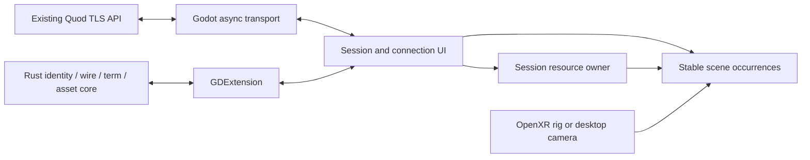

# Quod native viewer

A small Linux Godot client using Quod's existing APIs. On first launch, choose
**Create my key** (or import a backup). This step runs entirely offline and saves
the key locally. Next, enter the node address and port and press **Connect**.
Later launches skip key creation and open this connection screen with the saved
settings. If the key has no account on that network, **Create account and enter**
creates the account and provisions its lobby. Native OpenXR uses the same scene.
The Quod server and its protocols require no changes.

The viewer supports primitives, groups, labels, material textures, admitted
static GLBs and local subject picking. Account enrollment uses the existing
signup and lobby actions; scene interaction remains read-only. Simulation/body
poses, locomotion and world editing are outside this slice. Head/controller
tracking moves the observer only.

## Build and launch

Requirements: Linux x86-64, Python 3, Rust/Cargo and a Vulkan-capable GPU/driver.
Node.js and OpenSSL are needed only for interoperability/integration tests.
Commands below run from the repository root.

```sh
python3 client/native/tools/bootstrap.py
cargo build --manifest-path client/native/Cargo.toml --release --locked
python3 client/native/tools/run.py --editor --quit
python3 client/native/tools/run.py --node localhost --port 14570
```

Bootstrap pins official Godot **4.7.2-stable** and verifies both engine and export
template archive SHA-256 values. Cargo dependencies are locked. The extension
uses godot-rust 0.5.5 with the Godot 4.5 API baseline. Tools and engine state stay
in the ignored `client/_build/godot-native` tree; build artifacts stay local.

The connection screen has separate **Node address** and **Port** fields. Enter
a DNS hostname, IPv4 address or IPv6 address, without a scheme or URL path.
Port defaults to Quod's client TLS listener, **14570**. Both fields remain
editable after launch. Changing the node, port or CA cancels the active
connection and clears its scene. **Connect** reuses the saved key; it does not
generate a replacement. Account references remain scoped to their authenticated
network. Connection settings are remembered, with explicit CLI options taking
precedence.

The active identity and pending enrollment live in the native user-data
`identity/active.json` file. The directory is private (0700), the file is private
(0600), and a process lock prevents concurrent writers. Atomic replacement,
file/directory sync and read-back finish before the key or write is used on the
network. The active key is stored locally without passphrase encryption, much
like the browser's remembered key; encrypted backups are separate. A damaged
or unwritable store produces an error and is never silently replaced.

**Key & backups → Import a different key** accepts existing browser `.quodkey`/JSON backups and
remembers the imported identity. **Export encrypted key** creates the same
portable AES-GCM/PBKDF2 backup the browser can import, with a passphrase of at
least 12 characters. Expensive backup encryption/decryption runs off the render
thread. Backup import explicitly confirms replacement of the current identity;
resolve pending enrollment before replacing it. **Disconnect** ends the session
without deleting the remembered key. No passphrase is needed on normal launches.

Account setup durably retains the original signed request before submission.
After an interrupted or pending write, Connect queries its outcome instead of
submitting it again. A learned account and its next lobby operation are saved
atomically. **Finish account setup** is available for an account whose lobby
still needs provisioning. Network policy may refuse open signup; that leaves
the local identity intact. The client never bypasses policy or provisions by
changing the server.

Lighting uses directional sky fill and reflections so surfaces retain their
shape in shadow, filtered directional shadows, and reduced filmic exposure.
Authored materials and the projected sky backdrop remain unchanged.

TLS verifies the node certificate and hostname. For a private CA, select its PEM
certificate in the screen or pass `--ca /absolute/path/ca.pem`. There is no
certificate-verification bypass and no redirect to another origin.

When a private node's certificate names a different host from its dial address,
enter that name under **Certificate settings → Name on the trusted certificate**
or use `--tls-name NAME`. This requires an explicitly selected certificate;
the certificate chain and that name are still verified. For example, a node
whose trusted self-signed certificate names `localhost` can be reached by LAN IP
with `--ca /path/node.pem --tls-name localhost`. These settings are remembered
with the node address and port.

Desktop free-view controls:

- **WASD** (physical **ZQSD** on AZERTY) or **arrow keys**: move the camera.
- **R / F**: rise / descend; **Shift**: move faster.
- **Click the scene** once to capture the mouse; look without holding a button.
  **Esc** releases the pointer and opens the menu. Click the scene to capture again.
- **Wheel**: step forward/back; while captured, **left click** selects at the crosshair.
- **Tab / Esc** or **Quod · Menu**: open/close the lobby menu.

The controls are shown in the scene. Menu opening, focus loss and disconnection
stop movement and release the pointer. Refocusing never recaptures automatically;
keyboard navigation waits for capture. This is local observer navigation without
collision or server-body movement. VR currently provides room-scale tracking;
controller locomotion is not implemented. Refresh is explicit. Selecting a
subject does not execute any server action.

## Native OpenXR

Start the intended OpenXR runtime and launch:

```sh
python3 client/native/tools/run.py --xr --node quod.example --port 14570
```

Use `XR_RUNTIME_JSON=/absolute/path/runtime.json` in this process's environment
when selecting a runtime explicitly. The client does not change system runtime
configuration. Authentication remains on the desktop mirror. The headset shows
the scene and status. Initialization failure is reported explicitly.

The reusable rig binds Vive trigger/select, squeeze/grip, touchpad and touchpad
click, with aim and grip poses for each hand. Selection uses the aim ray.
Input is suspended on focus loss. An optional `--diagnostic` scene runs without
a Quod connection; it is clearly labelled and never substitutes for a lobby.

Physical Vive qualification remains outstanding. Simulated Monado exercises
stereo, floor reference and changing head/controller poses, but currently
reports Godot shutdown diagnostics; the XR qualification gate remains failed.
See the [qualification evidence](../../doc/evidence/native-godot/README.md).

## Export

```sh
python3 client/native/tools/run.py --export
client/native/dist/quod-native.x86_64 -- --node localhost --port 14570
client/native/dist/quod-native.x86_64 --xr-mode on -- --xr --node localhost --port 14570
```

Distribute the entire export directory, including the PCK and extension shared
library. Source tests are excluded from the export. The XR engine flag precedes
`--`; application options follow it. No Node.js process or browser is required
to run the exported client.

## Ownership and reuse



- `core`: engine-independent identity generation/storage/backups, enrollment recovery,
  Ed25519 signing and exact request bytes,
  term syntax, mark validation, GLB profile/cost/bounds admission.
- `godot-extension`: opaque session key handle and value conversion. It does not
  own transport, another asset cache or domain state.
- `godot`: cancellable TLS requests, session UI, verified resource lifetime,
  scene reconciliation and independent local XR input.
- `tools/contracts.mjs`: generates/checks disposable-key fixtures directly with
  existing browser implementations. Native code consumes those same fixtures.

Prolog remains authoritative. Exact depicted subjects and large integers stay
as term text across the engine boundary. Asset admission precedes GLTF decoding;
each occurrence retains its own policy allowances. An unchanged refresh reuses
decoded assets and scene nodes. Cached resources are scoped to their session,
without an on-disk asset cache.

The [implementation plan](../../doc/native-godot-client-plan.md) defines the
next seams: existing simulation protocols and extending the enrollment journal
before general interactions or cursor acceptance. Neither is replaced with client-side domain rules.

## Checks

Run the complete client gate sequence (requires local sockets for TLS and export):

```sh
python3 client/native/tools/validate.py --evidence /tmp/quod-native-check-unique
```

Individual checks:

```sh
cargo test --manifest-path client/native/Cargo.toml --release --locked -p quod-client-core
node client/native/tools/contracts.mjs
python3 client/native/tools/run.py --headless --script res://tests/viewer.gd
python3 client/native/tools/connection_check.py --evidence /tmp/quod-tls-check-unique
python3 client/native/tools/connection_check.py --onboarding --evidence /tmp/quod-onboarding-check-unique
python3 client/native/tools/xr_check.py --evidence /tmp/quod-xr-check-unique
```

Use `tools/check.py --evidence NEW_DIRECTORY [--godot] -- COMMAND ...` to retain
full output, true child exits and Godot error diagnostics. Evidence destinations
must be new, so failures remain intact. The TLS check uses a synthetic account
and a temporary local HTTPS fixture; it does not modify or qualify a deployed
Quod node. The XR check requires the existing private Monado build under
`client/_build/webxr-linux/monado-build` and host display/GPU access. It starts
and stops only its own isolated simulator service.
