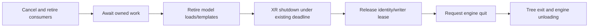

# M4-R1 bounded shutdown diagnosis

The bounded investigation completed without reproducing either historical
process-exit stall. **Cause undetermined; no production correction or shutdown
acceptance is claimed.** QUO-65 remains in-review80, parent QUO-60 remains67.
The complete result is [the R1 handoff](../../../nimbalyst-local/handoffs/godot-m4-r1-result.md).

The original candidate09/final06 and all failed campaigns remain untouched.
Read [the coordinator verification](../../../nimbalyst-local/handoffs/godot-m4-coordinator-verification.md)
and the original [failure dispositions](../godot-m4-20261029/failure-dispositions.md).
Passing R1 runs do not resolve gui-final03-backup-import or physics-final06.
The latter used actual Main.CloseApplication; it is not confined to the removed
direct SceneTree.Quit qualification path or proven external/native-only.

## Method and actual observation

[Diagnostic plan](diagnostic-plan.md) fixes three physics attempts and one local
case, concrete hypotheses and pre-watchdog capture bounds. Temporary Main and
SignedView markers record existing task IDs/statuses, monotone ticks, context
and thread without actor/request/key material. Their complete before/after
source is retained under inputs. A source-only diagnostic01 export was built
from91 supplied inputs and the same eight package archives/pinned engine.
All196 actual export entries are indexed; core189 passed.

The live production files were restored byte-for-byte to candidate09 before
campaign execution. The diagnostic export alone contains the observation.
There is no production tracing, new exit path, forced success, retry, task
abandonment, changed deadline/watchdog or server/domain change.

The existing chain observed is:



- [physics-diagnostic01](physics-diagnostic01/campaign.json) and
  [physics-diagnostic02](physics-diagnostic02/campaign.json):39 assertions each,
  real native signed input/frames and normal close, client/server/wrapper0.
  Existing owned waits completed, all close phases ran on thread1 with
  GodotSynchronizationContext, Quit and tree exit completed, and verbose engine
  unloading finished. There was no native XR session in these desktop runs.
- [physics-baseline03](physics-baseline03/campaign.json): the exact historical
  final04 export with original engine flags,39 assertions and true exits0.
  This bounds a possible observation/verbosity effect; it does not establish
  the original failure's cause or equivalence to a captured stall.
- [local-diagnostic01](local-diagnostic01/result.json): three actual exported UI
  assertions. Close began while backupWork was WaitingForActivation, awaited
  it, resumed on thread1/GodotSynchronizationContext, released the writer lease
  only afterward and left no imported active identity. Client/wrapper0.

The four campaign wrappers had explicit completion, no timeout and no engine
error diagnostics. [Qualification](qualification.json) retains phase/task data;
[full wrapper logs/commands](logs/physics-diagnostic01.json) and every separately
labelled client/server log are retained. The core/build receipts are separate
from the four application campaigns.

Only exact owned disposable PIDs allow parent-scoped tracing. A one-shot native
stack capture was armed20s after completion/close entry, bounded15s, before the
unchanged60s inactivity watchdog. Arguments/entry values are disabled; raw
diagnostics are private and no memory dump/environment/command-line read is
allowed. No run remained alive at the capture deadline, so **no stall stack was
captured**. The capture branch itself remains unexercised; an armed diagnostic
is not proof that native stacks were obtained.

## Boundary and remaining work

No application-owned missing lifecycle abstraction was demonstrated. The next
causal step requires a genuine reproduced stall with phase evidence and owned
thread stacks; another sequence of passes cannot establish shutdown acceptance.
No stronger model requirement was demonstrated. Actual API model remains
openai-codex:gpt-6.1-sol, launcher-requested/returned effort max; effective
backend effort is unexposed. [Identity](inputs/session-identity.json) and
[source preservation](inputs/initial-preservation.json) retain the receipts.

The installed Monado loader127/missing six OpenCV.so.413 libraries is separate.
No runtime/config/socket/display/system-package change was attempted. Native
OpenXR teardown/QUO-27 and physical original Vive/two-wand observations remain
unqualified; no Quest claim. Original uncertain operations/private stores remain
intact. No product fix, full-M4 credit, commit, M5 launch or server gate rerun.

The new immutable R1 boundary contains the complete current untracked payload
and actual read-only HEAD base/binary patch bytes, with a complete final
source manifest and real reconstruction outside every checkout. It also retains
actual diagnostic build inputs/outputs/export and fixture/provider objects;
unchanged dependencies/toolchains/server artifacts share verified immutable M4
bytes. Public audit limitations are recorded. See [source quality](source-quality.md)
and [failure dispositions](failure-dispositions.md).

Reproduce the separate immutable freeze with its preserved helper and a fresh
boundary label (never overwrite the original boundary):

```sh
python3 doc/evidence/godot-m4-r1-20261029/freeze-handoff.py /home/yan/.cache/quod-m4-r1-artifacts/quod-godot-m4-r1-handoff-ca84d4f8-20261029-01
```
