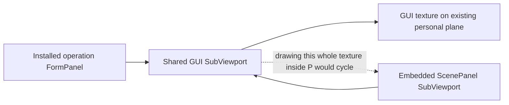
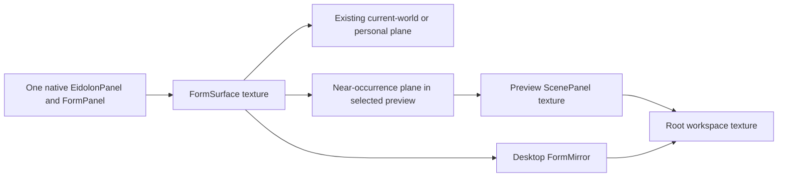

# Selected occurrence and form surface: current boundary

Both the current-world and embedded-preview paths are now qualified in the
selected occurrence-product01 software. A chosen scene occurrence carries its
owner, installed incarnation and exact subject to the existing operation/form
controller. The same native surface appears near that occurrence or in the
personal workspace. The original preview failure and subsequent failed labels
below remain literal. Current results and their exact reuse limits are in
[result.json](result.json) and the [result handoff](../../../nimbalyst-local/handoffs/godot-occurrence-form-result-275.md).

## Existing semantic contract

[GUI design](../../gui-plan.md:89) distinguishes a recipe, mark occurrence,
component and local draft. [Placement](../../gui-plan.md:643) already decides
near-object presentation with a personal-workspace alternative. This is not an
unanswered user preference. The existing [recipe owner](../../../priv/ontologies/common_predicates.pl:126)
resolves the exact class-selected recipe; [gui_forms](../../../priv/ontologies/gui_forms.pl:239)
provides the operation form and guarded execution. No arbitrary predicate
enumeration, new ontology, domain action, wire token or persisted placement is
needed for the implemented current-world choice.

## Qualified native route

[ScenePanel.Selection](../../../client/godot/ScenePanel.cs:13) retains the installed
owner/incarnation separately from its exact subject. Its pose is resolved through
that owner. Removal and ID reuse cannot revive an old selection. Main passes the
selection to the same [EidolonPanel](../../../client/godot/EidolonPanel.cs), while
the existing [OpenXRInput surface](../../../client/godot/OpenXRInput.cs:183)
uses the selected current-world pose. Desktop retains the scene beside a bounded
task region where width permits; enlarged/narrow layouts retain explicit subject
and placement controls. Spatial composition displays the same native texture
above the selected occurrence, without starting OpenXR.

Earlier current-world results: interaction13 **91**, lifetime13 **29**, space16 **40**,
mapped controller13/15 **86** each. All actual child/wrapper exits are zero with
complete streams. Native controls, dirty text, caret/selection, semantic revision,
original committed result and unchanged work are checked. The later desktop
cross-occurrence gate remains separately labelled. These software results do not
establish headset comfort, human understanding or historical exit reliability.

## Reproduced embedded-preview gap

[preview baseline17](inputs/occurrence-preview-baseline17.json) is a whole failure:
client1/server0/wrapper1/four EOF. Its retained `preview-binding.json` has:

- selected occurrence `selected/left`, same binding true;
- pose null, preview count zero, preview visibility false;
- native field present but not visible.

The exact source chain is `EidolonPanel.preview.Selected` → `OpenOccurrence` →
choosing the authored operation → `WithdrawRepresentation`. The latter retires
the signed visual reader and clears the very preview that owns the selection.
The operation itself remains exact and installed. Baselines14/16 retain separate
diagnostic failures (selection before accepted refresh; counting a group as a
visible subject occurrence). They do not establish this causal result.

The rendering topology also matters:

The preview has its own `World3D`; its coordinates are not current-world
coordinates. Retaining its reader alone does not establish a valid spatial
surface. Rendering the whole GUI texture in that preview would feed a texture
back into its own ancestor rendering dependency. Moving an installed form/view
owner between parents would also violate the already demonstrated retirement
boundary. Neither workaround is implemented.

## Reconciled shared extension and retained qualification history

Construct one **form-only native viewport** with the existing form/controller at
its original lifetime boundary. A local presentation binding references that
viewport, the exact installed visual occurrence and the chosen placement. The
same form texture can then be presented near the retained visual in its owning
scene, or in the personal workspace, without including that visual's preview in
the sampled texture. Retain the original signed visual reader only for its actual
visual consumer; terminal denial/removal still withdraws it. Selecting/moving a
surface performs no domain action and changes no form/draft/operation identity.

The implementation reconciles these existing native input owners:

- [SpatialGui](../../../client/godot/SpatialGui.cs) previously sent mouse/key
  input and capture to one `Surface`; nested form presentation preserves the
  exact native target and cancel on geometry/lifetime change.
- [SpatialKeyboard](../../../client/godot/SpatialKeyboard.cs) admits focused
  native editors from the two explicitly owned surfaces with the same
  generation/focus/modal fences, without arbitrary window targeting or a field registry.
- Appearance, local accessibility, adjacent keyboard sizing and popups must
  remain shared presentation concerns. Native form controls are constructed
  once; texture placement is not another form engine or editable state copy.
- The mark/domain schema need not be enlarged merely to remember this local
  selection. Ontology-authored arbitrary surfaces, if required beyond the local
  binding, need their separately explicit shared rendering contract.

The coordinator explicitly authorized this acyclic native presentation extension
in report `meta-1793567048688-p1b9m59`. Candidate18 constructs the existing
EidolonPanel once under SpatialGui's form-only SubViewport and constructs its
ScenePanel preview outside that tree. It preserves the original signed visual
reader for its installed occurrence consumer. The exact baseline17 retention
assertion passes in preview18 with client/server/wrapper0 and four EOF.

Preview19 adds actual input, keyboard, layout and cost observations. It remains
a whole failure after the desktop26 native-input/relocation prefix: desktop48
kept the preview and form side by side, overflowing the form's placement controls.
Its raster and true exits are retained. The same run also exposed duplicate
native mouse-enter notifications in the new routing. Candidate20 constrains the
form tree to its owned viewport, gives enlarged/narrow desktop forms the existing
full-width task region, and tracks native enter/exit transitions for each of the
two owned viewports. Their affected gates are recorded below.

The unaccepted273 attention candidate, question-subject gap and wider component/
asset gaps remain separate. No package or human opportunity is claimed here.
The final sparse freeze is separate from these software results.

## Current render and input ownership

FormSurface contains no ScenePanel or root workspace texture. SpatialGui routes
native input only to its two owned viewports. The existing keyboard edits the
focused native editor; it holds no text copy. Root-field keyboard presentation
uses a texture crop of that same keyboard, with the original focus/generation
and capture owner. Native popup/menu focus must remain dominant. The new surface
is a local adapter, not a new ontology object or a schema authority. Desktop
narrow/enlarged form presentation uses the existing full-width alternative;
near-preview placement is spatial, with the same explicit personal alternative.

## Subsequent affected observations

Preview20 passes desktop26/48/narrow and spatial field routing, then fails the
adjacent key hit. FormSurface grew while the preview plane retained its previous
pixel mapping: size notifications were attached only with tracker sources.
Candidate21 attaches the same presentation notifications for actual spatial
presentation, independently of native XR startup, and retires them on stop.

The unchanged headless keyboard diagnostic20 completes169 checks/client0/EOF but
fails its strict resource guard on an unused unparented FormMirror. Candidate21
retires that owned unused native node; keyboard21 passes169/all0/EOF. Current
controller21 passes86, root-keyboard-ray21 passes16 and form-keyboard-ray22
passes16, all children/wrappers0/EOF. These are software tracker/native controls,
without native XR or host input.

Preview21 passes92 checks including actual near-preview keyboard input at26/48,
native undo/draft/caret continuity, all five layout modes and zero named work on
three accepted unchanged preview/form renewals and relocations. It remains a
whole failure at later Submit enclosure. Observation22 preserves the same failure
with exact geometry: Submit763 pixels wide, actual clip644; form host771 wide
despite current minimum435 and viewport660. Candidate23 observes the existing
MinimumSizeChanged notification to reapply the real viewport allocation after
minimum size shrinks. No domain behavior, deadline or assertion was changed.

Preview23 passes the original Submit enclosure and original single commit, then
fails at an immediate availability assertion following visual removal. Its
saved native state has the independent operation owner still Updating. Preview24
waits for that owner's accepted replacement before the unchanged assertion:
**117 checks, client/server/wrapper0, four EOF**, no readers or timeout. It covers
the full preview route, native field and adjacent key input, undo/draft/caret,
all five layouts, original submission/readback, two same-subject occurrences,
movement/capture cancellation, removal, explicit personal recovery, actual recipe
revocation and a changed subject with freshly accepted independent world.

The same production vector passes current lifetime24 **29** and space24 **40**,
both all0/four EOF. Current-world interaction24 retains the corresponding early
availability failure after its original action and removal prefix. The only
interaction25 change is that same accepted-owner observation; it passes **91**,
all0/four EOF. Three accepted unchanged form/world renewals and local relocations
retain resources with named work.calls=[] and local writes0. The preview owner
likewise records calls=[]/writes0 on three unchanged renewals and relocations.
These are source-bound software results; historical noEOF and human/HMD limits
remain unchanged. The current trace-free export is qualified separately below.

Workspace25 retains a stale diagnostic three-parent cast failure before any
checks. Its corrected observation uses every actual clipping ancestor. Workspace26
then completes42 passing native checks but fails the original logical relative
mouse-motion assertion. The new root viewport hover route supplied position but
left relative motion at zero. Candidate27 obtains that delta from the native
viewport's previous mouse position, preserving one input owner. This causal
correction passes its original mirror/menu gate; no focus, capture, domain or
shutdown policy changed. The obsolete Main body-child representation exception
was removed after the form's construction moved to its permanent native surface.

## Selected current composition

Candidate27 passes current-world91 and embedded-preview117 with client, server
and wrapper0/four EOF. Workspace27 passes36 stored checks plus9 explicit native
probes (45 PASS lines), including the unchanged relative-motion obligation.
The selected lifetime29, space40, desktop occurrence input14, keyboard169,
controller86, root and form keyboard rays16 each, scene12 and material15 retain
their exact intervening-input dispositions in [result.json](result.json).
They are not represented as all having identical full input vectors.

The source-only trace-free product has98 live=supplied inputs and196 exported
files,193578580 bytes, five build phases and outer0. No diagnostic override is
distributed. All current selected tests have true zero exits, complete streams
and no native XR/host input. Historical noEOF and the prior human rejection
remain open; screenshots and software spatial composition do not establish
headset legibility, reach or comfort.
