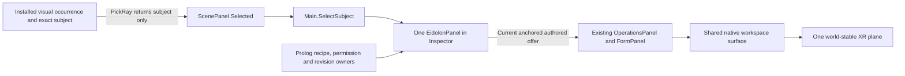

# Native GUI conformance review — steering274

The exact-instance operation model is already present. The delivered native adapter does not carry the selected visual occurrence into form placement: it opens a shared inspector/workspace. That is the principal missed requirement. A floating personal workspace is allowed, but it does not replace the required near-object form and explicit relationship to its visual Eidolon.

The traced delivered path is:

The missing connection is from the initiating occurrence to the selected form's
presentation placement. The exact subject and authored operation remain valid
through the existing semantic route.

The separate solid-rendering baseline reproduces three visible cube faces with exactly the same colour. The retained material and attention candidates are **unaccepted**. They compile, but neither candidate was run. This review is the requested reconciliation boundary, not implementation completion or a new checklist authority.

Actual viewed software rasters: [flat solid baseline](/data/quod-m4-vr-ca84d4f8-20261029/private/alignment-material-baseline03/sandbox/work/solid-oblique.png)
and [attention arrival baseline](/data/quod-m4-vr-ca84d4f8-20261029/private/alignment-attention-baseline02/sandbox/work/attention-arrival.png).
The second image does not show both forms: the native tree reports them visible,
but they are below the captured viewport. Neither image is a headset capture.

## Authority, reference tree and evidence meaning

The full [actual control/report batch](/home/yan/src/quod_worktrees/pearl-stone/doc/evidence/godot-vr-gui-alignment-20261101/inputs/review-boundary274-275.json) contains steering274 and root275. Steering274 supersedes273's deferral of object/form binding and its proposed attention-first answer. Production edits stopped when it was read; the already-owned candidate05 source build completed. No candidate application, further hardware opportunity, package or freeze was started.

Statuses below apply to the delivered parent262/272, with the five separate [273 before-copies](/home/yan/src/quod_worktrees/pearl-stone/doc/evidence/godot-vr-gui-alignment-20261101/inputs/before.json) used where the working source now contains an unaccepted candidate. “Met” means the particular stated software/model obligation has a traced owner and retained evidence; it never means the whole ticket or human experience passes. “Partial” distinguishes existing capability from uncovered behaviour. “Missing” identifies an absent path. “Contradicted” identifies source/observed behaviour contrary to the requirement. “Unverified” means the available evidence cannot establish it. Source findings without a real failing run are labelled as such.

Fully reread: [GUI plan](/home/yan/src/quod_worktrees/pearl-stone/doc/gui-plan.md), [GUI implementation plan](/home/yan/src/quod_worktrees/pearl-stone/doc/gui-implementation-plan.md), [ontology Eidolon plan](/home/yan/src/quod_worktrees/pearl-stone/doc/ontology-eidolons-plan.md), [spaces](/home/yan/src/quod_worktrees/pearl-stone/doc/spaces.md), [world](/home/yan/src/quod_worktrees/pearl-stone/doc/world.md), [native plan](/home/yan/src/quod_worktrees/pearl-stone/doc/native-godot-client-plan.md), [foundation contract](/home/yan/src/quod_worktrees/pearl-stone/doc/godot-foundation-contract.md), [multiwrite architecture](/home/yan/src/quod_worktrees/pearl-stone/doc/multiwrite-architecture.md), [governing space plan](/home/yan/src/quod_worktrees/pearl-stone/nimbalyst-local/plans/space-conceptual-architecture-review.md) and [current native README](/home/yan/src/quod_worktrees/pearl-stone/client/godot/README.md). Historical main-checkout references were resolved to this worktree, not used as authority to modify main.

The governing space plan retains historical ontology-below-space and lobby-era source descriptions. [The later exact ontology contract](/home/yan/src/quod_worktrees/pearl-stone/doc/ontology-eidolons-plan.md:7) and [current ontology ancestry](/home/yan/src/quod_worktrees/pearl-stone/priv/ontologies/common_predicates.pl:95) settle ontology identity independently of spatial membership. The old native plan describes a server-frozen Rust/first-viewer increment; accepted later C# and seven-foundation work supersedes its implementation arrangement. Its asset, identity, lifecycle and physical-evidence obligations are not thereby satisfied or deleted. The proposed gui_view term in the GUI plan is not represented here as the installed wire: current operations use operation_view and questions use question_form/form_view.

## Requirement inventory: instance, occurrence and domain authority

| ID | Requirement and specification | Disposition against the delivered reference |
| --- | --- | --- |
| I01 | Separate semantic instance, Eidolon, visual occurrence, controller and draft. [GUI identities](/home/yan/src/quod_worktrees/pearl-stone/doc/gui-plan.md:89); [descriptor identities](/home/yan/src/quod_worktrees/pearl-stone/doc/gui-implementation-plan.md:319). | **Partial.** [Subject/Eidolon](/home/yan/src/quod_worktrees/pearl-stone/client/godot/Core/Eidolons.cs:5) and [SceneMark](/home/yan/src/quod_worktrees/pearl-stone/doc/evidence/godot-vr-gui-alignment-20261101/inputs/before/client/godot/Core/Scene.cs:44) preserve exact semantic subject and occurrence internally. [Selected/PickRay](/home/yan/src/quod_worktrees/pearl-stone/client/godot/ScenePanel.cs:228) exports only the subject; the initiating occurrence is lost before form presentation. |
| I02 | Choose an authored information/action form of the exact instance, display it above/near its previous visual Eidolon, make the relationship unambiguous. [surface binding](/home/yan/src/quod_worktrees/pearl-stone/doc/gui-implementation-plan.md:671); [object-associated workspace alternative](/home/yan/src/quod_worktrees/pearl-stone/doc/gui-plan.md:643); steering274. | **Missing native path.** [SelectSubject](/home/yan/src/quod_worktrees/pearl-stone/doc/evidence/godot-vr-gui-alignment-20261101/inputs/before/client/godot/Main.cs:376) opens one [EidolonPanel](/home/yan/src/quod_worktrees/pearl-stone/client/godot/EidolonPanel.cs:7) and switches to Inspector. [Configure](/home/yan/src/quod_worktrees/pearl-stone/client/godot/OpenXRInput.cs:108) displays the complete native workspace texture on one plane. No selected-occurrence/placement context is passed to that form. The narrow human272 inspection pass does not establish this association. |
| I03 | Existing authored class/instance discovery; exact anchor, most-specific recipe and explicit operation binding; no arbitrary predicate menu. A class may define recipes in its own ontology; a separate recipe ontology is optional. [offered operations](/home/yan/src/quod_worktrees/pearl-stone/doc/gui-implementation-plan.md:183); [current standing rule](/home/yan/src/quod_worktrees/pearl-stone/AGENTS.md:18). | **Met, bounded model/software.** [entity/class recipe selection](/home/yan/src/quod_worktrees/pearl-stone/priv/ontologies/common_predicates.pl:112) → [gui_operations and exact recipe](/home/yan/src/quod_worktrees/pearl-stone/priv/ontologies/gui_forms.pl:239) → [Offer](/home/yan/src/quod_worktrees/pearl-stone/client/godot/Core/Forms.cs:165) → [signed offer consumer](/home/yan/src/quod_worktrees/pearl-stone/client/godot/OperationsPanel.cs:162). [Space Enter/Leave](/home/yan/src/quod_worktrees/pearl-stone/priv/ontologies/quod_space.pl:400) already defines and selects recipes in the class's ontology. [254 signed flow](/home/yan/src/quod_worktrees/pearl-stone/nimbalyst-local/handoffs/godot-space-experience-result-254.md) and [236 non-space form](/home/yan/src/quod_worktrees/pearl-stone/nimbalyst-local/handoffs/godot-gui-authored-appearance-result-236.md) are retained evidence. This supplies authored operation forms, not proof of a complete generic information/action composition at a scene occurrence. |
| I04 | Enter/Leave/Create remain explicit authored domain actions; viewing never moves the agent. [space contract](/home/yan/src/quod_worktrees/pearl-stone/doc/spaces.md); [storage/placement distinction](/home/yan/src/quod_worktrees/pearl-stone/nimbalyst-local/plans/space-conceptual-architecture-review.md:268). | **Met for accepted paths.** [Enter/Leave form and Move binding](/home/yan/src/quod_worktrees/pearl-stone/priv/ontologies/quod_space.pl:398) already supplies the same-agent transition. [SubmitWork](/home/yan/src/quod_worktrees/pearl-stone/client/godot/OperationsPanel.cs:222) uses the existing personal-agent route. 254 verifies exactly three deliberate instructions; [272](/home/yan/src/quod_worktrees/pearl-stone/nimbalyst-local/handoffs/godot-steamvr-local-start-result-272.md) records human inspection and a separately requested Enter/Move. No new space action executor is needed. |
| I05 | Authoritative permissions, revision/field binding, OCC and atomicity at execution; discovery is advisory. [bound operation contract](/home/yan/src/quod_worktrees/pearl-stone/doc/gui-implementation-plan.md:219); [multiwrite](/home/yan/src/quod_worktrees/pearl-stone/doc/multiwrite-architecture.md). | **Met for retained semantic paths.** [committed binding and execution guard](/home/yan/src/quod_worktrees/pearl-stone/priv/ontologies/gui_forms.pl:280) rechecks definition, values and operation_authorized; [advisory read versus acting principal](/home/yan/src/quod_worktrees/pearl-stone/client/godot/OperationsPanel.cs:199) retains this distinction.273 has no Prolog/wire/auth change. Old proofs are reused, not fresh universal security verification. |
| I06 | Move the same form to the personal workspace without replacing native controls, draft or controller. [object/workspace continuity](/home/yan/src/quod_worktrees/pearl-stone/doc/gui-implementation-plan.md:702). | **Partial.** Home/Inspector recall and appearance renewal preserve compatible installed controls (254/236). There is no object-attached presentation to move between placements. [Invalidate](/home/yan/src/quod_worktrees/pearl-stone/client/godot/OperationsPanel.cs:284) clears controls on subject replacement while its draft buffers survive; that is not object/workspace relocation evidence. Do not detach/reparent installed owners as a shortcut. |
| I07 | Multiple appearances of one instance retain distinct occurrence placement without granting rights; local drafts remain correctly scoped. [identity distinction](/home/yan/src/quod_worktrees/pearl-stone/doc/gui-plan.md:89). | **Partial.** Scene occurrences and exact subjects are distinct; operation buffers are keyed by network/key/human/exact subject/offer. [Press/Release](/home/yan/src/quod_worktrees/pearl-stone/client/godot/OpenXRInput.cs:288) compares only subject terms. Two visual occurrences of the same subject therefore cannot currently select which occurrence should anchor a form. This is a source finding, not a new runtime failure. |
| I08 | Ontology identity is not spatial membership; opening code neither creates a room nor founds an ontology. [settled ontology contract](/home/yan/src/quod_worktrees/pearl-stone/doc/ontology-eidolons-plan.md:7). | **Met for retained paths.** [Subject.Decode](/home/yan/src/quod_worktrees/pearl-stone/client/godot/Core/Eidolons.cs:7), [ontology below thing](/home/yan/src/quod_worktrees/pearl-stone/priv/ontologies/common_predicates.pl:95) and [exact source target admission](/home/yan/src/quod_worktrees/pearl-stone/client/godot/SourcePanel.cs:58) preserve it. The historical space-plan ancestry statement is superseded, not a reason to cast ontology to space. |

## Requirement inventory: ordinary space, inspection and work

| ID | Requirement and specification | Disposition |
| --- | --- | --- |
| S01 | Ordinary first landing foregrounds current authoritative interior and permitted contents; distinguish selected exterior. [foundation contract](/home/yan/src/quod_worktrees/pearl-stone/doc/godot-foundation-contract.md); [spaces](/home/yan/src/quod_worktrees/pearl-stone/doc/spaces.md). | **Met, bounded software254.** [254 baseline/correction and137 flow](/home/yan/src/quod_worktrees/pearl-stone/nimbalyst-local/handoffs/godot-space-experience-result-254.md) records zero-area old landing and corrected actual26/48/narrow/spatial content viewport before helper selection or scrolling. The half-metre exterior cube is not the interior. |
| S02 | Names come from the governed view; absent, invalid, ambiguous, denied and empty differ. | **Met for current named-space contract.** [authored exterior/name](/home/yan/src/quod_worktrees/pearl-stone/priv/ontologies/quod_space.pl:455) and current world view carry names;254 state27 covers committed/missing/malformed/ambiguous/repair and accepted independent-world renewal. No arbitrary naming service or invented name from an ID. |
| S03 | Recursive contents, exact parent transforms, finite/infinite extents, independent appearances and revocation. [recursive space contract](/home/yan/src/quod_worktrees/pearl-stone/doc/spaces.md). | **Met for accepted Stage2 software scope; physical generality unverified.** [contents projection](/home/yan/src/quod_worktrees/pearl-stone/priv/ontologies/quod_space.pl:469), [exact lengths/poses](/home/yan/src/quod_worktrees/pearl-stone/client/godot/Core/Scene.cs:6) and [147 disposition](/home/yan/src/quod_worktrees/pearl-stone/nimbalyst-local/handoffs/godot-space-stage2-result-147.md) retain those bounded obligations. Neither the cube raster nor272 proves general nested physical comfort or collision behaviour. |
| S04 | Same exact subject across scene, views, source and Workbench; no new domain/editor dispatcher. [same-subject source/lens path](/home/yan/src/quod_worktrees/pearl-stone/doc/ontology-eidolons-plan.md:44). | **Met for current named consumers; generic graphical form placement missing under I02.** [Choose](/home/yan/src/quod_worktrees/pearl-stone/client/godot/EidolonPanel.cs:157) dispatches offered scene, operation, source/lens and Workbench through existing owners. [221](/home/yan/src/quod_worktrees/pearl-stone/nimbalyst-local/handoffs/godot-space-contextual-usability-result-221.md) and [223](/home/yan/src/quod_worktrees/pearl-stone/nimbalyst-local/handoffs/godot-workbench-usability-result-223.md) qualify those bounded choices. |
| S05 | Prepare → same local source draft → Preview → explicit Save; exact fact removal is not cascade deletion. | **Met, bounded retained software.** [175](/home/yan/src/quod_worktrees/pearl-stone/nimbalyst-local/handoffs/godot-ontology-workbench-result-175.md) and223; [Workbench/source coupling](/home/yan/src/quod_worktrees/pearl-stone/client/godot/EidolonPanel.cs:55). View selection, local layout and shading must not write domain facts. |
| S06 | Unsent draft versus submitted original outcome; reconnect never replays uncertain work. [visible states](/home/yan/src/quod_worktrees/pearl-stone/doc/gui-implementation-plan.md:773). | **Met for qualified owner paths, not arbitrary GUI transitions.** [draft keys](/home/yan/src/quod_worktrees/pearl-stone/client/godot/OperationsPanel.cs:26), [original outcome and explicit recovery](/home/yan/src/quod_worktrees/pearl-stone/client/godot/OperationsPanel.cs:245); [218 bounded recovery](/home/yan/src/quod_worktrees/pearl-stone/nimbalyst-local/handoffs/godot-onboarding-usability-result-218.md) and254. Distinct-subject native control preservation is not established by same-subject Home recall. |
| S07 | Unchanged renewals/local transitions do no unnecessary history/rebuild/write/sync work; actual updates propagate. | **Met for retained254/236 measurements; unverified for273 candidates and future placement.**254 records three Home/recall and three accepted world renewals with calls[], writes0 and retained resources. [computed ReadLens](/home/yan/src/quod_worktrees/pearl-stone/client/godot/SourcePanel.cs:133) deliberately rereads its cursor;236's retired zero-computed-read claim must not return. Current cursor reads2→3 coexist with zero history/rebuild/write/sync. |
| S08 | No new physics/domain body, terrain or sky merely to render an empty ordinary space. [ordinary S0 contract](/home/yan/src/quod_worktrees/pearl-stone/doc/godot-foundation-contract.md). | **Met in delivered paths.** The material candidate's local light is only an unqualified adapter proposal, not permission to author a sun, sky, floor or physical object. Terrain/helper retirement and general physical scope remain outside this review. |

## Requirement inventory: attention and form presentation

| ID | Requirement and specification | Disposition |
| --- | --- | --- |
| P01 | Compact attention count/list; a human selects one primary form; arrivals do not open every form. [attention composition](/home/yan/src/quod_worktrees/pearl-stone/doc/gui-plan.md:625). | **Contradicted in delivered reference; real baseline.** [HUD arrival](/home/yan/src/quod_worktrees/pearl-stone/doc/evidence/godot-vr-gui-alignment-20261101/inputs/before/client/godot/QuestionHub.cs:26) appends/open forms and [projection](/home/yan/src/quod_worktrees/pearl-stone/doc/evidence/godot-vr-gui-alignment-20261101/inputs/before/client/godot/QuestionHub.cs:138) shows each. [baseline02](/home/yan/src/quod_worktrees/pearl-stone/doc/evidence/godot-vr-gui-alignment-20261101/logs/alignment-attention-baseline02-run.json) fails after nine checks with two visible-in-tree forms. Both forms are below the captured viewport: this proves tree/presentation behaviour, not two simultaneously visible forms or focus theft. |
| P02 | Recognizable title, source/application, responsible agent and textual state. [attention item metadata](/home/yan/src/quod_worktrees/pearl-stone/doc/gui-plan.md:627). | **Partial.** Delivered [QuestionDescriptor](/home/yan/src/quod_worktrees/pearl-stone/doc/evidence/godot-vr-gui-alignment-20261101/inputs/before/client/godot/QuestionHub.cs:101) validates source/responsible identity then discards their display fields; status is “Deferred question: …” and write replies can become JSON. Authored form title/help improved in213. The unrun273 candidate retains/displays metadata, but has no accepted raster or behaviour credit. |
| P03 | Source/title/Hide, bounded body, persistent status and actions outside field scroll. [four regions](/home/yan/src/quod_worktrees/pearl-stone/doc/gui-implementation-plan.md:710). | **Partial.** [column body/trailing actions](/home/yan/src/quod_worktrees/pearl-stone/client/godot/FormPanel.cs:130) implements bounded column fields and preserves explicit layouts;213 qualified it. Whole workspace/question status/actions are still not an accepted universal four-region working panel. The candidate's bounded primary question is unrun and does not solve I02. |
| P04 | Hide/Later is local; domain cancellation separate; retain draft and explicit original result. [dismissal versus cancellation](/home/yan/src/quod_worktrees/pearl-stone/doc/gui-implementation-plan.md:710). | **Partial.** Workspace Hide/Home retains work; delivered QuestionPanel offers only domain Cancel, no per-question Later/Hide selection path. [Write answer/cancel](/home/yan/src/quod_worktrees/pearl-stone/doc/evidence/godot-vr-gui-alignment-20261101/inputs/before/client/godot/QuestionHub.cs:147) uses distinct gui_submit/gui_cancel, which must remain. Unrun candidate Later/Hide is not delivered. |
| P05 | New questions preserve active form/focus/dirty draft; independent questions of one form stay distinct. [question identity](/home/yan/src/quod_worktrees/pearl-stone/doc/gui-plan.md:459). | **Partial.** Separate panels keyed by exact question_ref and236 appearance/question evidence preserve per-question identity and dirty native controls. No accepted attention-selection/arrival stability gate. The new baseline records null focus at its failure, so no focus-stealing cause is claimed. |
| P06 | Submitted means input committed; Applied requires actual application outcome; silence is not refusal. [states](/home/yan/src/quod_worktrees/pearl-stone/doc/gui-implementation-plan.md:773). | **Partial.** Existing Prolog question/handler owners and original-operation guards remain; delivered native state text is terse/raw and does not prove understandable handler-result presentation for every state. Operation Received outcome persists separately from a new draft (213); it must not be mistaken for a later form's saved state. |
| P07 | Invalid fields get nearby errors plus focusable summary; disabled reasons and readonly distinction. [input/states](/home/yan/src/quod_worktrees/pearl-stone/doc/gui-implementation-plan.md:748). | **Partial.** [Validate](/home/yan/src/quod_worktrees/pearl-stone/client/godot/FormPanel.cs:90) retains invalid drafts and inline labels; readonly editors remain copyable. No focusable validation-summary owner is present. Disabled form fields do not each carry a dedicated reason. Source finding; no new raster failure run. |
| P08 | Authored row/grid/column ordering, narrow/enlarged reflow and bounded long choices/tables. [responsive layout](/home/yan/src/quod_worktrees/pearl-stone/doc/gui-implementation-plan.md:718). | **Partial.** Existing HFlow/native popup and column paths have213/25426/48/narrow evidence. [GridContainer/scroll](/home/yan/src/quod_worktrees/pearl-stone/client/godot/FormPanel.cs:150) keeps authored fixed columns and uses fixed scroll height; no general grid-to-one-column transition or consumption of visible_rows appears. This source gap needs a finite real authored-layout reproduction before changing layout. |

## Requirement inventory: component suite and appearance

| ID | Requirement and specification | Disposition |
| --- | --- | --- |
| C01 | Closed neutral descriptors, exact IDs, strict unsupported/malformed rejection. [portable descriptor](/home/yan/src/quod_worktrees/pearl-stone/doc/gui-implementation-plan.md:304). | **Met for admitted vocabulary.** [Component.Decode](/home/yan/src/quod_worktrees/pearl-stone/client/godot/Core/Forms.cs:35) validates IDs/properties/typed values; [gui_compile](/home/yan/src/quod_worktrees/pearl-stone/priv/ontologies/gui_forms.pl:44) owns normalized form semantics. This does not imply every planned component is implemented. |
| C02 | Native text/multiline/number/button/check/toggle/select controls, units and local editing until explicit submit. [initial suite](/home/yan/src/quod_worktrees/pearl-stone/doc/gui-plan.md:550). | **Met for the qualified subset.** [native controls](/home/yan/src/quod_worktrees/pearl-stone/client/godot/FormPanel.cs:180) plus213,215,218 and254. Numeric input uses exact integers and retains invalid text; no write follows typing. Actual headset usability of all controls remains unverified. |
| C03 | Rotary appearance, bounded/wrapping domain semantics, indirect drag/capture across angular seam; numeric alternative. [rotary visual contract](/home/yan/src/quod_worktrees/pearl-stone/doc/gui-plan.md:718); [knob input](/home/yan/src/quod_worktrees/pearl-stone/doc/gui-implementation-plan.md:758). | **Contradicted as complete knob delivery.** [rotary mapped to HSlider](/home/yan/src/quod_worktrees/pearl-stone/client/godot/FormPanel.cs:204) provides a slider plus numeric/step alternatives. Circular rendering, angular capture/seam and authored wrap contract are missing. Do not silently treat the fallback as the specified knob. |
| C04 | Icons/images and accessible icon buttons from governed assets. [display/activation families](/home/yan/src/quod_worktrees/pearl-stone/doc/gui-plan.md:558). | **Missing native adapter support.** Prolog [image vocabulary](/home/yan/src/quod_worktrees/pearl-stone/priv/ontologies/quod_gui.pl:59) supports image assets. Native [FamilyOf](/home/yan/src/quod_worktrees/pearl-stone/client/godot/Core/Forms.cs:17) omits image; button image rejects anything except none at line71. Explicit refusal is safer than silent omission but does not meet the feature. |
| C05 | Radio presentation and basic table with stable rows/cells/selection. [choice/data families](/home/yan/src/quod_worktrees/pearl-stone/doc/gui-plan.md:563). | **Partial.** Stable option identity and single/multiple selection are implemented. [table flattening](/home/yan/src/quod_worktrees/pearl-stone/client/godot/Core/Forms.cs:30) joins cells into strings; [ItemList mapping](/home/yan/src/quod_worktrees/pearl-stone/client/godot/FormPanel.cs:223) renders radio/table/list with the same ItemList, with a separate joined heading. No independent aligned table-column or radio-mark presentation is established. |
| C06 | Authored menu/dialog open/close/cancel, focus restoration and accessible exit. [transient family](/home/yan/src/quod_worktrees/pearl-stone/doc/gui-plan.md:566). | **Contradicted as complete transient UI delivery.** Core accepts menu/dialog as containers; [container renderer](/home/yan/src/quod_worktrees/pearl-stone/client/godot/FormPanel.cs:130) gives them ordinary layout containers, without their transient lifecycle. Existing native dropdowns, XR menu and desktop BackupDialog are different specific owners, not proof of authored menu/dialog support. |
| C07 | Display labels/help/errors/separators/progress, no fabricated progress. | **Met for supported native kinds; broader accessibility unverified.** [display renderer](/home/yan/src/quod_worktrees/pearl-stone/client/godot/FormPanel.cs:175) uses labels, HSeparator and bounded percent ProgressBar. Image/icon gaps remain C04. Screen-reader semantics and all state perception were not physically tested. |
| C08 | Ontology-authored appearance distinct from semantic revision/value/permission; local Larger text/Opaque wins. [appearance tokens](/home/yan/src/quod_worktrees/pearl-stone/doc/gui-implementation-plan.md:725). | **Met in accepted236 native scope.** [semantic digest excludes only appearance](/home/yan/src/quod_worktrees/pearl-stone/priv/ontologies/gui_forms.pl:76), [strict token decoder](/home/yan/src/quod_worktrees/pearl-stone/client/godot/Core/Forms.cs:94) and [native appearance owner](/home/yan/src/quod_worktrees/pearl-stone/client/godot/FormPanel.cs:17). Current candidate does not receive a fresh pass by inheritance. |
| C09 | Translucent panel backgrounds only; opaque text/controls/status/keyboard; distinct control states. | **Met in accepted native software scope; human contrast unverified.**213,215,236 rasters/real-Control checks cover the shared palette and opacity. Pixel target sizes are trial defaults, not physical guarantees. |
| C10 | Supported browser consumes the shared appearance contract without silent loss. | **Partial.**236's five source-bound parser checks accept inherit and explicitly refuse non-inherit tokens. They do not establish browser authored-theme rendering or runtime visual parity. Any future descriptor change still needs affected browser qualification. |
| C11 | Generic GUI works outside a space and does not depend on lobby/physics. [space-independent GUI](/home/yan/src/quod_worktrees/pearl-stone/doc/gui-implementation-plan.md:656). | **Met for retained signed non-space form path.**236 instrument fixture and shared operation/question owners exercise it. Scene-adjacent placement must also support the existing workspace choice for an unplaced subject, not create a room or duplicate controller. |

## Requirement inventory: rendering, input and lifecycle

| ID | Requirement and specification | Disposition |
| --- | --- | --- |
| R01 | Honor authored solid surface factors and provide readable shape/depth cues. [material/asset contract](/home/yan/src/quod_worktrees/pearl-stone/doc/native-godot-client-plan.md:158); Yan272 feedback. | **Contradicted in delivered reference; reproduced.** [surface validation/drop](/home/yan/src/quod_worktrees/pearl-stone/doc/evidence/godot-vr-gui-alignment-20261101/inputs/before/client/godot/Core/Scene.cs:72) validates then discards metallic/roughness/emission; [unshaded primitive material](/home/yan/src/quod_worktrees/pearl-stone/doc/evidence/godot-vr-gui-alignment-20261101/inputs/before/client/godot/ScenePanel.cs:141) shades every solid face identically. Material-baseline03 samples three visible faces as6a90d9ff, difference0; actual raster inspected. No corrected raster yet. |
| R02 | Preserve authored emission, wireframe/label distinction, exact dimensions/poses and ordinary empty black space. | **Partial.** Geometry/labels/wireframe have accepted scene/Stage2 evidence; surface factors were lost (R01). Fourth surface factor is emission, not opacity. Candidate uses existing factors and a shared neutral adapter light, but emission/wire/label/real-update/unchanged-resource checks are UNRUN. |
| R03 | Full required native scene assets: textures/static GLB occurrences, bounded verified transfer/template reuse. [projection/assets](/home/yan/src/quod_worktrees/pearl-stone/doc/native-godot-client-plan.md:158). | **Partial.** Current scene decoder accepts only box/wire_box/sphere/group and no textures; [geometry/surface admission](/home/yan/src/quod_worktrees/pearl-stone/client/godot/Core/Scene.cs:58) explicitly refuses others. Existing [controller model owner](/home/yan/src/quod_worktrees/pearl-stone/client/godot/RenderModels.cs) covers governed controller GLBs, not general authored scene GLB occurrences. The legacy viewer's uncovered asset obligations remain; no retirement claim. |
| R04 | World-stable personal surface, explicit Move/Recenter/Hide; no head-follow or guessed wearing. [workspace placement](/home/yan/src/quod_worktrees/pearl-stone/doc/gui-plan.md:643). | **Met for retained personal workspace; insufficient for I02.** [place on explicit request](/home/yan/src/quod_worktrees/pearl-stone/client/godot/OpenXRInput.cs:174) uses tracked head once and keeps ordinary movement stable. A default floating panel is permitted; making the complete desktop shell the sole presentation is not proof of the complete design. |
| R05 | Same native focus/caret/selection/text buffer; adjacent opaque keyboard without covering field/status. [text entry](/home/yan/src/quod_worktrees/pearl-stone/doc/gui-implementation-plan.md:748). | **Met, bounded215/254 software.** [native focus owner](/home/yan/src/quod_worktrees/pearl-stone/client/godot/SpatialKeyboard.cs:14) and254 composition64 retain these paths. Fixed AZERTY is not general locale/IME. Backup/import separate Window remains desktop-only; mapping-expiry reauthentication is not proven headset bootstrap. |
| R06 | Signed/native/tracking/neutral/modal/capture guards; no input from appearance or stale resources. | **Met for accepted controller/native paths; must be requalified if placement changes.** [Frame admission](/home/yan/src/quod_worktrees/pearl-stone/client/godot/OpenXRInput.cs:218) and [capture cancellation](/home/yan/src/quod_worktrees/pearl-stone/client/godot/SpatialGui.cs:205) retain one routing owner.272 actual Focused/controller admission and human actions are narrow physical evidence, not every guard/gesture acceptance. |
| R07 | Hide/Escape restores the invoking control or attention item when valid, without reviving unauthorized input. [focus restoration](/home/yan/src/quod_worktrees/pearl-stone/doc/gui-implementation-plan.md:754). | **Partial / source gap.** Existing capture cancellation explicitly releases focus; current personal Hide/attention baseline has no retained invoking-control return path. It must never restore focus across authorization withdrawal. No general focus-restoration runtime check was performed here. |
| R08 | Device profile ties viewing distance, physical size, apparent text/target size, texture density and input; seated/one-handed comfort and frame budget measured. [device/ergonomic obligations](/home/yan/src/quod_worktrees/pearl-stone/doc/gui-implementation-plan.md:766). | **Unverified.** Current1200×800/26px/distance-scaled geometry and minimum44px controls are software defaults.272 proves visible pixels, Library inspection/entry and a negative shape-readability report. It proves no measured Vive profile, comfort, reach, frame-time budget or complete widget usability. |
| R09 | Normal disposal/exit and truthful noEOF failure handling; no timers/GC/close changes to mask failures. | **Partial.**272 closed normally. Historical failures remain unresolved; material-baseline03 also reaches the original phase bound after its assertion, then cleanup produces client-15/server0/wrapper1/4EOF. No cutoff engine identity or causal stack was captured. No teardown fix is inferred. |
| R10 | Preserve signed lifetime/recovery and resource costs across any new placement/presentation. | **Unverified for273/future correction.** Candidate04/05 only compile. Existing accepted costs/authority results do not validate new panel topology, cancellation or retained-resource transitions. Future qualification must measure these real owners, not only count labels or IsVisibleInTree. |

## Exact retained273 work

[Small review receipt](/home/yan/src/quod_worktrees/pearl-stone/doc/evidence/godot-vr-gui-alignment-20261101/review-receipt274.json) records the actual source delta against the seven separate before-copies, current HEAD/index, build receipts, failed runtime outcomes and original observation values. It is not an immutable freeze or independent acceptance.

| Label | Actual result and limits |
| --- | --- |
| baseline01 build | Failed1 on ambiguous diagnostic Json name; four prior phases0, export1. No complete-export claim. |
| baseline02 build | Five phases0, wrapper0; accepted98 production inputs plus one diagnostic, staged dispatch only. |
| material-baseline02 | Diagnostic sent atom fields where the strict real mark decoder expects binary text; client1/server0/wrapper1/four EOF. Not the intended material baseline. |
| attention-baseline02 | Nine checks then exact arrival-selection assertion fails; client1/server0/wrapper1/four EOF. Saved questions2/visibleForms2/focus null; forms below captured viewport. |
| baseline03 build/material run | Binary fixture corrected; same98 production inputs, five phases0. Three face samples identical6a90d9ff; retained assertion. No completion marker; original180s phase bound later fails, client-15/server0/wrapper1, all four EOF after existing cleanup. No close cause/fix. |
| candidate04 and candidate05 | Five source-only build phases and outer0 each. Same five changed production files;05 adds diagnostic coverage. **No application run and no production correction pass.** No trace-free product or package refresh. |

Candidate production delta is **84 added /32 removed lines, net52, five existing files**: ScenePanel9/2, Core/Scene4/2, Main18/10, QuestionHub51/17, FormPanel2/1. This is the273 delta against preserved parent copies, not the much larger cumulative git diff. It includes shared material factors/light and an attention/working-form candidate. Source/README policy and Prolog/wire/engine inputs did not change here. README is byte-unchanged against its copy. Current candidate code must not be confused with the accepted262 product or human272 runtime.

The attention candidate does not implement I02 and is not the agreed answer to Yan's instance-form complaint. It remains preserved for root disposition; no reset, silent removal, relabelling or broad staging was performed. The extended candidate05 diagnostic's future checks are not evidence.

## Proposed correction order for coordinator reconciliation

1. **Reconcile I01–I07 first.** Preserve the existing exact offered form/operation, selected visual occurrence and its installed-owner incarnation through the current picker → Main → EidolonPanel presentation route. Use the existing scene placement/resource owner; do not invent arbitrary operation discovery, a second GUI controller, duplicated domain facts or one ontology per room. A class may keep its recipes in its own ontology; a separate recipe ontology is optional under the current [standing rule](/home/yan/src/quod_worktrees/pearl-stone/AGENTS.md:18). Decide the smallest missing presentation binding only after reconciling this audit with root's findings. A local association is not domain authority.
2. **Place the selected form near that exact occurrence, with an explicit same-controller personal-workspace choice.** Demonstrate two appearances of one subject, source/occurrence withdrawal, object motion/replacement, unplaced subjects and dirty native control/caret/outcome retention. Hit testing must retain exact subject/control/occurrence and original input fences. Do not reparent an installed lifetime owner merely to move the panel.
3. **Qualify the demonstrated shared material correction.** Reuse the exact flat-face baseline and authored surface contract; demonstrate actual shaded solids, emission/wire/labels, real update and unchanged-resource cost. Review the preserved candidate light/material before adopting it. No Library/blue-cube exception, domain sky/floor, shader-output deception or engine fallback.
4. **Then reconcile P01–P08 as the attention/question path, separately from instance forms.** The compact list is legitimate pending-work presentation, not the universal replacement for object-associated information/actions. Retain each real controller/draft and original outcome; cancellation and dismissal stay distinct.
5. **Close the explicit component/adapter gaps in bounded existing-ticket slices:** icons/images, real knob and wrap semantics, authored transient menu/dialog behaviour, table/radio presentation, responsive authored grid/scroll properties and validation/focus accessibility. Establish real-owner baselines before each correction; do not infer semantics from a desktop lookalike or silently keep an unsupported fallback.
6. **Requalify affected composition and only then plan physical acceptance.** Reuse unchanged semantic/server evidence; measure native geometry, capture/lifetime, resource cost and real updates for changed owners. A later current-build human/headset test must measure actual legibility/reach/comfort/frame budget. This review authorizes no such test or automatic next scope.

## Boundary

All273 owned builds and software clients/fixtures are finished. No live runtime, hardware, display/focus/host-input action, new human invitation, broad suite, old export/archive/API/history audit, global mutation, cleanup, deployment or commit occurred in this review. Existing failures, profiles, archives and accepted package262 remain untouched.

Whole actual ROOT0/worker3 bodies were read once at this material review boundary; both previously read worker bodies matched exactly. List-only is not consumption. Root275's exact-occurrence finding agrees with this trace. Root reports a separately consented37-file, read-only Fable review now exists; no findings have been received here, it is not a gate, and this worker sent no new source or review request. The earlier failed review remains failed.

The subsequent class/recipe standing rule in [AGENTS.md](/home/yan/src/quod_worktrees/pearl-stone/AGENTS.md:18) has been read and incorporated into I03 and the correction order. Existing [space Enter/Leave recipes](/home/yan/src/quod_worktrees/pearl-stone/priv/ontologies/quod_space.pl:400) already select their exact owner with `current_ontology_identity(Ns,A)` and define the corresponding `eidolon` in that same ontology. This is existing model capability, not a new production change or runtime qualification. Root's AGENTS edit is preserved for the next source inventory; this worker did not modify it. The approved external packet predates this rule, so its advice must be reconciled against the current rule by the coordinator. This addendum changes only the review documents and does not resume implementation.

Tracker lookup previously returned no matching existing item in this tool context; no duplicate or blocked body publication was attempted. This is a source/evidence review disposition under existing user authority. **No implementation acceptance, full-ticket closure, new source freeze or package claim.** Per steering274, yield this inventory and the preserved candidate to coordinator reconciliation before further production changes.

