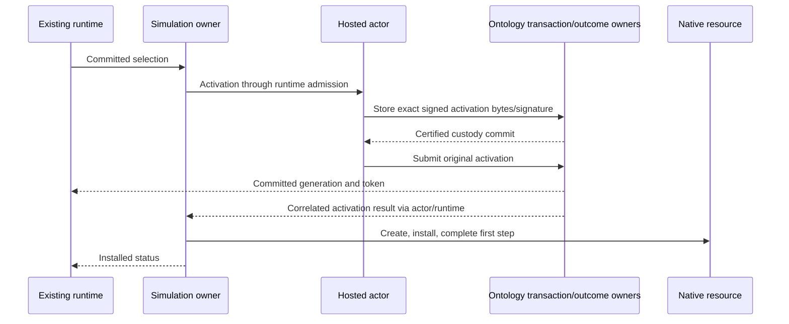

# Retained server physics profile

The authority and lifecycle contract is [world.md](world.md). This first adapter
supports authored solid and surface geometry, baseline poses, uniform gravity,
and coherent pose/contact snapshots. Vertical revolute cuboid doors add an
ordinary close action, mechanical obstruction braking and signed blocked/closed
consequences with an atomic stopped-angle checkpoint. One local client view
can consume current poses. Governed body-state and collision queries read the
installed owner. Signed transient controls move ontology-defined rigid agents and push eligible
free dynamic bodies. Explicit rest checkpoints preserve their recovery poses;
impact occurrences remain outside this profile. Unsupported joint/checkpoint declarations fail installation visibly;
there is no silent baseline fallback.

## Installation and policy

Load [quod_physics.pl](../priv/ontologies/quod_physics.pl) with the existing agent
hosting ontology, and include `quod_physics_predicates` in the ontology's founding
external-predicate manifest. Give the selected actor explicit `can_invoke`
grants for `physics_store_request/6` and `physics_activate/3` through ordinary
signing policy. The real-owner server fixture in
[quod_physics_tests.erl](../test/quod_physics_tests.erl) supplies those grants,
a ground collider and one falling body; run `rebar3 as test eunit
--module=quod_physics_tests`.

`physics_space(World, disabled, Instance)` suppresses both hosting that physics
agent and allocating its native world. Enabling it selects only the node in the
actor's committed hosting assignment. Other nodes have no local simulator for
that assignment. Each space can select a different host.
Each space uses a dedicated physics actor in this profile; sharing one actor
between independently enabled spaces is unsupported. The fixture uses one
world per containing ontology. Existing per-predicate OCC also means activation
custody changes in one ontology can conflict across its worlds.

The Prolog selection supplies:

- `physics_run(World, Generation, IncarnationToken)` and
  `physics_structure(World, Revision)`;
- `physics_allowances(World, limits(Bodies, Poses, Contacts, CoordinateMm,
  geometry(Parts, Vertices, Triangles)),
  StepMicroseconds, GravityMmPerSecondSquared, RequestBudgetMs)`;
- `physics_body(World, Id, Revision, fixed|dynamic|controlled, Pose,
  Shape, DensityKgPerM3)`.

This allowance schema replaces the earlier four-field `limits` term. Existing
world policy must explicitly supply geometry allowances before deployment;
this change does not migrate or wipe ontology history.

`Pose` is `pose(vector(X,Y,Z), rotation(Rx,Ry,Rz))`, with millimetres and
milliradians. Rotation applies X, then Y, then Z. `vector(X,Y,Z)` authors an
identity rotation. Supported solids are `box(HalfX,HalfY,HalfZ)`, `ball(Radius)`,
`capsule(HalfSegment,Radius)` along local Y, and `convex(Vertices)` with explicit
convex-hull semantics and positive volume. `parts([part(LocalPose,Solid),...])`
authors a rigid compound: gaps between parts remain gaps, and parts have their
own position and orientation. Articulated geometry requires supported joints;
it is not flattened into a hull or replaced with a capsule.

Fixed bodies additionally support `surface(Vertices,Triangles)`. Vertices are
`vector/3`; each `triangle(A,B,C)` names zero-based vertex indices. Invalid or
degenerate triangles fail installation. This is an explicitly authored physical
surface, independent of rendered meshes, picking bounds and voxel indexing.
It represents sloped/non-cubic terrain without introducing a grid controller.
Surface geometry cannot be used as a moving solid body.

Governed body edits share the Prolog `physics_valid_body/6` schema for body
identity, kind, authored pose, geometry, density and coordinate allowance.
It accepts every shape above; the supported hinge still requires box solids.
Native installation additionally checks numeric representation, convex volume,
triangle area, compound bounds and supported joint mechanics.

Geometry allowances count all installed parts, convex/surface vertices, and
surface triangles across the world, including unchanged retained bodies.
Unchanged geometry consumes its declared allowance without rebuilding native
shapes. Geometry and body revisions install together. `controlled` selects a
kinematic body; the governed motion path below applies checked poses without
movement-induced impulses to dynamic obstacles.

The limits are policy inputs, not Erlang constants. The native numeric envelope
bounds positions and physical dimensions. Gravity, velocity, density and all
other numeric values must be finite and representable as Rapier `f32`; density
is not compared to a distance allowance. IDs and body revisions use unsigned
64-bit native fields. Positive mass, dimensions and step are representation
requirements. The ordinary hosted-agent admission policy still owns actor
population and request capacity. Body/contact limits are not a hard byte or
wall-clock allocation guarantee: broad/narrow-phase pairs can grow quadratically
with the admitted body count. Policy authors must budget aggregate worlds too.

## Live Prolog physics queries

`physics_body_state(World, Body, Result)` requires the ordinary `can_invoke/4`
grant and `can_read_physics_body(World, Principal, Body)`. It returns
`body_state(Frame, Tick, body(Id,Revision), metres_seconds, Pose, Velocity)`.
`Frame` is `physics_frame(WorldRef, Authority, HostEpoch, RunGeneration,
Incarnation, Structure)`; pose rotations use `quaternion(X,Y,Z,W)`.
The owner copies its retained sample. A stale installed frame, missing body or
retired run may bind `unavailable`, never an inferred baseline. A missing owner
or failed owner call is a reasoned failure under the [proof contract](proofs.md),
distinct from that valid answer. Malformed request or policy values are errors.

`physics_motion_query(World, Body, Query, Result)` additionally uses
`can_query_physics_motion(World, Principal, Body, Query)` and
`physics_query_allowances(World, Principal,
query_allowances(SkinMm, PenetrationToleranceMm, SlideIterations,
NarrowPhaseTests, TranslationComponentMm, RotationComponentMrad))`.
Each allowance is ontology policy. Both predicates require a read-only proof;
they cannot validate staged grants or a durable edit using transient state.
Unauthorized queries fail. Their Erlang continuations require an opaque handle
created by the public predicate before evaluating ordinary Prolog policy.

Queries are `place(pose(vector(X,Y,Z),rotation(Rx,Ry,Rz)))`,
`travel(vector(Dx,Dy,Dz),angular(Ax,Ay,Az))` and
`landing(vector(X,Y,Z), ReachMm, DropMm, MinUpPermille)`. Placement rotation uses the authored
Euler convention; travel rotation is an angular displacement vector in world
coordinates. Distances/angles in inputs are millimetres/milliradians. The native travel
rotation query accepts at most pi radians per component. This is a single
bounded rotation sweep, not an unbounded spin command.

The result is `motion_query(Frame, Tick, body(Id,Revision), metres_seconds,
Answer)`. `Answer` is `clear(Pose,Checks)`,
`clipped(Pose,Contacts,Checks)`, `occupied(Body,Checks)`,
`blocked(Body,Checks)`, `no_support`, `unsupported`,
`unavailable`, `invalid`, or `exhausted`. Contacts name the collider and world
normal. Translation slides along contact surfaces; rotation stops at contact.
Slide exhaustion returns the conservative clipped pose; narrow-phase allowance
exhaustion returns no usable pose. Unsupported shape pairs fail closed.

Queries use the installed broad-phase index and current collider poses, including
doors; they do not rebuild terrain or move any body. Collider installation must
finish updating that index before queries become available. Results describe
that tick only: a clear preview is neither a movement authorization nor a future
landing guarantee. The command owner checks again at application.

## Played-agent movement

`physics_agent(World, Agent, Revision, Body, Motion)` selects an existing local
agent instance and its declared rigid body. `physics_viewpoint(World, Agent,
Name, Body, LocalPose, Tracking)` defines both position and orientation of the
camera in that body frame. There is no universal capsule or browser eye height.
The human principal may belong to another ontology and never impersonates the
controlled agent. A compound body may have arbitrary authored local parts;
unsupported articulated controllers fail closed.

`physics_control_agent(World, ExpectedEpoch, ExpectedSelection, Selection)` is
an ordinary transaction. Selection is `none` or `controlled(Agent, Viewpoint)`.
It requires `can_control_physics_agent/3` plus ordinary invocation admission,
checks exclusive target ownership, and advances an enduring binding epoch.
Release retains the epoch tombstone. A revoked holder cannot be silently
replaced while its durable binding still exists.

The first movement profile is:

```prolog
motion(free, SpeedMmPerSecond, TurnMradPerSecond, LeaseMs,
       query_limits(SkinMm, ToleranceMm, SlideIterations, NarrowPhaseTests), Capabilities)
motion(grounded(MinUpPermille), Speed, Turn, Lease, Limits, Capabilities)
```

Grounded means world-Y gravity, horizontal commanded travel and support normals
meeting the authored upward threshold. It is an explicit mechanical profile,
not an inference from agent shape. Capabilities are unique entries from
`snap(AngleMrad)`, `teleport(ReachMm, DropMm, MinUpPermille)` and `reposition`.
Unknown modes/capabilities are refused. Policy supplies speeds, lease and query
allowances; packet frequency does not multiply continuous travel distance.

The signed `control` mode (wire tag 3; `/api/goals/control`) reuses the existing
signed ingress and proof engine. Its database is read-only. The root uses the
existing distributed savepoint, and an external predicate stages at most one
indivisible transient effect in the immutable proof overlay. Only the first
surviving answer, after successful scope finalization, releases it through
`quod_effect` to the existing physics owner. Failure, abandoned branches,
negation, cut failure, expiry or proof cleanup release nothing. Ordinary read,
execute and cursor requests cannot stage this effect. This lane has no ledger,
operation journal, automatic replay or remote control forwarding.

```prolog
physics_control_input(World, control_frame(PhysicsFrame, Registration),
                      BindingEpoch, Sequence, Input, queued(Sequence)).
```

`PhysicsFrame` is the same exact frame used by live queries. Registration is
created by the current signed view and checked by the physics owner, together
with installed control configuration, authority, structure, sequence and expiry.
A refresh/disconnect revokes it and clears voluntary input, including unapplied
discrete requests. Grounded fall state survives a view disconnect or a reinstall
of the same control configuration. Changed physical geometry wakes support
checks even for a settled body. A clipped descent with no downward progress
settles mechanically; it does not make that contact a valid teleport landing.
While the physical configuration is unavailable, mechanics pause and old inputs
do not keep the step timer awake. A new view reads the retained sequence high-water mark,
including after configuration edits with the same binding; its prior result is
reported as suspended when the configuration changed. An
old registration cannot take over with a higher sequence. The browser sends one
request at a time and suspends commands after an uncertain response, without
replaying it. Proof success means queued admission; the view supplies the actual
mechanical outcome.

Inputs are `drive(vector(Vx,Vy,Vz),angular(Wx,Wy,Wz))`, `snap(AngleMrad)`,
`teleport(vector(X,Y,Z))`, and explicitly permitted
`reposition(pose(Position,Rotation))`. Drive is the latest desired velocity,
leased and applied at the server timestep. Translation stops/slides; rotational
sweeps check all parts and stop at contact. Snap may therefore stop short of its
requested angle. Teleport keeps orientation, checks the complete straight body
path, then searches downward for valid support. Occupied destinations, blocked
paths, unsupported slopes, missing support and exhausted queries leave the pose
unchanged. Previews never authorize a later landing. A pending discrete command
cannot be overwritten before its outcome; there is no command accumulation queue.

An occupied authored spawn or collider edit does not trigger hidden
unbounded depenetration: travel is refused with `occupied`. Numerical
penetration is admitted only up to the authored query tolerance, including
contacts with dynamic bodies; it never excludes a class of physical obstacles. Explicit reposition
checks the complete destination and may repair an occupied start without a
travel path. Reposition is live motion, not a durable baseline edit. Restart
restores authored body baselines under a new run/registration, making any
correction visible. Free dynamic bodies support the rest checkpoints below; played-agent checkpoints
remain outside this profile. Durable placement changes use the ordinary authored
edit or request/observation/committed-consequence path, never a live query as
evidence inside a durable proof.

Relevant committed physical/control changes invalidate a runtime-owned shared
generation before asynchronous reinstallation. Owners stop accepting/advancing
old commands immediately on that token, coalesce invalidation notices, and
notify only installed state. Shapes, indices and the simulation resource remain
owned by the same retained physics process. No browser mesh or picking result
becomes collision authority.

### Desktop and tracked viewing

The desktop adapter removes Babylon's translating inputs in the Simulation
scene. Keys submit bounded desired travel through the predicate; the camera
mount follows accepted poses without interpolation through walls. Look remains
local. Unknown/unavailable worlds freeze commanded travel instead of enabling
observer flight.

`view_only` supports desktop look. `tracking(view_only, MaxOffsetMm)` additionally
provides a calibrated XR reference-to-mount mapping. Calibration recentres
position and heading while preserving tracked pitch and roll. Head motion is view motion;
it does not change collision shape or body position. For each delivered frame,
the owner measures a conservative clearance ball around the authored mount
against the installed world, excluding its own body and using the same query
allowance. This is sensory clearance, not a new player collider. Each tracked
eye must stay within that clearance and the authored offset allowance. Otherwise
an opaque mask asks the human to return; tracking continues behind it. Missing
clearance, missing mappings, lost tracking and unavailable authority also mask.
A moved door can reduce clearance at the next authoritative frame; this is not
a physical barrier against a human moving in their room.

Default XR mesh teleportation is disabled. On the intended Vive mapping, the
left grip plus touchpad drives smooth travel; a left-pad left/right click requests
snap turn and a forward click requests a half-range teleport in the controller's
horizontal pointing direction. The right pad owns the action menu. Menus and
workspaces suppress locomotion. Components are discovered by WebXR type; missing
components are not guessed. Teleport placement uses body-origin coordinates and
physical support, without a visual-floor ray granting permission. The current
adapter has no landing preview marker. Hardware qualification must separately
check Vive runtime/browser mappings, masking, comfort and contact feedback.

## Chair pushes and rest checkpoints

A chair is an ordinary `dynamic` body with a stable numeric body identity in its
anchored world. Its projected mark binds `body_pose(Id, BodyRevision)` to the
anchored domain subject in `depicts`; neither a mesh name nor a visual occurrence
is a physics identity. Body identities must not be recycled after deletion.
`physics_move_body/5` retains the identity and advances its body revision to the
new world structure revision.

The existing signed `control` request accepts:

```prolog
physics_control_input(World, control_frame(PhysicsFrame, Registration),
    BindingEpoch, Sequence, push(body(Id, BodyRevision), vector(X,Y,Z)), Result).
```

The caller needs an active played-agent binding/view registration, ordinary
invocation admission, `can_push_physics_body(World, Principal, Id)`, and
`physics_push_allowances(World, Principal, Id, push_limits(MaxImpulse, MaxSpeed))`.
Prolog checks eligibility, the exact dynamic-body revision, and nonzero impulse
magnitude. Hinged bodies are ineligible. Policy supplies maximum impulse in
milli-newton-seconds and maximum resulting speed in millimetres per second;
input components use milli-newton-seconds. Eligibility policy may impose domain
restrictions; the adapter does not infer reach or ownership from a rendered hit.
The native owner refuses a push whose resulting linear speed exceeds the limit,
including accumulated velocity from earlier pushes. This bound governs the
command's application, not later velocity caused by gravity or collisions.

The client helper `pushInput(id, revision, impulse)` in
[locomotion.js](../client/src/locomotion.js) accepts newton-seconds and preserves
64-bit IDs. Pass its term to the simulation connection's `command` method.
The current profile exposes this programmatic action; it does not add a desktop
or headset grab/push gesture.

The owner rechecks installed policy, world/authority/host/run/incarnation,
structure, body revision, registration, sequence and expiry at admission and
application. A committed physical or policy change invalidates old commands
before asynchronous reinstallation. Each sequence can apply once within its
binding; a fresh registration reads the retained sequence and a new run discards
all inputs. `queued(Sequence)` is admission, while the projected control feedback
reports `pushed`, `refused` or expiry. A definite proof refusal keeps the current
view available and clears the rejected discrete command; a later command has
a fresh sequence and signed request. The client keeps one request in flight,
waits for discrete feedback before sending another input, and suspends commands
on an uncertain reply. Refresh obtains a fresh authorized view and never
resubmits the lost push. Physics frames move the existing visual body without
writing its author baseline; appearance refresh and checkpoint-only installation
retain the live pose and native resource.

A durable checkpoint is explicitly requested through an ordinary action:

```prolog
physics_checkpoint_body(World, Id, ExpectedBodyRevision, ExpectedSequence, RequestId).
```

`RequestId` is 32 bytes and the initial sequence is zero. The world must be
enabled. The caller needs
`can_checkpoint_physics_body(World, Id, Principal)` and ordinary invocation
admission. The world supplies `physics_rest_policy(World, Id,
recovery(PenetrationToleranceMm, NarrowPhaseChecks))`. The action records
`physics_rest(World, Id, NextSequence, waiting(rest(NextSequence, RequestId)))`.
It never accepts a caller-supplied measured pose. Once the native body sleeps,
the current authority emits a fenced, completed-tick rest observation. Give that
actor explicit invocation grants for `physics_store_rest_request/4` and
`physics_finish_rest/1`. Their existing custody lane saves exact signed bytes,
then commits the finished request and checkpoint together:

```prolog
physics_checkpoint(World, rest_v1(Id, BodyRevision,
    source(Authority, HostEpoch, Generation, Incarnation, Structure, Tick),
    world_mm_quaternion_million,
    pose(vector(X,Y,Z), quaternion(Qx,Qy,Qz,Qw)), zero_velocity)).
```

Positions are rounded millimetres and quaternion components are rounded to
millionths; linear and angular recovery velocities are zero. The authored
`physics_body/7` remains unchanged. Only the current checkpoint is selected;
replacement cannot move backward in `(Generation, Tick)`. Each new explicit
request and renewal of expired, certainly-unsent evidence completes a new
mechanical step even for a sleeping body. Unknown signed outcomes are resolved using the original bytes, without
resubmission or a fresh checkpoint request. A saved-but-never-submitted request
can remain visibly unresolved. A new request cannot bypass active custody.

An authored `physics_move_body/5` transaction advances structure/body revision,
removes that body's checkpoint and cancels its waiting checkpoint activity
atomically. It retains old signed custody for outcome resolution until a new
explicit checkpoint request replaces it. Cancellation and the changed body
revision fence the old finish permanently, so that distinct request may proceed
even if the old backend outcome remains unknown; it never resubmits the old
action or asserts a rejection. If the
checkpoint commits first, the edit removes it; if the edit commits first, the
old checkpoint loses ordinary OCC validation. Neither ordering restores the
pre-edit pose. Editing an unrelated body keeps this chair's checkpoint but
fences any pending observation against the old world structure.

Request, custody and checkpoint commits each refresh the signed live view and
suspend voluntary inputs. The retained body pose survives these refreshes.

Owner death, runtime collapse/restart, ontology replay and host restart discard
unsaved motion and unapplied pushes. The successor must commit a fresh run
before installing the current compatible rest checkpoint, or the authored
baseline with zero velocity when no checkpoint exists. Hosted-agent recovery
selects any replacement host; uncertainty or missing commit quorum leaves the
world unavailable. Replayed facts do not replay push or checkpoint reactions.
An unresolved saved checkpoint operation is resolved, never submitted again.
Frames under the new run expose the recovery reset and reject old commands.

Rest recovery uses zero displacement: it checks all restored bodies against the
current installed geometry with the policy's bounded narrow-phase allowance
and penetration tolerance. It cannot move through a newer wall or open a closed
door to repair overlap. Bad rotation, incompatible revision, unsupported shape
checks, exhausted allowance or excessive overlap visibly fail installation;
there is no silent baseline fallback. An authorized body edit invalidates the
checkpoint and supplies a new baseline as the explicit recovery exit.

## Door actions and effective definitions

`physics_add_door(World, DoorId, FrameId, Source, Position, ExpectedStructure)`
requires `can_edit_physics(World, Principal)`. `Source` is either
`local(Name, Version)` or `class_ref(Namespace, GenesisAnchor, Name, Version)`.
The latter resolves `physics_door_class/3` through the ordinary authorized
cross-ontology proof. The action materializes the resulting versioned leaf,
frame and joint in one world transaction. The retained, local-only selector
never resolves a shared class. Later class edits do not silently change an
installed instance.

A class contains `door(FrameBox, LeafBox, Density, BaselineAngleMrad,
motor(Stiffness, Damping, MaximumTorque, ClosedToleranceMrad))`. The supported
joint rotates a dynamic cuboid around a fixed frame's vertical axis. Its
collider is the leaf cuboid; frame/leaf collision is disabled. Each leaf has
one hinge, bounded by the existing body allowance, without a separate fixed
joint-count ceiling.

`physics_close_door(World, Door, ExpectedSequence, RequestId)` requires
`can_close_physics_door/3` and a 32-byte request id. It advances an activity
sequence and commits `closing(close(Sequence, RequestId))`. The retained owner
starts the selected motor. Native mechanics brake that hinge on non-frame
contact or arrival within its closed-angle tolerance; other bodies continue.
Only Prolog interprets the sample as `blocked(OtherBody)` or `closed`.

`physics_move_body/5` edits an unconnected obstacle with expected body and
structure revisions. Its new position retains authored geometry and orientation,
including non-box and compound bodies. `physics_move_door/5` edits the whole supported joint
group, advances its revisions, invalidates its checkpoint and cancels an
active close. Both require `can_edit_physics/2`. `physics_cancel_door/3`,
authorized by `can_cancel_physics_door/3`, explicitly ends a pending close
while retaining its original request for exact outcome resolution.

## Observation and consequence

The runtime authenticates the current simulator PID and incarnation before
matching `react_on(observed(Sample), Goal)` through the existing Prolog event
matcher. Private `physics_observation/1` metadata is available only there; an
ordinary event with the same term conveys no simulator authority. A private
physics request selects a custodied consequence; a generic observed callback
without signed-request preparation cannot consume it. The selected
actor signs a goal containing the entire frozen sample: world/activity,
authority assignment, generation/token, structure and participating body
revisions, completed-step tick, quantized angle, one bounded contact partner
(or clear), and its original validity interval.

The actor's existing custody lane first stores those exact signed bytes and
signature with `physics_store_door_request/5`, then submits
`physics_finish_door/2`. Grant both entry actions explicitly to the physics
actor. Prolog checks authority, sample bounds, revisions, current activity and
exact signed-request binding. One existing transaction replaces closing with
the finished result, records the compatible stopped-angle checkpoint, and
emits `physics_door_finished/4`. No durable proof reads live native physics,
and sealing has no physics exemption.

The checkpoint is an insertion-only restoration input, separate from the
joint's structural identity. Selecting its own new checkpoint does not reset
a retained body. A fresh simulator restores the compatible checkpoint or
baseline, after committing its new run, without replaying the earlier reaction.
A finished or cancelled activity does not restart its motor.

Required samples use the runtime's existing bounded owned-event cursor and
actor queue. Refusal retains the unsent sample; actual queue-capacity release
wakes it. Expired unsent evidence requires another completed native step and
a new validity interval, never an extension of old signed bytes. A rejected
request can be replaced only after the ordinary server proof checks the exact
original operation's immutable, consensus-applied terminal outcome at or
before the proof's pinned height. The simulator cannot certify rejection.
Outcome notifications are scoped to that request and retained across a
concurrent resolution read.

Pending, unknown and failed resolution leave the hinge held with a visible
observation status. Recovery resolves the original saved request without
resubmitting it. A saved-but-never-submitted request may remain pending;
authorized cancellation is its explicit exit. A certainly unsent policy
refusal is visible and waits for a relevant selection change. There is no
readiness polling or retry timer, and absence never means an unobstructed door.

## Owner and recovery

The existing ontology runtime selects `physics_worlds` from its retained
snapshot. One registered `quod_physics` process per anchored WorldRef owns all
native mutation. The runtime waits for its DOWN before replacing its slot;
the registration also prevents overlap when the runtime itself restarts.
Every native operation verifies the creator PID. The runtime authenticates
selection, status, result and death messages by current PID/reference.



The activation compares the expected committed generation and exact preceding
custody record. Its original bytes/signature are committed before submission,
using the existing transaction path. A successor resolves those exact bytes
through the existing outcome service. Even if its predecessor's activation
committed, the successor must activate a fresh generation with its own token.
It never adopts the dead incarnation's generation. Result-before-selection and
selection-before-result both wait for matching evidence.

`physics_activation_status(World, OriginalRequest, Status)` derives pending,
activated or cancelled from committed custody/run facts. It is not a separately
updated “sent” flag: a crash between send and recording send would still be
ambiguous. A successor resolves the saved original operation; it does not
resubmit an uncertain activation or adopt an older incarnation's token.

Pending, unknown, timeout and an unresolved custody-write result leave physics
visibly unavailable. None means rejection. Capacity waits retain the original
absolute deadline. Confirmed unsent failure, certified terminal rejection and
failed resolution reads have distinct statuses. A newer custody or run-generation
selection that arrived before a failed reply is processed once after that reply. Explicit
resource reconciliation can re-resolve unavailable activation using the same
original request, without recreating native state. A certainly unsent attempt may
start a new request on explicit reconciliation; it does not extend its old
deadline. An uncertain custody write stays closed while its issued
generation/token/custody selection is unchanged, including when it still shows
a predecessor's completed request. `activation_custody_unresolved` means the new
custody has not been observed: if it never lands, there is no matching request
to cancel. Explicit lifecycle retirement (for example disabling then enabling
the space) permits a fresh incarnation. Any late old store still competes on
its exact prior custody and generation; it cannot overwrite the new request.
If old custody does land first, recovery resolves it and policy cancellation
provides the pending-request exit. There is no retry timer.

A stored request might never have been submitted, so an outcome need not ever
appear. `physics_cancel_activation(World, ExpectedGeneration, ExactRequest)`
provides the explicit safety exit. The current principal must satisfy
`can_cancel_physics_activation(World, Principal)` as well as ordinary entry
and signing policy. No default policy authorizes it. In one transaction it
requires ground arguments, compares current custody and the still-unactivated generation, removes that
request's activation permission, and retains its exact bytes/signature in
`physics_cancelled_request/2`. It does not assert a backend operation outcome.

Cancellation and activation conflict on ordinary OCC dependencies, including an
activation whose proof already read/staged the old state. If activation commits
first, cancellation fails. If cancellation commits first, the old request cannot
later install a world or be restored as current custody. The waiting simulator retires and its replacement
activates a fresh token/generation. Cancellation never runs automatically due
to elapsed time, absent outcome or ordinary reconciliation. Policy decides who
may invoke it, including for a certified terminal failure.

For an active world, unchanged reconciliation sends no installation message, creates no resource,
and performs no ledger fold or file write/sync. Changed body definitions install
at a step boundary: unchanged IDs keep their live state, removed IDs retire,
and changed IDs require increasing revisions and reset to their authored pose
and zero velocity. The owner completes a step before exposing a coherent frame.
Changes to engine allowances, timestep or gravity require a new run.

At most one selection is in flight to the simulator; subsequent selections
coalesce into the runtime's latest desired specification. Frames stay with the
simulator and do not enter the runtime queue each tick. One timer exists while
awake, with no elapsed-time catch-up queue. A sleeping world cancels it and does
no stepping or publishing until a changed physical input wakes it. Explicit
queries copy the retained frame rather than call Rapier again.
The timer waits the timestep rounded to milliseconds after the previous call;
simulation time advances by the fixed timestep per completed integration and
can lag wall time under load. Installing changed bodies completes an immediate
step. This profile makes no real-time cadence guarantee.

Frames contain the anchored world/authority/host-epoch/run-generation fence,
structure revision, incarnation token, completed tick, per-body revisions,
metre/second units and world coordinate space. The owner snapshot API requires the expected fence/structure. A newer tick
returns a frame; the same tick returns `unchanged`, including for a sleeping
world. A stale fence, structure or future tick is unavailable. This snapshot API
is internal; the client boundary below governs pose delivery. Neither API
provides a remotely authorized contact-proof interface.

## One client view

The browser's **Simulation** scene first reads
`physics_client_world(ontology_ref(Namespace, Anchor))` in the signer's ontology.
The containing world supplies a local reference; a human ontology can author a
foreign reference. This is view selection, never a control grant. The client
then opens `/api/simulation` on the existing TLS listener. Both the signer's
ontology and the selected world must be local, and the simulation authority
must be hosted here. There is still one viewer; a second receives `view_busy`.

The world defines `physics_view(World, Marks)`, `can_view_physics(World, Principal)`
and an ordinary `can_invoke/4` grant for the complete guarded view goal:

```prolog
Namespace::(current_ontology_identity(Namespace, Anchor), physics_client_view(View)).
```

There is no default grant. The endpoint accepts exactly that parsed goal with
one `View` variable; an arbitrary proof cannot manufacture a projection.
It subscribes to both source and world before reading, and verifies unchanged
heights and the installed physical frame before attaching. An advance or replay
in either scope revokes the view. Invocation permission and keys remain under
ordinary signed ingress; the source principal is preserved in the world scope.

Marks are world-root `mark/7` occurrences using `body_pose(Id, Revision)` and
anchored `depicts/3`. Occurrence identity and body identity remain distinct.
The selected controlled body is also projected when it has no visible mark.
The endpoint checks the complete body set against the current owner. Numeric
identities, heights and sequences use decimal strings in JSON, preserving uint64
values beyond JavaScript's safe integer range.

`open` carries `session_id`, signed `request`, `signature`, `world_namespace`
and base64url `world_anchor`. `projection` returns the signed-request digest as
`view`, `height`, `expires_ms`, marks, optional Prolog control configuration and
a current frame. Schema 1 frames carry world/authority/run/structure/tick,
metre positions, XYZW quaternions, this view's random registration, selected
control's last accepted sequence and operation outcome, and optional sensory
clearance. Other principals' inputs are not exposed.

An `ack` for the exact view and last tick releases one delivery credit. The
owner retains one latest frame, not a motion queue. Unchanged sleeping worlds
send nothing; repeated acknowledgements neither step nor write. Command outcomes
advance feedback even when the body does not move. This is transport credit,
not durable acknowledgement. The original signed expiry is enforced by server
and browser; a lost connection cannot keep an authorized view indefinitely.

Durable changes, owner death, expiry and structural invalidation require a fresh
signed read. Installation waits use owner notices, not polling. The Simulation
scene rereads the signer's selected world when refreshing. Unavailable poses are
hidden and commanded travel pauses. Leaving the Simulation scene restores the
separate local observer camera. Old view IDs, registrations, physical fences and
non-increasing ticks cannot drive the current scene. Each namespace commit
conservatively costs a new read/watch; a busy namespace can still starve view
availability. Narrow dependency watches for arbitrary view proofs are outside
this profile.

Replay, runtime queue collapse, actor death, changed assignment and explicit
disable retire the current simulator. Replay reconstructs desired resources
without replaying historical reactions. A recoverable native error retires the
resource and leaves a visible failed selection in its existing owner; unchanged
reconciliation cannot loop on the poison definition. A changed physical
specification or an explicit lifecycle restart can start a new incarnation.
An unexpected simulator crash leaves a failed slot in the runtime until the
physical inputs/assignment change, explicit cancellation removes custody, or
the containing lifecycle restarts. Late custody/generation-only changes do not
clear that slot. It does
not repeatedly activate the same crashing selection. Normal retirement and an
explicit process kill still restore through original-operation recovery. Actor
death is conservatively a lifecycle boundary, including an unrelated actor
request-worker crash; a simulator never outlives its selected signing executor.

## Native safety audit and port decision

The Quod adapter is independent of ontology semantics. Exact dependencies are
Rapier 0.36.0 and Rustler 0.36.2, with the complete Cargo lockfile committed;
Rapier 0.36.0 was verified as the latest stable crate on 2026-10-05 against
Cargo and the upstream changelog. Rapier's `parallel` and `simd8` features are
disabled; its normal solver still uses upstream vector math. Enable
`solver-bounds-checks`: stale solver IDs and empty contact lanes must raise an
unwind panic before unchecked solver gathers. This does not remove every
upstream unsafe operation.
There are no native worker threads, event channels, foreign callbacks or unsafe
blocks in the adapter. Upstream Rapier/Rustler and their dependencies do contain
unsafe code. This is a boundary and lifecycle audit, not a formal verification
of all upstream code. The evidence record includes a dated check of every
locked package name against a pinned RustSec advisory-database snapshot and
review of its affected version ranges.

All entry points, including creation, decoding, queries and explicit retirement,
run on dirty CPU schedulers. The mutex uses `try_lock`, never an ordinary
scheduler-blocking lock. One step is one fixed Rapier integration; it cannot
yield halfway through or be safely interrupted. Solver iterations remain
Rapier's finite defaults. The benchmark includes both separated cuboids and
a densely overlapping case; body count alone does not predict cost.

The resource owns its entire Rapier graph. No Erlang term, environment or borrowed
input pointer survives a NIF call. A bounded list decoder checks the body
allowance before allocating another decoded row. Full validation precedes
mutation. Sampling allocates at most the actual admitted bodies and configured
active solver-contact pair output count, with finite checks before returning a
complete snapshot. These are Rapier contact candidates, not Prolog domain
consequences. An overflow returns a named failure instead of a partial snapshot. Input,
retained definitions and returned terms still occupy distinct bounded copies.
No growing pose history or contact-event channel is retained.

Typed native errors, Rapier non-finite-state quarantine and unwind panics
discard the world. The required soft-body container stays empty in this profile.
The improper-list boundary test exercises a real Rustler panic under the adapter's unwind catch,
then checks that the retired handle cannot be reused and the VM still runs.
The release uses `panic=unwind`. Allocator abort, process abort, memory corruption,
segmentation fault, double panic during unwinding and undefined behavior can
still terminate the entire BEAM. Catching unwinds does not contain those risks.

Explicit retirement frees the graph on dirty CPU. If an owner is killed without
termination, Rustler's final resource destructor runs wherever BEAM releases the
last reference; it is not guaranteed a dirty scheduler. The measured owner-death
case covers this small graph, not a general destructor latency bound. A killed
process executing a dirty NIF also cannot release that graph before the NIF
returns.

Keep the recorded in-process choice for this small, policy-admitted cuboid
profile. The fixture admits 64 bodies/64 poses/256 contact pairs, and measurements
include four simultaneous 64-body worlds. Do not infer suitability for arbitrary
untrusted geometry, unconstrained quotas or hard real-time service. If native
crash isolation is required, or measured scheduler/destructor/memory cost at the
intended policy limits is unacceptable, replace this adapter's execution boundary
with the recorded supervised-port fallback before enabling that profile. Keep
the same authority, activation custody, fences and resource owner; a second
physics domain engine is unnecessary.

Build/release hooks compile with `--locked` and atomically rename the completed
library into place, preserving any inode already mapped by a running BEAM.
Native hot-code upgrade is unsupported; a release restart loads a new library.
CI/release images install Rust
1.90.0 and package the resulting library under application `priv/native`.
Availability is an Erlang read of the retained module-load result. A missing
or incompatible library leaves the module loadable with availability false, so optional physics does not break embedded node startup. An enabled
selection reports `native_unavailable` with the retained load error before
submitting activation.
Native tests precede the normal sequential Erlang gates. Measured costs and
retained verification logs belong in the [evidence record](evidence/physics/README.md).
