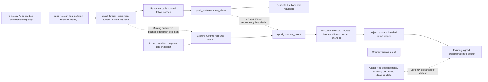

# Existing subscription and installation owners

This traces the current production path. Dashed edges are missing capability,
not implemented propagation. It does not choose a simulation-domain boundary.

The runtime attaches a retained follow in `attach_source_follow/2`; follow
registration precedes snapshot delivery. `handle_source_notice/5` checks the
exact follow reference, records ready/building/unreachable state, then queues
only publications selected by `source_interests`. A ready resnapshot has no
publications. Irrelevant or dropped publications are acknowledged, and recovery
restores the verified projection without replaying reactions. No resource basis
is consulted here.

`quod_foreign_log:projection_clauses/3` validates the caller-owned follow and
materializer generation before reading current clauses. This is a retained
projection seam, not a source-owned permission for physics installation. It has
no production caller in the traced tree. A raw clause read cannot replace the
explicit Prolog delegation proposed at the architecture gate.

`run_resource/7` captures the local selector's observation basis before calling
`resource_selected`. The runtime records that basis and rejects queued changes
racing the selection. `select_resource/4` uses `policy_verdict_context`, so
`guarded_ask/5` rejects foreign scope evaluation. This explains both missing
edges: committed remote geometry cannot currently be selected by this worker,
and authenticated source notices cannot invalidate its installed result.
The existing owners should be extended; another broker, mirror, polling loop
or synchronization protocol would duplicate their guarantees.

`quod_prolog:run_pinned_origin` already owns a proof's selected scopes and
ordinary authorization reads. Its successful read result crosses
`finish_proof/3` with only the origin height: the read set is discarded there,
and foreign scope heights are not exposed as retained view dependencies.
`quod_client_simulation` subscribes before reading, but subscribes only to the
acting-agent and physics namespaces. It cannot infer an additional visible,
geometry or authorization scope from that one height. An authored dependency
list would not prove that failed or disabled selections were covered.

The required extension must carry authenticated actual read versions while
their proof scopes are still alive, retain every dependency of the chosen view,
subscribe before comparing current snapshots, and preserve original deadlines,
owner incarnations and cancellation. Unavailable reads cannot manufacture a
verified height. Existing whole-world and per-predicate conservatism remains;
this trace claims no row-level OCC or invalidation precision.
