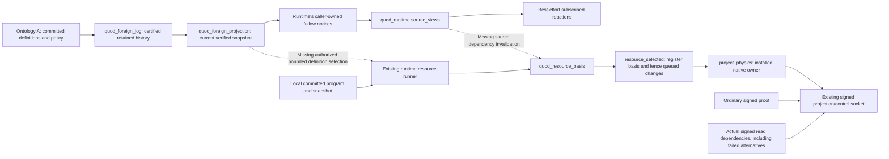

# Existing subscription and installation owners

This traces the current production path. Dashed edges are missing capability,
not implemented propagation. It does not choose a simulation-domain boundary.

The runtime attaches a retained follow in `attach_source_follow/2`; follow
registration precedes snapshot delivery. `handle_source_notice/5` checks the
exact follow reference, records ready/building/unreachable state, then queues
only publications selected by `source_interests`. A ready resnapshot has no
publications. Irrelevant or dropped publications are acknowledged, and recovery
restores the verified projection without replaying reactions. No resource basis
is consulted here.

`quod_directory_control:node_projection_clauses/2` already consumes
`quod_foreign_log:projection_clauses/3`; the earlier claim that this interface had
no production caller was incorrect. That caller remains. Handle lookup now uses
the actual calling consumer, and the materializer pins a shared MVCC snapshot
while the bounded caller evaluates it. The old materializer-loop clause-read
protocol has been removed. See `projection-readers-disposition.md` for owner,
cancellation, deadline and unchanged-work checks. This retained data handle is
not source-owned permission for physics installation; the explicit Prolog
delegation remains necessary.

`run_resource/7` captures the local selector's observation basis before calling
`resource_selected`. The runtime records that basis and rejects queued changes
racing the selection. `select_resource/4` uses `policy_verdict_context`, so
`guarded_ask/5` rejects foreign scope evaluation. This explains both missing
edges: committed remote geometry cannot currently be selected by this worker,
and authenticated source notices cannot invalidate its installed result.
The existing owners should be extended; another broker, mirror, polling loop
or synchronization protocol would duplicate their guarantees.

`quod_prolog:run_pinned_origin` now retains the actual opening height of every
scope, including authorization reads and failed alternatives, before cleanup.
The canonical signed-read result carries those exact identities/heights through
local and remote ingress. The existing socket subscribes to all returned scopes
before comparing current snapshots: asynchronous local engine snapshots and
existing foreign certified-progress follows. Negative logical results retain
their watches; proof errors cannot use partial dependencies as a valid selection.
Original deadlines, owner incarnations, cancellation and late-follow cleanup
remain within the existing owners. No authored dependency list substitutes for
the actual proof scopes.

The ordinary space-view selector and its typed disabled/nonphysical/denied states
now use this same socket. Navigation dependencies are visited in its signed proof
and checked against the actual envelope. See `ordinary-view-disposition.md`.
The foreign collider selection/invalidation edges above remain missing. Existing whole-world and per-predicate conservatism remains;
this trace claims no row-level OCC or invalidation precision. Current test and
review results are recorded in `view-dependency-disposition.md`.
