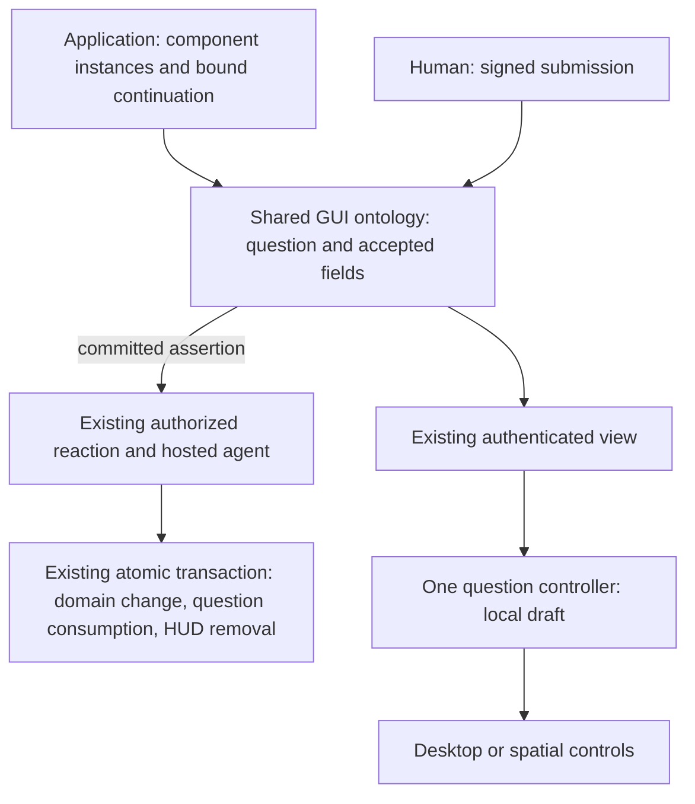

# Architecture simplification review

Yan requested this independent review after the GUI implementation grew too
complex. The concrete mistake was extending the shared work scheduler before
tracing its result to a GUI consumer. This review withdraws that extension;
it does not claim the whole ticket is complete.

## Smallest useful architecture

Applications should only declare components, bindings, policy and domain meaning.
Shared ontology behavior owns the correlation and reaction plumbing. The human
HUD stores references, not a second copy of question state. Drafts belong to the
existing controller, shared by presentation adapters.

## Remove the unused observer

The work-observation candidate introduced execute/observe work modes, exact
request and expiry dependencies, a new runtime snapshot message shape and another
cursor. It also migrated FIPA solely to accommodate that proposed GUI work mode.
Source tracing finds no GUI selector and no GUI consumer of its
agent_request_finished results. The runtime consumer handles physics requests;
the GUI controller uses its signed question view and explicit status read.
Consequently the new observer neither updates the HUD nor resumes a continuation.

The trace runs through `gui_completion_event/6` and `gui_question_status/2` in
[shared question behavior](../../../../priv/ontologies/gui_question.pl),
`agent_owned_result` in [the runtime](../../../../src/quod_runtime.erl), and
the status/read callbacks in [the controller](../../../../client/src/question-controller.js).

The candidate is withdrawn: five production files return to their exact previous
contents, removing a net 54 production lines (+27/-81 for this simplification).
Seven test/fixture files return to the prior API. Candidate-specific observation
tests remain archived, with every failed run and the passing candidate run.
Existing execution, custody, outcome, resource lifecycle and GUI tests remain.
See [disposition](../work-observation-01/disposition.md) and the exact withdrawn
manifest/tree. No unrelated changes were reverted.

The candidate's same-height cursor correction addressed the newly added request
delta consumer. It did not establish an independent defect in the prior snapshot
contract. Keeping that protocol change after removing its consumer would preserve
the speculative complexity.

## Keep the boundaries with demonstrated consumers

- Opening needs real receiver and installed-handler acceptance before reporting
  success. The existing declared action, read-only native scope and effect journal
  supply that boundary. An ordinary live preflight followed by a material write
  would violate the proof contract and fail to make acceptance atomic.
- Accepted fields and exact completion bytes share one question transition.
  The existing reaction dispatches those bytes; completion and consumption check
  the signed request identity. Removing that identity would permit a different
  operation to act as the accepted completion after an uncertain result.
- Negative expiry has an actual consumer: authorized cancellation of a submitted
  question when certified evidence excludes completion. Wall-clock silence is
  insufficient. Retain the existing outcome/read-set implementation.
- Question state, local drafts and the saved signed-operation journal have
  different owners and purposes. Do not merge them into a GUI work inventory.
- Native presentation receipts are resources in the existing effect/socket
  lifecycle, not another durable question queue.

## Remaining work, without speculative infrastructure

Public opening, normal completion and cancellation already have production-seam
coverage, including remote receiver absence, actor loss, rollback, concurrent
openings and nonphysical examples. Browser fixtures do not establish headset
comfort or reach.

Automatic recovery observation remains unresolved. First trace the user-visible
status through the existing signed question view and its dependency lifecycle;
only then identify any missing notification in the owner that already has the
verified result. Do not add a generic work mode or another result consumer merely
to run reads in the background. This is a direction for the remaining integration,
not a claimed implementation or a waiver of recovery acceptance.

The concrete starting point is `gui_question_form/2`: today it projects submitted
fields but not the already available `gui_question_status/2` result. The existing
view owner subscribes before snapshots and handles projection progress and owner
recovery. Its current height-based invalidation is broader than an exact request
watch; do not claim selective recovery cost until that consumer path is measured
and the required request/expiry dependency is traced. No additional scheduler is
justified by this gap.

A retained submission does not by itself guarantee eventual execution after a
crash. Unknown completion must never be resubmitted. The unresolved crash/status
behavior and actual HTC Vive validation still prevent marking the ticket done.

## Verification

Restored live tree gate01: **89 tests, 0 failures, true child exit 0, 98.591s**.
All 367 source hashes in gate01-manifest.json remained unchanged throughout.
The exact twelve restored files are frozen under tree/. This result is separate
from the withdrawn candidate's 90-test gate.

The gate covers agent work dependencies, observation dropping, resource basis,
resource/root lifecycles, runtime, GUI components, questions and live examples.
These retain unchanged-operation cost assertions, real updates, authority,
rollback, concurrency, actor/receiver loss and certified cancellation. The GUI
examples open and complete six forms through production owners across lobby,
independent and same-ontology composition. Candidate-only tests for the removed
observe mode and request dependency basis are archived, not weakened or replaced
with assertions about a nonexistent API. No UI code changed in this refinement;
no browser or headset validation is claimed by this gate.
