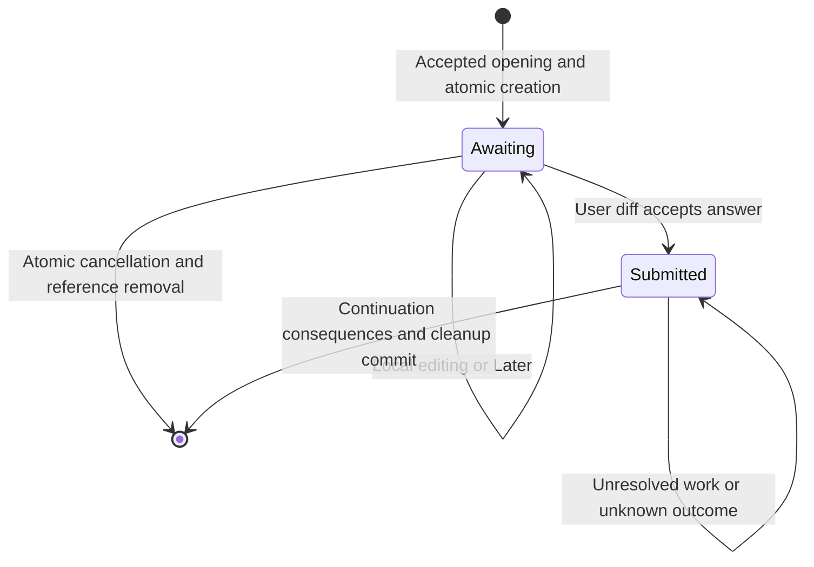

# General GUI implementation plan

Implement [the GUI design](gui-plan.md) for browser desktop and Babylon VR,
with an ontology API and semantic descriptors that a later client can reuse.
The deliverable is a general framework: the lobby and an independent application
use the same component classes, submission rules and presentation contract.

This is the implementation planning document for [QUD.25](nimbalyst://QUD.25).
The original design remains the product source of truth. The refinements below
record Yan's subsequent instructions: no new execution paths, convenient
authoring without event/reaction plumbing, class instances as components,
bound values returned to the originating ontology, and portability beyond
Babylon. API names below are proposed contracts, not implemented predicates.
Implementation starts after Fable's consultative review, independent disposition
of its findings, and Yan's plan review. The opening integration in section 5
must have an executable, reviewed contract before production implementation.

## 1. Scope and existing owners

Use the existing signed-goal ingress, proof scopes, diffs, atomic multiwriter,
runtime reaction catalogue, agent execution and agent-work recovery. No GUI
transaction lane, callback executor, broker, message ledger, retry queue or
private domain database is introduced.

| Responsibility | Existing owner and planned extension |
| --- | --- |
| Classes, values and common GUI semantics | Extend `quod:gui`; shared instance behavior is composed into participating ontologies using the existing founding/source-edit mechanism. |
| Components and application meaning | Ordinary `instance_of/2`, `isa/2`, `attribute/3`, actions and authored predicates in the application ontology. |
| Submitted input | Existing signed goals and committed diff events; all admitted fields form one transaction. |
| Application continuation | Existing `react_on/2` matching and authorized hosted agent; shared rules hide registration and correlation. |
| Recoverable unfinished work | Existing ontology facts and `agent_work_goal/5`; completion and related domain consequences commit together. |
| Representation | Existing Eidolon selection, lenses/encodings and marks; add a semantic GUI recipe and surface binding. |
| Authentication and live views | Existing client auth, signed ingress and authenticated view lifecycle; generalize the view adapter rather than add another execution service. |
| Editing | A shared client controller holds drafts; desktop and spatial adapters render it. Existing proof/source tools retain their own cursor semantics. |

Source anchors: [proofs](proofs.md), [multiwrite](multiwrite-architecture.md),
[runtime and agents](runtime-and-agents.md),
[common semantics](../priv/ontologies/common_predicates.pl),
[diff events](../src/predicates/quod_runtime_predicates.erl),
[transaction staging](../src/predicates/quod_transaction_predicates.erl),
[FIPA composition](../priv/ontologies/fipa_request.pl),
[authenticated views](../src/quod_client_simulation.erl).

## 2. Authoring and return values

An author instantiates classes, composes a form and declares a continuation.
They do not author `react_on`, `trigger_event`, subscription registration,
request correlation or cleanup for each form/widget.

Illustrative complete binding declaration, with ordinary component instances:

```prolog
instance_of((quod:gui):form, settings).
instance_of((quod:gui):text_box, name).
instance_of((quod:gui):slider, level).
instance_of((quod:gui):rotary_knob, angle).
instance_of((quod:gui):button, apply).

gui_children(settings, [name, level, angle, apply]).
attribute(settings, label, <<"Object settings">>).
attribute(name, label, <<"Name">>).
attribute(level, label, <<"Level">>).
attribute(level, range, range(0, 100, 1)).
attribute(angle, label, <<"Angle">>).
attribute(angle, range, range(0, 359, 1)).
attribute(angle, unit, degrees).
attribute(apply, label, <<"Apply settings">>).

gui_form(settings,
    [field(name, Name), field(level, Level), field(angle, Angle)],
    submit(apply, settings_entered(Name, Level, Angle))).

gui_initial(settings, name, Name) :- object_name(Name).
gui_initial(settings, level, Level) :- object_level(Level).
gui_initial(settings, angle, Angle) :- object_angle(Angle).

settings_entered(Name, Level, Angle) :-
    goal(object_settings(Name, Level, Angle)).
```

`gui_open(settings, Question)` is the convenient local entry supplied by shared
GUI behavior. It captures the exact owning ontology, form and authorized
responsible agent. The default human comes from authenticated context;
agent-originated questions obtain their human from authorized application state.
No caller-supplied human string confers authority.

`Question` is a correlation reference, not the future answer. The field
variables are freshly instantiated from `gui_form/3` when the answer is
accepted. The shared reaction invokes the declared continuation in a new proof
in the originating ontology. It does not resume the opening proof or retain
its stack, variables, locks or MVCC snapshot during human editing.

The example declares the application's meaning once. Several form instances
can reuse the same continuation. Parameterized forms, for example
`settings(Object)`, capture ground application context in their identity and
use correspondingly scoped control identities. Values not supplied by fields
must already be ground context; unbound continuation variables are rejected.

Initial values are a separate projection. They never bind the future input
variables. Empty text is a valid binary when policy permits it. A supplied
literal binding is a validation constraint, not an implicit setter. Shared
variables enforce ordinary Prolog equality between their declared fields.

The implementation must turn this example and a parameterized non-lobby
example into executable tests. Add no new Prolog module/import syntax:
`:` remains qualified-name data; foreign calls use anchored `::` scopes.
The short local entries delegate through the composed GUI behavior and the
catalogued vocabulary reference.

## 3. Class composition and the portable descriptor

One authoritative model consists of class membership, attributes, ordered
children, field bindings, initial projections and continuation declarations.
Compile it to ground semantic data; do not maintain a second mutable tree.
The vocabulary provides inherited defaults. Instance values override defaults
under an explicit singleton rule; incompatible equally specific classes fail
with a configuration reason instead of choosing an arbitrary class.

Resolve class closure through existing `isa/2` and `most_specific_classes/3`.
Generic recipe discovery currently enumerates direct instance classes; extend
that shared discovery where needed and test existing Prolog recipes too.
Class membership alone does not install runtime reaction clauses.

The proposed wire value is:

```prolog
gui_view(1, FormRef, Revision, SubjectRef, Appearance,
         component(FormInstance, form, Properties, Children)).
```

Every child uses `component(Instance, Kind, Properties, Children)`. Properties
are a closed semantic vocabulary: label/help, field type, initial value,
required/readonly/enabled, options with stable IDs, numeric range/step/unit,
layout, focus order and accessible description. Collections are proper bounded
lists. Text is binary, booleans are explicit, numeric units follow Quod measure
conventions. Arbitrary executable terms, callbacks, CSS, HTML, Babylon handles
and client-local IDs are excluded from the descriptor.

`FormRef` and `SubjectRef` use exact ontology anchors and instance identities.
A view occurrence, semantic instance and local draft are distinct identities.
Revision is a digest of the normalized semantic schema, binding/continuation
contract and relevant initial/context values. Canonical variable numbering
makes equivalent declarations stable. Submission rechecks that revision;
unrelated ontology commits do not invalidate a draft. Accepted values can
change without rebuilding an unchanged component layout.

Adapters support the same closed component suite. Unsupported descriptor
versions/kinds cause an explicit presentation refusal before opening succeeds.
They never silently drop a field. A future native client implements this
descriptor and the same typed signed submissions; it does not reproduce
domain policy or require rewriting form definitions.

## 4. Submission uses diffs and reactions

The client supplies only the question/form identity, displayed revision,
activated control and typed field values. The shared signed submission entry
checks authenticated human, exact subject, current permissions, schema and
complete field set. Unknown, repeated or missing fields and non-ground or
mistyped values refuse the whole submission. Disabled and readonly constraints
are enforced in Prolog even if a client is modified.

The default notification form uses `trigger_event/1`: an event is placed in the
committed diff without asserting a permanent answer fact. Existing applied-diff
conversion also supports authored domain assertions/retractions when those
changes are the application's intended state. There is no GUI-specific event
dispatcher, and ordinary submissions cannot supply arbitrary executable goals.

The shared behavior composes one guarded `react_on` rule per behavior/source
scope. It identifies the responsible actor with `me/1`, validates the authorized
form/response binding and constructs the declared continuation with submitted
values. A foreign actor uses the existing exact `from(Namespace, Anchor, Event)`
pattern and `subscribes/2` installation; authors do not hand-register each form.
Its continuation enters the originating ontology through ordinary anchored
`::` authorization. Callback execution does not inherit the human's signing
authority; the originating ontology must grant the selected agent that action.

Install shared executable behavior at founding or through the existing
authorized source-edit transaction. Do not assert executable rules per opening,
infer installation from the remote GUI vocabulary alone, or introduce a new
behavior loader. Exact source subscriptions follow the existing catalogue
lifecycle and are shared across forms from that source.

An event is a wake/occurrence, not proof of the claimed sender. Narrow entry
ACLs and the application continuation's authorization remain mandatory. The
lobby's broad owner grant is an intentional authority boundary, not evidence
that a GUI row cannot be forged. A cross-ontology receiver checks the exact
source identity and its own domain policy before acting.

Submission success means Submitted. A reaction's consequence is a subsequent
ordinary or atomic multi-ontology transaction. Applied/Saved is shown only
when that consequence is established. An event-only form promises occurrence
delivery under existing reaction semantics, not eventual execution after every
crash; forms promising recoverable completion use section 6.

## 5. Opening and live receiver integration

The required behavior is fixed: no connected intended human, no installed
authorized responsible handler, or refused capacity means Prolog failure.
No offline offer, hidden partial question, suspended editing proof, replacement
deadline or claim that network receipt and consensus are atomic is permitted.
An unreachable owner is an infrastructure error, not authoritative absence.

The existing signed control lane finalizes a selected proof before releasing
one transient owner operation. The existing runtime can match owner observations
and submit ordinary signed consequences. These are the reuse seams to examine;
they are not already a general GUI admission implementation.

The proposed integration responsibility is confined to those owners:

1. The authenticated client view owns a receiver for the exact human,
   connection incarnation and supported component version. Its admission is a
   signed read through existing ingress, not mere possession of a login token.
2. The existing runtime checks the exact hosted agent incarnation, installed
   shared behavior, signing authority and policy-owned capacity. No second GUI
   registry of agents or pending execution queue is introduced.
3. The selected presentation operation asks those owners for actual acceptance
   of the same opening identity. No network work occurs in a state owner's
   mailbox. Partial transient attachment is released on a definite refusal.
4. Where a question is durable, its creation and human discovery reference are
   one ordinary atomic transition through existing signed-goal execution.
   Any owner observation used to initiate it must have explicit authenticated
   custody; it cannot be smuggled into a write proof as a live dependency.
5. The opening result reports success only at the documented receiver-acceptance
   boundary. If durable creation has started, every later uncertain result must
   retain its exact signed operation evidence for ordinary outcome resolution.
   Such a result can never be converted into ordinary no-human failure.

**Contract requiring resolution before implementation:** current
`quod_effect:release_transient/2` returns `ok`, a definite refusal, or uncertainty
for physics control. It does not hand back/persist a later signed question
transaction. `prepare_signed_request/3` provides existing agent custody, but
its store transaction is itself a material transition. Reusing these calls
without defining custody and result ownership would hide a partial write.
Also, `quod_dtx:seal_admissible/4` rejects every nonempty diff with live
dependencies, including an event-only diff. `trigger_event/1` is not an escape
from that boundary.

The implementation-level admission trace must name the initiating signed
request, actual receiver acknowledgement, selected agent, exact durable
operation, custody owner before dispatch, cancellation/expiry boundary and
original caller's success/fail/unknown result. It must cover caller, socket
and agent death at each handoff. Resolve this with the existing owners and
operation machinery; no bespoke admission receipts, new transaction lane or
new question executor is approved by this plan. If the trace requires a
semantic change to those owners, record the concrete gap and review it before
coding rather than disguising it as already supported.

Receiver scope is explicit and anchored. For human-originated presentation,
use the originating authenticated connection. For an agent-originated question,
authorized human/application state selects a receiver scope; route through
existing authority/routing machinery. A local registry miss establishes absence
only for the selected authoritative scope. Unsupported/unreachable routing
remains distinguishable. Multiple tabs have distinct incarnations and drafts;
the policy chooses a receiving scope, never an arbitrary registry entry.

Opening acceptance is instantaneous evidence, not a promise of continued
connection. After acceptance, losing the human or agent does not cancel a
question or undo a committed answer. Presence and authored capacity remain
separate from question status and actual queue availability.

## 6. Questions and bounded current state

Deferred questions have ordinary classed instances in the originating ontology.
Keep only the current unresolved interaction: exact form/human/responsible
agent, revision, awaiting or submitted state, and the minimum accepted values
and operation custody needed while the continuation is unfinished. There is no
permanent `answer/…` archive or terminal-question table in current ontology state.

The human ontology contains exact discovery references, not copies of form
schemas, answers or status. Creating/removing a reference and the corresponding
question state is one existing atomic multi-ontology transition. Shared behavior
provides narrow projection, link/unlink and answer/cancel entries with explicit
Prolog policy grants; application agents do not gain access to the human's
private ontology. Source subscriptions and question references are different
things and must not become duplicate pending inventories.



Question identity must not become reusable when its row is removed. Allocate
from a monotonic counter scoped to the owning ontology, or bind to an existing
authenticated operation identity if the admission trace supplies one without
another allocation path. Select exactly one scheme in the opening contract;
`proof_draw/3` alone is not a uniqueness scheme. Distinct questions may share
one form. Missing/consumed questions fail on late submissions; they are not
silently recreated by the answer entry.

`gui_submit(Question, Revision, Control, Fields)` consumes awaiting state and
emits the correlated event atomically. With recoverable completion, it replaces
awaiting with submitted work in that same transition. `agent_work_goal/5`
selects this work using existing dependency invalidation and the shared runtime
queue. Both the reaction and work entry call the same guarded continuation.
Domain consequences, consumption of submitted work and reference cleanup form
one atomic transition. Duplicate wakes therefore cannot repeat completion.

Do not resubmit an uncertain operation under a new ID. Reuse existing exact
operation custody and outcome lookup. Current agent-work passes can advance
after unsuccessful work; they do not provide unconditional retries. Known
failure remains visible as unresolved work or a domain-defined failure until
an authorized dependency change/recovery action makes progress possible.
No readiness polling or GUI retry timer is added.

Concurrent submit/submit and submit/cancel proofs conflict on the same pending
state, so at most one wins. A rejected field leaves all pending state intact.
Hide/Later changes only the local presentation; cancel is a signed ontology
transition. Terminal cleanup removes framework state, while any intended domain
result remains in its existing domain owner. Ledger history still grows with
commits; bounded current state is not ledger erasure.

## 7. Client and representation work

Generalize [the form decoder](../client/src/world.js) and
[workspace adapter](../client/src/workspace-panel.js) around the semantic tree.
Replace the superseded flat-form dispatch rather than keeping two parsers.
Migrate console/editor descriptors into that tree and retain their existing
controllers and cursor behavior. Generic forms have local drafts and explicit
submission only. No duplicate source editor or ontology editing application.

Extract shared signed-view dependency/subscription lifecycle only where both
world and HUD projections need it. Keep one implementation of ordering,
owner monitoring, exact anchored dependencies, cancellation and deadline checks.
General GUI projections must work with no space, physics owner or simulation.
Existing native-client callers of any changed common transport contract need
compatibility coordination; native GUI rendering is outside this milestone.

The HUD reads its authorized discovery references, obtains each form/status
under normal ACLs and updates from scoped installed-state notifications.
Subscribe before snapshot. Retain current projections for the view lifetime;
invalidate affected dependencies only. Duplicate notices and unchanged renewals
do not rebuild layouts, replay history or write/sync files. Drafts survive safe
value refreshes, but a changed schema/target is explicitly stale and never
silently receives the old draft.

GUI Eidolons select semantic forms and appearance tokens. Spatial surface
bindings link a form occurrence to an existing mark/placement or the personal
workspace. Hit testing returns exact subject/control references. Appearance
does not confer domain authority or create a competing scene graph.

Deliver every family in the design's initial suite: nested form/panel/group,
row/column/grid/scroll/tabs; labels/icons/help/status/progress; text/multiline/
number; buttons; checkbox/toggle; radio/select/list; slider/rotary knob; basic
table; menus/dialogs. For each, specify semantic properties and desktop/VR input
equivalence. Numeric controls share range/step/unit semantics and offer exact
entry plus increment/decrement. Intermediate dragging/typing remains local.

Use the agreed tinted panel, initially 780 permille opacity, adjustable with
an opaque mode. Text, controls and input wells remain opaque. Larger text
reflows layout. Keep world-stable panels, Move/Recenter/Hide, a separate small
attention control, and a focus-driven keyboard that does not cover the active
field. New questions never steal focus. Local appearance/placement preferences
do not alter request identity. These are trial values, not headset certification.

## 8. Implementation slices and verification

1. **Executable contract.** Resolve section 5; freeze the API, identity,
   receiver scope, authority matrix, state cleanup and descriptor examples.
   Verify the small author example through real parser/proof seams. Fable
   review and independent disposition precede Yan's implementation approval.
2. **Semantic vertical slice.** Shared classes/composition, one form,
   continuation binding and ordinary signed submission. Prove class behavior
   outside the lobby, event-only answer semantics, narrow ACLs and fresh-proof
   continuation. No application-authored `react_on`/`trigger_event` plumbing.
3. **Questions and presentation.** Exact admission, HUD references, concurrent
   lifecycle, cancel/disconnect, recovery and unknown outcomes using existing
   owners. Do not postpone the negative admission cases until UI polish.
4. **Common adapters and controls.** One semantic decoder/controller contract,
   desktop and spatial suite, appearance and accessibility. Migrate existing
   tools and remove superseded dispatch in the same slice.
5. **Two elaborate applications.** Lobby settings and a nonphysical laboratory
   instrument component in an independent ontology. Include text, selection,
   checkbox, slider, knob and grouped fields; one callback accepts all values.
   Demonstrate a responsible agent hosted outside the component ontology and
   two concurrent questions using the same form.
6. **Integrated review and acceptance.** Freeze the actual tree, run applicable
   clean sequential gates with full logs/true exits, request the explicitly
   authorized Fable implementation review, independently disposition findings,
   and retain hardware results separately. No deployment or history migration
   is authorized by this ticket's implementation plan.

Production-seam tests must cover:

- Ordinary absence/refusal and infrastructure uncertainty; wrong human/anchor,
  stale connection and agent incarnation, missing handler/signing permission,
  refused capacity, failed alternatives, cut and rollback with no duplicate UI.
- All-field atomic validation, empty text, shared-variable equality, malformed
  trees and class ambiguity, multiple occurrences and isolated local drafts.
- Local and foreign reaction unification; forged events/rows, raw event calls,
  direct callback invocation and current domain authorization.
- Two openings, stale revision, duplicate answers, answer/cancel races, late
  answers after cleanup and cancel/reopen with a genuinely new identity.
- Agent loss before/after answer commit, recovery without replaying events,
  one completion despite competing wakes, and exact unknown-outcome resolution.
- Repeated unchanged operations through actual owners: count projection work,
  prefix reads, rebuilds, disk writes/syncs and registrations; all unnecessary
  repeated work stays zero. A real update still invalidates and applies.
- Repeated complete/cancel cycles return current framework facts and live
  registrations to baseline, apart from a bounded identity counter if selected.
  Preserve original outcomes; do not delete ledger evidence to achieve this.
- Client controller tests, browser spatial tests, and existing console/editor,
  signed-operation, runtime, multiwrite and reaction-metadata regression seams.

Hardware acceptance uses the intended headset and actual input devices.
Repository context names the original HTC Vive; confirm the browser/WebXR path
on that device rather than treating native OpenXR simulator results as coverage.
Record text legibility, bright/dark/moving scenes, panel transparency, seated
reach, target selection/mis-selections, keyboard entry, precise numeric input,
frame behavior and arm/neck comfort. Desktop screenshots and simulated XR are
software evidence only. Keep the hardware checklist outstanding until measured.

Report actual production/test/documentation line deltas and remaining risks.
Common UI components necessarily add functionality, but replacement work must
remove obsolete dispatch and duplicate lifecycle machinery. Mark the tracker
complete only when its required acceptance is met under the repository's
review/commit workflow; partial implementation or unrun headset checks are not
completion.
