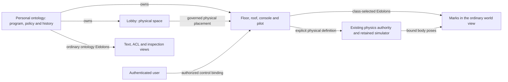

# Lobby built from governed spaces and ordinary Eidolons

Design for the default personal lobby. Implementation and deployment acceptance
are pending. This replaces the proposed lobby-specific browser physics startup.
It uses the [governed-space model](spaces.md),
[physics plan](governed-physics-plan.md), [native profile](physics-native.md),
[ordinary ontology representations](ontology-eidolons-plan.md) and
[atomic lifecycle](multiwrite-architecture.md).

## What the lobby declares

The `lobby` class is a subclass of `physical_space`, which is a subclass of
`space`. A personal lobby needs only its `lobby` instance declaration; shared
class-aware queries resolve the inherited physical-space and space membership.
Its containing ontology owns its program, policy and history. Those are
different roles, even when the default places everything in one ontology.

```prolog
isa(physical_space, space).
isa(lobby, physical_space).
instance_of(lobby, personal_lobby).
instance_of(lobby_floor, floor).
instance_of(lobby_roof, roof).
instance_of(prolog_console, console).
instance_of(agent, pilot).
```

These are existing class/instance forms; the instance names are an example.
`isa(physical_space, space)` already belongs to the shared space vocabulary;
it is shown here to make the ancestry explicit, not to duplicate its definition.
Use `space_instance/2` when testing inherited space membership: the raw
`instance_of/2` relation itself does not expand ancestry. Nonphysical information
spaces remain instances of `space` or another appropriate subclass, not `lobby`.
The lobby factory composes the shared space, agent and physics behavior and an
explicit default physical policy. The author chooses a physical lobby and its
contents; the client does not assemble a simulator or assign its authority.

The planned distinction remains: a bare class fact grants no permissions and
allocates nothing. The physical lobby's composed policy supplies enablement,
hosting delegation, resource allowances, body definitions and control rights.
Defaults are visible Prolog rules/configuration, editable under the real owner's
policy. Disabled or incomplete configuration remains an explicit state.

## One entity, several representations



The floor becomes an ordinary named entity with an Eidolon, replacing its
anonymous, hardcoded scene part. The roof and console follow the same selection
path. The sky remains decorative and acquires no collision body. Preserve the
existing appearance assets; this redesign concerns their domain meaning and
behavior, not another visual-art campaign.

Use `space_member/2` for organizational containment and the existing
`space_place/3`, `space_placement/3` and `physical_assignment/3` path for physical
participation. Remove `lobby_device/2` as a parallel membership inventory.
Selection may derive a decorative member's authored visual transform; a physical
entity's occurrence uses its admitted body binding and pose. Do not keep
`device_placement/3` as a second physical location to synchronize with physics.

Each solid entity owns one `physics_definition/3`, with its definition allowance.
The shared admission action creates the existing live body binding. Body IDs come
from `physics_next_body/2`; no separate list assigns magic IDs to the floor,
pilot, roof or console. Control and viewpoint configuration resolve the admitted
pilot body through that binding. Local source definitions need no duplicate
foreign state. Definitions owned elsewhere use exact references, explicit
subscriptions and the retained foreign projection already implemented.

The default definitions describe the annular floor and its opening, the roof
with its oculus and entrances, the console's solid parts, and the pilot capsule.
Use the supported solid/compound/surface geometry. An appearance mesh or picking
box is never the collider. The pilot spawns supported by the floor, facing the
console, with the existing grounded motion and authored eye viewpoint.

Playing and edition Eidolons depict the same anchored entities. The console
opens the existing proof/source controls. Opening the personal ontology uses its
ordinary `ontology_ref(Namespace, Anchor)` instance and applicable Eidolons.
Editing a visual occurrence's layout cannot relocate a body or change ownership.
Do not make the broader 3D ontology workbench a prerequisite for this lobby.

## Founding and automatic installation

1. Ordinary signup and `provision_lobby/1` prepare complete source and founding
   configuration, create the ontology, establish its exact reference, request
   hosting and link the account using the existing atomic creation path.
   There is no source-repair action on login or reconnect.
2. The newly installed committed configuration selects a bounded first-host
   obligation for the explicitly authorized node. This is shared agent/physical
   setup, independent of the word `lobby`, and must work with a second non-lobby
   physical-space fixture. The node already has an authenticated identity.
3. The existing node executor prepares stable key custody for the exact new
   agent reference and `none/0` assignment. This happens after founding: a key
   bound to the genesis anchor cannot be inserted into that same genesis without
   introducing a circular identity dependency.
4. One ordinary signed transaction establishes the authority's initial host/key,
   admits the declared physical contents through the shared space actions,
   establishes the pilot/control/viewpoint bindings, and completes the initial
   configuration. All related facts commit together. A failed body validation,
   ACL check or resource allowance aborts that transition; do not split it to
   evade limits. No native world may appear from partial staging.
5. The existing physics resource owner installs the committed selection and uses
   its existing signed activation, run fence and recovery path. The normal world
   view reports recovering until installation and a valid controlled view are
   ready. Body travel stays paused on unavailable physics.

Enablement is committed intent, distinct from installation and readiness.
The default may declare enabled intent at founding; with no committed authority
assignment the existing projection selects no native world. This avoids a second
lobby-only disabled-to-enabled protocol. An explicit later disable withdraws
the resource and is never undone by opening the lobby.

## Concrete shared gaps to resolve before implementation is accepted

The runtime already has a node execution slot, hosted-agent work selection,
stable first-key preparation, ordinary initial-host actions, operation custody
and physics activation. It does **not** currently connect them into recoverable
first-host installation driven by committed configuration. The failed lobby
approach filled that gap in the account client.

Prefer extending the existing physics installation/activation owner to handle
the initial unassigned authority, using the existing node execution slot for
the first authorized action. Reuse its signed-request custody and exact-outcome
rules; do not introduce a general work subsystem just for this transition.
Policy selects work and grants narrow actions; Erlang only carries out that
selection through existing owners. Do not add a bootstrap service, general job
registry, new queue or browser handshake. The node's own policy and the target's
ACL must both authorize the operation; hosting an ontology alone is not
permission to mutate it.

Recovery needs special care: current FIPA continuation explicitly permits a
distinct attempt after an unknown result. That rule cannot be borrowed for
initialization. Retain the exact signed request before it can be sent, using
the existing custody owner and outcome path. Resolve that identity across owner
restart, disconnect and lost reply. Neither a pending configuration fact nor
a new runtime incarnation permits another submission of an uncertain write.
The implementation must demonstrate custody-before-send and the crash windows;
merely observing a monotonic cursor is insufficient. The direct-effect journal
currently retains prepared effects, not arbitrary unexecuted signed goals, and
must not be described as already providing this missing capability. The precise
extension of the existing physics request state, including refusal/revocation
and cancellation before an authority exists, is a required design-review point.

Two narrower composition checks are also required: local definitions must pass
through the shared admission path without a fabricated self-subscription, and
the class-selected scene must resolve a local entity's current body binding.
Preserve existing foreign subscription checks and exact identity validation.
Verify these against the real owners before changing their contracts.

## Replacement and verification

Remove the unpublished `lobby_startup/1`, `start_lobby_physics/2`, account
`lobby-physics` journal stage and disabled-space setup button. Remove the deployed
`complete_lobby_setup` source-repair path as part of the coherent replacement.
The account client retains signup/provisioning and exact outcome recovery only.
Keep the existing physics engine, signed controls, activation custody and view
controllers. Update current documentation when the replacement is implemented;
preserve historical evidence, including the superseded draft's tests and review.

Acceptance requires fresh ordinary signup on the deployed candidate, not a
manually configured test world. Verify actual landing, floor and console
collision, roof collision where reachable, and authored openings through desktop
input. Inspect exact entities, placements and physical definitions through their
owner and another ordinary representation. Editing or removing a solid must use
the existing structural transition and update its retained simulation correctly.

Also cover a non-lobby physical space; a nonphysical information space; denied
and revoked setup; wrong anchors; stale initial assignment; disconnect before
and after submission; lost replies and restart with the same uncertain request;
deliberately disabled physics; and unchanged reads/reloads with no new domain
writes, history replay or geometry rebuild. Legitimate simulation stepping is
measured separately. Use the standing clean sequential release gates and the
requested Claude Fable review. Desktop results do not claim physical VR comfort
or keyboard acceptance.

The authorized redeploy is a clean candidate refound with complete default
ontologies. Verify the exact new image, source and healthy fleet, then purge only
the obsolete candidate ledgers under the existing deployment procedure. The
separate main network and user key files are outside that deletion scope.
