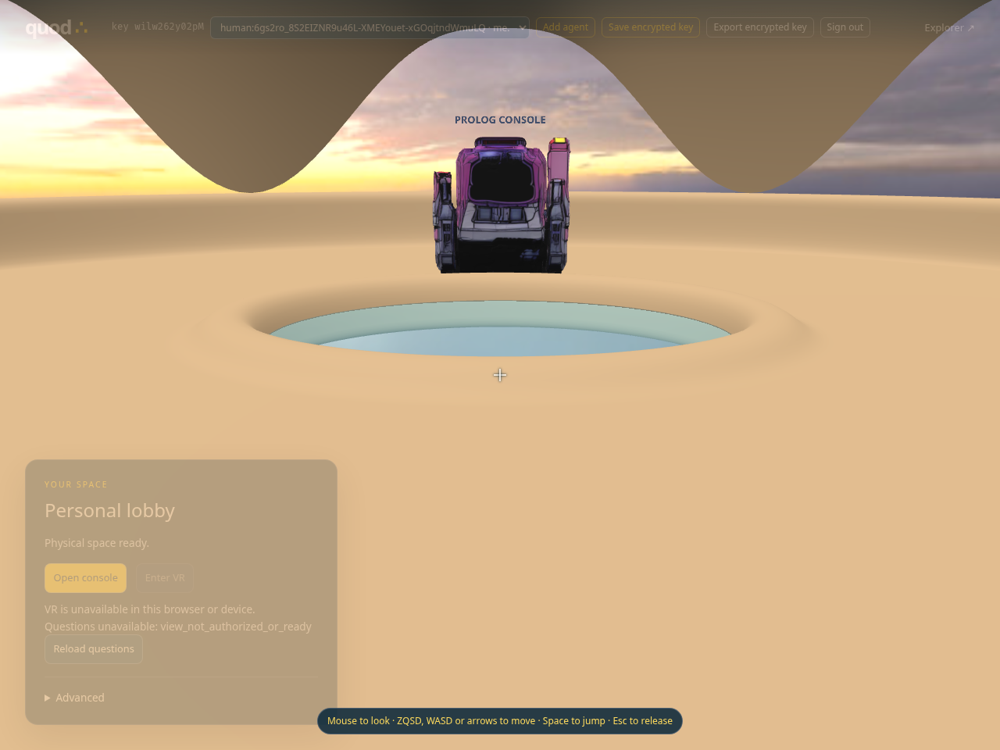

# Lobby safety release 0.7.271

Delivered to https://192.168.1.10:30519/ on2026-10-16. Implementation commit
`121e8b4fc5b254aaf89085f5653ad8b68effbc10`; separate version label
`265d2193f0f9d1b061711a4003e97e2a84f2833e`.
Image digest `sha256:5d33f698ca3bf0fa227d1c06bf4e8efe0fa93e892af60e67a07397737c4d823e`.

The central opening has a downward-curved glass cover and authored collision.
The outer coping has collision; default walking is2.5m/s and Space launches
at3m/s (about43cm rise). Existing signed control, native world, authorized owner
and ontology policy are reused. Production delta130 added/36 removed lines,
net+94, excluding generated assets, binaries, tests and documentation.

The old blue fall was reproduced on270: physics/projection stayed active with
no pageerror, but the camera fell outside the fixed40m sky sphere and exposed
the navy clear colour. Closing the opening removes that physical route.

## Review and release checks

Fable04 approves core jump, shared vertical-progress correction and non-vacuous
rim experiment; Fable05 approves keyboard drive handoff. No remaining blockers.
The display hints/preview label received independent review. Review scopes and
unchanged-file receipts are retained in the parent evidence directory.
All11 frozen sequential gates05 pass:4009 EUnit/0,148 Common Tests/0,native
debug/release,Clippy,18 client test files,UI build/lint,xref,Dialyzer,release.
Every gate has true childexit0 and unchanged frozen inputs. Label-only changes
are separate; every image input matches a blob in the committed tree.

## Deployment boundary

Candidate job `quod-finality-candidate-v6-20260926` is version90/index864393,
with8 healthy allocations,0 restarts,18 ready system ontologies and root
`8E3314264F847487FEFDB04A34F7E2B74BCBB1CA41357A73AFDD3F6D0C8BD9D8`.
The candidate was cleanly refounded under Yan's explicit deployment/purge
instruction. All8 exact oldv8candidate volumes were deleted only after fleet
and desktop acceptance. Newv9volumes remain. Separate main job246/index826727
and frontend1/index846370 were verified unchanged. Browser key files excluded.
Reload and use Create account with the existing key on the reset candidate.

## Actual desktop acceptance

Desktop04 reused the one account created once in01; no setup or execute write
was resubmitted. It verified the exact served glass digest, support on the bowl,
Space jump/landing (observed rise0.42775m), actual horizontal rim contact at
Z-8.30566m,walking2.44565m/s,owner read,console access,and reload0writes with
same identity,anchor and native incarnation. No pageerrors. Visual01 uses only
ordinary mouse-look and shows the glass on the deployed scene;0domainwrites.

Initial acceptance01 assumed an exact centre stop and waited forY<.3 although
the body stopped farther across the curved bowl atY.498.02 compared a live
Uint8Array against its JSON object form despite identical anchor bytes.03's
second timed airborne key gesture was dropped/missed under the existing
one-command rule; its first jump and landing were definite. These stopped
runs and true exits remain intact.04 corrects harness assumptions, keeps all
actual safety checks, and explicitly leaves midair refusal to the already
passing deterministic real-owner tests. No runtime changes followed gate05.

Physical VR keyboard/comfort was not tested. At exact wall-skin contact the
native support query may conservatively refuse a jump. A discrete key press
while another control is in flight may be dropped; no queue or uncertain
resubmission is introduced. Optional questions remain unavailable, as before.
The exact founding-proof heap peak was not measured; the complete atomic
factory passes under the unchanged64MiB cap. Profiles,keys and cookies are
excluded from these archives.
