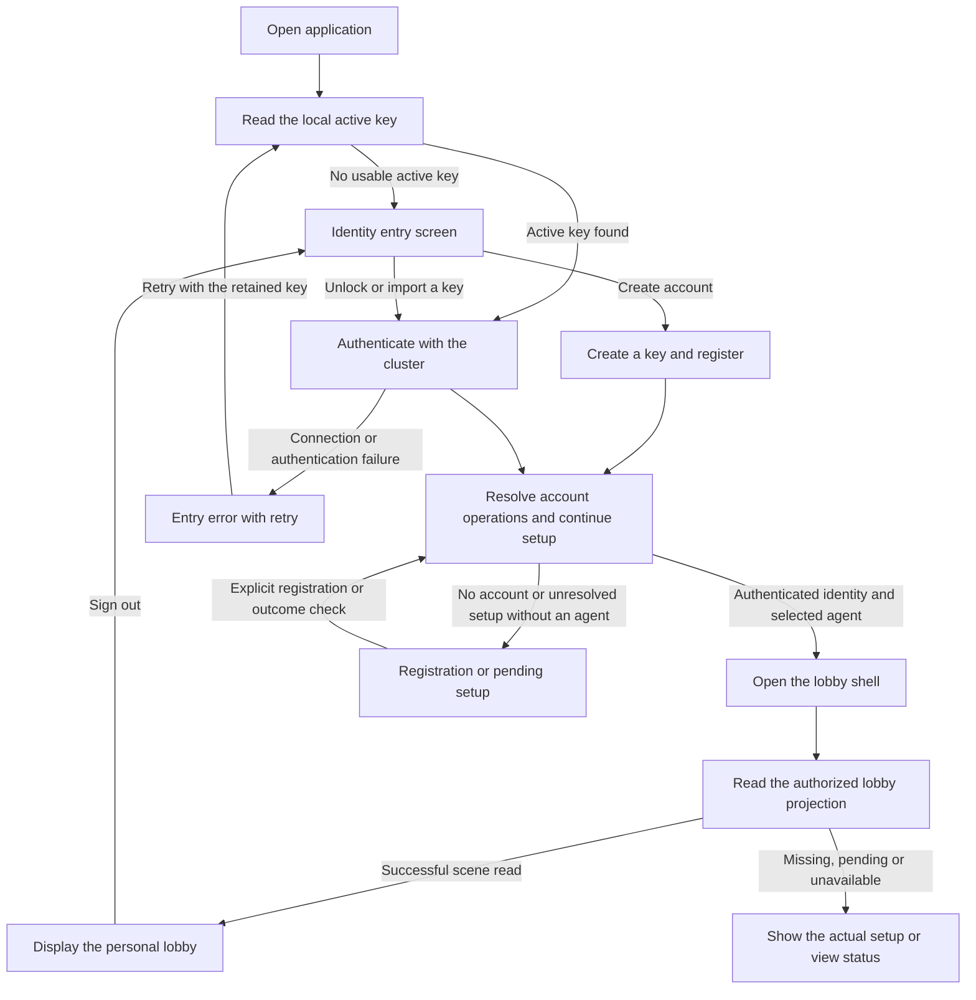

# Client and world direction

The current browser foundation has key handling, authentication, signed
Prolog goals, retained answer cursors, unresolved-operation resolution and
Explorer. Bundled ontologies define rendering, modelling, material,
environment and lobby vocabulary. Client code can render supported
descriptors and assets. These pieces do not yet make a complete shared
simulation or editable VR world.

The intended world model keeps semantic facts, permissions and meaningful
consequences in ontologies. Scene indexes, meshes, visibility, interpolation
and per-frame physics working state are rebuildable or transient. Physics
measures interactions; ontology rules decide their domain meaning and
durable consequences. Ordinary and immersive clients consume bounded
projections of the same world state.

The [governed space contract](spaces.md) defines organizational containment and
optional exclusive physical admission independently of ontology ownership.
Class membership alone enables no simulation.

An exact ontology is an ordinary `ontology` instance identified by
`ontology_ref(Namespace, GenesisAnchor)`. Its source workspace and ACL,
explicit-interface and live-route inspection Eidolons use the same class and
instance selection as other representations. Anchored ontology marks retain
that identity across views. The [inspection contract](system-ontology-acls.md)
describes authorized reads and edits; displaying an ontology in 3D changes
neither its owner/history nor its independent space or physics policy.

## Application startup

The normal application entry is the TLS client's root URL. Startup first
establishes the user's identity; it does not present an anonymous lobby.
The standalone read-only Explorer is a separate surface. This presentation
contract does not change server authorization or make hiding a control a
permission check.

### User-visible lifecycle

These are presentation states derived by the existing session and view owners,
not another persistent state machine. Their display rules are:

| State | Visible interface | Next action |
| --- | --- | --- |
| Starting or restoring | Identity card with progress; no registration buttons, lobby canvas, world controls or Explorer link | Complete the local key check, authentication and account recovery |
| No active identity | Identity card with **Create account**, encrypted-key import, and unlock when a saved encrypted key exists | Explicitly create a key or recover an existing one |
| Authenticated key without a selected agent | Account registration with that same key | Create the account; disable creation while operations remain unresolved |
| Pending setup without a selected agent | Pending status and **Check account setup** | Resolve the retained operation; do not submit it again |
| Entry failure | Actual error and **Try again** | Retry restoration/authentication without replacing the retained key |
| Authenticated identity and selected agent, entry work finished | Lobby shell, followed by the signed scene projection or its actual error/setup status | Use the lobby when available; otherwise use the existing recovery controls |
| Signed out | Identity entry screen; lobby unmounted | Explicitly create, unlock or import a key |

The shell's exact current mounting condition is
`!entering && identity && agent`. It is not proof that a personal lobby has
been provisioned, that the selected agent is authorized, or that its scene is
available. Those facts come from signed Prolog queries. A session error after
this condition is met is displayed in the world status instead of being
silently treated as a successful lobby load. **Finish account setup** is an
explicit action for an account whose lobby setup can safely continue; it is
disabled while an operation remains unresolved.

### Identity and account ownership

The browser owns the local signing key and its operation journal. The key is
not itself a user account. Authentication binds the session to the cluster's
network identity; the remembered account is selected for that network and
contains an exact ontology namespace, genesis anchor and agent instance.
Local references do not confer authority. Prolog owns signup policy, account
and lobby creation, hosting and authorization under the existing
[atomic write contract](multiwrite-architecture.md).

For a first registration, the client creates a key, authenticates it, submits
the ordinary signed signup action, remembers the committed account, and
continues with the ordinary signed lobby-provisioning action. If a key is
already authenticated but lacks an account, registration reuses that key.
There is no automatic replacement identity or second account on failure.

For an established account, loading the page restores the active key from
IndexedDB, authenticates it, resolves retained operations and selects the
account before mounting the lobby. A normal reload of a completed account
does not submit signup or lobby creation. Resolution of an interrupted signup
may continue its authorized lobby-creation handoff after the exact parent
commit is established. The existing operation journal retains that handoff;
timeouts, missing replies and reconnects never authorize resubmitting an
unknown original or inventing a rejection.

Automatic return requires the active key to remain usable in the same browser
profile and origin. A saved encrypted key is a separate recovery mechanism
and requires its passphrase. Signout clears the active key; it does not delete
the account, its lobby, or a saved encrypted key. Startup does not poll for
readiness or bypass identity restoration with a temporary preview identity.

The current key loader returns no active key both when none exists and when
IndexedDB cannot supply a usable key. The identity entry screen therefore
means that no usable active key was recovered, not proof that no identity was
ever stored. Corrupt saved agent references can also fail session initialization;
the entry card does not yet provide a dedicated repair flow for that case.

### Implementation and verification boundaries

[Session](../ui/src/Session.tsx) owns entry progress, identity recovery and the
entry card; [App](../ui/src/App.tsx) mounts the lazy world behind that card.
[Key handling](../client/src/key-provider.js),
[account setup](../client/src/accounts.js) and the
[operation journal](../client/src/operation-journal.js) retain their existing
responsibilities. [World](../ui/src/World.tsx) owns the subsequent projection,
setup status and console. Saving/exporting a key and other ordinary session
work must not unmount the lobby merely because `busy` becomes true.

Browser acceptance must cover an empty profile, successful registration,
delayed restoration without a registration or lobby flash, automatic return
with the same account, failed-connection retry without key replacement,
signout, and console use after entry. Count actual signed execute requests:
an ordinary reload or connection retry of a completed account must create no
new domain writes. Unknown-operation recovery must additionally preserve the
original operation identity and distinguish a committed setup handoff from a
resubmission. Retain execution logs and results separately from this contract.

## Mesh-backed Eidolons

The implemented [mesh contract](eidolon-mesh-support.md) extends the existing
class-selected Eidolon recipe, modelling and `mark/7` rendering path. A mesh
supplies geometry and appearance; the anchored Prolog subject, recipe, asset
digest and view occurrence remain distinct. The default lobby's Prolog console
uses a packaged `console.glb` in its playing view while keeping its existing
subject and actions. The edition view retains its structural recipe.

The first profile admits public, self-contained static GLB with triangle
meshes, transform hierarchies, core PBR materials and embedded PNG/JPEG images.
It rejects animation, skins, morphs, cameras, external resources and extensions
before loading. Prolog policy owns resource allowances; the client verifies the
digest and measured use, shares one decoded template, and gives each placement
its own transform and picking identity. Imported names and metadata cannot
create subjects or permissions. A pinned offline workflow converts FBX, glTF,
OBJ, STL and polygon PLY and records conversion diagnostics and provenance.
Private assets still require authorized byte delivery and publication; a
digest grants no read access.

The current client lives under `client/` and the shared browser shell under
`ui/`. The server's TLS client endpoint is `src/quod_client.erl`.

## Authoritative physics contract

This is the contract for the shared simulation. The implemented first server
profile is described in [the retained native adapter](physics-native.md); it
covers optional explicit-geometry simulation, activation/recovery and the obstructed-door consequence through the runtime. It supersedes the authority, recovery and observation proposals
in the archived [client/world direction](outdated/client-world-direction.md) and
[consequence direction](outdated/world-consequence-direction.md). Scene
streaming for physical bodies is available for one local authorized client view;
remote multi-viewer projections, general physics interactions, headset interaction
and world editing still require implementation and validation. Personal lobby
provisioning and static scene projection are available through the startup path
above; they do not establish the physical door interaction's acceptance.
The [runtime contract](runtime-and-agents.md) and
[atomic write contract](multiwrite-architecture.md) remain the substrate.

### Authority and restart fencing

Physics is optional. A space whose committed policy does not enable simulation
starts neither a physics agent nor a native simulation resource. An information
request alone does not enable it. Each simulated world has one committed
physics-authority assignment to an ordinary
hosted `agent_instance_ref(Namespace, GenesisAnchor, Instance)`. The first
profile places that instance and the world's physical structure in the world's
own ontology. It uses existing agent hosting, key custody and signing grants;
neither the physical node, a client nor a native simulation handle is the
authority principal. Delegating this role grants only the world's explicit
observation and checkpoint actions, not unrestricted world writes.

The engine runs on the node currently hosting that agent, selected by committed
Prolog hosting policy. The first profile simulates all bodies in that space on
that node. Different spaces can use different hosts; other ontology participants
and viewers receive authorized projections. Distributing one space's body
calculations among several nodes is deferred until measurements justify it and
cross-node collision, attachment and ownership-transfer rules are specified.

Every active simulation has a fence
`(WorldRef, AuthorityRef, HostEpoch, RunGeneration)`. `WorldRef` includes its
ontology's genesis anchor. `HostEpoch` is the existing agent assignment epoch;
`RunGeneration` is a committed, strictly increasing world generation, never
reused across authority changes, host changes or simulation restarts. A local
PID/incarnation additionally authenticates owner messages, but cannot replace
the committed generation. Ticks and native handles are local to one run.

An authorized activation action compares the expected authority and generation,
checks the current `agent_hosted/4` assignment, and commits the new generation.
Changing the authority agent changes that assignment in the same transition.
A host move uses existing `assign_agent_host/6`, including its epoch increment
and key revocation; the old run fails its hosting prerequisite immediately,
even before a replacement run is activated. A simulation restart on the same
host keeps the hosting epoch but must activate a new run generation. Competing
activations conflict on their expected state; none may silently rebase.

The runtime first quiesces the previous local run, then uses its existing
hosted actor's signed-goal path for activation. Only the replacement simulation
incarnation may install the resulting fence. It restores current structure and
recovery state before publishing ready, stepping or emitting observations. If
activation is uncertain, resolve that exact operation before proceeding. A
stored request with no outcome may have never been submitted. An explicit
Prolog-policy-authorized cancellation may instead revoke that exact pending
activation atomically: compare its custody and expected generation, retain its
original signed request as cancelled custody, and remove its permission to
activate. Cancellation is not a claim that the original operation was rejected
and must never be inferred from timeout. An old activation and cancellation
conflict through their ordinary transaction dependencies; whichever commits
first prevents the other. A successor then activates its own fresh generation.
A reconciliation with the same live owner and unchanged inputs neither activates
another generation nor rebuilds the simulation. A generation commits authority;
only an owner notification certifies installation readiness.

A fresh incarnation never adopts a generation just because it finds that record
in the ontology. Installation is bound to its own activation and local owner
incarnation; an activation left uncertain by a dead owner remains a recovery
obligation. The resource installer detects an absent run or mismatched host
assignment and sends an authenticated activation-needed notice to the selected
hosted actor. This bootstraps same-host restarts without requiring a changed
domain fact, a historical reaction or a running simulation to activate itself.

Commands, frames, observations and checkpoints carry the complete fence.
Proofs check it against committed state, including the current hosting epoch
and active signer, through ordinary OCC dependencies. Consumers discard old
fences after installing a newer one. During a partition, an isolated client
may display stale motion; it cannot claim freshness or commit consequences
against a superseded assignment. Failure suspicion alone grants no authority:
host recovery uses existing observer policy, prepared custody and consensus.
Without the required recovery/commit quorum the world remains unavailable.

### Identity, revisions and structural edits

An entity is an anchored domain subject. A body has an explicit stable identity
under that subject; it is distinct from a recipe, mesh digest, visual occurrence
and native body/collider handle. Multiple visual occurrences do not create
multiple physical bodies. Deletion and recreation must not reuse a retired
body identity or revision. The owner alone maps native handles to these names.

The revision contract is deliberately separate from tick progression:

| Revision | Meaning and change rule |
| --- | --- |
| Entity revision | Committed authored edit version. An edit carries the expected version; an intervening edit conflicts. |
| World structure revision | Advances in the same transaction as any change to effective physical structure. It also fences negative observations such as an empty doorway, whose dependency is more than the named contact pair. |
| Body revision | The world structure revision at which that body's effective physical description last changed. It is a tag, not another independent counter. Unaffected bodies retain theirs. |

Physical structure includes colliders, mass/material parameters used by physics,
authored transforms and their ancestor frames, body type, joints and attachments.
A live body descriptor binds its source entity and exact assignment/definition
revisions. Governed source edits advance affected body and world revisions in
the same atomic transaction; retained verified subscriptions install that change
automatically. Explicitly materialized reusable recipes remain a different
choice: adopting another recipe version is a world structural edit. Changing
an authored parent likewise invalidates affected body revisions; old colliders
cannot remain authoritative after those dependencies change.
An appearance-only edit changes the authored entity revision without changing
physical structure. Unchanged geometry checks and ordinary motion advance
neither edit nor body revision. Activity/control state, such as which close
request is active, has its own exact committed request identity and guards.

An edit commits its new description, revisions and checkpoint invalidation
together. The simulation installs the affected bodies/constraint group at a
step boundary, then publishes the installed revision. Outputs never mix new
geometry with old body mappings. The first profile resets affected bodies to
their new authored baseline with zero velocities; preserving a moving pose
requires an explicit, revision-checked checkpoint in that edit transaction.
Unrelated bodies keep their live pose. A deleted body cannot be resurrected by
a delayed frame, observation, asset load or checkpoint.

Observations carry the installed world structure revision and the relevant
body revisions. Acceptance requires those versions still be current. This
conservative world fence rejects even an unrelated physical edit racing an
observation; narrower spatial dependencies are outside the first profile.
This includes grabs and releases, which change attachments. Body tags do not
give the current engine row-level OCC: its read versions are per predicate, so
otherwise unrelated checkpoints or edits can also conflict. This first profile
accepts that contention and observation loss; it makes no busy-world throughput
claim. A certified rejection is distinct from an unknown outcome.
A supplied snapshot height is provenance, not a substitute for these checks.
If the observation commits first, the later edit applies to its result; if
the edit commits first, the old observation is rejected, never retargeted.

### Baseline, pose and checkpoint ownership

| State | Authoritative owner | Persistence and use |
| --- | --- | --- |
| Authored baseline | World ontology, through authorized editing actions | Durable structure, placement, physical parameters and attachment intent. Simulation does not overwrite it each tick. |
| Transient pose | One retained simulation resource on the authority's current host, under the ontology runtime lifecycle | Live transforms, velocities, solver/contact state and hot controls. Clients interpolate authorized projections; their predictions never become world truth. Unsaved motion is lossy. |
| Durable checkpoint | World ontology, through the authority's authorized checkpoint action | Explicit, bounded recovery state with source fence, structure/body revisions and sample identity. Ledger custody and ontology recovery provide durability; a local native snapshot is only a cache. |

A checkpoint records quantized transforms in named frames, linear/angular
velocities and the restart state required by the supported activity. Units,
quantization and schema version are explicit; native handles and opaque solver
memory are excluded. Joint/attachment-connected bodies checkpoint and restore
as one compatible group. Current domain facts, such as a stopped door or held
object, always constrain restoration; a checkpoint cannot undo them.

Pose frames bind the fence, completed simulation tick, installed structure
revision and each body's revision and frame of reference. Receivers never
interpolate across a run/body change or treat frame arrival as durable progress.
Hot controls also bind the current body/activity and input sequence; obsolete
or duplicate controls cannot apply twice. Recovery discards them, including
unapplied impulses, rather than reconstructing them from past reactions.

Keep only the current committed recovery checkpoint per group in current
ontology state. Replacement is revision-checked and cannot move its sample
backwards in `(RunGeneration, Tick)` order; conflicting data for the same sample
is rejected. A structural edit invalidates the affected group's checkpoint
unless it supplies a compatible replacement atomically. Recovery does not search old
ledger prefixes for a more convenient pose. It uses the compatible current
checkpoint, including one from an earlier authority/run, or the current authored
baseline with zero velocities if none exists. Invalid or unsupported committed
checkpoint data is a visible recovery failure, not a silent baseline fallback.
No mixed old/new attachment group may be restored.

Separate groups can restore from different ticks. Before publishing ready, the
owner performs bounded mechanical settling under committed world policy, with
impact occurrences and domain consequences suppressed. For example, an old
crate checkpoint may overlap a more recently closed door. Settling must respect
the committed door/attachment state and allowed recovery displacement/tolerances;
it cannot open the door or release the object to repair the overlap. An
inadmissible or unresolved configuration is a visible recovery failure. Pose
corrections are exposed as a recovery reset, not as impacts. An authorized
checkpoint-discard or structural edit provides an explicit recovery exit;
there is no silent fallback from corrupt or incompatible state.

Runtime collapse, simulation-owner death or ontology replay quiesces the run,
invalidates its local receipts and hot controls, and requires a fresh generation
before motion resumes. A host failure follows the same restoration after the
existing hosted-agent recovery chooses a successor. Unsaved pose is lost;
rollback to the checkpoint/baseline is observable and allowed. Clients discard
old interpolation buffers at the new fence. Reconstructing broadphase/contact
caches establishes initial levels but does not synthesize impact occurrences.
Replay restores facts and resources without re-emitting historical reactions.

For this initial lifecycle, runtime overflow/collapse deliberately retires the
simulation too: it is a continuity break even if the native resource could have
survived. Ordinary unchanged reconciliation is not such a break. This costs a
rewind and activation under overload and must be measured. Keeping a run alive
across runtime collapse would require a separately verified ownership contract.

Checkpoint frequency, retained samples, body counts, work and byte budgets are
Prolog policy. Unchanged resource checks must not replay history, rebuild bodies
or write/sync files. Explicit checkpoints and real durable changes keep ordinary
durability. Owner notifications, scoped to world, revision and incarnation,
drive installation and readiness; simulation stepping is not readiness polling.

### Authenticated observations and the oracle boundary

A sample is immutable data captured outside the durable proof. Its envelope
binds schema/units, full fence, installed structure revision, semantic body IDs
and revisions, sample identity, activity/request identity when applicable,
quantitative payload and validity bound. All quantities crossing into Prolog
are bounded integers or explicitly scaled fixed-point values. Motion frames
and observations are filtered through each recipient's authorized world view;
knowing an identity grants no access to its pose or contact data.
Each sample is one coherent completed step, not independent queries of position,
velocity and contact at different ticks.

The retained owner delivers that sample with authenticated owner/incarnation
metadata to the existing runtime/reaction path. Normal Prolog event-pattern
unification is preserved. A public event with the same term is not an
authenticated physics sample. Read-only matching selects the authority actor's
ordinary signed action carrying the frozen data; it neither changes domain
state nor performs a new physics query. The action checks signer, assignment,
fence, revisions, validity, request state and policy before interpreting the
measurement. Failed candidates and aborted transactions leave no consequences.

Current sealing rejects live observations in proofs with durable changes
([bridge classification](../src/quod_predicates.erl),
[sealing regression](../test/quod_dtx_tests.erl)). Do not implement the archived
`physics_contact/2` live-query proof path or relabel live data as a committed
query. Sampling precedes signing; the signed request binds the complete sample.
Preserve its signed expiry and the original absolute caller deadline through
matching, queueing and submission. A validity policy can shorten those bounds,
never extend them; an expired sample is not renewed by re-signing it.
Validity bounds admission and use of the evidence, not the completion time of
an already admitted transaction. Existing commit/recovery obligations survive
caller timeout; passing the expiry cannot establish rejection.

The authority is a **trusted physical oracle**. Validators authenticate the
signer, authorization/policy and committed revisions/dependencies under the
existing transaction protocol. They do not run contact simulation or verify
that the reported physical contact happened. Consensus does not turn a signed
measurement into physical proof. A faulty or malicious authority can misreport
within its grants; world admission policy must explicitly accept that trust.
Native determinism may aid debugging but does not change this boundary.

Other Prolog agents may request bounded physics information through the existing
authenticated agent/goal paths. The physics agent checks the caller's access and
answers with a coherent sample carrying the same run, revision and validity
binding. Read-only queries do not require durable request/reply facts; explicit
domain conversations use existing actions and FIPA support when needed. An
inactive or recovering simulation reports unavailable, not an invented clear
condition, and does not start itself merely to answer. Using a measurement for
a durable consequence still requires the authorized signed-sample action above;
a query answer cannot bypass sealing or confer the authority agent's rights.

### Levels, occurrences and uncertain writes

**Levels** describe a replaceable current condition, such as door obstruction.
The key is `(fence, structure revision, subject, activity, condition)`; samples
have increasing sequence numbers. Contact partners and their revisions are
payload, not part of the condition's identity: `clear` must replace `obstructed`
even when the partner set changes. The owner retains the latest bounded sample
per key, coalesces unsent superseded samples, and can lose intermediate changes
on overload/disconnect. Neither absence nor loss means `clear`: before the
first sample, after expiry, or after a fence/revision change the level is
`unknown`. Prolog may retain the latest accepted level and sequence, but its
validity remains bounded; an old `clear` fact is never indefinite permission.
Expired or superseded keys release transient samples; retention cannot make
their recorded levels current again.
This is a condition measured at the sample, not proof that it remained constant
until commit or expiry. Collision safety remains the simulation's continuous
responsibility; validators cannot establish it from a validity timestamp.

A changed level wakes affected work through owner notifications. A fresh
measurement after recovery can establish the level again without replaying an
old event. Sequence checks reject stale or duplicate samples, and an unchanged
valid level needs no new durable write. A freshly sampled validity renewal is
a real change when needed by a new action; extending old evidence is forbidden.
Intermediate obstruction edges can be lost, so levels cannot count impacts or
authorize cumulative damage. A lasting condition can be resampled; a vanished
transient condition cannot be reconstructed from its later level.

**Occurrences** name distinct measured events, such as two separate impacts,
even when their payloads are equal. Their identity is `(fence, occurrence
sequence)` from one ordered stream per world run; each freezes its own payload.
The owner retains unsent occurrences within Prolog count/byte/age allowances.
The first profile explicitly permits loss before durable acceptance: overflow,
expiry, owner death and superseding edits may discard unsent occurrences,
with visible loss/rejection accounting while the owner survives. A crash marks
a stream discontinuity; the number of unreported lost samples may be unknown.
Occurrences are not coalesced by event term,
regenerated from history, or promised lossless by the reaction queue.

For a durable occurrence, one ordinary action commits its acceptance cursor,
payload binding, domain consequences, required recovery checkpoint and related
receiver changes in one atomic transaction. Every body whose rewind could
repeat that consequence needs a compatible checkpoint at or after the event
tick. The transaction may retain an already committed later checkpoint if it
also satisfies the resulting domain state; it must never replace it with an
older pose. If no suitable checkpoint exists, it installs the required
post-event checkpoint atomically. A consequence without that recovery coverage
is outside this profile. A gameplay rule requiring
lossless capture before submission needs a separately specified durable capture
bridge; a generic outbox or hidden event log is not part of this contract.
Pure presentation cues may remain best-effort and need no durable consequence.

There is at most one submitted occurrence operation awaiting resolution per
stream. Thus an unknown result blocks later durable impacts throughout this
world; transient simulation may continue and its unsent events may be lost.
This is an explicit availability limit until the original operation can be
resolved, not a timeout-based rejection or implicit authorization to advance
past it. Current ontology state retains the accepted sequence high-water mark
and latest payload binding; sequences at or below it cannot execute again.
Gaps identify discarded/unaccepted samples, not permission to fill them later.
Operation evidence supplies the original result; a cursor alone must not report
a duplicate as successfully applied. A reused identity with different data is
rejected. An unsent old-run cursor can retire once its fence is closed.
Saved signed-request custody still requires exact outcome resolution: closing
the fence does not establish whether an earlier submission committed. Committed
history retains audit evidence; no in-memory contact receipt history is needed.

Queue admission, reaction matching, a timeout or a missing result is never a
commit acknowledgement. After submission, retain the original operation
reference and request binding and use existing outcome resolution. Absence is
uncertainty, not certified failure. Never retry the sample as a fresh operation,
extend its deadline, or drop its unresolved reference under an unsent-sample
retention rule. New samples that could repeat an unresolved non-idempotent
consequence wait for resolution. A level may be sampled afresh, but cannot
bypass this rule for any occurrence-like consequence it triggers.

Restart first recovers committed outcomes and existing transaction obligations;
a late committed result remains valid even if its sample's fence has since
closed. Fencing prevents new acceptance, not recovery of already committed
work. If original request/operation custody cannot be recovered, a non-idempotent
continuation remains blocked; the bridge must make that binding recoverable
before submission. It must extend the existing work/custody owner if necessary,
not invent a second executor. Historical event replay is never the repair path.

`trigger_event/1` may emit live notifications after these transitions;
`react_on/2` keeps ordinary unification. Reactions are lossy wakeups, not another
commit lane. Consequences that form one transition, including effects on a
receiver ontology, are already in its atomic transaction. Any genuinely later
required work is an explicit domain obligation recovered by existing resources
and agent work, not an assumption that an old reaction will execute again.

### Acceptance timelines

These are required implementation scenarios. All rejection checks use the
production signed action, transaction and resource-owner seams.

**Chair — authored edit while moving.**

1. Chair C has authored baseline A, entity revision E, body revision B and a
   compatible checkpoint P. Run G publishes a falling pose; neither A nor E/B
   changes per tick.
2. An authorized edit based on E moves or resizes C. Its commit advances E and
   world structure revision S, tags the affected bodies with S, and invalidates
   their checkpoint group. At installation C resets to the new baseline. An
   appearance-only edit would keep its physical revision and falling pose.
3. A queued pre-edit impact/checkpoint either commits first and is included in
   the edit's subsequent state, or loses the revision race and is rejected.
   Delayed old-body frames cannot move the newly edited chair. Deletion followed
   by recreation uses a new body identity.
4. Kill the simulation on the same host: HostEpoch stays fixed, G advances,
   and C restores a compatible current checkpoint or the edited baseline.
   Replay cannot restore its former shape, rerun its old impact, or retain an
   old generation's frame. Repeated unchanged reconciliation does no rebuild
   or persistence work; a real edit still installs once.

**Door — requested close, obstruction and impact.**

1. An ordinary authorized action commits close request R with its expected
   state. This establishes `close_requested`, not `door_closed`. The runtime
   installs the motor intent and publishes actual angle while it moves.
2. An obstacle stops the door partway. A level sample binds R, the run, S and
   the door/obstacle body revisions. Its action atomically records R's blocked
   result, removes its active close intent and checkpoints the stopped pose,
   with any required receiver state. `door_closed` remains false. The failed
   physical objective does not roll back already executed motion.
3. Race that sample with an obstacle edit, cancellation or replacement R2.
   The old sample cannot finish R2 or certify the new doorway as clear. If a
   `clear` level is lost/expired, the condition is unknown. Completion needs a
   fresh observation of the closed pose for the still-current request; a
   previously clear doorway alone cannot establish closure.
4. Two impacts at the same point have different occurrence sequences; each
   accepted durable consequence commits once with its restart checkpoint. An
   identical delivery cannot repeat damage. Lose a submission reply: resolve
   its original operation; no timeout starts another damage operation.
5. Collapse the runtime or fail the host: retire the old run and restore the
   committed blocked/stopped state and checkpoint. A still-pending R first
   resolves any saved signed request, then waits for a fresh level before
   resuming. A missing terminal outcome, including a request whose proof failed
   before ordering, requires explicit authorized cancellation; it is not a
   rejection. Recovery never assumes an old clear sample survived.
   Ledger replay emits no old impacts, sounds or close reactions. Unsubmitted
   impacts may be lost, while committed consequences survive lost live notices.

**Held object — attachment, release and host recovery.**

1. The holder first commits an authorized grab request against the expected
   attachment state. The authority samples the grip and fulfils that exact
   request in its own signed action: attachment, measured grip frame, physical
   revisions and related holder state commit atomically, across ontologies if
   needed. Installation replaces the free body with the held constraint.
   Controller poses remain hot inputs. The user cannot author an authoritative
   measured checkpoint merely by submitting a pose.
2. A hand or geometry edit invalidates the whole affected constraint group.
   Concurrent release and edit compare the same attachment/revisions; one
   loses the race. A delayed pre-grab impact, release command or checkpoint
   cannot apply to the new attachment or reattach a released object.
3. Release likewise has an authorized request followed by the authority's
   sampled fulfilment. The latter checks the current request, permission and
   attachment, then commits detachment and the measured recovery pose/velocity
   checkpoint for the free body together. Grab and release each require two
   committed transitions in this profile: requested, then physically fulfilled.
   Acceptance of the request alone never means detached. An uncertain fulfilment
   is resolved by its original operation before an incompatible continuation.
4. After same-host restart or host takeover, a still-held object restores with
   its holder from a compatible group checkpoint or their committed baseline
   and grip frame. Lost tracking freezes at that recovered pose until current
   authorized control or an authorized release; disconnection alone cannot
   grant release or ownership. Old hot inputs have the wrong run fence.
5. Replay restores the latest attachment state, never a historical grab,
   impulse or impact reaction. If release committed before failure, restore
   the free body's checkpoint; if it did not, retain the attachment. An
   unresolved release must settle before either state is advertised as final.

### Existing path and concrete missing bridge

The implementation path is committed world actions → existing runtime resource
selection/installation → retained simulation → authenticated immutable sample
→ existing hosted-agent signed action → ordinary sealed atomic transaction →
installed consequences and live reactions. The existing owners are
[agent hosting policy](../priv/ontologies/agent_instance.pl),
[runtime resources and reactions](../src/quod_runtime.erl),
[hosted execution](../src/quod_agent.erl),
[outcome resolution](../src/quod_client_goal_ingress.erl) and the
[multi-ontology transaction path](multiwrite-architecture.md).

The typed `physics_worlds` resource now selects committed authority, baseline
physical structure and policy allowances, and retains one native simulation under
the runtime. Its own activation uses durable original signed-request custody
and outcome resolution before installation. Same-host restart commits a fresh
generation; no successor adopts a dead incarnation's generation. The
[adapter profile](physics-native.md) describes failure, backpressure and recovery
boundaries, including authored revolute-joint/stopped-angle checkpoints, free-body rest
checkpoints and rejection of unsupported joint/checkpoint declarations.

The reusable hinged capability selects physical commands, restores supported
stopped-angle checkpoints and hands authenticated immutable samples to the exact authority
actor through the existing event matcher. The actor commits original signed
request custody before submission. A blocked/closed consequence and checkpoint
and any composed receiver changes commit atomically. Hinged and rest samples
share one signed envelope with exact command and participating revision fences.
Pending outcomes are resolved exactly. Custody replacement requires a matching
finished request, certified terminal rejection, or an explicit cancellation plus
changed participating physical revisions. The hosted actor's queue alone
is not durable custody. Impact-operation custody and occurrence acceptance
remain outside this implemented profile.

Frames stay in the retained simulation. One local signed view receives bounded
current poses directly from that owner under their current fence; motion does
not flood the runtime queue each tick. Governed live queries and signed hot
controls use the installed owner. Eligible free dynamic bodies support bounded
pushes and explicitly requested rest checkpoints through the same custody and
observation path. Authored edits atomically invalidate the affected checkpoint;
restart loses uncheckpointed motion and never replays pushes. Durable contact
actions remain outside the implemented profile. Checkpoint/cursor writes retain
the live resource and process only actual input changes.

Current parser/request limits are also an integration constraint
([goal limits](../include/quod_client_goal_limits.hrl),
[runtime admission](../src/quod_runtime.erl)). Separate encoding constraints
from configurable resource allowances, move the latter to Prolog policy when
they block the slice, and report the actual exceeded resource. Never split an
atomic consequence/checkpoint transaction merely to evade a constant.

Extend existing resource selection, owned-observation delivery and work/custody
only for those gaps. Keep domain interpretation and budget allocation in Prolog;
the native owner holds mechanical state, not a private domain KB. Installation
must subscribe before snapshot, wake only changed dependencies and preserve
cancellation/deadlines. Verify through the real owner that unchanged repeats
do not parse history, rebuild state or write/sync files, while real changes do
install. No new broker, message ledger, reaction replay engine or consensus
protocol is needed for this contract.
