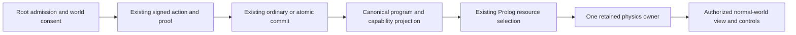

# Governed physics in existing spaces

Design proposal for the existing-world integration task. This document does
not amend the accepted runtime contract or claim implementation, deployment
or physical acceptance. Predicate examples describe proposed vocabulary.

## Recommendation and scope

Keep physical definitions, activation policy and control bindings in the
existing world ontology. Add the missing generic, governed transition for its
effective external-predicate capabilities through the existing proof, commit
and projection owners. Preserve the world's namespace, genesis anchor and
complete history, including its immutable founding module manifest.

This deliberately extends the founding-only module-membership contract in
[the actor architecture](outdated/ontology-actor-architecture.md#3-prolog-is-the-authority-erlang-is-the-bridge).
It needs an explicit architecture decision before server implementation.
The removed bridge-selection experiment is not its implementation or evidence.

A separately founded physics component is appropriate when a domain actually
needs separate ownership. It is not the recommended default merely to obtain
a missing bridge: it would turn structure edits, authorization and withdrawal
into cross-ontology composition and require new world/reference semantics.
Keeping the existing owner avoids those obligations for an ordinary space.

No hot compiler, dynamic code download, new capability process or second
physics owner is proposed. Native code still ships through a coordinated
release. Prolog decides whether an eligible ontology may use it.

## Space and physical space

The shared vocabulary should express these immediate edges:

```prolog
isa(space, thing).
isa(physical_space, space).
isa(lobby, space).
```

A space is a domain subject inside an ontology, not the ontology container
itself. One ontology can describe many subjects. The first supported physical
profile remains one simulated space per containing ontology; the taxonomy
does not silently promise several independent simulations there.

An individual lobby may have both `instance_of(lobby, personal_lobby)` and
`instance_of(physical_space, personal_lobby)`. Other spaces and lobbies need
not be physical. Class declarations belong in shared domain vocabulary;
membership and policy belong to the owning world. Reuse the existing `isa/2`
closure and class selection, including subclasses and ambiguity handling.
`instance_of/2` is class-first; do not assume it automatically expands ancestry.

Resource selectors remain local read-only proofs. Adopt shared behavior through
the existing authorized source-composition/edit path, with exact vocabulary
references and explicit local declarations. Do not make resource selection
follow foreign class graphs or mirror another ontology's changing knowledge
base. Changes to an adopted physical definition require explicit adoption and
the normal physical revision transition.

Three different questions have different owners:

| Question | Authoritative answer |
| --- | --- |
| Does this subject have physical semantics? | Its Prolog class membership and inherited domain rules |
| Is its simulation desired, and under whose authority? | The world's existing `physics_space/3`, hosting, grants and allowances |
| Can commands run now? | The existing runtime and physics owner's installed revision and run fence |

Class membership does not load native code, create an agent or grant control.
The physical-space behavior must guard all activation paths with the same
class/policy prerequisites. An enabled declaration on an ineligible subject,
an ambiguous authority or missing required configuration is a visible
configuration refusal. A disabled physical space retains its definitions,
control epoch tombstones and recovery custody while allocating no simulator
or active physics actor. Looking at a world never enables it.

## Existing path and the precise extension

Founding already composes `source` and `terms` through
[ontology lifecycle](../src/quod_ontology.erl). Authorized source edits can
install Prolog behavior in an existing ontology. Shared class references alone
do not import that behavior or external predicates.

[Canonical projection](../src/quod_committed_projection.erl) loads external
modules from genesis. [Commit validation](../src/quod_commit_validation.erl)
rejects ordinary and atomic changes to the founding manifest.
[The loader](../src/quod_predicates.erl) permits coordinated implementation
updates of declared modules, not membership changes. Editing a packaged file
does not update an already-founded world's source or grant a missing module.

The proposed extension is one revision-checked capability transition:

1. Root Prolog policy admits a shipped capability contract for an exact target
   ontology; the target's own policy consents under the signed principal.
   Bridge availability does not imply either grant. Keep the native module's
   context, dependency classification and domain invocation checks.
2. An ordinary authorized action compares the current effective-set revision
   and stages its replacement. Admission uses the pre-transition policy;
   staged rules or grants cannot authorize their own installation. Related
   world definitions and desired activation state commit in the same existing
   transaction. A changed root grant participates through the ordinary atomic
   multiwriter path only when existing policy authorizes the complete change;
   unchanged root policy is a certified read dependency. An asserted grant is
   not its own authorization. Canonical validation must require the same
   admission evidence and revision guards for every write to the protected
   effective declaration, including raw source edits.
3. Genesis initializes the effective set. Later certified transitions change
   it. The founding manifest stays immutable provenance. All consumers obtain
   one current effective view through the canonical projection; no separate
   runtime selector maintains another module list.
4. Canonical apply installs the registry and committed program consistently
   before publishing the new applied state. Registry construction is a local
   projection operation with no network I/O, simulation allocation or external
   effect. Duplicate predicate ownership and collisions with protected
   framework predicates are rejected. Installation failure makes the scope
   unavailable; it never publishes new policy with an old registry.
5. The existing runtime then selects desired resources from committed Prolog.
   The existing hosted actor performs signed activation with retained request
   custody. Only the physics owner's installation notice establishes readiness.

Root admission authorizes a transition; the committed effective set owns the
resulting permission in that world. Removing admission for future grants does
not secretly revoke an installed capability. Withdrawal targets the existing
world explicitly through its pre-authorized governance action. If root policy
and an installed grant must change together, use one atomic transaction. This
avoids a local copy of root policy becoming a second mutable authority.



There is no physics bridge call inside the proof that first grants that bridge:
that proof stages declarations using its original capability snapshot. Desired
activation can commit with those declarations; actual activation follows
installed state through the existing lifecycle. This is the ordinary distinction
between committing desired state and installing its resource, not a second
domain transaction invented to reconnect related facts.

The precise durable descriptor and authorization API must be settled in the
implementation contract. They must reuse canonical terms, existing OCC/read
dependencies and the shared reducer rather than introduce another commit lane.

## Concurrent proofs, withdrawal and recovery

Proof workers retain their original capability snapshot. A governed bridge
attempt records its relevant capability dependency before success, failure,
negation or backtracking can discard it. Sealing and ordinary/atomic validation
reject a superseded dependency. Granting a bridge cannot rescue an old proof
that lacked it, and revocation cannot be bypassed by an already-open cursor.
Existing prepared-transaction reservations and resolution remain authoritative.

Transient commands additionally check current installed capability permission,
control epoch, body revisions and full authority fence at application. On
learning a relevant committed invalidation, the owner stops accepting old
input before installation completes. An old read can report its identified
snapshot; it cannot authorize a fresh effect. Snapshot retention and retirement
belong to the existing proof/projection lifecycle.

Failed proof branches and aborted transactions install no registry or native
resource. Undo after a successful commit is a new authorized compensating
transition, not history rewriting. Simulation installation failure is reported
as committed configuration that is unavailable; it is not a retroactive abort.

Disable/revoke stops new use and quiesces the run. It preserves signed requests
with uncertain outcomes and any committed recovery obligations. Withdrawal of
a bridge is refused while an obligation still requires that bridge to finish;
new-use grants can already be revoked. Resolve original operations or use an
explicitly authorized cancellation where the existing contract permits one.
Neither timeout nor disabling proves rejection. A retained binary or registry
needed for recovery is not permission for new domain operations.

Re-enable uses a fresh run generation and the existing compatible checkpoint
or authored-baseline contract. Corrupt or unsupported recovery data remains a
visible failure. Replay reconstructs the same capability transitions and facts
through canonical apply, without historical reactions, inputs or impulses.
Late committed outcomes remain recoverable after their old run has retired.

Every validator, proof engine, follower and recovery consumer must support the
new contract. Use the existing cold coordinated release: drain/stop old
participants, retain ledgers and keys, restart compatible participants, verify
replay and pending operations, then reopen traffic. There is currently no
automatic release fence to assume. Unsupported participants must not rejoin.
An older binary cannot be called a safe rollback once history requires the new
contract; recovery then requires a compatible artifact. No refound is authorized.

## Physical definitions and editing

Reuse `physics_body/7`, `physics_agent/5`, `physics_viewpoint/6` and
`physics_control/4` from [the retained profile](physics-native.md). A human's
control binding selects an existing agent; it does not impersonate that agent,
spawn a body or grant its signing key. Camera position and orientation are
authored relative to its named body/component frame.

Supported solids, convex hulls, rigid compounds and fixed triangle surfaces
remain explicit physical definitions with Prolog resource allowances. A visual
GLB, picking AABB or Eidolon supplies no collision authority. Lobby collision
geometry must preserve its actual openings, roof and console contours; neither
one enclosing hull nor an old simplified visual recipe establishes fidelity.
Source geometry may be deliberately converted and adopted as a physical asset,
with its own validated definition and revision. Unsupported moving concave or
articulated shapes produce a refusal rather than an approximation.

Use the existing world structure revision and affected body tags. Geometry,
physical frame changes and checkpoint invalidation commit together; appearance
and camera-only edits do not alter collision geometry. Camera/control changes
still retire their affected registrations and tracking calibration. Moving
doors invalidate live placement previews through current motion; they do not
need a structural edit each tick. Unrelated bodies keep their live state.

Future noncubic chunks use this same explicit surface/compound contract, exact
content/revision references and aggregate geometry allowances. A coherent edit
must install before affected travel resumes. Missing collision coverage means
unknown/unavailable, never empty space. Terrain streaming and generation are
not added to this task merely to reserve those semantics.

## Ordinary client views

The normal signed world projection should explicitly describe whether physics
is absent, disabled or enabled and identify its exact world and optional
authorized control binding. Runtime availability is attached from the owner;
it must not be fabricated as a durable Prolog fact. Denial, failed reads and
missing configuration cannot masquerade as a successful nonphysical view.

Generalize the existing scene/simulation projection to permit ordinary visual
marks alongside explicitly body-bound occurrences. Preserve authored parent
transforms and camera frames. Establish one validated visual binding set and
matching physical revisions; do not race two independent `setMarks` writers.
Only declared body bindings receive simulation transforms. Decorative scenery
does not acquire a collider, and unseen colliders need not become visible.

Subscribe before reading, use exact owner/dependency invalidations and discard
stale responses after world, mode or principal changes. Absent/disabled views
also need dependency subscriptions so an authorized later enablement can wake
them without polling or an attempted native allocation. A physical edit pauses
affected movement until matching structure is installed. The existing local
single-view limitation remains explicit: a remote authority or occupied view
reports unavailable until forwarding/multiple viewers are deliberately added.

| Situation | Required behavior |
| --- | --- |
| Nonphysical or disabled world | No simulation allocation; observer travel only where the view policy permits it |
| Enabled but unavailable world | Show the actual status; pause body commands; no automatic switch to observer travel |
| Ready world, no control binding | Authorized observation; viewing does not bind, spawn or reposition an agent |
| Occupied spawn or collider edit into the agent | Report invalid placement and freeze unsafe travel; allow an explicitly granted, fully checked corrective reposition |
| Teleport or snap turn | Recheck complete body configuration and supported path/rotation at application; a preview is not permission |
| Door moves or collider is deleted | Use current mechanical state; stale queries/frames cannot preserve or resurrect old geometry |
| Control switch, revocation, disconnect or authority change | Retire old registration/input; retain durable binding/custody as policy requires; reopen with fresh signed state |
| Unknown command result | Resolve/reconcile through the existing original-operation or transient-registration contract; never replay the uncertain command |

Observer travel, commanded body travel and tracked head movement remain three
different operations. Desktop and XR use the same authored mount. Head offsets
stay within the permitted tracking mapping; moving a physical head/component
uses its normal collision-checked control. Looking around never silently moves
the body's collider. Hardware tracking and comfort still require real Vive tests.

## Verification and implementation boundary

One server-writing owner implements the agreed contract. First prove the
generic capability transition and recovery behavior through the real owners,
including grant/revoke races, failed/caught branches, atomic abort, retained
cursors, missing modules and concurrent prepared work. Exercise at least two
distinct existing ontology identities, including a non-lobby class, and assert
unchanged genesis anchors/history prefixes before and after activation.

Then cover mixed scene projections and the behavior table above with distinct
supported agent shapes and camera mounts. Reuse existing physics regression
coverage, and add tests at the changed seams rather than another simulated
domain owner. Class instantiation, signed view reads and reloads must produce
no unrequested domain writes or simulation allocations.

Trace unchanged repeats through proof, runtime and native owners. Require zero
history replay, registry/geometry rebuild and storage write/sync for unchanged
selection and observation. Measure legitimate simulation steps separately.
Verify a real capability/geometry/control change installs once, invalidates the
right dependencies and leaves unrelated bodies intact. Current whole-world
structure fencing and per-predicate OCC remain conservative; this design does
not claim spatial or row-level invalidation that the engine lacks.

Live acceptance must first identify Yan's current personal lobby with signed
reads. The [October 10 refound](evidence/hot-controls/deployment-256-refound/README.md)
means the [October 9 identity](evidence/player-movement/live-lobby-20261009/README.md)
is historical; a catalogue's lobby-vocabulary anchor is not a personal lobby.
Retain the current target's identity/history before and after the authorized
change, and exercise actual desktop collision in its normal view. Fixtures
prove generic behavior but cannot substitute for that acceptance. Vive/WebXR
landing, contact, tracking and comfort remain the separate hardware obligation.

The immediate architecture decision is whether to authorize the proposed
root-governed effective-capability transition in the existing ontology. This
proposal authorizes no runtime mutation, deployment, history reset or completion
of the integration tracker item.
