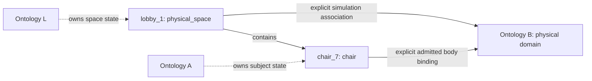

# Spaces, ontologies and governed physics

Design proposal, not an accepted runtime contract or implementation. It follows
Yan's distinction between ontology containers and virtual objects, the
[requested Fable consultation](evidence/space-ontology-review-20261010/review-02/fable-review.md)
and the [checked disposition](evidence/space-ontology-review-20261010/disposition.md).
Examples below are conceptual vocabulary unless explicitly identified as existing.

## The model

An ontology is an authenticated Prolog program and committed state/history
scope. A space is a domain subject describing a place. A class describes kinds
of subjects; instances are individual subjects. These are independent concepts.

| Concept | Meaning |
| --- | --- |
| Class | A type with declared ancestry and applicable behavior/representation |
| Instance | A particular subject with an identity and state owner |
| Space | An instance that can contain other instances, including other spaces |
| Physical space | A space with explicitly governed physical participation and rules |
| Ontology | The code, committed-state, authorization and history boundary that makes claims about subjects |
| Agent | A classed instance authorized to act; identity, signing keys, hosting and its process remain distinct |
| Simulation domain | The set of bodies advanced together by one designated physics authority under one run fence |
| Eidolon/mark | A representation recipe or visual occurrence; neither creates another domain subject or body |

Use the existing class semantics:

~~~prolog
isa(space, thing).
isa(physical_space, space).
isa(lobby, space).

instance_of(physical_space, my_lobby).
instance_of(lobby, my_lobby).
instance_of(chair, chair_7).
contains(my_lobby, chair_7).
~~~

A class can itself be inspected or depicted as a first-class subject. A visible
depiction of the chair class is still different from chair_7. The existing
common predicates already select a code Eidolon for classes and an ontology
Eidolon. A universal metaclass hierarchy is unnecessary for the first slice.

Class membership does not import code, install a bridge, start an actor or grant
permission. Existing isa/2 supports ancestry; instance_of/2 is class-first and
does not itself expand ancestry. Dispatch must use the actual vocabulary and
normal authorized proof paths, including explicit foreign scopes where needed.

## An ontology as an ordinary domain object

Introduce the reflective class ontology below thing. An exact ontology
reference can be a subject of queries, lenses, actions and Eidolons. Its
namespace, genesis anchor, authorized source/interface information and contacts
are exposed through their existing owners.

This object is a representation of the runtime scope, not a second mutable
record of it. A source-code view reads that scope; an authorized edit uses its
existing action path; creation uses ordinary ontology lifecycle. Editing a
contact field cannot transfer history, ownership or invocation authority.

Identity is the anchored reference. A network address is a replaceable route
to it. Derive route/host metadata from existing routing and hosting owners;
do not persist another directory in ontology-object attributes.

Root's system catalogue describes system ontologies, not all private scopes.
Likewise public source-query shapes are not a complete callable-method
catalogue or an invocation grant. Reflection starts with exact known references
and preserves each owner's read and action policy.

The existing pinned root, verified genesis, signing and consensus/lifecycle
mechanics still establish trust. Making their subjects inspectable through an
ontology class does not replace that foundation or require a new metacircular
runtime. The shared reflection vocabulary's precise owning ontology remains a
small vocabulary-placement decision, not permission to alter bootstrap.

## Containment is separate from code and state ownership

Distinguish the following relations:

- What class a subject belongs to.
- Which space contains it.
- Where its behavior and reusable definitions are available.
- Which ontology owns each mutable fact.
- Which physics authority currently simulates an admitted body.
- Which occurrences depict the subject.

A chair's state may belong to ontology A while a room belongs to ontology B.
Entering the room does not migrate the chair's identity, code or entire KB.
A user looking at the chair invokes its authorized behavior through the
appropriate anchored owner.

One possible placement separates these relationships explicitly:

These arrows name distinct contracts, not automatic permissions. L and B may
be the same scope when its founding capabilities and governance permit it.

Contains is domain membership, not automatically physical presence, permission
or a coordinate transform. An inventory, a room, and a visual gallery may each
need different containment policy. Physical participation requires an explicit
body/subject binding, admitted description, frame and authority assignment.

Rooms can be nested. Sharing a building's simulation authority does not allocate
one simulator per room. The first profile can use one physical space per
simulation domain without turning that into a class or ontology invariant.
Crossing between rooms under one authority is ordinary motion. Crossing between
independent simulations is an authority-transfer operation with additional
requirements.

## Owners for physical participation

For a subject owned by A and simulated in domain B, the proposed responsibilities
are:

| State | Authoritative owner |
| --- | --- |
| Subject identity, nonphysical attributes, reusable physical-definition source | A or the explicitly named definition owner |
| Space's containment relation and admission policy | The space owner |
| Exclusive embodiment assignment/epoch, when required by object policy | One designated subject owner, normally A |
| Accepted body descriptor, adopted source revision and physical structure revision | B's ontology |
| Transient pose, contacts and queued bounded input | B's retained physics owner |
| Checkpoint and physical consequence custody | B's ontology, composed atomically with other affected owners |
| Human binding, motion/viewpoint grants | Their explicitly designated domain owner; the first existing profile keeps controlled agents local to B |
| Rendering occurrences | Authorized scene projection; no independent physical truth |

An adopted descriptor is B's explicitly accepted physical definition at an exact
source revision. It is not a mirrored mutable copy of A's ontology. Reuse the
existing door-adoption pattern, but general object/body adoption is new work.
Updating a shared recipe does not silently alter adopted bodies. An actual
instance-form edit must update its active physical participation and revisions
through the responsible owners.

Local resource selection reads committed local declarations only. Foreign
authorization and definition adoption happen through ordinary proofs with
certified dependencies. Do not add foreign policy reads, history replay or
network waits inside the runtime selector.

Read-only consent from A is sufficient only when the policy permits independent
admissions. If an object must have one active physical embodiment, two spaces
must not both obtain it from the same unchanged consent fact. Its owner advances
an assignment epoch in the same ordinary atomic transaction that changes B's
admission/body. This is a delegation record, not a second pose store.
Multiple permitted embodiments need explicit policy and separate body identities.

For a visible space owned in L and a simulation domain hosted in B, the exact
space-to-domain association remains a real domain contract. B does not acquire
the space's identity simply because its native resource is registered there.

## The bridge decision

Defer mutable external-predicate membership. The previous recommendation to
make effective-capability evolution the default prerequisite is withdrawn;
its exact text remains in the review's frozen source tree.

The first candidate for an existing world that lacks the bridge is ordinary
founding of a physics-capable ontology and an explicit association from the
existing space to that simulation domain. The original space, namespace,
genesis and history remain intact. Its physical implementation can live in a
different scope without replacing the space with a new user-visible world.

For a newly founded world, co-locating its space and physical state in an
ontology already founded with the physics module is also legitimate. Neither
one-ontology-per-space nor separate-ontology-for-every-space is a universal
requirement. Choose boundaries for governance, lifecycle and useful ownership.

Existing ontology_ref and foreign signed reads are useful foundations, not a
completed composition API. Define the space/domain link, consent, body/subject
bindings, normal-view discovery, projection dependencies and withdrawal.
Provisioning must use the existing create lifecycle and custody with the
related source/link changes in its existing transaction; resource readiness
still follows installation. Do not invent child writes into a not-yet-founded
scope or a second provisioning coordinator.

The existing controlled-agent profile assumes the agent is local to the
simulation ontology. A first slice may explicitly author such an agent there
and bind the original human principal to it. That does not prove generic
foreign-agent embodiment. Preserving an existing foreign agent reference in
control configuration is a separate, demonstrable extension if required.

No package-file edit changes an existing founding manifest. No class installs
a native module implicitly. Compatible validators and the ordinary coordinated
release/deployment rules remain required. No refound or global physics bridge
loading is part of this proposal.

## Transitions and failure behavior

Admission commits exact consent/delegation, accepted geometry, body identity,
physical revisions and related source/receiver consequences through the existing
ordinary or atomic transaction. Runtime installation occurs at a step boundary.
Binding control never implicitly spawns or repositions an agent.

A committed authored baseline can be occupied at installation. Report accepted
configuration separately from usable physical placement, freeze unsafe motion,
and allow corrective reposition only when explicitly granted and mechanically
clear. A durable assertion of physically fulfilled placement needs the existing
signed-sample and committed-consequence pattern. A live occupancy query cannot
be used to authorize a durable diff.

A physical edit installs new geometry/revisions and checkpoint invalidation
together. Appearance-only changes preserve collision state. Camera-only changes
retire affected view/control registrations without altering the body shape.
Moving doors invalidate live previews through current mechanical state rather
than an authored structural edit every tick. Deleted identities/revisions must
not be resurrected by delayed frames.

Leaving a domain removes its admitted body and relevant containment, clears
affected checkpoint/constraint state, advances physical revisions and releases
the exclusive assignment when applicable, atomically across the actual owners.
Related durable consequences are not separated and repaired with messages.

Revoking future admission does not automatically revoke an existing delegation.
Define an explicit active-removal/control-revocation action and who can invoke
it. The first proposed policy allows either the domain authority to evict or the
subject authority to withdraw its delegated embodiment, subject to required
constraint cleanup. Execution uses the existing owners and transactions; it
does not bypass their ACLs or discard unresolved operations.

Same-host restart, authority change and host recovery retain the existing fresh
run-generation and checkpoint rules. Failure or absence of a source ontology
cannot authorize new admissions or changes. Existing admitted simulation may
continue only under its already-committed delegation contract.

Transfer between independent simulation domains is not supplied merely by
atomically deleting one body and adding another. It additionally needs the
assignment fence, source retirement and destination activation ordering,
checkpoint/frame mapping, installation evidence and uncertain-outcome recovery.
A partitioned old owner may still show stale motion; current fences protect
acceptance, not instantaneous global quiescence. This general transfer is outside
the first lobby slice. No custom handoff protocol is approved by this document.

Resolve every uncertain durable operation by its original identity. A failed
read, timeout or missing route is not rejection. Transient reconnect follows
the existing registration/sequence contract without replaying commands.
Replay restores facts and resources without replaying reactions or motion.

## Ordinary views and explicit geometry

The normal signed view identifies its space independently of the code/state
containers involved, and identifies its optional admitted simulation domain.
Nonphysical, disabled, recovering, denied and unavailable are distinct results.
Failed discovery must never masquerade as a nonphysical world.

Use one coherent scene projection containing decorative and body-bound marks.
Only explicit body bindings receive simulation transforms. Foreign depicted
subjects retain their anchored identity and authorization. Preserve authored
parents, attachment frames and camera transforms. Do not race separate visual
and simulation writers replacing the complete scene.

The current lookup asks the acting agent's ontology for its simulation target;
putting a rule only in the lobby is insufficient. The current socket tracks the
source and simulation scopes. A separate visible-space owner and any additional
authorization dependencies need subscribe-before-snapshot invalidation through
existing owner notices. Missing/disabled selections also need retained
dependencies so an explicit later activation wakes them without polling.

Observer travel, commanded body travel and tracked head motion remain distinct.
Desktop and XR share the authored camera position/orientation and permitted
tracking mapping. Body travel uses signed controls; tracked offsets do not
silently change colliders. Unavailable physics pauses body movement without
automatically switching to observer travel.

Reuse supported solids, convex hulls, rigid compounds and fixed triangle surfaces.
A GLB, picking bound or Eidolon is not collision authority. Author the lobby's
openings, roof and console geometry explicitly. Unsupported articulated or
moving concave geometry must be reported, not replaced with an implicit box.

Future noncubic chunks use the same explicit geometry, content/revision and
resource-policy contract. Coherent edits install before affected travel resumes;
missing collision coverage is unknown, not empty. Terrain generation/streaming
is not required merely to reserve those semantics.

The current local single-view restriction remains explicit. Do not silently add
remote forwarding or multiple viewers. First verify that the selected host and
view route can support the real acceptance target.

## Bounded implementation and acceptance

1. Settle and implement the class/instance and reflective-ontology vocabulary,
   with no new ontology registry, implicit native installation or global object
   process. Name state owners and authoritative relations explicitly.
2. Specify the existing-space/simulation-domain association and generic body
   adoption under ordinary Prolog actions. Test exact references, ownership,
   competing admissions, revocation and rollback through real owners.
3. Generalize the existing signed projection and ordinary client view, including
   foreign subjects, mixed marks, all relevant dependencies and explicit status.
   Preserve the current control owner and uncertainty semantics.
4. Author the real space's physical definitions and chosen agent/viewpoint through
   those paths. Cover occupied baseline/reposition/teleport, rotations and distinct
   supported shapes, collider edits/deletion, idle door contact and recovery.
5. Measure unchanged repeated selection/read/control work: zero history replay,
   native geometry rebuild or storage write/sync caused by unchanged checks.
   Measure legitimate simulation stepping separately. Verify real changes install
   once, affected registrations invalidate and unrelated bodies retain state.
6. Use at least two distinct ontology/space identities, including a non-lobby
   class, for generic owner tests. Existing conservative world-structure fencing
   and per-predicate OCC remain; do not claim row-level or spatial invalidation.
7. Identify Yan's current personal lobby with fresh signed reads, retain its exact
   identity/history baseline, coordinate one server writer and perform real signed
   normal-view desktop collision acceptance. The October 10 refound makes October
   9's anchor historical; a catalogue's lobby vocabulary is not a personal lobby.
   Physical Vive/WebXR landing, contact, tracking and comfort remain separate.

This sequence is a proposal. The Fable review establishes neither implementation
nor approval of the remaining ownership decisions. No runtime mutation,
deployment, history reset or tracker completion is authorized by this document.
