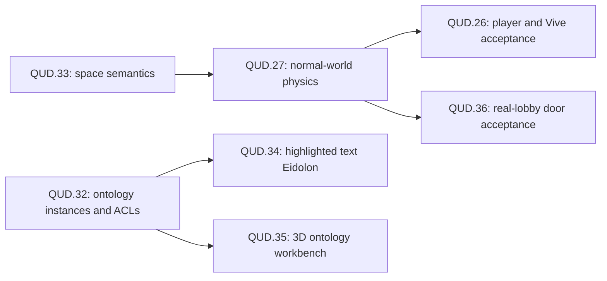

# Ontology, space and physics tracker audit — 2026-10-10

Scope: reconcile the discussion and current tracker work, not implement or
deploy the proposed runtime changes. Used the conceptual-thinking MCP and
checked the relevant tickets against source, architecture and recorded scope
decisions. Frozen Fable review evidence is unchanged.

## Explicit user decision

Yan selected independent ontology and space classes. An accessible ontology
can have text, policy and 3D representations without automatically being a
space. Explicit space membership adds containment semantics; physical_space
is a subtype of space, with simulation separately governed by Prolog policy.

Other controlling requirements: reuse existing class/instance, lens, encoding,
Eidolon, mark, ACL and action owners; expose ontology ACLs under read policy;
live collider changes follow existing committed-diff subscriptions; no manual
per-edit re-adoption, second synchronization path or backward-compatibility
machinery. Preserve the actual current lobby identity/history. A linked physics
ontology remains an architectural candidate, not an accepted default.

## Created work

- [QUD.31](nimbalyst://QUD.31): source-checked terminology reference.
- [QUD.32](nimbalyst://QUD.32): ordinary ontology instances, Eidolon dispatch and ACL reflection.
- [QUD.33](nimbalyst://QUD.33): governed space/physical-space and containment semantics.
- [QUD.34](nimbalyst://QUD.34): dedicated highlighted ontology text-editing Eidolon.
- [QUD.35](nimbalyst://QUD.35): 3D inspection/build/edit workbench using existing representations.
- [QUD.36](nimbalyst://QUD.36): deferred real-lobby blocked/closed door and recovery acceptance.

## Corrected existing work

- [QUD.19](nimbalyst://QUD.19): title/body now match Yan's accepted visual-only lobby scope. Remains done; original physical-door acceptance was explicitly deferred and is now QUD.36. Its recorded visual commit d7c4dd32d23970ec90352357f64b7319d6475159 exists locally.
- [QUD.26](nimbalyst://QUD.26): removed stale claim that completed hot controls are future work; distinguishes implemented foundations from actual normal-lobby and physical Vive/WebXR acceptance. Remains in progress and depends on QUD.27.
- [QUD.27](nimbalyst://QUD.27): incorporates optional Prolog physics, existing subscriptions, no backward compatibility, explicit geometry/camera, governance and acceptance requirements. October 9 lobby identity evidence is historical after the separately authorized October 10 refound; a fresh signed personal-lobby baseline is required. Remains to-do.
- [QUD.25](nimbalyst://QUD.25): preserves the common GUI/question lifecycle and hardware obligations, with separate ontology-editing consumers and no blanket dependency on its entire milestone.
- [QUD.23](nimbalyst://QUD.23): removes the assumption that a package/module-list edit grants existing non-root ontologies a new bridge. Requires governed capability/deployment resolution without merging routing into physics.
- [QUD.3](nimbalyst://QUD.3): records delivered foundations and remaining integration/acceptance dependencies. Changed to in-progress; it is not complete.

[QUD.20](nimbalyst://QUD.20) and [QUD.24](nimbalyst://QUD.24) remain done for their delivered ACL enforcement and complete-state inspection. They are not claims of completed ACL reflection, highlighted text editing or a 3D workbench. [QUD.17](nimbalyst://QUD.17) and [QUD.18](nimbalyst://QUD.18) remain open: local physics queries and door-level outcomes do not satisfy remote-agent measurement or distinct-impact acceptance. Unrelated tickets were not rewritten.

## Dependency shape

Arrows mean prerequisite to dependent. Existing completed foundations and the
physics umbrella's other children are omitted for clarity.

Terminology and general GUI work are related, not blanket blockers of both
branches. Independent-simulation transfer and remote multi-viewer expansion
are not silently added to the first lobby slice.

## Verification and storage limitation

The inventory grew from 29 to 35 nonarchived items. All twelve new/updated
descriptions matched exact local tracker readback. The dependency graph has no
missing IDs or cycles. No unfinished implementation was marked done. Production
source delta is zero; no runtime, server, deployment, headset or physics
acceptance test was performed in this audit.

Every description write reported saved item fields and a saved local snapshot,
but failed collaborative body storage. Retrying those same item IDs failed
again. Local readback is verified; shared synchronization is not. No duplicate
items or claims of successful collaboration-body persistence were substituted.
The updated working plan records the requirements; this audit is a historical
receipt, not a second mutable tracker or implementation source of truth.
