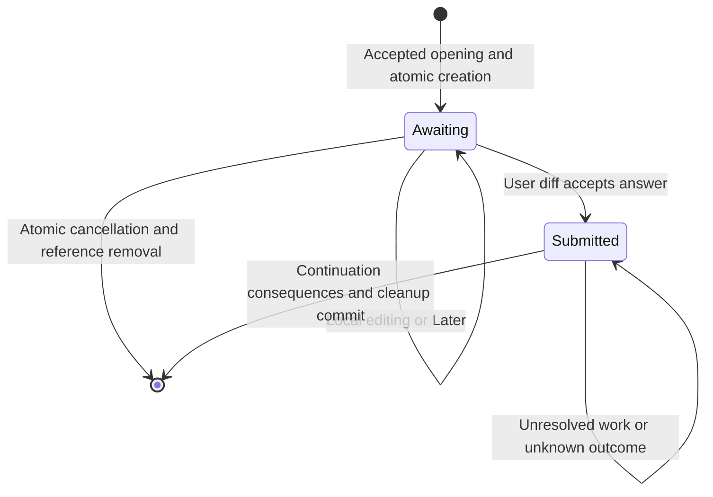

# General GUI implementation plan

Implement [the GUI design](gui-plan.md) for browser desktop and Babylon VR,
with an ontology API and semantic descriptors that a later client can reuse.
The deliverable is a general framework: the lobby and an independent application
use the same component classes, submission rules and presentation contract.

This is the implementation planning document for [QUD.25](nimbalyst://QUD.25).
The original design remains the product source of truth. The refinements below
record Yan's subsequent instructions: no new execution paths, convenient
authoring without event/reaction plumbing, class instances as components,
bound values returned to the originating ontology, and portability beyond
Babylon. Shared component classes, schema compilation and field bindings are
implemented. Submitted answers retain the exact completion request; the shared
assertion reaction dispatches it through the hosted agent. Domain consequences,
question consumption and HUD removal share one atomic transaction. The desktop
and spatial adapters use the same live question controller, signed views and
saved-operation recovery.

The production-seam examples exercise public opening, native client acceptance,
submission and automatic hosted completion, including a receiver on a separate
observer node. Submitted questions automatically refresh their status through
the existing signed-view controller. The input suite also includes multiline text,
number entry, checkbox/toggle, radio groups and single/multiple selectable lists.
The common composition, display, table and transient families now have implementations
in the same vocabulary and adapters. The final software gates pass, including
both renderers and the signed production-owner tests.
[Final Vive acceptance](gui-hardware-acceptance.md) remains outstanding.
Section 5 defines the implemented native boundary and its verification limits.

## 1. Scope and existing owners

Use the existing signed-goal ingress, proof scopes, diffs, atomic multiwriter,
runtime reaction catalogue, agent execution and agent-work recovery. No GUI
transaction lane, callback executor, broker, message ledger, retry queue or
private domain database is introduced.

| Responsibility | Existing owner and planned extension |
| --- | --- |
| Classes, values and common GUI semantics | Extend `quod:gui`; shared instance behavior is composed into participating ontologies using the existing founding/source-edit mechanism. |
| Components and application meaning | Ordinary `instance_of/2`, `isa/2`, `attribute/3`, actions and authored predicates in the application ontology. |
| Submitted input | Existing signed goals and committed diff events; all admitted fields form one transaction. |
| Application continuation | Existing `react_on/2` matching and authorized hosted agent; shared rules hide registration and correlation. |
| Unfinished interaction | The question retains accepted fields and exact completion bytes. Submitted view updates trigger existing outcome reads; certified negative outcomes enable authorized cancellation. Unknown requests are never resubmitted. |
| Representation | Existing Eidolon selection, lenses/encodings and marks; add a semantic GUI recipe and surface binding. |
| Authentication and live views | Existing client auth, signed ingress and authenticated view lifecycle; generalize the view adapter rather than add another execution service. |
| Editing | A shared client controller holds drafts; desktop and spatial adapters render it. Existing proof/source tools retain their own cursor semantics. |

Source anchors: [proofs](proofs.md), [multiwrite](multiwrite-architecture.md),
[runtime and agents](runtime-and-agents.md),
[common semantics](../priv/ontologies/common_predicates.pl),
[diff events](../src/predicates/quod_runtime_predicates.erl),
[transaction staging](../src/predicates/quod_transaction_predicates.erl),
[FIPA composition](../priv/ontologies/fipa_request.pl),
[authenticated views](../src/quod_client_view.erl).

## 2. Authoring and return values

An author instantiates classes, composes a form and declares a continuation.
They do not author `react_on`, `trigger_event`, subscription registration,
request correlation or cleanup for each form/widget.

Illustrative complete binding declaration, with ordinary component instances:

```prolog
instance_of(quod:gui:form, settings).
instance_of(quod:gui:text_box, name).
instance_of(quod:gui:slider, level).
instance_of(quod:gui:rotary_knob, angle).
instance_of(quod:gui:button, apply).

gui_children(settings, [name, level, angle, apply]).
attribute(settings, label, <<"Object settings">>).
attribute(name, label, <<"Name">>).
attribute(level, label, <<"Level">>).
attribute(level, range, range(0, 100, 1)).
attribute(angle, label, <<"Angle">>).
attribute(angle, range, range(0, 359, 1)).
attribute(angle, unit, degrees).
attribute(apply, label, <<"Apply settings">>).

gui_form(settings,
    [field(name, Name), field(level, Level), field(angle, Angle)],
    submit(apply, settings_entered(Name, Level, Angle))).

gui_initial(settings, name, Name) :- object_name(Name).
gui_initial(settings, level, Level) :- object_level(Level).
gui_initial(settings, angle, Angle) :- object_angle(Angle).

settings_entered(Name, Level, Angle) :-
    goal(object_settings(Name, Level, Angle)).
```

`gui_open(settings, Question)` is the convenient local entry supplied by shared
GUI behavior. It captures the exact owning ontology, form and authorized
responsible agent. The default human comes from authenticated context;
agent-originated questions obtain their human from authorized application state.
No caller-supplied human string confers authority.

`Question` is a correlation reference, not the future answer. The field
variables are freshly instantiated from `gui_form/3` when the answer is
accepted. The shared reaction invokes the declared continuation in a new proof
in the originating ontology. It does not resume the opening proof or retain
its stack, variables, locks or MVCC snapshot during human editing.

The example declares the application's meaning once. Several form instances
can reuse the same continuation. Parameterized forms, for example
`settings(Object)`, capture ground application context in their identity and
use correspondingly scoped control identities. Values not supplied by fields
must already be ground context; unbound continuation variables are rejected.

Initial values are a separate projection. They never bind the future input
variables. Empty text is a valid binary when policy permits it. A supplied
literal binding is a validation constraint, not an implicit setter. Shared
variables enforce ordinary Prolog equality between their declared fields.

The implementation must turn this example and a parameterized non-lobby
example into executable tests. Add no new Prolog module/import syntax:
`:` remains qualified-name data; foreign calls use anchored `::` scopes.
The short local entries delegate through the composed GUI behavior and the
catalogued vocabulary reference.

Qualified class names use the ordinary spelling `quod:gui:text_box`: class
`text_box` in ontology `quod:gui`. Parenthesizing the namespace must not change
that identity or be required of authors. The current parser produces different
term groupings, and the shared class resolver splits the outer `Ns:Class` term,
although ontology-name normalization already flattens either grouping equally.
Reconcile qualified-name normalization and owner resolution in the shared
semantics, with coverage for both spellings through class and Eidolon lookup.
The shared argument-following and class paths now resolve both structured
spellings; GUI components use that same resolution.

The first executable layer is composed from `gui_instance.pl`, using the same
founding/source-edit mechanism as existing reusable ontology behavior:

- `gui_schema(Form, Revision, Tree)` compiles the component tree and binding
  declaration. It neither opens a question nor authorizes a submission.
- `gui_values(Form, ValuesToken, Fields)` projects the authored initial values
  separately from the schema revision.
- `gui_bind(Form, Revision, Control, Fields, Continuation)` validates a complete
  typed field set and binds only the authored continuation. It returns a term;
  question lifecycle code must authorize and execute it through the existing
  reaction/agent path. It is not a direct submission endpoint.

`gui_vocabulary(Namespace, Anchor)` pins the vocabulary used by these predicates.
The containing ontology still supplies its own entry ACL. A variant digest uses
the existing canonical term codec's variable tags, so renaming declaration
variables preserves the revision while changing variable sharing does not.

The implemented local form/control identifiers are ground terms, including
parameterized terms such as `settings(Instrument)`. A top-level qualified
`Owner:Name` is not a local form identifier: enter that owner's anchored `::`
scope explicitly. Qualified class names keep ordinary ontology semantics.
Selection values may be arbitrary ground terms; a colon in a submitted value
is data and never asks another ontology to validate it.

Text fields use a UTF-8 **byte** allowance, `max_bytes` (default 4096), rather
than a misleading character count. Numeric values use integer units and the
inclusive `range(Min, Max, Step)` lattice. Every input appears exactly once in
`gui_form/3`; shared declaration variables impose equality between fields.
Readonly or disabled fields must echo their current frozen values, and a
required field cannot be frozen empty. Editable required text may start empty.
Application-specific attributes remain available on components; the GUI
projects its declared keys. Validation-sensitive domain data belongs in
`gui_validation_context(Form, GroundContext)`.

The component contract and attribute reflection derive from one declaration
in `quod_gui.pl`. The source collects its own component data and asks the
pinned vocabulary once to compile the entire tree; binding and initial-value
validation are also batched. No clause database or mutable projection is
copied. Schema, initial-value and binding queries are deterministic over their
validated unique component identities.

### Offered class and instance operations

Compose `gui_operation.pl` alongside `gui_instance.pl` in the target ontology.
The former adds description and binding only; existing signed goals, domain
guards, transactions and result recovery remain the execution path. Composing
these rules grants no entry ACL and publishes no `action/3` automatically.

An author explicitly offers a recipe with
`class_eidolon(Class, operation(class), Name, recipe(Ns, Anchor, Recipe))`
or `operation(instance)`. Existing most-specific class selection chooses the
recipe; ambiguous choices refuse that offer. The anchored recipe implements
`eidolon(Recipe, subject(ontology_ref(Target, History), Subject), operation(Form))`,
where `Subject` is `class(Class)` or `instance(Id)`. It selects a form owned by
that target, including any instance parameters. Source and inspection recipes
retain their existing purposes and contracts.

The ordinary form declaration supplies the operation's semantics:

```prolog
gui_form(create_example, [field(name, Name)],
    submit(create, with_build_plan(Inputs, assert(instance_of(example, Id))),
           operation(create(Inputs), [result(created, entity_ref(Ns, Anchor, Id))]))) :-
    Inputs = [attribute(name, Name)],
    current_ontology_identity(Ns, Anchor).
```

Labels/help, controls, types, initial values and frozen parameters use the
existing component declarations. `operation(Permission, Results)` distinguishes
an offered operation from a deferred question. `Permission` is the exact S1.3
operation term; its variables must come from inputs. Results have unique atom
names and may share intentional output variables with the authored goal, but
never with editable inputs. Every free goal variable must be an input or a
declared result. A question still uses `submit(Control, Goal)` and must bind a
fully ground continuation. Operation forms cannot enter question submission.

`gui_operations(ExactSubject, Views)` accepts `class_ref(Ns, Anchor, Class)`
or the existing `entity_ref(Ns, Anchor, Id)`. Class discovery needs no instance.
Each view is `operation_view(Name, ExactSubject, Revision, Tree, ValuesToken,
Values, Control, ResultNames, Availability)`. The tree carries labels/help and
input metadata; editable defaults have their separate value token. Availability
is `requires_input`, `available` or `unavailable`, always advisory for the
current authenticated principal. Discovery runs inside the existing read-only
proof boundary, even when called in an execute request.

`gui_operation_bind(ExactSubject, Name, Revision, Control, Values, Goal, Results)`
requires fresh output arguments. It validates the exact submitted field set,
types, frozen values and revision, then checks committed permissions with the
supplied parameters. It returns an ordinary conjunction of a current-definition
guard and the authored goal, sharing output variables with `Results`. The guard
rechecks identity, definition, fields and committed permission at execution,
then compares the goal and results with a fresh authored variant without
unifying them. Prebound outputs and new aliases are refused; intentional
authored sharing is preserved. In particular, an offered creation cannot be
changed into an existing-instance membership assertion by binding its result.
Only named variables in the submitted request become durable result bindings;
callers retain the result term through that existing mechanism. No client
continuation is accepted as authority. Direct creation with a fresh output still
encounters the constructor's S1.3 guard. Authorized source edits and additional
classification of existing instances retain their separate existing semantics.

The revision includes subject/history, selected recipe, form, compiled schema,
authored goal, permission, result sharing, fixed values and explicit validation
context. Ordinary editable initial values remain separate. Authors must include
validation-sensitive domain revisions in the goal or `gui_validation_context/2`,
as for question forms; this is not a hash of every helper predicate's source.
Broad authorized source rewriting retains its existing authority.

`gui_operation_classes(Classes)` enumerates classes with explicit class offers
in the selected storage ontology. The World screen's **Create / operations**
entry selects storage explicitly, then the class and authored form. Exact-instance
operation recipes open from the same Eidolon choices as workspaces and inspection.
Returned entity references can open their own operations with the original anchor.
Workspace recipes return `workspace(Controller, Target, Entity, Tools, View)`;
the supported existing controllers are `prolog_editor`, `proof_console` and
`space_library`. This replaces lobby-specific menu/workspace discovery.

The shared operation controller supplies the existing ordinary `GuiForm` and
spatial workspace panel. It observes `gui_operations/2` through the existing
signed view owner. The ordinary Prolog `gui_operation/6` composition binds
typed fields with `gui_operation_bind/7` and calls that guarded goal through
the personal agent's signed route, returning only the named results. Discovery is a
human read; advisory availability for that reader does not substitute for A's
committed authorization on execution. Revoking the human sign-in key blocks new instructions; already accepted A-signed work may finish under A's current key and target permissions. No form-specific helper, question or
second executor participates.

Local unsent drafts survive panel close/reopen and adapter switches. An updated
schema preserves but disables the old draft until the user explicitly adopts
current fields, retaining input in compatible editable roles. Changed choices
and ranges still require valid input; adoption grants no authority. Explicit
defaults reset a current form. Closing aborts active client work; an uncertain signed
write remains in the existing journal and can only be resolved. Successful
submission settles that draft; another creation requires explicit defaults.
No draft autosave is introduced. After reload, authoritative personal-instruction
associations allow recovery even with an empty local journal; unresolved originals
block new submissions. The panel distinguishes refusal, uncertainty and committed
bindings. Terminal observations are reused for that controller's lifetime;
a new identity consumer recovers its authoritative history once. The retained
instruction route can remain uncertain without a terminal receipt, including
after expiry; the client never treats elapsed time as permission to resubmit.
Terrain questions and the existing My worlds library shortcut keep their
continuation/setup owners until stage 3; neither creates an empty space.

## 3. Class composition and the portable descriptor

One authoritative model consists of class membership, attributes, ordered
children, field bindings, initial projections and continuation declarations.
Compile it to ground semantic data; do not maintain a second mutable tree.
The vocabulary provides inherited defaults. Instance values override defaults
under an explicit singleton rule; incompatible equally specific classes fail
with a configuration reason instead of choosing an arbitrary class.

Resolve class closure through the existing class semantics in ordinary signed
proofs. Foreign vocabulary traversal must check the configured namespace and
genesis anchor, as existing `gui_vocabulary/2` callers do; the current bare
`Ns::isa/2` traversal is insufficient by itself. Generic recipe discovery
currently enumerates direct instance classes; extend that shared discovery
where needed and test existing Prolog recipes too. Reaction guards and work
selectors read local committed rows only. They must not perform foreign class
resolution, schema compilation or governed I/O. Class membership alone does
not install runtime reaction clauses.

The proposed wire value is:

```prolog
gui_view(1, FormRef, SchemaRevision, ValuesToken, SubjectRef, Appearance,
         component(FormInstance, form, Properties, Children)).
```

Every child uses `component(Instance, Kind, Properties, Children)`. Properties
are a closed semantic vocabulary: label/help, field type, initial value,
required/readonly/enabled, options with stable IDs, numeric range/step/unit,
layout, focus order and accessible description. Collections are proper bounded
lists. Text is binary, booleans are explicit, numeric units follow Quod measure
conventions. Arbitrary executable terms, callbacks, CSS, HTML, Babylon handles
and client-local IDs are excluded from the descriptor.

`FormRef` and `SubjectRef` use exact ontology anchors and instance identities.
A view occurrence, semantic instance and local draft are distinct identities.
SchemaRevision is a digest of the normalized semantic schema, binding and
continuation contract, and any context explicitly required as a submission
precondition. Canonical variable numbering makes equivalent declarations
stable. Submission rechecks that revision; unrelated ontology commits do not
invalidate a draft. Display-only initial values have a separate ValuesToken.
Changing those values preserves dirty local fields and does not rebuild an
unchanged layout. Option membership, authorization targets and values used as
validation preconditions are not merely display refreshes.

The existing proof/source workspaces compile through the same component
vocabulary and emit this same component tree. Their `editor`, `bindings` and
`catalogue_selection` are presentation capabilities of the existing controllers;
they are refused in common submitted forms. A `catalogue_selection` receives
its choices from that controller's source lens. An ordinary `selection` always
carries explicit option identities and labels; a missing catalogue is refused.
Client adapters preserve invalid local numeric drafts and show inline feedback,
rather than silently submitting the last valid number.

Adapters support the same closed component suite. Unsupported descriptor
versions/kinds cause an explicit presentation refusal before opening succeeds.
They never silently drop a field. A future native client implements this
descriptor and the same typed signed submissions; it does not reproduce
domain policy or require rewriting form definitions.

## 4. Submission uses diffs and reactions

The client supplies only the question/form identity, displayed revision,
activated control and typed field values. The shared signed submission entry
checks authenticated human, exact subject, current permissions, schema and
complete field set. Unknown, repeated or missing fields and non-ground or
mistyped values refuse the whole submission. Disabled and readonly constraints
are enforced in Prolog even if a client is modified.

Submission replaces the current question row with its accepted fields and exact
completion bytes. The ordinary committed assertion diff triggers the shared
reaction; no synthetic GUI event or permanent answer-history fact is needed.
Accepted values remain only until completion. All `gui_open/2` examples use this one recoverable lifecycle. Local
presentation, navigation and draft edits do not create questions. Existing
applied-diff conversion also supports authored domain assertions/retractions
when those changes are the application's intended state. There is no
GUI-specific event dispatcher, and submissions cannot supply arbitrary goals.

The shared behavior composes a guarded `react_on` rule in the responsible
agent's ontology. Its local guard selects the exact actor with `me/1` and a
submitted question row. Schema validation and construction of the declared
continuation run in the subsequent signed proof. When the application is
foreign, that proof enters the originating ontology through ordinary anchored
`::` authorization. Callback execution does not inherit the human's signing
authority; the originating ontology must grant the selected agent that action.
Existing anchored `from/3` subscriptions remain available for application
events; they are not needed as a second per-question recovery inventory.

Install shared executable behavior at founding or through the existing
authorized source-edit transaction. Do not assert executable rules per opening,
infer installation from the remote GUI vocabulary alone, or introduce a new
behavior loader. Exact source subscriptions follow the existing catalogue
lifecycle and are shared across forms from that source.

An event is a wake/occurrence, not proof of the claimed sender. Narrow entry
ACLs and the application continuation's authorization remain mandatory. The
lobby's broad owner grant is an intentional authority boundary, not evidence
that a GUI row cannot be forged. A cross-ontology receiver checks the exact
source identity and its own domain policy before acting.

Submission success means Submitted. A reaction's consequence is a subsequent
ordinary or atomic multi-ontology transaction. Applied/Saved is shown only
when that consequence is established. This milestone does not add a second,
weaker event-only form mode with different identity and recovery guarantees.
The event itself remains an occurrence; section 6 supplies current state.

## 5. Opening and live receiver integration

The required behavior is fixed: no connected intended human, no installed
authorized responsible handler, or refused capacity means Prolog failure.
No offline offer, hidden partial question, suspended editing proof, replacement
deadline or claim that network receipt and consensus are atomic is permitted.
An unreachable owner is an infrastructure error, not authoritative absence.

Opening uses one original signed **execute** request. The selected integration
is a real prepared presentation through the existing declared action,
proof-local handle and durable direct-effect journal. The ordinary transaction
commits its effect, the responder's question and the human's HUD reference
atomically. There is no control request followed by a separately signed write.
The effect-bearing scope remains free of ordinary diffs; source, responder and
human scopes keep their existing material-write validation.

The preparation must run these steps before returning a successful action:

1. Shared Prolog behavior compiles the form and fixes the human, authorized
   responder, exact hosted incarnation, receiver and their normal entry policy.
   Those selections are committed state or authenticated request context.
2. The action's private staging continuation obtains actual handler feasibility
   from the selected host's existing runtime: current actor/epoch/key, installed
   common handler and authored capacity. This is part of preparing the real
   external presentation. It is not an application-visible liveness result,
   a fact assertion or a separate actor effect.
3. The authenticated client view accepts the supported descriptor and allocates
   a hidden provisional presentation for that exact occurrence and connection.
   Partial preparation expires or is retired on rollback. No visible orphan
   form or agent-side question inventory is created.
4. Existing preparation binding, source reservation, Vote/Resolve/Complete and
   exact outcome machinery own the original request. A certified applied result
   is success; pre-dispatch absence/refusal is Prolog failure; uncertainty after
   dispatch retains the original request evidence for resolution.
5. Ordered effect release activates that exact provisional view. If its
   incarnation has disappeared, release terminates as expired; it never blocks
   the journal waiting for reconnection. The committed HUD reference owns later
   discovery and does not cancel when the human disconnects.

The concrete existing precedent is `human_user_instance:provision_lobby/1`,
which combines source linking facts and a foreign scope's prepared creation
in one original atomic request. Native lifecycle preparation already inspects
actual feasibility before sealing. This does not authorize relabeling an
arbitrary live query as a staging operation.

The existing closed effect catalogue now includes `present` with the private
`gui_presentation` codec. `gui_prepare_question(Opening)` allocates the existing
opaque action handle; its declared action checks source, responder and human
policy. `gui_prepared(Opening)` reads that proof's staged desired state, so an
ordinary ontology fact cannot fabricate native acceptance. The responder's
`gui_accept_question/1` then creates both shared rows in the same transaction.

`quod_ask:native_read/5` uses the original signed authentication in a separate
read-only scope selected at an exact physical node and ontology anchor. It uses
the existing scope transport and may run on an observer. Ordinary `::` selection
is unchanged. Nested reads preserve the original principal and deadline;
preparation cannot turn their live observations into ordinary material reads.
The selected host must already serve the anchored capability through normal
ontology hosting; requests never repair or join missing capabilities.

The native actor check compares the actual installed actor/key/epoch and complete
shared reaction against the existing runtime catalogue. Receiver preparation uses
the signed HUD socket registered for the exact authenticated human and connection
token. That socket validates the descriptor acknowledgement before issuing a
private receipt. Prepared payloads retain the original request authentication,
receiver identity and absolute expiry. Journal release activates only that
receipt; missing or expired receipts discharge presentation without deciding
material outcomes. Lost activation acknowledgement waits only for that original
receipt expiry and never resubmits the material request.

The original source's existing custody precedes effect binding and Vote dispatch,
including for hosted-agent callers. No child operation or fresh-ID retry exists.
The human owns the signed receiver selection in its ontology; agent-originated
opening additionally requires the human's receiver policy. Multiple tabs have
distinct connection incarnations and drafts. A registry miss establishes absence
only on that selected authenticated scope; an unreachable host is infrastructure
uncertainty. Local opening and actual journal release are tested together; remote
observer transport is tested separately, with remote end-to-end GUI integration
still required.

Opening acceptance is instantaneous evidence, not a promise of continued
connection. After acceptance, losing the human or agent does not cancel a
question or undo a committed answer. Presence and authored capacity remain
separate from question status and actual queue availability.

Pending-question allowances belong to human-ontology policy; responder
allowances belong to responder-ontology policy. Existing runtime queue counts
and pending-byte totals are resource budgets, not encoding constraints. If they
participate in admission, move their policy ownership and enforcement together;
do not rename them, raise constants or split transactions to evade them.

## 6. Questions and bounded current state

The implemented transition layer is composed from
[`gui_question.pl`](../priv/ontologies/gui_question.pl) in the responsible
ontology and [`gui_hud.pl`](../priv/ontologies/gui_hud.pl) in the human ontology.
The application composes [`gui_instance.pl`](../priv/ontologies/gui_instance.pl)
and declares `gui_question_policy(Form, HumanRef, ResponsibleRef)`.
`gui_submit/4`, `gui_complete/1` and `gui_cancel/1` use the
ordinary signed request and transaction owners. `gui_pending_questions/1`
returns the authenticated human's exact references. In the referenced scope,
`gui_question_view(Id, FormRef, Revision, State)` reads the authoritative row
for that human; it exposes either `awaiting` or
`submitted(OriginalSubmitOperation, Control, Fields)`. These read interfaces
do not grant another human or responder access to the accepted fields.

`gui_question_form(Id, Projection)` follows the exact source under that human's
authority. Its `question_form(Source, Responsible, OpenedRevision, State,
form_view(CurrentRevision, Tree, ValuesToken, Values, SubmitControl))` result
keeps the accepted revision separate from the current schema. The shared client
decoder classifies it as `editable`, `stale`, or `submitted`. Only a current
awaiting question is editable; stale awaiting questions can be cancelled, while
submitted values remain accepted data rather than defaults for a new edit.
`gui_question_view/4` remains the metadata read for HUD status when the source
cannot supply a form, including withdrawn policy or an invalid current schema.
It grants no permission to display a cached form or submit against it.

Submission retains canonical unsigned completion bytes in the same question row
as the accepted fields. The internal state is
`submitted(OriginalSubmitOperation, Control, Fields, CompletionBytes)`; public
projections omit those bytes. The responsible ontology declares one
`gui_completion_allowance(Actor, Milliseconds)` policy. Submission requires a
unique active actor key and a positive integer allowance. The completion deadline
is the human request's signed expiry plus that allowance; it does not extend the
human submission. Its operation identity derives from the anchored question and
authenticated submission, and its only goal is `gui_complete(Id)`.

The shared local assertion reaction selects those bytes with `use_agent_request/1`.
The existing hosted actor queue and governed signer execute the original request.
The shared GUI ontology supplies the narrow signing entry and grant for those
exact retained bytes and their ground `gui_complete(Id)` goal. No broad actor
signing permission is required. Consuming the submitted row withdraws that grant.
Completion and consumption require `current_signed_request/1`; a fresh request
for the same goal cannot substitute. A changed key refuses dispatch. Source domain
writes, question removal and HUD removal remain one atomic transaction. Applications
supply the ordinary bound continuation and policy, with no per-widget reactions.

`gui_question_status(Id, Status)` lets the assigned human observe the original
completion outcome. An unresolved outcome raises the ordinary unavailable error;
it does not grant cancellation. `gui_cancel/1` can retire submitted state only
when the exact committed outcome is `rejected`, `aborted` or certified `expired`.
That evidence participates in the retirement transaction's read set. Awaiting
questions remain cancellable without an outcome. Reads and reconnects never
redispatch retained requests.

The shared `/api/views` subscription owner serves world, human HUD and selected
question projections through signed anchored reads. HUD and question adapters
reuse the same connection, dependency, renewal and expiry machinery; they attach
no physics subscription. The browser's question controller owns only local drafts
and interaction locks. Submission and cancellation use the existing signed
operation journal, and unresolved operations are checked only through its outcome
endpoint. Renewals preserve drafts when revision and defaults are unchanged;
changed schemas lock and preserve drafts with their original fields. Choosing
current defaults is an explicit local action. Desktop and spatial forms share this controller
and the existing workspace model. Pending questions are accessible through the
world client's existing action menu as well as its desktop controls.

Public opening now commits through the native preparation and atomic transaction
owners, including an authenticated receiver on a separate observer node. Live
application examples use that public opening and automatic completion. The
question controller reads status when a submitted signed view opens or refreshes,
including reconnects and renewals. It ignores responses for retired views and
keeps unresolved client writes under the existing exact-outcome resolver. A
certified negative completion outcome enables cancellation; the cancellation
transaction rechecks that evidence. This does not retry completion or provide an
offline background worker. Existing signed-view invalidation covers the opened
ontology scopes; it is not a new per-request subscription. A work selector cannot
query outcomes inside its pure policy verdict.

Questions have ordinary classed instances in the responsible agent's ontology.
The originating application owns the form definition and continuation; the
question stores exact references to them. Shared assertion reactions consume
committed submissions; no GUI `agent_work_goal/5` selector is installed.
Keep only the current unresolved interaction: exact form/human/responsible
agent, revision, awaiting or submitted state, and the minimum accepted values
and operation custody needed while the continuation is unfinished. There is no
permanent `answer/…` archive or terminal-question table in current ontology state.

The human ontology contains exact discovery references, not copies of form
schemas, answers or status. Creating/removing a reference and the corresponding
question state is one existing atomic multi-ontology transition. Shared behavior
provides narrow projection, link/unlink and answer/cancel entries with explicit
Prolog policy grants; application agents do not gain access to the human's
private ontology. The responder grants narrow `gui_accept`/`gui_submit`/cancel
entries keyed on the authorized human, exact form and pending state. The human
ontology grants link/unlink only for the corresponding reference and selected
responsible agent. The application grants descriptor/validation reads and the
declared continuation under its ordinary domain policy. These grants are part
of shared behavior installation, not an application author's per-widget work.
Source subscriptions and question references are different things and must not
become duplicate pending inventories.



Question identity is bound to the original opening's authenticated operation
reference, including its exact ontology and signing principal. The implemented
`current_request_operation/1` exposes that existing signed evidence in origin
and foreign proof scopes. It does not allocate another GUI counter or accept an
unauthenticated caller ID. The admission trace preserves this identity through
its result/custody handoff.
Distinct questions may share one form: no form-level uniqueness check may
collapse them. Missing/consumed questions fail on late submissions; they are
not silently recreated by the answer entry. A Submission similarly identifies
the exact signed submit operation, not a client-selected event sequence.
Creation must also reject a late repeat after cleanup. Absence of the current
question row alone is insufficient: the admission contract must retain the
same exact material operation identity through existing outcome machinery,
rather than allowing another operation to recreate a consumed Question.

`gui_submit(Question, Revision, Control, Fields)` replaces awaiting with submitted
state and exact completion intent atomically. The committed assertion is the
correlated event; the shared reaction dispatches its exact request once. Recovery
observes retained outcome evidence through the existing question controller
rather than invoking the continuation again. `agent_work_goal/5` cannot query
outcomes in its pure policy context. Domain consequences, consumption
of submitted work and reference cleanup form one atomic transition.

Do not resubmit an uncertain operation under a new ID. Reuse existing exact
operation custody and outcome lookup. Current agent-work passes can advance
after unsuccessful work; they do not provide unconditional retries. Known
failure remains visible as unresolved work or a domain-defined failure until
an authorized dependency change/recovery action makes progress possible.
No readiness polling or GUI retry timer is added.

Concurrent submit/submit and submit/cancel proofs conflict on the same pending
state, so at most one wins. A rejected field leaves all pending state intact.
Hide/Later changes only the local presentation; cancel is a signed ontology
transition. Terminal cleanup removes framework state, while any intended domain
result remains in its existing domain owner. Ledger history still grows with
commits; bounded current state is not ledger erasure.

## 7. Client and representation work

Generalize [the form decoder](../client/src/world.js) and
[workspace adapter](../client/src/workspace-panel.js) around the semantic tree.
Replace the superseded flat-form dispatch rather than keeping two parsers.
Migrate console/editor descriptors into that tree and retain their existing
controllers and cursor behavior. Generic forms have local drafts and explicit
submission only. No duplicate source editor or ontology editing application.
The same migration replaces the ground `gui_view/2` forms in
[the GUI vocabulary](../priv/ontologies/quod_gui.pl), the workspace descriptors
in [Prolog Eidolons](../priv/ontologies/quod_prolog_eidolons.pl),
class-selected workspace recipes and their consumers/tests. Keep one view process type with
explicit admitted world/GUI read goals, not a parallel GUI subscription owner.

Extract shared signed-view dependency/subscription lifecycle only where both
world and HUD projections need it. Keep one implementation of ordering,
owner monitoring, exact anchored dependencies, cancellation and deadline checks.
General GUI projections must work with no space, physics owner or simulation.
Existing native-client callers of any changed common transport contract need
compatibility coordination; native GUI rendering is outside this milestone.

The HUD reads its authorized discovery references, obtains each form/status
under normal ACLs and updates from scoped installed-state notifications.
Subscribe before snapshot. Retain current projections for the view lifetime;
invalidate affected dependencies only. Duplicate notices and unchanged renewals
do not rebuild layouts, replay history or write/sync files. Drafts survive safe
value refreshes, but a changed schema/target is explicitly stale and never
silently receives the old draft.

GUI Eidolons select semantic forms and appearance tokens. Spatial surface
bindings link a form occurrence to an existing mark/placement or the personal
workspace. Hit testing returns exact subject/control references. Appearance
does not confer domain authority or create a competing scene graph.

Deliver every family in the design's initial suite: nested form/panel/group,
row/column/grid/scroll/tabs; labels/icons/help/status/progress; text/multiline/
number; buttons; checkbox/toggle; radio/select/list; slider/rotary knob; basic
table; menus/dialogs. For each, specify semantic properties and desktop/VR input
equivalence. Numeric controls share range/step/unit semantics and offer exact
entry plus increment/decrement. Intermediate dragging/typing remains local.

Use the agreed tinted panel, initially 780 permille opacity, adjustable with
an opaque mode. Text, controls and input wells remain opaque. Larger text
reflows layout. Keep world-stable panels, Move/Recenter/Hide, a separate small
attention control, and a focus-driven keyboard that does not cover the active
field. New questions never steal focus. Local appearance/placement preferences
do not alter request identity. These are trial values, not headset certification.

## 8. Visual design and interaction specification

The existing concept establishes the visual direction:

[Original GUI visual concept](gui-concept.mockup.html "width=1100 height=850")

The use-case study applies that direction to the examples in section 9. Its
controls change only the local mockup; it does not execute ontology goals or
establish headset ergonomics.

[GUI use cases and visual states](gui-use-cases.mockup.html "width=1100 height=900")

### Workspace layout

Desktop has an attention sidebar and a resizable main form. The sidebar may
collapse without closing the active form. VR has a small summonable attention
surface and one primary world-stable panel; the sidebar can be hidden while
editing. Neither follows each head movement. Object-attached forms can be
moved to the personal workspace while keeping the same controller and draft.

Every working panel has four regions: source/title and Hide at the top; a
bounded scrollable body with labelled groups; a persistent status strip; and
actions outside the scrolling region. Move and Recenter operate on the local
panel placement. Later/Hide retains the draft. Cancel request is visually
separated from Submit by a full target width where space permits; it is a
different domain operation. Confirmation is used only for a domain-declared
destructive cancellation, not as mandatory friction on ordinary dismissal.

Rows/grids reflow to one column for narrow panels and larger-text mode. Labels
remain visible above fields; values and units sit beside numeric controls.
Long choices open a bounded picker with stable selection, not an endless pair
of previous/next buttons. Tables keep row IDs and selection stable on refresh.
New arrivals change the attention count without moving the active item,
opening a modal, changing focus or discarding a draft.

### Appearance tokens

The GUI appearance recipe supplies renderer-neutral integer/color tokens;
the adapter translates them. Keep graphical translucency independent of values,
permissions and component identity.

| Token | Initial study value | Contract |
| --- | --- | --- |
| Panel background | `#192B32`, opacity 780/1000 | Default visible translucency; adjustable, with 1000/1000 opaque mode. |
| Input wells and status | `#0F1B20`, opaque | Text-entry and outcome information remain readable over any scene. |
| Main and supporting text | `#F5F1EB`, opaque | Supporting text on glass keeps body size and contrast. |
| Focus and primary action | `#F9C80E` | Focus outline and explicit action label, not color alone. |
| Error and completion | `#FFB8BD`, `#C5E7A0` | Always accompanied by text and an icon/shape. |
| Spacing | 8, 16, 24, 32 logical units | Consistent hierarchy and enough separation for ray selection. |
| Text | 16 body, 18 section, 28 title logical units | Prototype desktop scale; VR uses measured device profiles. |
| Targets | 48 logical units in the desktop study | Not a headset angular-size requirement. |

Only the panel background is translucent. Applying opacity to the whole
component tree is incorrect because it fades text, focus outlines and controls.
Use a restrained edge and corner radius; avoid bloom, layered glass and
decorative depth around text. Opaque/high-contrast, larger text and reduced
motion are supported preferences. No blur/refraction dependency is required.

### Controls and input

Textbox/multiline controls have labels, caret, clear focus and nearby errors.
The virtual keyboard appears only for text/number entry, on a separate opaque
surface adjacent to the panel, leaving the active field and status visible.
Hardware keyboard entry and platform text input remain available where supported.
Focus order follows the semantic tree; Hide/Escape restores focus to the
invoking control or attention item. A future client's keyboard is an adapter
choice, not an ontology dependency.

Sliders and knobs display their value and unit, and offer numeric entry and
increment/decrement. Knobs use indirect dragging with pointer capture and
continuous delta handling at the angular seam; no repeated wrist twisting is
required. The domain declares bounded versus wrapping values. Checkbox/toggle
labels form part of their hit targets. Radio/list selection uses a persistent
mark as well as highlight. Disabled labels stay legible and expose a reason;
readonly values remain selectable/readable and are distinct from disabled ones.

Controller-ray interaction must work with relaxed arms, including seated and
one-handed use. Direct touch is optional. World-stable placement, recentering
and text/target scale are adjustable. Device profiles record viewing distance,
physical panel dimensions, apparent text/target size, texture resolution and
input method together; the current Babylon plane dimensions are not accepted
ergonomic defaults.

### Visible states

| State | What the human sees and can do |
| --- | --- |
| Draft | Local editable values; Submit and Later available. |
| Invalid input | Error beside each affected field and a focusable summary; retain all valid edits. |
| Submitted | The input commit is known; awaiting the responsible agent's result, with no claim of domain success. |
| Applied | Verified application result; acknowledge/dismiss locally. |
| Needs attention | A refusal or recovery condition is known; show its useful reason and only permitted recovery actions. Silence is not proof of refusal. |
| Outcome unknown | Check the original operation; no second Submit for that operation. |
| Stale form | Explain that schema/context changed; preserve the old draft for explicit reconciliation. |
| Disconnected | Keep the draft and last known state; no claim of cancellation or commit failure. |
| Cancelled | No new answer is accepted; the local view can close. |

Terminal visual feedback can remain in the controller after authoritative
temporary question state is consumed. A reconnect need not reconstruct a GUI
answer archive merely to show a historical toast. Fresh domain projection and
the original operation outcome are the authorities.

## 9. Chosen usage examples

Executable grouped versions of the lobby and nonphysical instrument forms are
documented in [Application forms](gui-examples.md). Their signed-owner tests cover
public opening through automatic completion and cleanup.

These are proposed application examples to make the API executable during
implementation, not claims that the named domain actions already exist. The
classes, attributes and `gui_children/2` pattern from section 2 apply in each
case; declarations below focus on the form call and returned values. Common
controls are instantiated once in the owning application's normal ontology
source. Demo helpers must not introduce a second component-definition language.

### A. Lobby atmosphere

A human selects the sky's Settings Eidolon. A two-group form contains preset
name, panorama selection, brightness slider with exact entry, and rotation
knob with degree entry. The panorama list comes from the authorized domain
projection. The form can stay beside the sky or move to the personal workspace.

```prolog
open_atmosphere(Sky, Question) :-
    gui_open(atmosphere(Sky), Question).

gui_form(atmosphere(Sky),
    [field(preset(Sky), Preset),
     field(panorama(Sky), Panorama),
     field(brightness(Sky), Brightness),
     field(rotation(Sky), Rotation)],
    submit(apply(Sky),
           atmosphere_entered(Sky, Preset, Panorama, Brightness, Rotation))).

atmosphere_entered(Sky, Preset, Panorama, Brightness, Rotation) :-
    goal(sky_settings(Sky, Preset, Panorama, Brightness, Rotation)).
```

The author calls `open_atmosphere(personal_sky, Question)`. The GUI framework
handles opening/correlation. On a valid submission the calling lobby ontology
receives, for example,
`atmosphere_entered(personal_sky, <<"Evening">>, dusk, 650, 45)` in a fresh
authorized proof. Brightness is stored as a permille value, displayed as 65%
by its unit/encoding contract. The application's `sky_settings/5` action updates
the existing sky attributes together; it does not add an answer-history fact.
The display shows Applied only after that consequence is established. The
existing sky brightness attribute is already declared `permille`; its founded
value `120` means 12%, whereas this example's edited `650` means 65%.

Acceptance: use numeric entry and the knob/slider alternatives, hide/reopen
without losing edits, reject a stale panorama choice, and prove one complete
atomic settings transition rather than separate field commits.

### B. Independent nonphysical instrument panel

An `instrument` component in a separate application ontology offers a GUI
Eidolon even when it belongs to no space. It is a configuration demonstration,
not a new physics or hardware controller. The form contains a run name,
operating-mode selection, gain slider, phase knob, enabled checkbox, notes,
and a bounded table of channels with multi-selection. General/Channels tabs
share one draft and one Submit configuration action.

```prolog
instance_of(quod:gui:form, instrument_settings(Instrument)) :-
    instance_of(instrument, Instrument).
instance_of(quod:gui:rotary_knob, phase(Instrument)) :-
    instance_of(instrument, Instrument).
attribute(phase(Instrument), range, range(0, 359, 1)) :-
    instance_of(instrument, Instrument).
attribute(phase(Instrument), unit, degrees) :-
    instance_of(instrument, Instrument).

open_instrument(Instrument, Question) :-
    gui_open(instrument_settings(Instrument), Question).

gui_form(instrument_settings(Instrument),
    [field(run_name(Instrument), Name), field(mode(Instrument), Mode),
     field(gain(Instrument), Gain), field(phase(Instrument), Phase),
     field(enabled(Instrument), Enabled), field(channels(Instrument), Channels),
     field(notes(Instrument), Notes)],
    submit(apply(Instrument),
           instrument_entered(Instrument, Name, Mode, Gain, Phase,
                              Enabled, Channels, Notes))).

instrument_entered(Instrument, Name, Mode, Gain, Phase, Enabled, Channels, Notes) :-
    goal(instrument_configuration(Instrument, Name, Mode, Gain, Phase,
                                  Enabled, Channels, Notes)).
```

The remaining controls use the same class-instance declarations as the phase
knob, with select/multi-select option IDs and typed values. No lobby helper is
consulted. For `analyzer_a`, a submission can bind Name to `<<"Sweep A">>`, Mode
to `sweep`, Gain to `40`, Phase to `90`, Enabled to `true`, Channels to
`[left, right]` and Notes to `<<"Compare with baseline">>`. These values reach
the instrument ontology's continuation together, under its normal ACL.

Acceptance: host the responsible agent in another authorized ontology; run the
same form on desktop and in the personal VR workspace; verify tabs, selection
and focus without a physical-space dependency. Open another question for the
same component and prove the drafts and correlation remain independent.

### C. An agent asks for a deferred review decision

An application agent needs a human decision on a work item. It calls the same
GUI API; application policy supplies the intended human from the work item's
authorized ownership and selects the responsible agent. The HUD adds a small
attention item without opening a modal. The human can answer later, including
after reconnecting, while the original opening proof has already ended.

```prolog
ask_review(Work, Question) :-
    gui_open(review(Work), Question).

gui_recipient(review(Work), Human) :- work_reviewer(Work, Human).
gui_responder(review(Work), Agent) :- work_responder(Work, Agent).

gui_form(review(Work),
    [field(decision(Work), Decision), field(comment(Work), Comment)],
    submit(return_review(Work), review_entered(Work, Decision, Comment))).

review_entered(Work, Decision, Comment) :-
    goal(work_reviewed(Work, Decision, Comment)).
```

`gui_recipient/2` and `gui_responder/2` are proposed shared-policy selectors;
their answers must pass ordinary opening/continuation authorization. They are
not caller-supplied identity overrides. The component instances include a
read-only work summary, labelled decision choices and a multiline comment.
The returned continuation might be
`review_entered(work_42, request_changes, <<"Please include the units">>)`.

This form promises recoverable completion, so accepted values remain only
while its continuation is unfinished. The consequence updates existing domain
review state and consumes temporary GUI work/discovery references atomically.
Reopening a view does not create another question. Later hides the panel;
Cancel request follows the application's cancellation permission. Duplicate
answers, agent loss and an uncertain submission never create a second decision.
If opening fails because no human is connected, no question is created. A later
connection does not automatically restart the failed work pass. Re-asking must
be selected by an authorized changed dependency or explicit domain action using
the existing work owner; this is not a reason to add a retry timer.

These examples also define the portability test: feed their identical semantic
descriptors and interaction vectors to the desktop and Babylon adapters, then
to a minimal renderer-independent test adapter. Compare typed submissions,
focus/selection identities and state transitions. No Babylon import is allowed
in the semantic decoder/controller module. Building a complete future native
renderer is outside this milestone.

## 10. Implementation slices and verification

1. **Executable contract.** Resolve section 5; freeze the API, identity,
   receiver scope, authority matrix, state cleanup and descriptor examples.
   Verify the small author example through real parser/proof seams. Fable
   review and independent disposition precede Yan's implementation approval.
2. **Semantic vertical slice.** Shared classes/composition, one form,
   continuation binding and ordinary signed submission. Prove class behavior
   outside the lobby, answer events and temporary work cleanup, narrow ACLs and fresh-proof
   continuation. No application-authored `react_on`/`trigger_event` plumbing.
3. **Questions and presentation.** Exact admission, HUD references, concurrent
   lifecycle, cancel/disconnect, recovery and unknown outcomes using existing
   owners. Do not postpone the negative admission cases until UI polish.
4. **Common adapters and controls.** One semantic decoder/controller contract,
   desktop and spatial suite, appearance and accessibility. Migrate existing
   tools and remove superseded dispatch in the same slice.
5. **Two elaborate applications.** Lobby settings and a nonphysical laboratory
   instrument component in an independent ontology. Include text, selection,
   checkbox, slider, knob and grouped fields; one callback accepts all values.
   Demonstrate a responsible agent hosted outside the component ontology and
   two concurrent questions using the same form.
6. **Integrated review and acceptance.** Freeze the actual tree, run applicable
   clean sequential gates with full logs/true exits, request the explicitly
   authorized Fable implementation review, independently disposition findings,
   and retain hardware results separately. No deployment or history migration
   is authorized by this ticket's implementation plan.

Production-seam tests must cover:

- Ordinary absence/refusal and infrastructure uncertainty; wrong human/anchor,
  stale connection and agent incarnation, missing handler/signing permission,
  refused capacity, failed alternatives, cut and rollback with no duplicate UI.
- All-field atomic validation, empty text, shared-variable equality, malformed
  trees and class ambiguity, multiple occurrences and isolated local drafts.
- Local and foreign reaction unification; forged events/rows, raw event calls,
  direct callback invocation and current domain authorization.
- Two openings, stale revision, duplicate answers, answer/cancel races, late
  answers after cleanup and cancel/reopen with a genuinely new identity.
- Agent loss before/after answer commit, recovery without replaying events,
  one completion despite competing wakes, and exact unknown-outcome resolution.
- Repeated unchanged operations through actual owners: count projection work,
  prefix reads, rebuilds, disk writes/syncs and registrations; all unnecessary
  repeated work stays zero. A real update still invalidates and applies.
- Repeated complete/cancel cycles return current framework facts and live
  registrations to baseline. Question identity reuses signed operation identity.
  Preserve original outcomes; do not delete ledger evidence to achieve this.
- Client controller tests, browser spatial tests, and existing console/editor,
  signed-operation, runtime, multiwrite and reaction-metadata regression seams.

Hardware acceptance uses the intended headset and actual input devices.
Repository context names the original HTC Vive; confirm the browser/WebXR path
on that device rather than treating native OpenXR simulator results as coverage.
Record text legibility, bright/dark/moving scenes, panel transparency, seated
reach, target selection/mis-selections, keyboard entry, precise numeric input,
frame behavior and arm/neck comfort. Desktop screenshots and simulated XR are
software evidence only. Keep the hardware checklist outstanding until measured.

Report actual production/test/documentation line deltas and remaining risks.
Common UI components necessarily add functionality, but replacement work must
remove obsolete dispatch and duplicate lifecycle machinery. Mark the tracker
complete only when its required acceptance is met under the repository's
review/commit workflow; partial implementation or unrun headset checks are not
completion.
