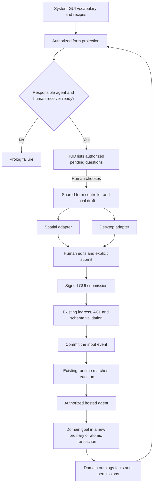
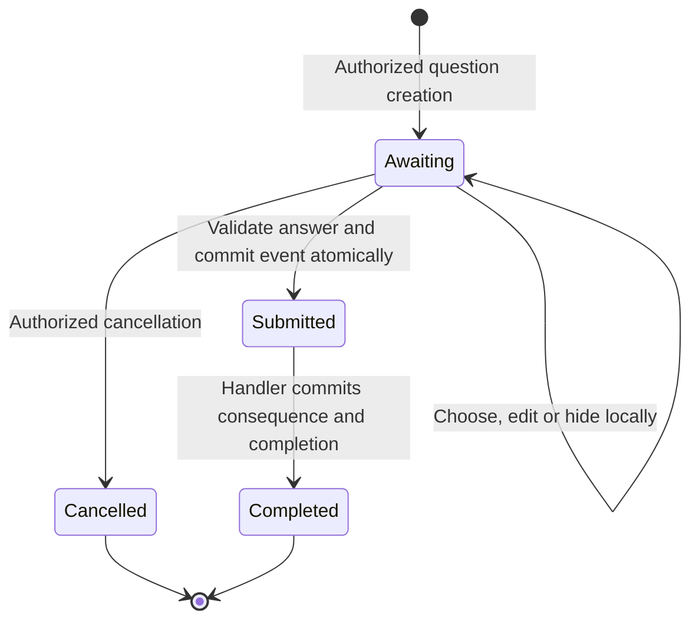

# Quod GUI design proposal

Implementation tracker: [QUD.25](nimbalyst://QUD.25) — general GUI framework
for VR and desktop (local workspace ticket). The ticket links back to this plan,
the visual concept and the review assessment.

Quod should let any ontology author instantiate GUI component classes, compose
them into forms and attach them to domain entities. This is a general GUI
framework for tools, objects, agents and applications throughout Quod. The
lobby is one consumer. The same semantic GUI should work in VR and on desktop.

Forms bind submitted field values into ontology events. Interested entities
respond through the existing `react_on/2` mechanism and authorized agent
execution. The GUI framework supplies that wiring automatically. Each presented
interaction has a responsible agent able to receive and handle its response;
otherwise opening it fails in Prolog. Authors declare controls and application
meaning, without registering a reaction for every widget or question.
The proposed predicate names and descriptor shapes below remain design work;
they are not implemented APIs. The existing proof, transaction and deployment
contracts remain in force.

## Requirements

- Compose elaborate forms in an ontology, with reusable controls and layouts.
- Provide the common component suite from the first GUI milestone, including
  text inputs, buttons, selections, sliders, rotary knobs and composition.
- GUI components are classed instances; their renderings do not own their state.
- Emit ontology events for submitted input; domain reactions own consequences.
- A GUI query with no connected human recipient fails in the Prolog sense.
- It also fails without an authorized, available agent with installed response
  handling and capacity to own the interaction. Mere agent existence is insufficient.
- Shared GUI behavior supplies event/reaction registration and cleanup. Neither
  the human nor the form author writes a `react_on` clause for each interaction.
- Proposed attention model: pending questions appear in the human's HUD;
  the human chooses which to address. Shared ontology state owns each question
  and its accepted answer, while unsubmitted edits remain local.
- Keep the Prolog authoring interface convenient and the human interface simple.
- Use moderate graphical translucency for the visual style. This is the intended
  meaning of transparency, not an additional system-explanation requirement.
- Design for VR comfort and accessibility while retaining desktop operation.
- Keep domain meaning, authorization, validation and policy in Prolog.

The motivating expression is `quod_gui:text_box(my_text_box, Value)`.
Its intent is a requirement; its spelling is not yet an executable Quod API.
Quod uses `:` for qualified names as data and `::` for foreign proofs, as
described in [Proofs](proofs.md). A concrete system call would use the
catalogued `quod:gui` identity and an anchor guard. Short authoring syntax
must resolve to that existing mechanism, without introducing module semantics
or implicit routing as a side effect of GUI work.

## Existing foundation and concrete gaps

[quod_gui.pl](../priv/ontologies/quod_gui.pl) already defines `gui_view/2`,
the component class vocabulary and ground forms for the proof console and
source editor. These describe roles and labels; they do not suspend variables
until keyboard events arrive.

[world.js](../client/src/world.js) decodes the forms and checks the expected
console/editor roles. [workspace-panel.js](../client/src/workspace-panel.js)
renders editor, input, choice, bindings and button controls with Babylon GUI.
Its controller owns drafts and actions. The
[console](../ui/src/Console.tsx) and [source editor](../ui/src/PrologEditor.tsx)
already share their controllers with spatial presentation.

[lobby_instance.pl](../priv/ontologies/lobby_instance.pl) obtains GUI views
through an anchored vocabulary reference. This is existing usage, not the
scope or required entry point of the GUI framework. The
[Prolog eidolon library](../priv/ontologies/gui_tools.pl) associates
a subject, tool ontology and form without transferring ownership of the subject.
These are the paths to generalize for component-associated forms.

The demonstrated gaps are general component schemas and bindings, reusable
form submission rules, nested layout support, additional controls, and a
defined connection between an intended human, a responsible agent and an active
GUI receiver. The runtime already owns installed reactions and hosted agents;
GUI admission must reuse those owners rather than track a shadow registration list.
The existing [client authentication owner](../src/quod_client_auth.erl)
proves control of a key and retains expiring sessions. That alone does not
establish that a live GUI can receive a query.

The [earlier GUI direction](outdated/client-world-direction.md#6-gui-ontologies-and-human-interaction)
already distinguishes accepted values, local drafts, atomic submissions and
durable requests for later input. It is design precedent; general forms and
human-input workflows are not established implementations by virtue of that text.
Its section 6.1 prescribes a direct domain change in the submission transaction.
The event-based submission requested here revises that proposed default; the
transaction boundaries and consequences are explicit below.

## Entities, Eidolons and marks

Use plain descriptions alongside the current source names:

| Source term | Plain meaning | GUI example |
| --- | --- | --- |
| Class | A reusable semantic kind, linked by `isa/2` | `text_box`, `slider`, `form` |
| Instance or entity | A particular thing in an owning ontology, declared with `instance_of(Class, Instance)` | The `name_input` control in a particular settings form |
| Eidolon or recipe | A reusable way to represent a subject for a purpose and style | A settings panel, or a rotary appearance for a numeric control |
| Mark | One visual occurrence in a view, described by `mark/7` | A panel surface or the visible dial of a knob |
| `depicts` | The link from a mark to its semantic subject | The dial points to its exact ontology and `angle_input` instance |

An Eidolon is the recipe; a mark is one visual occurrence. A control instance
may have several representations and appear in several places without becoming
several independent controls. Conversely, several decorative marks may depict
one control. A renderer mesh name is never the domain identity.

The current path is grounded in
[common class recipe discovery](../priv/ontologies/common_predicates.pl),
[rendering descriptors](../priv/ontologies/gui_scene.pl),
[workspace recipe output](../priv/ontologies/gui_tools.pl) and
[client decoding](../client/src/world.js). `class_eidolon/4` associates a class,
purpose and style with an exact recipe; `entity_eidolons/2` discovers choices.
The existing recipe can return a semantic `workspace(...)`, so not every GUI
control needs to become an independent 3D mark. The rendering ontology already
names `gui_eidolon` alongside model and surface representations.

Generalize that path: a subject's GUI recipe selects a semantic component tree;
an adapter presents it on a world surface, a spatial panel or a desktop view.
Spatial geometry uses the existing mark/modelling path where appropriate.
Hit-testing resolves the exact component instance and presentation context,
never infers a control's meaning from its shape. Keep a view occurrence ID,
component instance and client draft identity distinct. Sharing an instance
does not mean sharing one human's unsubmitted edits with every viewer.

The current `mark/7` schema contains geometry, placement, material, label and
subject, but no form-surface binding. The spatial workspace is currently made
by the client adapter. A reusable binding between a semantic form and a chosen
surface/placement is a concrete gap to close in the existing rendering model;
do not claim it is already implemented or invent a competing scene graph.

## Ownership proposal

Extend `quod:gui` for semantic controls, typed values, composition, validation
contracts and reusable form rules. The seven-foundation composition also owns
shared appearances, exact measurement, rendering/model descriptors and portable
inspection recipes in `quod:gui`; see the
[foundation contract](godot-foundation-contract.md). Domain meaning and
representation remain separate declarations under that owner. Do not create an
ontology or runtime process for each widget. Catalogue entries and source access
follow [system ontology ACLs](system-ontology-acls.md).

Domain ontologies own form instances, links to components, accepted values,
permissions and meaningful pending requests. A form is a view of the domain;
it does not create a second copy of its accepted state. Shared system
ontologies own definitions, not a global store of people's input.

The client controller owns unsubmitted edits, focus, pointer capture and
temporary validation feedback. The renderer owns meshes, textures and local
feedback. Session/runtime owners supply authenticated delivery and observations
of connection lifecycle, without becoming a second domain engine. Private
preferences belong in an authorized user ontology; `quod:user` holds shared
human vocabulary and private signup receipts under its source policy.



## Component instances and Prolog API

Extend the existing `isa/2`, `instance_of/2`, `have_attribute/3` and
`attribute/3` model. System ontologies define component classes and their
contracts; application ontologies instantiate them and define containment,
labels, constraints and event bindings. A form is itself a component instance.
Component creation belongs to ordinary ontology actions and transactions.
Instance identity does not require a process, a consensus namespace or a
transaction for each control. Derived instance relations are possible where
the owning ontology defines stable identities unambiguously.

The following is proposed notation, not currently callable GUI code. The
qualified class names refer to the anchored `quod:gui` vocabulary dependency;
the new `gui_child/2` and `gui_form/3` contracts still need implementation:

```prolog
instance_of((quod:gui):form, settings_panel).
instance_of((quod:gui):text_box, name_input).
instance_of((quod:gui):slider, level_input).
instance_of((quod:gui):rotary_knob, angle_input).
instance_of((quod:gui):button, apply_button).

gui_child(settings_panel, name_input).
gui_child(settings_panel, level_input).
gui_child(settings_panel, angle_input).
gui_child(settings_panel, apply_button).

attribute(settings_panel, label, <<"Settings">>).
attribute(name_input, label, <<"Name">>).
attribute(level_input, range, range(0, 100, 1)).
attribute(angle_input, range, range(0, 359, 1)).
attribute(angle_input, unit, degrees).
attribute(apply_button, label, <<"Apply">>).

gui_form(settings_panel,
    [field(name_input, Name),
     field(level_input, Level),
     field(angle_input, Angle)],
    submit(apply_button, event(settings_requested(Name, Level, Angle)))).
```

`field/2` references an existing component instance; it does not create a
second widget definition. The author shares variables between field bindings
and a domain event template. Projection compiles this to a ground schema with
field references. No variables, executable goals or arbitrary client callbacks
cross the wire. The shorthand should remain small; a higher-level form builder
may derive these relations from one declaration, but must not maintain a
second mutable copy of the component tree.

Initial values are explicit projections of accepted domain state, separate
from variables representing newly submitted input. A textbox's initial name
must not bind the future `Name` so that editing becomes an equality test against
the old name. Drafts stay local to the human's presentation context.

### Submission and reactions

Distinguish local presentation activity, directly opened domain forms and
agent-initiated questions. Focus, hide, layout preferences and draft adjustments
need no pending domain request. A directly opened form still submits an ontology
event to an authorized responsible agent, as required here; it need not create
an unanswered-question instance merely to display controls. Durable questions
add identity, awaiting/answer/cancel state and HUD discovery to that same component
and submission model. Durable work after a submission is determined by the
promised completion behavior, not by which presentation opened the form.

For durable questions, the proposed entry `gui_submit(RequestRef, Revision, ControlId, Fields)` runs as
an ordinary signed goal in the request's owning ontology. The committed request
identifies its form and responsible agent. It checks the authenticated submitter,
form/button permissions, revision, and complete field schema; rejects missing,
duplicate or unknown fields; and binds the declaration's event template in a
fresh proof. In one `transaction/1`, it changes that request from awaiting input
to submitted and uses existing `trigger_event/1` to stage one ground event.
The client submits values and a permitted control identity, never an arbitrary
event or goal to execute.

A proposed event envelope is:

```prolog
gui_submitted(RequestRef, Submission,
              settings_requested(Name, Level, Angle))
```

`RequestRef` identifies one question instance in its exact owning history, using
the existing `subject(ontology_ref(Namespace, Anchor), Instance)` shape. It links
to a separate `FormRef`; two questions can use the same form. The signed entry
validates the human against committed request permissions. Handlers validate the
corresponding submitted state and authority, rather than trust event fields as
evidence of origin. `Submission` identifies the original signed operation;
its exact encoding/accessor must be specified against existing request metadata.
An arbitrary string supplied by the client is not proof of committed submission.

### Automatic agent binding

Derive the default human recipient from the existing authenticated proof context.
The [signup rules](../priv/ontologies/quod_user.pl) found a personal ontology
with `instance_of(human_user, me)` and `agent_key(me, Key, active)`, returning
`agent_instance_ref(Namespace, Anchor, me)`. The shared
[human vocabulary](../priv/ontologies/quod_user.pl) declares
`isa(human_user, agent)`. The browser creates the signing key; enrollment links
it to this instance. Key creation or a login session alone is not enrollment.

`current_principal/1` supplies the authenticated agent reference. Foreign `::`
calls preserve that principal alongside the ontology call chain used by
`can_invoke/4`. For a human-originated proof, shared GUI behavior can resolve
the principal's human classification through authorized facts in its exact
anchored ontology and use that human as the recipient. No separate GUI user
registry or caller-supplied human ID is needed. The current path carries one
authenticated principal and an ontology chain, not a separately exposed history
of all agents involved in earlier asynchronous work.

A later reaction starts work as its selected agent. Recover the intended human
from the authorized shared question when the current principal is an application
agent; do not infer delegation from an ontology's position in the call chain.
Bind the question to its responsible agent and permitted response behavior through
ontology policy. The signup human identity is not automatically a hosted reaction
executor. An authorized human identity also does not prove that its HUD remains
connected; only that live delivery fact requires receiver lifecycle observation.

The reusable GUI behavior supplies `react_on` rules once in the owning agent
ontology through the existing ontology behavior/composition path. Those rules
match responses to that agent's admitted interactions and invoke the declared
application behavior. Keeping a rule solely in the shared GUI vocabulary is
insufficient: the existing runtime must actually have it in the receiving
ontology's installed reaction catalogue. Do not assert a new executable clause
for each textbox, form opening or button click.

Runtime matching tries the clause for eligible hosted actors. A shared local
rule therefore needs `me(Agent)` plus an ownership guard tying the question or
form to that exact responsible agent; clause existence alone is insufficient.
Install behavior through founding source composition or an authorized source
edit. Cross-ontology reactions require installed anchored `from/3` patterns and
ground `subscribes/2` declarations for each source, supplied by shared behavior
at the appropriate lifecycle boundary rather than hand-written per widget.
The responsible agent may be hosted in a separate authorized ontology.

The form author declares field bindings and an event such as
`settings_requested(Name, Level, Angle)`. The agent/application defines what
that event means once as reusable domain behavior. Standard receive, correlation,
cancel and release behavior comes from the GUI framework. Additional domain
observers may explicitly use `react_on`, but ordinary GUI use requires no
manual subscription or reaction registration from the human or form author.

Response correlation uses the committed question identity, its responsible agent
and current lifecycle state. Transport handles identify a presentation, not the
question's authority or accepted answer. Several controls share one question;
several presentations may display it. A new question receives a new identity,
even when it reuses a form whose earlier question was cancelled or completed.

The agent holds responsibility through ontology state, without a second private
inventory of questions. It holds no live Prolog variable, open proof or snapshot
throughout human think time. Policy owns pending-work capacity and expiry. The
existing runtime owns execution and lifecycle observations; the HUD owns only a
rebuildable view and local drafts. Durable responsibility does not by itself
prove that a capable agent is currently available for presentation admission.

The production seam is
[runtime candidate dispatch](../src/quod_runtime.erl) followed by
[Prolog reaction matching](../src/predicates/quod_runtime_predicates.erl).
Local event terms match directly. Other ontologies use the existing anchored
`subscribes/2` mechanism and match `from(Namespace, Anchor, Event)`. Preserve
normal pattern unification, read-only eligibility checks, owner selection and
the existing signed-goal queue. Do not broadcast private form data globally.

The submission entry's ACL must prevent unauthorized callers from forging its
trusted event envelope through a raw `trigger_event/1` goal. Remote subscribers
validate the exact source identity. A reaction executes as its selected agent,
not as the submitting human: a claimed human identity grants no delegated
signing authority. Handler entry policy must also prevent direct invocation from
bypassing the checks relied upon during reaction matching.

For a durable question, an event may carry only its exact reference and wake a
handler that reads the accepted answer from committed state. This reduces
duplicated payload but does not establish provenance by itself: a principal with
broad write authority can also forge a submitted-state row. Guard every handler
by the domain's authorization and accepted-work rules, including the provenance
it actually needs. A human's private ontology is not automatically readable by
an application agent; recover the intended human from authorized question state.

### Transaction and delivery meaning

This is explicitly asynchronous event processing:

1. The submission transaction validates all fields and commits the input event,
   together with the question's submitted state or durable work when applicable.
2. The runtime matches interested reactions after ordered apply.
3. Each selected agent proves and commits its consequence in a new transaction.

An input event is an occurrence in the committed diff, not a permanent assertion
of its payload as current widget or domain state. Submission success means
**Submitted**. Show **Saved** or **Applied** only when the owning domain's actual
result is established. Admission rejects an interaction with no responsible
handler. Later handler loss, queue overload or execution failure cannot roll
back an already committed submission. Multiple additional interested agents
may succeed or fail independently; their reactions are not one atomic group.

This revises the earlier plan's promise that GUI submission and all domain
consequences are one transaction. It does not weaken atomicity inside a real
domain transition: a handler that changes several related ontologies still
uses the existing atomic multiwriter path. If an application requires submission
and a particular domain change to be inseparable, ordinary post-commit
`react_on` cannot provide that contract. Specify that application requirement
before promising it; do not add acknowledgements to pretend two commits are one.

Recovery restores state and projections without replaying past events. The
current reaction queue does not guarantee eventual execution of every committed
occurrence. A use case requiring completion after a crash needs a durable domain
work obligation in the same transaction that accepts the request, processed by
the existing agent work/recovery machinery. Do not build a GUI outbox or replay
all historical input. Ordinary notification events need no such obligation.

### Value and context rules

A presentation identifies the exact form/control instances, human and connection
incarnation. Multiple tabs or devices must not choose an arbitrary receiver or
combine separate drafts. One submission binds a coherent set of field values.

An optional value accessor must distinguish accepted domain values, signed
submission values and live drafts. Live drafts and presence checks remain governed
live observations under the [proof contract](proofs.md); even failed reads cannot
authorize a material diff. Ground values in a signed submission can be validated
normally. Empty text is a value, a supplied value is unified rather than used as
an implicit setter, and failed alternatives must not duplicate presentation.

## Human connection and failure

The user-facing rule is settled: resolve the intended human from the authenticated
context or authorized question, require a connected receiver and an authorized
responsible agent able to handle the interaction, and otherwise fail in Prolog.
The human may leave an accepted question in the HUD and answer later. Success
does not promise that the human or agent remains connected until the answer.
The runtime integration below is implementation work, not an open requirement
or a decision the user needs to make again.

Opening a GUI interaction requires both a connected human receiver and a
responsible agent whose authorized response behavior is installed and which can
accept the interaction. Known absence or refusal of either produces ordinary
Prolog failure, without displaying an orphan prompt, inventing a default or
waiting for future availability. A class declaration, matching source clause,
valid login token or live process alone does not establish this conjunction.

The presentation operation must obtain acceptance from the existing agent and
receiver owners before reporting success, rather than check readiness and later
choose a recipient. Bind that acceptance to the exact agent, form, human and
owner incarnation; release any partial transient attachment if the other side
refuses. This is lifecycle coordination, not another registration database or
a new transaction executor. It must not keep the owner blocked on network I/O.

The exact governed admission interface remains an implementation design task.
For example, the current runtime's `reaction_agents/2` is restricted to its
event runner; it is not a general GUI availability predicate to call directly.
Extend the real owner only where required. Live availability is not certified
write evidence and must not bypass the existing material-diff sealing veto.

Define the observation point for “connected”: a receiver can disappear
immediately after any check. Absence established by the receiver owner should
produce the required failure. An unreachable owner is an infrastructure failure,
not proof that the human is offline. The public error mapping must preserve
that distinction rather than treating every timeout as logical falsity.
An empty registry on one node likewise does not prove absence from a different
node. Bind a presentation to its authoritative receiver/connection scope; if that
scope is unsupported or unreachable, report that condition rather than silently
classifying a connected human as offline.

A disconnect after a signed submission has been admitted cannot retroactively
turn a committed operation into failure. Preserve the existing exact-outcome
contract; the no-human failure requirement concerns the GUI interaction attempt.
The implementation must make this observation point explicit.

Reuse scoped owner notifications and subscribe-before-snapshot ordering for
attachment, detachment, cancellation and updates. Retain absolute caller
deadlines and reject stale connection notices. No readiness polling, new
message broker or replicated inventory of live widgets is needed.

The selected form model ends the projection/presentation operation before the
human edits. Submitting later starts a fresh proof and binds the declared fields
there. Opening success means that the intended receiver accepted the question
into its HUD, not that the human opened the form, answered or committed a domain
change. The original call can finish before the human chooses a HUD item.
Specify the exact governed presentation predicate and acceptance signal in the first
implementation design; projection data alone is not evidence of receipt.

Reading a form definition alone creates no question. A question offered for
later attention is meaningful pending domain state, as described below. A live
presence check cannot become a material write precondition for creating it.

### Shared questions and the HUD

Use an ontology-owned question instance as the source of truth for deferred
human interaction. It relates the form, intended human, responsible agent,
expected schema revision, permitted response and current status. Reuse the
existing class/instance model; shared GUI ontologies define its vocabulary and
behavior, while an authorized application ontology owns the instance. A user's
HUD may project questions from several authorized ontologies without copying
them into a global inbox ontology or an Erlang queue.

Discovery must be explicit: the HUD cannot scan arbitrary ontologies for questions
or infer permission from hosting visibility. One candidate is a human-owned set
of exact question references, linking to the authoritative application-owned
questions without copying their schema, answers or status. Installing or removing
such a reference with a related question transition uses the existing atomic
multiwriter path. This requires narrow Prolog entry grants in both owners; the
current human template does not admit an arbitrary application agent. Define that
reference lifecycle and its authorized projection before promising automatic
multi-application HUD discovery. It is a reference mechanism, not a second queue.

The HUD presents a list or stack of pending questions. Arrival makes an item
available without forcing its form into focus. The human chooses a question,
edits its local draft and submits or cancels. Closing the panel or choosing
another item leaves the question pending; cancelling the question is a distinct
authorized ontology transition. No exclusive editing lock is needed merely to
look at a form in two views.



These states describe the proposed domain lifecycle, not connection presence or
an implemented predicate schema. A refused field leaves the question awaiting
input. For a workflow promising completion, submitted state retains the minimal
work needed by the existing agent-work owner; the event wakes a reaction but is
not the only memory of that work. The handler requires that question still to be
submitted; completion and related domain consequences commit together, so a
duplicate wake cannot repeat an already completed transition. A handler failure
must remain visible as unresolved work or a
domain-defined terminal failure, never as a falsely completed question. Expiry
and who may cancel are Prolog policy, not new fixed runtime timers.

Shared state supplies a concrete correlation and concurrency rule: answering
requires the exact question still to be awaiting input, validates its expected
schema and current permissions, then consumes that state in the same transaction
as the event. Competing answers or answer-versus-cancel conflict on that state;
at most one transition can be accepted. Ordinary OCC enforces the transaction's
reads, while explicit revision comparison detects a form changed during human
editing. An unknown operation outcome is resolved through its original operation
reference; a new submission must not manufacture another accepted answer.
The revision must cover the displayed schema and relevant question bindings;
an unrelated ontology commit need not invalidate the form. Define request identity
allocation and preserve it across uncertain outcomes. A finite `proof_draw/3`
result is not by itself a uniqueness or deduplication guarantee.

Authorized participants observe committed changes through the existing ontology
and runtime notification paths. The HUD projects current questions using scoped
notifications and snapshot ordering; it neither polls nor replays historical
prompts. A cancellation or accepted answer updates the other views. Notifications
can arrive late: validation at the owner still rejects a stale response. Shared
ontology state does not imply sharing keystrokes or disclosing every question to
every participant; projection and submission follow the applicable permissions.
The general authenticated GUI projection channel still needs implementation.

The [internal FIPA Request rules](../priv/ontologies/fipa_request.pl) provide the
existing pattern for pending state, shared request identity, atomic acceptance
and completion, and opt-in agent work. If a question transition genuinely needs
facts in several ontologies, use the existing atomic multiwriter path. Do not
create independent sender/receiver copies and a new acknowledgement protocol
to reconnect what should be one transition.

This proposal resolves where questions and answer correlation live; it does
not resolve the live-admission/write boundary. A stored question is not proof
of a connected human or an available agent. Presenting an existing question can
use governed live admission without a material write. An API that both creates
a durable question and presents it must still specify its permitted effect and
commit contract, including what happens if delivery fails. Do not hide a
partially created request behind ordinary Prolog failure, weaken the live-read
write veto, or claim that a notification makes a commit and human receipt atomic.
HUD deferral does not authorize silently accepting new GUI interactions offline;
the original no-connected-human failure requirement remains in force. Existing
pending state and committed submissions survive disconnection according to their
domain lifecycle; connection loss alone is not cancellation.

## Forms and controls

Use ground, renderer-neutral descriptors with stable control IDs, labels,
types, current values, validation constraints and semantic event names. The first
GUI milestone includes this common suite, rather than stopping at a textbox demo:

| Family | Initial component classes | Shared behavior |
| --- | --- | --- |
| Composition | Form, panel, group, row, column, grid, scroll container, tabs | Ordered children, layout, focus order, bounded content |
| Display | Label, icon/image, separator, progress indicator, status/help/error text | Accessible description, readable state, meaningful loading/error feedback |
| Text and numbers | Textbox, multiline editor, number input | Typed input, initial value, required/read-only/disabled states, constraints |
| Activation | Button and icon button | Label, enabled state, explicit activation event |
| Boolean input | Checkbox and toggle | One boolean value, explicit change acceptance |
| Choice | Radio group, dropdown/select, selectable list | Stable option IDs, single or multiple selection as declared |
| Continuous input | Slider and rotary knob | Shared range, step, unit and numeric-entry alternative |
| Structured display | Basic table/list view | Stable row IDs, selection, bounded data projection |
| Transient UI | Menu and dialog | Open/close, cancel, focus restoration and accessible exit |

Each supported class needs semantic schema, instance projection, desktop and
spatial adaptation, and behavior tests. A selectable list, for example, must not
be accepted in the vocabulary but rejected by the VR adapter. Reuse underlying
client controls where available; the table does not imply a custom implementation
of every drawing primitive. Specialized editors can build on this base later.

Each class declares its permitted semantic events, such as activation, accepted
value change, selection, submission or cancellation. The form maps these to
domain event templates. Focus, hover, drag previews and intermediate keystrokes
remain local presentation activity unless an application explicitly defines a
meaningful committed interaction. A button can emit an event without input
fields; a form submits related fields together.

Rotary knobs adjust values; their circular appearance does not turn them into
push buttons or radio choices.

Sliders need a range, unit, step and visible value, with an alternative for
precise entry. Reuse `quod:gui`'s exact measurement algebra for domain quantities. Dragging changes a
local draft; the ontology determines which explicit event submits a meaningful
change. Do not commit every render frame or pointer sample.

A knob should expose the same typed value/range contract as a slider, with a
visible number, unit and accessible increment/decrement or direct-entry path.
Choose bounded versus wrapping rotation from the domain: brightness has end
stops, while an orientation angle may wrap. Pointer capture and continuity near
the angular boundary belong in the adapter. Avoid requiring repeated wrist
twisting; provide an indirect drag mapping as well as device-appropriate input.

Form submission carries the relevant form revision, field values and activated
control in a bounded signed goal. Ontology rules validate input-event admission
and current permissions. OCC handles conflicting admission reads; each later
reaction rechecks its own domain preconditions. Display
field errors without persisting error facts. Preserve valid local edits when
refreshing; do not silently apply them to a changed target or schema.

Prolog policy owns limits on fields, input size, pending requests and projection
resources. Runtime adapters enforce the applicable allowances and report the
resource actually exceeded. Encoding constraints remain distinct from budgets.

Keep the existing operation identity when a submitted write has an unknown
outcome. The interface displays uncertainty and resolves the original operation;
it does not resubmit a second write. Cancel before submission, cancel a durable
input request, and resolve an already submitted operation are distinct actions.
Resolving the submission establishes only its event commit, not a later handler's
outcome. Keep those operations and their user-visible statuses separate.

## Graphical design proposal

[Interactive HUD and form concept](gui-concept.mockup.html "width=1100 height=900")

The concept illustrates appearance and local interaction only; it does not call
Quod or validate headset comfort. Its controls preview a bright/dark world,
adjustable translucency, opaque panels and submission states. The dial illustrates a rotary appearance
with an accessible range/numeric alternative; direct dial manipulation is still
an adapter task. These visual decisions are proposals, not installed renderer
capabilities.

### Composition and placement

The idle HUD exposes a compact **Your attention** control with a pending count.
Opening it reveals a question list; selecting a question opens its form beside
the list. Each item shows a recognizable title, source object/application,
responsible agent and textual status. New arrivals update the count without
stealing focus, rearranging the active question or opening a modal. A completed
item offers a result before leaving the pending list; the list is current work,
not a duplicate historical ledger.

Use one primary working panel at a time by default. Its hierarchy is source,
title, short instruction, grouped fields, status and actions. Keep the title and
actions outside the scrollable field region. Labels remain visible above fields;
place units next to numeric values and errors beside the affected field. Allow
rows and columns on wide surfaces, then reflow to one column when space or larger
text requires it. Never shrink text to fit more controls. Long lists/tables scroll
in a bounded region with stable row identity and visible selection.

In VR, HUD means a personal attention surface, not a large form rigidly attached
to every head movement. Summon the working panel into a comfortable forward
position, keep it stable in the world, and provide **Move**, **Recenter** and
**Hide** through accessible actions. An object-associated form can use a surface
near that object; if that placement is uncomfortable, offer the same form in the
personal workspace. Reuse the same semantic form and local controller state.
Desktop uses a sidebar and ordinary resizable content region. Neither adapter
changes request identity when placement changes.

VR is the primary design target. Keep the working form within a comfortable
forward view, let the attention list collapse while editing, and preserve sight
of the surrounding world. Prefer controller-ray or supported indirect input
that lets arms rest; direct touch is optional. Large labelled hit areas and
clear separation matter more than dense desktop layouts. A user's text/target
scale and seated position must affect layout, not just texture resolution.
Do not continuously turn a world-anchored form to follow the user's head.

The current [spatial panel](../client/src/workspace-panel.js) already positions
itself in front of the active camera when opened. Its fixed 1.8 × 1.7 metre plane,
1.6 metre opening distance and 1280 × 1440 texture are implementation facts,
not approved ergonomic defaults. Define device profiles in terms of readable
apparent size, target spacing, placement and texture density, and measure them
on the intended headsets. Do not equate a CSS pixel, texture pixel and visual angle.

### Appearance and typography

Reuse the existing [palette](../client/src/palette.js) and
[frontend theme](../ui/src/index.css). The default is a dark tinted panel with
opaque cream text, darker input wells, a thin visible edge and modest corner
rounding. Avoid decorative depth or bloom around text. Keep the control plane
coherent; shadows help separate surfaces without making each widget float at a
different depth.

| Semantic token | Initial prototype value | Purpose |
| --- | --- | --- |
| Panel / field surface | `#192B32` / `#0F1B20` | Reuse existing spatial surfaces |
| Main / supporting text | `#F5F1EB` / `#C9D2DB` | Opaque labels, values and explanations |
| Action / focus accent | `#F9C80E` with dark foreground | Existing desktop primary accent; add shape/text cues |
| Error / completion text | `#FFB8BD` / `#C5E7A0` | Light variants for dark surfaces, paired with labels |
| Panel opacity | 780 permille initially; adjustable; 1000 in opaque mode | World remains visible through the tinted background; foreground stays opaque |
| Spacing steps | 8, 16, 24, 32 logical units | Control gaps, groups and panel padding |
| Text roles | Body 16, section 18, title 28 logical units | Prototype scale; adjustable per adapter/device |
| Control target | 48 logical units minimum in this desktop mockup | Starting layout token, not a universal VR target size |

Values are starting points to compare, not accessibility certification or policy
limits. Supporting text on translucent surfaces uses at least the body text size
and the main opaque text color. Reserve muted text for opaque surfaces with
verified contrast; do not encode “secondary” by making it almost transparent.
Provide **Larger text** beside **Opaque panels** in appearance preferences and
reflow the form when enlarged. Use a regular/medium sans-serif for labels and body text,
semibold titles, and monospace only for source/code or data that benefits from it.
Theme colors, contrast mode and text scale are user preferences. The appearance
recipe exposes semantic tokens; the Babylon adapter translates them to rendering
properties. Reuse the existing integer/permille conventions where descriptors
cross the ontology boundary. No browser CSS strings or Babylon handles belong
in domain facts.

Translucency is visible by default, not merely an optional effect: the prototype
starts at 22% transparency and permits comparison from 5–30%. These are visual
trial values, not final headset limits. Keep text, control symbols and input wells
opaque; apply alpha to the background surface only. Do not require backdrop blur
or refraction to achieve it. Verify world visibility as well as text contrast
against bright, dark and moving scenes, and retain the opaque accessibility mode.
Keep the rail and working panel separate rather than stacking translucent layers.
The keyboard has its own opaque surface and must not cover the active form field.

### Control appearance and feedback

| Component | Visual and interaction contract |
| --- | --- |
| Text / multiline / number | Persistent label, dark input well, clear caret and focus ring; errors beneath, numeric units outside editable text |
| Button / icon button | Visible boundary and verb label; one primary action per group; icons have accessible names and descriptions |
| Checkbox / toggle | Checkmark or thumb position plus label; whole labelled area is a target; readonly differs from disabled |
| Radio / select / list | Selected dot/check and highlight; stable option labels; large option lists use a bounded picker, not endless previous/next clicks |
| Slider | Visible thumb, filled track, endpoints, current value and unit; exact numeric entry; dragging edits a local draft |
| Rotary knob | Circular rim, pointer, value and unit; stops or wrap indicated by domain range; drag/step and numeric alternatives, no mandatory wrist rotation |
| Tabs / menus | Visible selected tab, persistent labels, predictable focus; opening one preserves the current draft |
| Progress / status / errors | Text and shape accompany color; progress only when progress is measurable; indeterminate work is labelled |

Default, hovered, focused, pressed, selected, readonly, disabled and invalid
states need distinct recipes. Hover can lighten a fill; focus adds a strong
outline; selection adds a check or persistent edge. Keep disabled labels legible
and explain unavailable actions where useful. Errors use both a mark and text;
color alone never distinguishes an accepted answer from a failure.

**Later** or **Hide** closes the presentation and retains its local draft for the
controller's lifetime. **Cancel request** is a separate domain action. The primary
action is **Submit settings** or a similarly explicit verb; status progresses
from **Draft** to **Submitted — awaiting result**, then **Applied** only on verified
domain completion. Unknown outcomes show **Check submission**, preserving the
original operation identity. A lost connection shows **Disconnected** without
claiming cancellation or success. Cancellation after submission follows domain
policy rather than pretending the signed operation can be withdrawn.

Show the virtual keyboard only when text entry needs it. Keep it in a stable
region adjacent to the form without covering the active input or status. Reuse
existing Babylon controls and shared controllers; layout must accommodate the
keyboard rather than scale the whole form down. Support hardware keyboard and
platform input where available, keyboard focus order, escape/hide and accessible
numeric adjustment. The current fixed keyboard layout is not a general locale
solution. Do not add voice transcription as an implicit dependency.

No focus-stealing arrival animation, flashing pending badge or continuously moving
panel is needed. Prefer immediate feedback; any short optional visual transition
must respect reduced-motion preferences. Test a bright scene, dark scene and
moving background with translucent and opaque appearances, enlarged text, controller
ray and available alternative inputs. UI snapshots cannot establish VR comfort.

## VR ergonomics and learning sources

Use a restrained translucent panel surface with clear text and controls. Keep
text and essential control marks opaque; test readability against bright, dark
and moving world backgrounds. An opaque/high-contrast appearance should remain
available. Transparency belongs in a GUI appearance recipe, independent of the
form's values and behavior.

The current `surface/5` mark material has no opacity field. A GUI appearance
recipe therefore needs a defined translucency contract at its existing adapter
boundary, with any shared rendering-schema extension made explicit. Do not
assume that adding alpha to an existing colour term makes this supported.

Apple's [spatial UI course](https://developer.apple.com/videos/play/wwdc2023/10076/)
describes contrast problems when light materials are stacked and recommends
strongly legible foreground content on glass. For Quod, start with a tinted
surface and restrained layering; blur or refraction is a later rendering choice
subject to headset measurements. Lowering the opacity of an entire form would
also fade its text and controls and is not the intended design.

Apple's [Design for spatial input](https://developer.apple.com/videos/play/wwdc2023/10073/)
course recommends comfortable indirect input, central placement of primary
content, limited depth changes, generous target spacing and alternate input
methods. Its 60-point eye-target guidance belongs to visionOS, not a universal
pixel or metre size for Babylon. For Quod, test apparent target size at actual
viewing distances and support interaction with relaxed arms.

The companion course,
[Design for spatial user interfaces](https://developer.apple.com/videos/play/wwdc2023/10076/),
provides further learning material on spatial layout, typography and controls.

Microsoft's [Comfort guidance](https://learn.microsoft.com/en-us/windows/mixed-reality/design/comfort)
discusses focal distance, depth transitions and stable rendering. Its HoloLens
distance recommendations and immersive-device qualifications should inform
device profiles and testing, not become universal GUI constants. Quod should
keep panels stable, allow repositioning and avoid unnecessary movement in depth.

The W3C [XR Accessibility User Requirements](https://www.w3.org/TR/xaur/)
is an informative Working Group Note, not a conformance standard. Its themes
include alternative inputs, semantic descriptions, customization, accessible
timing and ways to leave an uncomfortable experience. Quod should preserve
labels, roles, values and errors across VR and desktop, support seated and
one-handed operation, and provide a readily available way out of a form.

Proposed acceptance exercises: text entry, precise slider adjustment, selecting
a choice, submission failure and cancel/exit on the intended headsets. Observe
mis-selections, task completion, legibility and arm/neck discomfort with users
of different reach and accessibility needs. Test the headset's actual frame
budget; desktop screenshots cannot establish VR comfort.

## Implementation sequence

1. Specify the selected form API with executable small examples. Fix projection
   compilation, class/instance semantics, initial values, presentation acceptance,
   automatic agent binding, shared question lifecycle, HUD projection, event
   admission, handler authority and revision checks. Resolve creation versus
   live presentation without bypassing the live-observation write boundary.
2. Extend `quod:gui` and the shared class-selected recipe path for components.
   Specify the semantic form/surface binding and shared GUI appearance library.
   Generalize the current decoder/controller/adapters and existing tool forms.
3. Add the smallest governed receiver/value interface required by the agreed
   API. Trace it through existing session, proof and runtime owners; retain the
   live-observation sealing boundary.
4. Complete the common component suite above, including keyboard/accessibility,
   spatial appearance and event behavior. A textbox is an early vertical test,
   not completion of this milestone.
5. Demonstrate the same components in a lobby form and a separate application
   ontology, such as a machine's control panel. Neither path may require lobby
   rules. Exercise event delivery, multiple listeners, handler failure and the
   actual desktop/headset experience. Identify any durable domain work required
   by the example's promised completion behavior before accepting that behavior.

## Verification obligations

- Ordinary no-human failure leaves the value unbound; empty text succeeds.
  Unification mismatch, alternative branches, cut and negation retain their
  ordinary semantics and do not duplicate delivery.
- No responsible agent, missing installed response behavior, denied authority
  or refused interaction capacity makes opening fail without an orphan prompt.
  Successful admission binds the intended owner, not a different eligible agent.
  A normal form works without a hand-written per-form `react_on` declaration;
  repeated opening does not accumulate executable clauses or stale registrations.
- Private drafts and requests cannot cross human, ontology, form or connection
  boundaries. Forged receiver claims and stale messages grant no authority.
- A live GUI read, even on a failed branch, cannot authorize a material diff.
  Submitted ground data remains usable through ordinary validation and actions.
- All fields of one submission validate and commit as one input event. A
  rejected field leaves no partial event or falsely accepted domain value.
  Reactions have separate outcomes; a handler's related multi-ontology changes
  remain atomic. Verify handler loss after admission and failed execution do not
  falsely report domain success or retroactively change a committed outcome.
- Local and anchored foreign event patterns bind their variables correctly.
  Actor guards select only interested executors; forged sender/control data and
  direct calls to handler entry points cannot borrow another principal's rights.
- Class inheritance, instance containment and recipe selection work outside
  the lobby. Multiple visual occurrences resolve to the same component while
  different humans retain separate drafts. Decorative marks grant no authority.
- Every component in the initial suite has equivalent semantic behavior through
  desktop and VR adapters, including focus, disabled state and accessible input.
- Disconnect, signout, renderer disposal, cancellation and owner restart use
  observed lifecycle events in tests. No sleep-based synchronization.
- Recovery rebuilds current projections without replaying historical prompts
  or effects. Unknown submissions resolve their original operation reference.
- Two questions using one form keep distinct identities. Two views answering
  one question, answer-versus-cancel, late replies and cancel/reopen admit at most
  one accepted input transition per question. HUD updates reflect committed state
  while drafts remain local. Hiding a panel leaves its question pending; schema
  changes during editing require validation against the displayed revision.
- Through the real owners, unchanged reads/refreshes cause no history replay,
  projection rebuild or disk write/sync; a real update still propagates.
- Existing console/editor cursor behavior remains covered when their form
  model is generalized. Useful seams include
  [world tests](../client/test/world.test.js),
  [spatial browser tests](../client/test/workspace-panel.browser.mjs),
  [lobby tests](../test/quod_lobby_tests.erl) and
  [cursor tests](../test/quod_client_cursor_tests.erl). Reaction semantics must
  also be covered at the existing
  [runtime tests](../test/quod_runtime_tests.erl) and
  [reaction metadata tests](../test/quod_reaction_metadata_tests.erl).

Implementation must follow the repository's applicable sequential gates and
founded-ontology deployment authority. This proposal authorizes no deployment,
history replacement or data migration.
