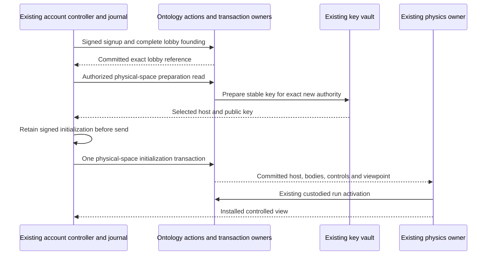

# Default physical lobby

Build the default lobby by composing the existing ontology, space, agent,
physics and Eidolon mechanisms. The contracts are [world.md](world.md),
[spaces.md](spaces.md), [physics-native.md](physics-native.md) and
[multiwrite-architecture.md](multiwrite-architecture.md).

## Model and defaults

```prolog
isa(physical_space, space).              % Existing shared vocabulary
isa(lobby, physical_space).
instance_of(lobby, personal_lobby).
instance_of(lobby_floor, floor).
instance_of(lobby_roof, roof).
instance_of(prolog_console, console).
instance_of(agent, pilot).
```

Keep the existing class-first membership and transitive `isa/2`. Use
`space_instance/2` for inherited membership; do not add redundant instance
facts or another inheritance implementation. The containing ontology owns the
program, policy and history. The lobby is the physical space inside it.

The factory composes complete reviewed source and default policy through the
existing prepared-creation/source-file mechanism. The declaration selects
physical-space behavior; explicit composed policy supplies enablement, hosting,
resource allowances, admission and control rights. Classification grants no
extra authority. An intentionally disabled space stays disabled on view/reload.

Keep the existing sky and appearance assets. Floor, roof, console and pilot
are ordinary named entities. Each solid has one explicit entity-owned physical
definition and one admitted live body binding. The annular floor contains a
transparent glass porthole curved downward over its centre. Its collision mesh
fills the centre and follows the raised outer coping. Reuse the roof, oculus,
entrances, console solids and pilot capsule geometry already built;
verify dimensions against the existing visuals. Appearance meshes are not
colliders. Spawn the pilot supported by the floor using
the existing grounded controller and eye viewpoint. Default walking speed is
2.5 m/s, with an authored 3 m/s grounded jump through the ordinary signed control
path. The visual glass uses the existing static GLB profile and alpha blending.

The default jump speed keeps the pilot inside the authored coping. Changing
either the launch speed or coping geometry requires repeating the rising-contact
rim-containment experiment.

## Shared connections

Use `space_member/2` for decorative organizational membership and
`space_place/3` for physical admission. Derive the entity list from
`space_contains/2`, removing duplicates. Remove the parallel `lobby_device/2`
inventory. The admitted body owns physical pose; remove duplicate
`device_placement/3` physical transforms. Decorative layout remains presentation.

Two shared connections support this composition:

- Local live definitions must use the same committed ontology state during
  admission and installation. Check the exact local namespace AND anchor;
  preserve definition revision/digest, assignment, delegation and dependency
  checks. A local entity needs no fabricated foreign subscription. Foreign
  definitions retain existing subscriptions and verified retained projections.
- Shared `entity_eidolons/2` must include inherited classes and preserve qualified
  class identities, modes, recipe choices and exact recipe anchors. Use it for
  entity scene composition; remove the private lobby dispatch. The world-view
  entry works for an ordinary space, with lobby-specific appearance supplied
  as ordinary recipes. This does not require the broader 3D workbench.

Body identifiers come from `physics_next_body/2`. Rendering, controls and the
pilot viewpoint resolve the current admitted binding; no magic body IDs. A
physical mark needs a valid binding before it can use `body_pose/2`. An
incomplete physical view reports unavailable/setup state and cannot fly through
objects as a fallback. The console retains the existing GUI/source controls;
the ontology remains an ordinary anchored ontology-instance Eidolon target.

## Setup using the existing signed account flow



1. Keep ordinary signup and `provision_lobby/1`. Found complete content and
   policy, create the exact ontology identity, link the account and request
   hosting through the existing lifecycle. No source repair on login.
2. After the genesis anchor exists, an authorized preparation query uses
   `prepare_agent_key_custody/5`. Policy selects the exact host and authority;
   the browser receives a result and does not choose domain facts. Repeated key
   preparation uses the existing stable slot. Preparation grants no assignment.
3. Add one shared physical-space initialization action in the existing physics
   composition. It checks enabled intent, exact identity, current principal,
   initial assignment and authored defaults; establishes the first host/key;
   calls existing placement/admission for all initial solids; and installs the
   pilot controls/viewpoint using the allocated binding. These changes form one
   ordinary transaction. Any ACL, stale baseline, geometry or policy-limit
   failure rolls back all of it. Found run/allocator/structure state explicitly;
   let normal admission advance structural revisions.
4. The account controller chains that action from the certified lobby result
   through the existing signed-operation journal. Atomically replace the parent
   with the exact signed child before sending. If preparation fails, retain the
   parent for explicit continuation. If a child is uncertain, resolve only that
   child. Do not reconstruct it from a pending/absent server state. Explicit
   finish-setup checks for unresolved operations first and never repairs source.
5. The existing physics owner handles installation and incarnation-specific run
   activation. A predeclared run/token cannot bypass its fence. The client waits
   for actual installed readiness before enabling body movement.

This uses the existing setup controller, not a new save protocol. The same
physical-space action must work for a non-lobby fixture. No unassigned native
owner, node-signing wrapper extension, new bootstrap service or work queue is
needed. Opening an already configured or disabled space causes no setup write.

## Recovery contract

The existing vault retains the exact signed custody-store request and its inner
activation before the store first enters ingress. The stable receipt scope is
network plus exact world plus activation purpose; assignment epoch and key are
receipt contents, so a new incarnation cannot bypass an uncertain request.
The ledger remains the outcome authority. The vault never submits or resolves.

Only a newly durable receipt permits the first submission. A duplicate claim,
lost reply or restarted owner resolves the retained outer request without
resubmitting it. Committed store custody hands retention to `physics_request`;
recovery then resolves the inner activation through the existing path. A new
owner must still activate its own token before installing native state.

An unknown request remains unavailable. Disable/re-enable, key-file deletion,
expiry and reconnect do not erase its receipt. Retirement requires a terminal
outcome or an exact committed domain fence: cancellation, generation advancement,
or revoked old host/key assignment. Cancellation covers the case where the
outer store has not appeared yet; its negative read prevents late application.
The existing owner loads receipts once and serves unchanged lookups from memory.
Receipts for abandoned worlds persist until their retirement is proved.

The complete source also exposed a redundant fixed node-count quota in the wire
codec. Enclosing byte bounds, structural depth, symbol validation and governed
prepared-effect admission remain the limits; no split creation or numeric cap
increase is used. Codec alphabet and canonical bytes remain unchanged. This
shared-boundary refactor requires the same review and release gates as recovery.

## Replacement and delivery

Remove the deployed `complete_lobby_setup` source-repair path when the complete
factory replaces it. Replace private lobby membership/physical placement and
Eidolon dispatch with the shared paths in the same scope. The unpublished
startup draft stays archived; reuse its assets and valid test obligations, not
its duplicate implementation. Update current specs/examples with the corrected
class hierarchy and actual recovery behavior; preserve historical evidence.

Delivery requires owner/browser verification, the requested exact-tree Claude
Fable review and clean sequential release gates, an implementation commit and
separate release label, then the authorized candidate refound and desktop
acceptance. Report actual production line delta and explain necessary growth.

Acceptance must prove:

- Fresh normal signup reaches a visible controlled lobby; desktop movement
  lands on the floor and collides with console/roof solids; authored openings
  remain passable. Inspect the same entities and definitions through their owner
  and ordinary source/inspection representations.
- A non-lobby physical space uses the shared setup/rendering path. An information
  space stays nonphysical. Disabled physics stays disabled on reconnect.
- Wrong anchor, read-only access, revoked grants, stale first-host assignment,
  malformed geometry and resource-policy rejection leave no partial host/body
  transition. A legitimate edit/removal updates the retained simulation.
- Crash/lost-reply tests cover parent-to-child journal handoff, initialization
  submission, custody-store submission, activation submission and owner/node
  restart. Unknown outcomes produce no newly signed or resubmitted replacement.
- Unchanged reads, reloads and reconciliations reuse retained state: no ledger
  replay, geometry rebuild, domain writes or file syncs. Measure legitimate
  simulation stepping separately. Actual changes still apply durably.

Deployment remains limited to the authorized candidate network and its obsolete
ledgers, following the existing clean-refound procedure. Pin and verify the new
image/source, exact target identity/volumes and healthy fleet. Leave the separate
main network and user key files untouched. The bug is complete only after fresh
candidate signup and real desktop evidence. No physical VR acceptance is implied.
