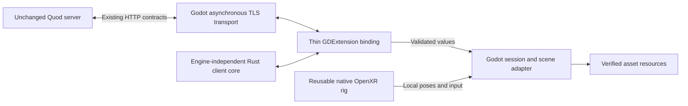

# Native Godot client

## Purpose and boundary

Build a small Linux desktop Godot client that authenticates an existing Quod
identity (created locally or imported) and displays its actual lobby through native OpenXR. Preserve useful
work as a renderer-independent client library, reusable Godot components and
shared protocol fixtures. The first headset target is the original HTC Vive.

Yan's explicit constraint: **the Quod server must not change**. This includes
Erlang, server Rust/NIFs, ontologies, wire formats, deployment configuration,
served browser bundles and persisted server data. Use installed APIs as they
are. A missing capability is an explicit limitation, never a reason to add a
native-only endpoint, proxy or client-side domain engine.

The first client slice is implemented in [client/native](../client/native/README.md).
This document defines its boundaries and remaining acceptance gates; it does
not claim live-node or physical-headset qualification. The engine choice and
component layout below are accepted.
Follow [the working agreement](../AGENTS.md), [world ownership](world.md) and
[multi-ontology write semantics](multiwrite-architecture.md). Existing unrelated
working-tree changes remain owned by their current workstreams.

## First deliverable

One native executable supports two explicit launch modes: a desktop viewer and
an OpenXR viewer. Both use the same identity, protocol and scene components.
XR failure displays the real error; it does not silently claim desktop rendering
as XR success.

The user enters a node address and port in separate editable fields (also
available as `--node` and `--port` launch options). A separate first-launch
welcome step creates or imports a key offline and persists it before presenting
the connection screen. Later launches restore the active key and skip welcome;
connection always requires an explicit Connect action. On a network with no
account, a focused account step uses the existing signup and lobby actions.
The lobby opens with its menu closed. Browser-compatible encrypted backup
import/export remains optional under Key & backups. The client authenticates and renders the
personal lobby's supported marks and assets. Signup availability is determined
by the installed catalogue and server policy.

The native active identity uses a private local file and one writer lock.
Persistence is atomic and durable before network use. Enrollment retains exact
signed requests, replaces parent/child recovery records atomically, and resolves
uncertain outcomes without resubmission. No general domain writes are exposed.

The XR viewer provides stereo rendering, head tracking, both controller poses,
named trigger/grip/touchpad actions, local pointing and selection. Selection
retains the mark's exact depicted subject; it does not execute a domain action.
Desktop free-view navigation uses a reusable camera controller with physical
WASD/arrow keys, vertical movement, mouse look and focus/menu cancellation.
Local tracking and free-view navigation change the observer view only. It must not imply an avatar has
moved, that collisions were checked or that tracked hands can manipulate bodies.

Explicitly outside the first deliverable: authoritative locomotion, physics
interaction, general durable writes, proof cursors, world editing, general GUI
forms, multiplayer avatars, hand tracking and standalone-headset export.

## Existing contracts to reuse

| Responsibility | Existing implementation / contract | Native use |
| --- | --- | --- |
| Identity backup | [key-provider.js](../client/src/key-provider.js), [identity tests](../client/test/key-provider.test.js) | Import the same encrypted bundle; preserve account references and key identity. |
| Authentication and signed reads | [signed-client.js](../client/src/signed-client.js), [wire tests](../client/test/signed-client.test.js) | Exact challenge bytes, request bytes, signatures, deadlines and result semantics. |
| Exact agent references | [agent-references.js](../client/src/agent-references.js) | Namespace, genesis anchor and instance term remain separate, validated fields. |
| Prolog value syntax | [prolog-read.js](../client/src/prolog-read.js), [prolog-term.js](../client/src/prolog-term.js) | Parse/render transport terms without evaluating Prolog or inventing a JSON scene API. |
| Lobby lookup | [world.js](../client/src/world.js) | `lobby_reference(Lobby).`, then anchored `lobby_modes/1` and `lobby_view/2` reads. |
| Scene descriptors | [marks.js](../client/src/marks.js), [scene.js](../client/src/scene.js) | Validate the same `mark/7` vocabulary and reconcile stable visual occurrences. |
| Assets | [mesh contract](eidolon-mesh-support.md), [GLB validator](../client/src/glb-profile.js), [resource owner](../client/src/render-resources.js) | Existing content-addressed URLs, digests, profiles, bounds and projected allowances. |
| Later simulation | [simulation.js](../client/src/simulation.js), [locomotion.js](../client/src/locomotion.js), [movement contract](player-movement-plan.md) | Existing view stream, owner fencing, projection refresh, control sequence and viewpoint policy. |
| Later durable actions | [operation-journal.js](../client/src/operation-journal.js), [write contract](multiwrite-architecture.md) | Persist original signed operations before submission; resolve uncertainty without resubmission. |

Initial network traffic uses `/api/auth/challenge`, `/api/auth/complete`,
`/api/ontologies/system` when needed, `/api/goals/read` and the current asset
URLs. Existing [routes](../src/quod_client.erl) are evidence, not an edit target.
Enrollment alone calls the existing execute and outcome endpoints. The viewer
never calls cursor-accept or control endpoints.

## Component ownership

Files live below `client/native/`, with `core/`, `godot-extension/`
and `godot/` subdirectories. A client-local Cargo workspace keeps this entirely
separate from the server physics crate. Keep conformance data below
`client/test/fixtures/native-contract/` so browser and native tests can consume
one set.

**Rust core.** Own exact request encodings, identity import/signing, transport
term parsing and validated scene values. Its public API takes/returns ordinary
Rust values and bytes, with no Godot nodes, network runtime or server state.
Keep the signing key behind an opaque handle. Use maintained libraries for
Ed25519, PBKDF2-SHA-256 and AES-256-GCM; do not implement cryptography ourselves.
Add modules only when the first slice consumes them.

**GDExtension binding.** Translate values and expose narrowly scoped operations.
It owns neither another protocol implementation nor another cache. Preserve
large integers as exact values across the boundary, not floating-point JSON
numbers. Keep expensive key derivation off the XR render thread; only the main
thread mutates Godot scene objects.

**Typed GDScript components.** Own the session UI, asynchronous HTTP adapter,
scene reconciliation, render resources and XR rig. One session owns outstanding
requests and cancels/discards late completions when identity, endpoint or view
changes. Rendering never blocks on network I/O. No Node.js sidecar, embedded
browser or local HTTP bridge is needed.

Rust is used because the repository already uses its toolchain and the
protocol core should remain usable without Godot. Godot's documented
[Crypto API](https://docs.godotengine.org/en/stable/classes/class_crypto.html)
does not expose the required Ed25519 path, and
[AESContext](https://docs.godotengine.org/en/stable/classes/class_aescontext.html)
supports ECB/CBC rather than the identity bundle's GCM mode. The
[godot-rust binding](https://godot-rust.github.io/book/) provides GDExtension
integration. This adds a native build artifact; qualify that loading seam early.

The browser remains a separate supported surface. Reuse its contracts, assets
and test vectors, not copied Babylon code or a second JavaScript bridge. Native
code has one implementation per responsibility. A browser migration to a shared
compiled library is outside this scope; shared fixtures constrain drift now.

## Compatibility invariants

### Identity and requests

- Preserve the existing encrypted backup format, authenticated data, KDF
  parameters and account references. Derive the signing public key from private
  key material and check consistency; unauthenticated bundle metadata grants
  nothing. Wrong passphrases and damaged bundles fail without replacing keys.
- Import through the UI, never command-line secret arguments. Keep unlocked
  active keys in private local storage for automatic restore, with separate
  encrypted portable backups. Clear live session references on disconnect.
- Validate TLS certificates and hostnames. Support an explicit local CA when
  needed; no insecure fallback. Bind remembered accounts to the authenticated
  network identity. Never transfer a signing session to a redirected origin.
- Match the existing signed-goal domain separator, parser version, field order,
  byte lengths, big-endian integers and base64url encoding exactly. Test the
  signed bytes, not merely decoded JSON. Preserve absolute request deadlines.
- Preserve result distinctions: successful answer, Prolog failure, authorization
  refusal, malformed response and transport failure. Do not turn a failed read
  into an empty valid scene. Refresh is explicit, not a readiness polling loop.

### Projection and assets

- Reuse the complete vocabulary required by the existing lobby: primitives,
  groups, labels, materials/textures and static GLB occurrences. Unsupported or
  malformed descriptors produce an explicit error instead of partial success.
- Preserve occurrence IDs, parent-before-child order, exact ontology anchors
  and depicted subjects. Imported mesh names and metadata never grant identity
  or permission. Reparent retained children before retiring removed parents.
- Convert authored millimetres and degrees once at the engine boundary. The
  current Babylon scene explicitly uses right-handed coordinates; do not apply
  a guessed blanket Z flip. Verify rotation composition, front/pivot mapping,
  parent transforms and XYZW pose conventions with asymmetric fixtures.
- Check transfer size and SHA-256 before decoding. Enforce the existing static
  GLB profile, measured resource use and declared bounds before loading with
  [GLTFDocument](https://docs.godotengine.org/en/stable/classes/class_gltfdocument.html).
  Decoder capability is not permission to accept extra glTF features.
- Keep verified bytes, decoded templates and textures alive for their real
  viewing session. Share by digest/profile, check each occurrence's allowances,
  and retain distinct placement/picking identities. An unchanged scene does not
  fetch/decode assets again, recreate nodes or write cache files. A real change
  updates only the affected resources; cancellation must prevent stale installs.
- Budgets come from existing descriptors/policy; encoding limits come from the
  existing protocol. Missing allowances or unsupported assets are reported,
  not fixed by silently inventing caps or changing the server.

### XR

Use Godot 4 native OpenXR and the Mobile renderer as the initial configuration,
following [Godot's XR setup](https://docs.godotengine.org/en/stable/tutorials/xr/setting_up_xr.html).
Pin the exact stable engine, export templates, Rust dependencies and compatible
GDExtension API before implementation. Do not depend on an unpinned latest build.

Use one reusable `XROrigin3D` rig with camera and two controllers. Keep the rig
independent of Quod authentication and scene projection. Use a deliberate
[OpenXR action map](https://docs.godotengine.org/en/stable/tutorials/xr/xr_action_map.html)
with named actions and the Vive interaction profile; raw controller indexes
must not appear in domain code. Handle tracking loss, focus loss and session
stop through runtime events. Keep rendering with the runtime's frame pacing.

The first viewer has an explicit observer origin, not a fabricated controlled
agent eye position. Later movement must use the ontology-projected viewpoint,
tracking mapping and clearance rules. Godot character controllers or XR Tools
locomotion must not become a competing authoritative simulation.

## Implementation sequence and acceptance

1. **Pin the foundation and qualify the XR rig.** Record exact binary/dependency
   hashes and host/runtime selection in a separately labelled evidence directory.
   Use project-local tools and process-local runtime selection. Build a diagnostic
   scene and the extension loading seam. Confirm native stereo frames, floor
   reference, head/controller poses and action delivery. Exercise two clean
   start/stop cycles. The diagnostic scene remains a reusable test fixture.

2. **Establish cross-client conformance.** Produce deterministic fixtures using
   existing JavaScript encoders and disposable test keys: challenge/request
   bytes, signatures, encrypted bundle import, anchored references, term syntax,
   marks and invalid inputs. Native tests consume the same corpus and compare
   exact results. Browser tests verify that the corpus still matches production
   functions. No real identity material enters fixtures or logs. Fixtures specify
   interoperability, not a second schema authority.

3. **Connect the unchanged server.** Add the import/unlock/account UI and TLS
   transport. Read an existing lobby through the exact anchored goals. Verify
   wrong-network references, refusal, timeout, cancellation and endpoint changes.
   Capture redacted request metadata showing no domain execute/control requests.
   If credentials or a provisioned account are unavailable, retain that live-test
   blocker explicitly while continuing offline conformance/rendering work.

4. **Render the actual lobby.** Implement validated marks and asset resources;
   cover the lobby's required vocabulary without substituting a hand-authored
   scene. Reuse the existing asymmetric GLB fixture to catch handedness, pivot
   and placement errors. Bind the same scene to desktop and XR presentation.
   Verify an unchanged repeat through the real resource owner using counters for
   fetches, decodes, node creation and disk writes; then apply one actual change.

5. **Qualify and package the small client.** Produce a reproducible Linux build,
   run instructions and focused test commands. Test the exported executable as
   well as editor execution. Separate headless, simulated-XR, live-server and
   physical-Vive results. Physical acceptance requires stereo output, tracking,
   trigger/grip/touchpad actions, focus recovery and two session cycles on the
   actual headset. Report frame-time measurements with the scene and runtime;
   a simulator cannot establish comfort or physical controller support.

Steps 2–4 can proceed while physical hardware is unavailable, but step 5 cannot
claim physical acceptance. Preserve the previous WebXR campaign and failures:
[existing evidence](evidence/player-movement/linux-webxr-20261008/README.md)
establishes simulated native OpenXR success, not Godot or Vive success.

## Later increments using the same components

**Simulation and authorized movement.** Extend the core with the existing
`/api/views` protocol: signed view open, accepted projection, frame ACK,
refresh/unavailable handling, expiry and world/authority/epoch/generation/
incarnation/structure fences. Discard stale view/body revisions on replacement.
Map input into existing `/api/goals/control` commands only when projected
capabilities permit them. Preserve sequence recovery and never replay uncertain
commands. If Godot requires a per-frame WebSocket pump, that is transport service,
not a timer that repeatedly probes server readiness. No polling-based reconnect.

**Durable interactions and UI.** Enrollment already retains exact signed operations
and resolves them after interruption. Extend that journal for general execute
and cursor-accept paths, with interruption/restart coverage before enabling them. Presentation can later
consume existing supported forms through a separate Godot adapter. The
[GUI plan](gui-plan.md) describes broader proposed semantics; those are not
installed capabilities and cannot be prerequisites for this server-frozen work.

## Completion evidence

Keep full logs, actual child exits and failed attempts for each qualification
run. Use delivery/processing evidence rather than sleeps. Run client core tests,
shared conformance tests, Godot import/headless checks and relevant existing
browser tests sequentially before integration; perform hardware gates separately.
Record exact source hashes because other workstreams may change the reference
client while this work proceeds. Reconcile contract changes explicitly.

Before declaring the first slice complete, verify all of the following:

- An existing account's real lobby renders through the unchanged server in the
  exported native client; scene geometry comes from its authorized projection.
- Identity and wire compatibility pass the shared corpus, including rejection
  cases and integers beyond floating-point exactness.
- Renderer ownership/cancellation and unchanged-repeat costs satisfy the tests.
- XR software qualification and physical hardware acceptance have distinct,
  honest statuses; any unperformed gate remains outstanding.
- This work changes only client code, client test assets/tooling and its own
  documentation. No server files, server data, deployment or served bundles were
  modified by this work. Report actual production-line growth and its purpose.
