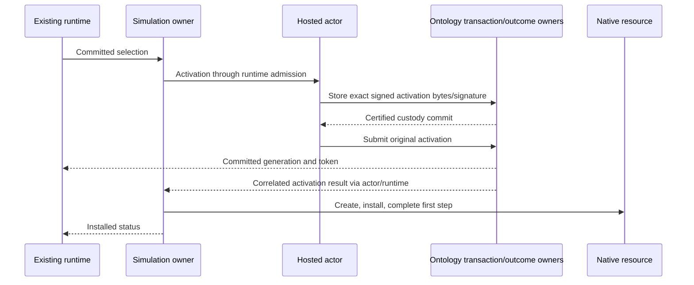

# Retained server physics profile

The authority and lifecycle contract is [world.md](world.md). This first adapter
supports authored solid and surface geometry, baseline poses, uniform gravity,
and coherent pose/contact snapshots. Authored revolute joints support reusable
Prolog close/cancel actions, mechanical contact braking and signed blocked/closed
consequences with an atomic stopped-angle checkpoint. One local client view
can consume current poses. Governed body-state and collision queries read the
installed owner. Signed transient controls move ontology-defined rigid agents and push eligible
free dynamic bodies. Explicit rest checkpoints preserve their recovery poses;
impact occurrences remain outside this profile. Unsupported joint/checkpoint declarations fail installation visibly;
there is no silent baseline fallback.

## Installation and policy

Physics bridges are registered in every ontology's common startup base. This
allocates no simulation and grants no invocation or control rights. Compose
[quod_physics.pl](../priv/ontologies/quod_physics.pl) with the existing agent
hosting rules in the world owner. Give the selected actor explicit `can_invoke`
grants for `physics_store_request/6` and `physics_activate/3` through ordinary
signing policy. The real-owner server fixture in
[quod_physics_tests.erl](../test/quod_physics_tests.erl) supplies those grants,
a ground collider and one falling body; run `rebar3 as test eunit
--module=quod_physics_tests`.

Deploy the shared startup base through the existing release authority, with
participating validators and projection consumers on the same implementation.
Founding manifests remain immutable provenance. World rules, authority custody
and enablement remain Prolog state, installed through ordinary edits and actions.

`physics_space(World, disabled, Instance)` suppresses both hosting that physics
agent and allocating its native world. Enabling it selects only the node in the
actor's committed hosting assignment. Other nodes have no local simulator for
that assignment. Each space can select a different host.
Each space uses a dedicated physics actor in this profile; sharing one actor
between independently enabled spaces is unsupported. Tests cover different
world-owning ontologies and independently hosted worlds in one ontology.
Existing per-predicate OCC also means activation
custody changes in one ontology can conflict across its worlds.

The Prolog selection supplies:

- `physics_run(World, Generation, IncarnationToken)` and
  `physics_structure(World, Revision)`;
- `physics_allowances(World, limits(Bodies, Poses, Contacts, CoordinateMm,
  geometry(Parts, Vertices, Triangles)),
  StepMicroseconds, GravityMmPerSecondSquared, RequestBudgetMs)`;
- `physics_body_definition(World, Id, Revision, fixed|dynamic|controlled, Pose,
  owned(Shape, DensityKgPerM3)|live(EntityRef, AssignmentRevision,
  DefinitionRevision, Digest))`;
- `physics_next_body(World, NextUnusedId)` for admission and hinged-object allocation.

World policy explicitly supplies geometry allowances; package changes do not
rewrite committed ontology rules or founding manifests.

## Live definitions and atomic admission

Compose the [space transitions](spaces.md) with
`space_physical_change(W,S,Change) :- physics_space_change(W,S,Change)`.
The source entity owns `physics_definition(Entity, Revision,
geometry(Shape,Density))` and `physics_definition_allowance(Entity,CoordinateMm)`.
The destination supplies `physics_admission(World,EntityRef,Kind,Pose)` and an
authored ground `subscribes(SourceNamespace,SourceAnchor)` fact. Derived
subscription answers are not runtime declarations. Admission requires an
enabled simulation; merely classifying a space allocates no body.

`space_place/3` commits the exclusive assignment, destination admission,
source installation delegation, live body binding and structure revision in
one existing atomic transaction. The source's
`can_delegate_physics_definition(Entity,Principal,WorldRef,AuthorityRef)`
controls its exact delegation. It does not grant invocation, disclosure,
control or hosting. Each participating scope still needs its ordinary entry
ACL for the exact anchored callback. Callbacks verify the staged counterpart;
they are not independent public editing entries.

`physics_edit_definition(Entity,ExpectedRevision,geometry(Shape,Density))`
requires source `can_edit_physics_definition/2` and destination
`can_refresh_physics_definition(World,Principal,EntityRef)`. It changes the
source definition and the destination body/structure revisions and checkpoint
state atomically. This destination permission does not grant arbitrary world
editing. The binding stores an exact source reference, assignment/definition
revisions and canonical term digest, never a mutable geometry copy.

`space_withdraw/3` removes the exact body/delegation and retains the assignment
tombstone. `physics_delete_definition/2` composes that withdrawal and a
revisioned `none` definition. Unsupported constraints, an existing agent/body
binding or unresolved original checkpoint custody refuse removal; compose an
authorized binding release first in the same transaction. Body IDs never
return to the allocator. An existing world must initialize the allocator
explicitly above its authored IDs through an authorized edit.

`physics_assign_authority(World,BeforeInstance,AfterInstance)` requires world
editing permission, an already hosted successor, completed activation custody
and every source's delegation permission for that successor. It changes the
world assignment and all live source grants atomically. Host/key assignment
uses the existing agent lifecycle; replacement starts a new run generation.
This is not an inter-simulation transfer.

The runtime resolves live definitions over its existing retained verified
source projections in its bounded resource worker. Source predicate changes
wake the affected resources independently of reaction delivery. Installation
checks the exact source follow, projection height/identity and materializer
generation alongside local body/structure fences and the original deadline.
Ready subscription notices carry the exact retained reader. Selection and
installation compare its current follow row and reader lifetime locally;
they neither block on the shared log owner nor fetch or rebuild source state.
An established reader's death triggers reconstruction from the current retained
verified cache. Failure before publishing a replacement parks the source until
new progress, rather than repeatedly rebuilding the same failed input.

While a source verifies a new delta, its consuming simulation pauses without
discarding the viewer or extending input expiry. An unrelated delta resumes
the same controls. A relevant change retires the old view; missing or denied
geometry keeps its world unavailable, never turns the collider into empty
space. Independent valid worlds continue. Recovery selects current verified
state without replaying reactions. Unchanged selections do not rebuild native
geometry or write/sync storage. Geometry and installation-authorization
changes reach existing viewers through this same physics owner and its normal
refresh/installed notices. A viewer needs the world's viewing/control grants,
not entry grants to every collider source. The signed view separately retains
its actual visible-world, acting-agent, physics and Prolog authorization reads.
Hot inputs and authenticated contact matching use installed body/run fences
without reading source geometry again.

Explicit reusable hinged-object recipes produce owned geometry. They are deliberately
materialized recipes, not the default semantics of admitted live instances.
Live definitions may use the world's own source scope or a different ontology
with an explicit subscription. Repositioning a live body revalidates its source geometry,
so the editor needs the corresponding source entry grants. An entity admitted
only to an unsimulated space has no installation delegation; its definition
can be edited without a simulated receiver consequence.

## Shared-domain contents frames

An ordinary space can participate in a continuous physical component without
enabling another simulation. The root world authors
`physics_frame_admission(World, ParentFrameRef, SpaceRef)` for each frame edge
and `physics_component_admission(World, ParentFrameRef, EntityRef, Kind, LocalPose)`
for bodies admitted inside a child. Direct root bodies retain
`physics_admission/4`. The shared component's local pose comes from the source's
unique authored transform and must satisfy that admission policy, including a
transform staged by travel. Source entry and destination admission remain separate
from these physical policies. Display membership supplies none of them.
`physics_frame_allowance(World,Limit)` governs admitted frame count separately
from the existing body/geometry budgets. Missing, ambiguous or exhausted frame
policy refuses allocation with the named frame resource; no depth cap is built
into the adapter.

The contents source exports `frame(Transform, SelectedRecipe)` through its
existing `physics_definition_projection/5` and exact source delegation. A frame
revision is the digest of that authored transform and selected recipe. Shared
frames require the same contents recipe in playing and edition views.
An incompatible selection becomes unavailable. The root
retains `physics_frame_member(World,SpaceRef,Assignment,Revision,Path)`; every
path edge names the exact source, assignment and frame revision. This binding
does not change the source's ordinary assignment, storage or owner. A space
shown by its marker and admitted as an inert frame creates no collider or child world.

One root authority, run and native world own the bodies of the component. Each
exact entity/assignment has one body, even with independent decorative
appearances. A child body's authored pose is `framed(Path,LocalPose)`. Local
space transforms use integer degrees; the existing `pose/2` format uses integer
milliradians. The runtime resolves each source edge over its retained verified
reader and checks the root binding at every prefix. The engine adapter composes
parent-before-child rotations and translations, then converts once to the
existing native XYZ radians representation, with deterministic gimbal handling.
It never adds Euler components or introduces scale. Positions retain an exact
integer millimetre anchor plus fractional residual through native rebasing.
Terrain's axis-aligned lattice is not a supported framed body and refuses with
`unsupported_framed_terrain(Body)`.

Unconfigured child frames explicitly inherit the root domain's gravity vector,
timestep and units. Rotating a child frame does not rotate that domain gravity.
Configured child simulations, including disabled profiles, are outside this
shared-component subset and refuse delegation. Independently enabled worlds,
body inventories, prior runs, pending activation or control selections refuse
frame delegation. Selecting contents grants no active-simulation migration.
Existing activation, hinge, control, rest and custody protections still fence
frame edits and branch removal. A source representation change and dependent
body/structure revisions commit atomically; body IDs remain stable on updates.

Geometry, frame and delegation dependencies share the same resource selector
and retained foreign readers. The selector reads committed snapshots and can
call class owners through ordinary signed scopes with their ACLs; live queries
and writes remain forbidden.
Revocation or missing verified input parks only consuming simulations. Unrelated
changes retain native resources and controls. Required geometry, delegation and
frame-membership/export failures are explicit results for the consuming world;
they preserve the selector's failure reason and missing-read dependencies while
the owner continues reconciling other worlds. A real committed repair wakes the
affected selection through its retained dependencies. Unexpected evaluator faults
still fail at the existing owner boundary. The signed view separately proves
source disclosure for every visible edge and includes
`view_frame(ViewedSpaceRef,TransformChain,BodyFrames)` alongside the selected root domain.
Native samples, contacts and authenticated inputs use that one domain frame.

A decorative occurrence in the selected domain uses `body_frame_pose(Id,Revision)`.
`BodyFrames` contains one `body_frame(Id,Revision,PathId,TransformChain)` per
referenced body. The occurrence applies the inverse composed source frame to
the streamed world pose before its own parent frame. Actual placement retains
absolute `body_pose/2`. Independent appearances share that one body stream and
do not allocate mass, contact or control. Product rendering of this portable
descriptor requires the corresponding client implementation.
`TransformChain` on the viewed interior applies to absolute body poses in that
interior. A reframed occurrence instead uses its body's source chain on the
original domain sample, then its occurrence parent; do not apply both inverse
chains to the same sample. Root-level source bodies use an empty source chain.

## Geometry and resource policy

The pure authored-body data schema is shared framework source in
[`geometry_schema.pl`](../priv/ontologies/geometry_schema.pl), loaded by the
existing committed projection base. Body authoring, terrain, hinge and native
installation callers use this one implementation. It validates supplied
geometry and coordinate allowances without choosing a world, allocation,
policy or admission. Mutable definitions, delegation, run/control state and
atomic consequences remain in their existing composing ontology. These are
ordinary interpreted base clauses, included in complete source inspection
and governed local edits; reconstruction requires the exact base package.
Native feasibility still checks representation, hull volume and triangle area.

`Pose` is `pose(vector(X,Y,Z), rotation(Rx,Ry,Rz))`, with millimetres and
milliradians. Rotation applies X, then Y, then Z. `vector(X,Y,Z)` authors an
identity rotation. Supported solids are `box(HalfX,HalfY,HalfZ)`, `ball(Radius)`,
`capsule(HalfSegment,Radius)` along local Y, and `convex(Vertices)` with explicit
convex-hull semantics and positive volume. `parts([part(LocalPose,Solid),...])`
authors a rigid compound: gaps between parts remain gaps, and parts have their
own position and orientation. Articulated geometry requires supported joints;
it is not flattened into a hull or replaced with a capsule.

Fixed bodies additionally support `surface(Vertices,Triangles)`. Vertices are
`vector/3`; each `triangle(A,B,C)` names zero-based vertex indices. Invalid or
degenerate triangles fail installation. This is an explicitly authored physical
surface, independent of rendered meshes, picking bounds and voxel indexing.
It represents sloped/non-cubic terrain without introducing a grid controller.
Surface geometry cannot be used as a moving solid body.

The composable [voxel terrain domain](voxel-world.md) binds one fixed terrain
body to a procedural field and current patches. Its existing resource worker
retains immutable chunk surfaces and volume classifications; loading chunks
allocates no durable body IDs. Missing physical coverage pauses relevant work
until installation, rather than treating unknown terrain as empty.
Known terrain obstruction and ambiguous geometry are distinct blocked outcomes
identifying the affected body. They retain the native state and wait for a
governed correction, without an unsatisfiable coverage request. Authored
geometry/pose changes receive surface admission checks; ongoing unchanged
contacts remain under the normal solver. The [terrain contract](voxel-world.md)
defines these outcomes and prospective viewer-window admission.

Governed body edits share the Prolog `physics_valid_body/6` schema for body
identity, kind, authored pose, geometry, density and coordinate allowance.
It accepts every shape above. Hinged moving parts accept the same supported
solids and compounds; fixed supports also accept surfaces. Integer rotations,
density, motor scalars and dimensions must fit the adapter's finite binary64 representation before unit conversion;
this encoding envelope is independent of coordinate and geometry policy.
Native installation additionally checks numeric representation, convex volume,
triangle area, compound bounds and supported joint mechanics.

Geometry allowances count all installed parts, convex/surface vertices, and
surface triangles across the world, including unchanged retained bodies.
Unchanged geometry consumes its declared allowance without rebuilding native
shapes. Geometry and body revisions install together. `controlled` selects a
kinematic body; the governed motion path below applies checked poses without
movement-induced impulses to dynamic obstacles.

The limits are policy inputs, not Erlang constants. Authored world positions
are exact integer millimetres. A coherent integer origin converts them to a
bounded local frame before native floating-point conversion; shifting that
frame preserves live bodies, colliders, velocities and run identity. The native
numeric envelope bounds local positions and physical dimensions. Gravity, velocity, density and all
other numeric values must be finite and representable as Rapier `f64`; density
is not compared to a distance allowance. IDs and body revisions use unsigned
64-bit native fields. Positive mass, dimensions and step are representation
requirements. The ordinary hosted-agent admission policy still owns actor
population and request capacity. Body/contact limits are not a hard byte or
wall-clock allocation guarantee: broad/narrow-phase pairs can grow quadratically
with the admitted body count. Policy authors must budget aggregate worlds too.

## Live Prolog physics queries

`physics_body_state(World, Body, Result)` requires the ordinary `can_invoke/4`
grant and `can_read_physics_body(World, Principal, Body)`. It returns
`body_state(Frame, Tick, body(Id,Revision), local_metres_seconds(OriginMm), Pose, Velocity)`.
`OriginMm = vector(X,Y,Z)` is the exact integer world origin. Add it to local
pose millimetres to recover canonical coordinates; velocities are unaffected.
`Frame` is `physics_frame(WorldRef, Authority, HostEpoch, RunGeneration,
Incarnation, Structure)`; pose rotations use `quaternion(X,Y,Z,W)`.
The owner copies its retained sample. A stale installed frame, missing body or
retired run may bind `unavailable`, never an inferred baseline. A missing owner
or failed owner call is a reasoned failure under the [proof contract](proofs.md),
distinct from that valid answer. Malformed request or policy values are errors.

`physics_motion_query(World, Body, Query, Result)` additionally uses
`can_query_physics_motion(World, Principal, Body, Query)` and
`physics_query_allowances(World, Principal,
query_allowances(SkinMm, PenetrationToleranceMm, SlideIterations,
NarrowPhaseTests, TranslationComponentMm, RotationComponentMrad))`.
Each allowance is ontology policy. Both predicates require a read-only proof;
they cannot validate staged grants or a durable edit using transient state.
Unauthorized queries fail. Their Erlang continuations require an opaque handle
created by the public predicate before evaluating ordinary Prolog policy.

Queries are `place(pose(vector(X,Y,Z),rotation(Rx,Ry,Rz)))`,
`travel(vector(Dx,Dy,Dz),angular(Ax,Ay,Az))` and
`landing(vector(X,Y,Z), ReachMm, DropMm, MinUpPermille)`. Placement rotation uses the authored
Euler convention; travel rotation is an angular displacement vector in world
coordinates. Distances/angles in inputs are millimetres/milliradians. The native travel
rotation query accepts at most pi radians per component. This is a single
bounded rotation sweep, not an unbounded spin command.

The result is `motion_query(Frame, Tick, body(Id,Revision), local_metres_seconds(OriginMm),
Answer)`. `Answer` is `clear(Pose,Checks)`,
`clipped(Pose,Contacts,Checks)`, `occupied(Body,Checks)`,
`blocked(Body,Checks)`, `no_support`, `unsupported`,
`unavailable`, `invalid`, or `exhausted`. Contacts name the collider and world
normal. Translation slides along contact surfaces; rotation stops at contact.
Slide exhaustion returns the conservative clipped pose; narrow-phase allowance
exhaustion returns no usable pose. Unsupported shape pairs fail closed.

Queries use the installed broad-phase index and current collider poses, including
doors; they do not rebuild terrain or move any body. Collider installation must
finish updating that index before queries become available. Results describe
that tick only: a clear preview is neither a movement authorization nor a future
landing guarantee. The command owner checks again at application.

## Played-agent movement

`physics_agent(World, Agent, Revision, Body, Motion)` selects an existing local
agent instance and its declared rigid body. `physics_viewpoint(World, Agent,
Name, Body, LocalPose, Tracking)` defines both position and orientation of the
camera in that body frame. There is no universal capsule or browser eye height.
The human principal may belong to another ontology and never impersonates the
controlled agent. A compound body may have arbitrary authored local parts;
unsupported articulated controllers fail closed.

`physics_control_agent(World, ExpectedEpoch, ExpectedSelection, Selection)` is
an ordinary transaction. Selection is `none` or `controlled(Agent, Viewpoint)`.
It requires `can_control_physics_agent/3` plus ordinary invocation admission,
checks exclusive target ownership, and advances an enduring binding epoch.
Release retains the epoch tombstone. A revoked holder cannot be silently
replaced while its durable binding still exists.

The first movement profile is:

```prolog
motion(free, SpeedMmPerSecond, TurnMradPerSecond, LeaseMs,
       query_limits(SkinMm, ToleranceMm, SlideIterations, NarrowPhaseTests), Capabilities)
motion(grounded(MinUpPermille), Speed, Turn, Lease, Limits, Capabilities)
```

Grounded means world-Y gravity, horizontal commanded travel and support normals
meeting the authored upward threshold. It is an explicit mechanical profile,
not an inference from agent shape. Capabilities are unique entries from
`snap(AngleMrad)`, `teleport(ReachMm, DropMm, MinUpPermille)`,
`jump(LaunchMmPerSecond)` and `reposition`.
Unknown modes/capabilities are refused. Policy supplies speeds, lease and query
allowances; packet frequency does not multiply continuous travel distance.

The signed `control` mode (wire tag 3; `/api/goals/control`) reuses the existing
signed ingress and proof engine. Its database is read-only. The root uses the
existing distributed savepoint, and an external predicate stages at most one
indivisible transient effect in the immutable proof overlay. Only the first
surviving answer, after successful scope finalization, releases it through
`quod_effect` to the existing physics owner. Failure, abandoned branches,
negation, cut failure, expiry or proof cleanup release nothing. Ordinary read,
execute and cursor requests cannot stage this effect. This lane has no ledger,
operation journal, automatic replay or remote control forwarding.

```prolog
physics_control_input(World, control_frame(PhysicsFrame, Registration),
                      BindingEpoch, Sequence, Input, queued(Sequence)).
```

`PhysicsFrame` is the same exact frame used by live queries. Registration is
created by the current signed view and checked by the physics owner, together
with installed control configuration, authority, structure, sequence and expiry.
A refresh/disconnect revokes it and clears voluntary input, including unapplied
discrete requests. Grounded fall state survives a view disconnect or a reinstall
of the same control configuration. Changed physical geometry wakes support
checks even for a settled body. A clipped descent with no downward progress
settles mechanically; it does not make that contact a valid teleport landing.
While the physical configuration is unavailable, mechanics pause and old inputs
do not keep the step timer awake. A new view reads the retained sequence high-water mark,
including after configuration edits with the same binding; its prior result is
reported as suspended when the configuration changed. An
old registration cannot take over with a higher sequence. The browser sends one
request at a time and suspends commands after an uncertain response, without
replaying it. Proof success means queued admission; the view supplies the actual
mechanical outcome.

Inputs are `drive(vector(Vx,Vy,Vz),angular(Wx,Wy,Wz))`, `snap(AngleMrad)`,
`teleport(vector(X,Y,Z))`, `jump(LaunchMmPerSecond)`, and explicitly permitted
`reposition(pose(Position,Rotation))`. Drive is the latest desired velocity,
leased and applied at the server timestep. Translation stops/slides; rotational
sweeps check all parts and stop at contact. Snap may therefore stop short of its
requested angle. Teleport keeps orientation, checks the complete straight body
path against physical geometry without an added margin, then searches downward
for valid support using the authored skin. A body inside that support margin
can travel along a clear floor. Occupied destinations, blocked
paths, unsupported slopes, missing support and exhausted queries leave the pose
unchanged. Previews never authorize a later landing. A pending discrete command
cannot be overwritten before its outcome; there is no command accumulation queue.

Jump requires grounded mode and the exact authored launch speed. The retained
owner checks current native support with a drop of twice the authored skin
(plus the cast's skin margin), using the same landing query and upward-normal
threshold. A wall touching that margin can conservatively refuse support;
stepping away allows the floor check. An ascending or unsupported
body cannot jump again. Launch, gravity, landing and head contact use the existing
travel solver and vertical state. Blocked vertical progress cancels upward
velocity; tiny negative wall-normal components do not identify a ceiling.
Disconnect cancels an unapplied jump and preserves an already applied fall or
ascent. Desktop Space requests one jump per key press; held-key repeats do not
submit further jumps. No browser prediction or durable jump transaction is added.

An occupied authored spawn or collider edit does not trigger hidden
unbounded depenetration: travel is refused with `occupied`. Numerical
penetration is admitted only up to the authored query tolerance, including
contacts with dynamic bodies; it never excludes a class of physical obstacles. Explicit reposition
checks the complete destination and may repair an occupied start without a
travel path. Reposition is live motion, not a durable baseline edit. Restart
restores authored body baselines under a new run/registration, making any
correction visible. Free dynamic bodies support the rest checkpoints below; played-agent checkpoints
remain outside this profile. Durable placement changes use the ordinary authored
edit or request/observation/committed-consequence path, never a live query as
evidence inside a durable proof.

Relevant committed physical/control changes invalidate a runtime-owned shared
generation before asynchronous reinstallation. Owners stop accepting/advancing
old commands immediately on that token, coalesce invalidation notices, and
notify only installed state. Shapes, indices and the simulation resource remain
owned by the same retained physics process. No browser mesh or picking result
becomes collision authority.

### Desktop and tracked viewing

The desktop adapter removes Babylon's translating inputs for a controlled
physical space in the ordinary view. Keys submit bounded desired travel through the predicate; the camera
mount follows accepted poses without interpolation through walls. Look remains
local. Unknown/unavailable worlds freeze commanded travel instead of enabling
observer flight.

`view_only` supports desktop look and calibrated XR viewing. Calibration maps
the entry position and heading to the authored camera mount while preserving
tracked pitch and roll. Both eyes then follow real head movement without a
displacement limit, automatic recentering or a full-view collision mask.
Head motion is local view motion: it does not submit locomotion commands, move
the controlled body or change its collision shape. Loss of tracking or physical
authority pauses commanded travel; it does not install a black overlay.
Controlled-body travel, landing and collision checks remain owned by the
existing physical runtime. Visual terrain demand follows the camera through
the existing view-interest stream; it is distinct from mechanical terrain demand.

Default XR mesh teleportation is disabled. On the intended Vive mapping, the
left grip plus touchpad drives smooth travel; a left-pad left/right click requests
snap turn and a forward click requests a half-range teleport in the controller's
horizontal pointing direction. The right pad owns the action menu. Menus and
workspaces suppress locomotion. Components are discovered by WebXR type; missing
components are not guessed. Teleport placement uses body-origin coordinates and
physical support, without a visual-floor ray granting permission. The current
adapter has no landing preview marker. Hardware qualification must separately
check Vive runtime/browser mappings, masking, comfort and contact feedback.

## Chair pushes and rest checkpoints

A chair is an ordinary `dynamic` body with a stable numeric body identity in its
anchored world. Its projected mark binds `body_pose(Id, BodyRevision)` to the
anchored domain subject in `depicts`; neither a mesh name nor a visual occurrence
is a physics identity. Body identities must not be recycled after deletion.
`physics_move_body/5` retains the identity and advances its body revision to the
new world structure revision.

The existing signed `control` request accepts:

```prolog
physics_control_input(World, control_frame(PhysicsFrame, Registration),
    BindingEpoch, Sequence, push(body(Id, BodyRevision), vector(X,Y,Z)), Result).
```

The caller needs an active played-agent binding/view registration, ordinary
invocation admission, `can_push_physics_body(World, Principal, Id)`, and
`physics_push_allowances(World, Principal, Id, push_limits(MaxImpulse, MaxSpeed))`.
Prolog checks eligibility, the exact dynamic-body revision, and nonzero impulse
magnitude. Hinged bodies are ineligible. Policy supplies maximum impulse in
milli-newton-seconds and maximum resulting speed in millimetres per second;
input components use milli-newton-seconds. Eligibility policy may impose domain
restrictions; the adapter does not infer reach or ownership from a rendered hit.
The native owner refuses a push whose resulting linear speed exceeds the limit,
including accumulated velocity from earlier pushes. This bound governs the
command's application, not later velocity caused by gravity or collisions.

The client helper `pushInput(id, revision, impulse)` in
[locomotion.js](../client/src/locomotion.js) accepts newton-seconds and preserves
64-bit IDs. Pass its term to the simulation connection's `command` method.
The current profile exposes this programmatic action; it does not add a desktop
or headset grab/push gesture.

The owner rechecks installed policy, world/authority/host/run/incarnation,
structure, body revision, registration, sequence and expiry at admission and
application. A committed physical or policy change invalidates old commands
before asynchronous reinstallation. Each sequence can apply once within its
binding; a fresh registration reads the retained sequence and a new run discards
all inputs. `queued(Sequence)` is admission, while the projected control feedback
reports `pushed`, `refused` or expiry. A definite proof refusal keeps the current
view available and clears the rejected discrete command; a later command has
a fresh sequence and signed request. The client keeps one request in flight,
waits for discrete feedback before sending another input, and suspends commands
on an uncertain reply. Refresh obtains a fresh authorized view and never
resubmits the lost push. Physics frames move the existing visual body without
writing its author baseline; appearance refresh and checkpoint-only installation
retain the live pose and native resource.

A durable checkpoint is explicitly requested through an ordinary action:

```prolog
physics_checkpoint_body(World, Id, ExpectedBodyRevision, ExpectedSequence, RequestId).
```

`RequestId` is 32 bytes and the initial sequence is zero. The world must be
enabled. The caller needs
`can_checkpoint_physics_body(World, Id, Principal)` and ordinary invocation
admission. The world supplies `physics_rest_policy(World, Id,
recovery(PenetrationToleranceMm, NarrowPhaseChecks))`. The action records
`physics_rest(World, Id, NextSequence, waiting(rest(NextSequence, RequestId)))`.
It never accepts a caller-supplied measured pose. Once the native body sleeps,
the current authority emits a fenced, completed-tick rest observation. Give that
actor explicit invocation grants for `physics_store_rest_request/3` and
`physics_finish_rest/1`. Their existing custody lane saves exact signed bytes,
then commits the finished request and checkpoint together:

```prolog
physics_checkpoint(World, rest_v1(Id, BodyRevision,
    source(Authority, HostEpoch, Generation, Incarnation, Structure, Tick),
    world_mm_quaternion_million,
    pose(vector(X,Y,Z), quaternion(Qx,Qy,Qz,Qw)), zero_velocity)).
```

Positions are rounded millimetres and quaternion components are rounded to
millionths; linear and angular recovery velocities are zero. The authored
`physics_body/7` remains unchanged. Only the current checkpoint is selected;
replacement cannot move backward in `(Generation, Tick)`. Each new explicit
request and renewal of expired, certainly-unsent evidence completes a new
mechanical step even for a sleeping body. Unknown signed outcomes are resolved using the original bytes, without
resubmission or a fresh checkpoint request. A saved-but-never-submitted request
can remain visibly unresolved. A new request cannot bypass active custody.

An authored `physics_move_body/5` transaction advances structure/body revision,
removes that body's checkpoint and cancels its waiting checkpoint activity
atomically. It retains old signed custody for outcome resolution until a new
explicit checkpoint request replaces it. Cancellation and the changed body
revision fence the old finish permanently, so that distinct request may proceed
even if the old backend outcome remains unknown; it never resubmits the old
action or asserts a rejection. If the
checkpoint commits first, the edit removes it; if the edit commits first, the
old checkpoint loses ordinary OCC validation. Neither ordering restores the
pre-edit pose. Editing an unrelated body keeps this chair's checkpoint but
fences any pending observation against the old world structure.

Request, custody and checkpoint commits each refresh the signed live view and
suspend voluntary inputs. The retained body pose survives these refreshes.

Owner death, runtime collapse/restart, ontology replay and host restart discard
unsaved motion and unapplied pushes. The successor must commit a fresh run
before installing the current compatible rest checkpoint, or the authored
baseline with zero velocity when no checkpoint exists. Hosted-agent recovery
selects any replacement host; uncertainty or missing commit quorum leaves the
world unavailable. Replayed facts do not replay push or checkpoint reactions.
An unresolved saved checkpoint operation is resolved, never submitted again.
Frames under the new run expose the recovery reset and reject old commands.

Rest recovery uses zero displacement: it checks all restored bodies against the
current installed geometry with the policy's bounded narrow-phase allowance
and penetration tolerance. It cannot move through a newer wall or open a closed
door to repair overlap. Bad rotation, incompatible revision, unsupported shape
checks, exhausted allowance or excessive overlap visibly fail installation;
there is no silent baseline fallback. An authorized body edit invalidates the
checkpoint and supplies a new baseline as the explicit recovery exit.

## Hinged actions and effective definitions

Compose [quod_hinged.pl](../priv/ontologies/quod_hinged.pl) with the core physics
rules in the same ontology. This optional Prolog capability owns close/cancel
states and their meaning; the runtime handles physical commands and samples.
A door, lid or hatch uses the same actions and owner.

`physics_add_hinged(World, MovingId, FixedId, Source, Pose, ExpectedStructure)`
requires `can_edit_physics(World, Principal)`. `Source` is either
`local(Name, Version)` or `class_ref(Namespace, GenesisAnchor, Name, Version)`.
The latter resolves `physics_hinged_class/3` through the ordinary authorized
cross-ontology proof. The action materializes both bodies and their joint in
one transaction. These explicitly pinned recipes do not change after a later
class edit; live referenced colliders retain their separate subscription rules.

```prolog
physics_hinged_class(Name, Version,
    hinged(FixedShape, MovingShape, Density, Axis,
           anchors(FixedAnchor, MovingAnchor), limits(Lower, Upper), Baseline,
           position(Target, motor(Stiffness, Damping, MaximumTorque),
                    stop(Tolerance, target_or_contact)))).
physics_joint(World,
    hinge(body(MovingId, MovingRevision), JointRevision,
          body(FixedId, FixedRevision), Axis,
          anchors(FixedAnchor, MovingAnchor), limits(Lower, Upper), Baseline)).
```

Angles are signed milliradians; anchor vectors are millimetres. `Axis` is a
nonzero local direction shared by both bodies. Positive motion follows the
right-hand rule. The adapter uses Rapier's complete angular frame for that axis,
including its deterministic negative-X case. With frame rotation `F`, fixed-body
rotation `Rf`, angle `a`, and authored anchors `af`/`am`, restoration sets
`Rm = Rf * F * Rx(a) * inverse(F)` and `pm = pf + Rf*af - Rm*am`.
The constructor's `Pose` is the group's placement anchor, not the moving body's
effective baseline pose. The joint supplies that pose. Installation validates
the computed pose before changing the native resource.

Limits stay within [-3141,3141], span at most 3141, and contain baseline and
target. This avoids the revolute angle's wrap ambiguity. Baseline and target
may be positive, zero or negative, in either direction. Each moving body has
one hinge; several moving bodies may share a fixed support. The pair's own
contact is disabled, so any intended rim/support belongs to that fixed body.
Other contacts stop the motor and take precedence over target arrival. The
bounded observation selects the lowest contacting body ID and revision.
A motor stalled without contact or target arrival remains pending until an
authorized cancellation or relevant physical change. Measured angles and
checkpoints outside the authored angular interval are refused. Numerical
constraint overshoot at a travel limit can therefore leave completion held;
authored target tolerances should lie inside that interval for this profile.

`physics_close_hinged(World, MovingId, ExpectedSequence, RequestId)` requires
`can_close_physics_hinged/3` and a 32-byte request id. It advances the sequence
and records `closing(close(Sequence, RequestId))`. The selected explicit target,
motor and stopping policy come from `physics_hinged_control/3`. A closing
activity requires a valid `position/3` command; replacing its definition with
`hold` makes the projection unavailable. Cancellation is the governed way to
stop that activity. Native mechanics brake on the selected physical condition. Prolog interprets the measurement as
`blocked(OtherBody)` or `closed`; no native code tests object names or states.

`physics_move_body/5` edits an unconnected body with expected body and structure
revisions, retaining its authored geometry and orientation.
`physics_move_hinged/5` moves a fixed support and **all** its attached moving
parts in one transaction. It advances their body and joint revisions, removes
their checkpoints and cancels active closes. It preserves already finished
activity results and custody, so a later close can replace that committed
request. A finished activity records its earlier result; removing its checkpoint
means that result is not a current placement certificate. Unsupported members
roll back the entire edit. Both require `can_edit_physics/2`. `physics_cancel_hinged/3`,
authorized by `can_cancel_physics_hinged/3`, ends a pending close while retaining
original signed custody for exact outcome resolution.

## Observation and consequence

Hinged and free-body rest measurements share one immutable envelope:

```prolog
physics_sample(
    physics_frame(WorldRef, AuthorityRef, HostEpoch, Generation, RunToken, Structure),
    activity(ResourceReference, Request, SelectedCommand),
    revisions(ParticipatingReferences), Tick, validity(At, Expiry), Payload).
```

Hinge references include the joint and both independently versioned bodies;
rest references include the free body. Payloads are
`joint_position_mrad(Angle, clear)` or
`joint_position_mrad(Angle, contact(BodyId, BodyRevision))`, and
`rest_pose_mm_quaternion_million(Pose)`, respectively. The complete envelope,
selected command and payload are covered by the signature. A changed target
cannot reuse an observation even if the activity identity stays the same.

The runtime authenticates the current simulator PID/incarnation and common
world/run/structure/time fields before matching `react_on(observed(Sample), Goal)`.
It does not inspect domain payloads. Private `physics_observation/1` metadata is
available only in that matcher; a public event with the same term conveys no
measurement authority. The Prolog consumer checks its exact references,
command, current request and measurement. A generic observed callback without
signed-request preparation cannot consume this custodied work.

The existing actor lane stores exact signed bytes and signature with
`physics_store_hinged_request/4`, then submits `physics_finish_hinged/2`.
Grant both entry actions explicitly to the authority. The finish checks exact
signed-request binding, replaces closing with the result, writes
`physics_checkpoint(World, hinge(MovingId, JointRevision, MovingBodyRef,
FixedBodyRef, Generation, Tick, Angle))` and emits `physics_hinged_finished/4`
in one existing transaction. Application clauses of
`physics_hinged_consequence(World, MovingId, Request, Result, Goal)` contribute
ordinary goals to that same transaction, including authorized receiver writes.
Failure rolls back result, checkpoint, event and receiver changes together.
No durable proof reads native physics and sealing has no physics exemption.

The checkpoint is an insertion-only restoration input separate from joint
structure. Selecting its own checkpoint does not reset a retained body. A new
owner restores the compatible checkpoint or authored baseline after committing
its new run; it does not replay an earlier reaction or restart a finished motor.

Required samples use the existing bounded owned-event cursor and actor queue.
Refusal retains the unsent sample and capacity release wakes it. Expired unsent
evidence needs a later completed native step and a new interval; old bytes keep
their original expiry. Replacing saved custody requires a matching finished
request, certified rejection/abort of the original operation, or explicit
cancellation **and changed participating physical revisions**. Cancellation
alone cannot discard an unknown operation. This rule is shared with rest
checkpoints. Original history and bytes remain available for exact resolution.

Pending, unknown and failed resolution leave the resource held with a visible
status. Recovery resolves original custody without resubmitting it. Terminal
outcomes are read through ordinary pinned proof dependencies and OCC; simulator
notifications cannot certify rejection. Unsent policy refusal waits for a
relevant selection change. There is no readiness polling or retry timer.

This is a coordinated format replacement. Validators, selectors and native
adapters must use the same release. Updating a package does not update retained
ontology rules or founding manifests; old formats are not converted or silently
accepted. Apply ontology changes through the established governance/deployment
owner, preserving original operation history, or perform a separately authorized
refound when required. Never hot-replace a loaded native resource.

## Owner and recovery

The existing ontology runtime selects `physics_worlds` from its retained
snapshot. One registered `quod_physics` process per anchored WorldRef owns all
native mutation. The runtime waits for its DOWN before replacing its slot;
the registration also prevents overlap when the runtime itself restarts.
Every native operation verifies the creator PID. The runtime authenticates
selection, status, result and death messages by current PID/reference.



The activation compares the expected committed generation and exact preceding
custody record. Its original bytes/signature are committed before submission,
using the existing transaction path. A successor resolves those exact bytes
through the existing outcome service. Even if its predecessor's activation
committed, the successor must activate a fresh generation with its own token.
It never adopts the dead incarnation's generation. Result-before-selection and
selection-before-result both wait for matching evidence.

`physics_activation_status(World, OriginalRequest, Status)` derives pending,
activated or cancelled from committed custody/run facts. It is not a separately
updated “sent” flag: a crash between send and recording send would still be
ambiguous. A successor resolves the saved original operation; it does not
resubmit an uncertain activation or adopt an older incarnation's token.

Pending, unknown, timeout and an unresolved custody-write result leave physics
visibly unavailable. None means rejection. Capacity waits retain the original
absolute deadline. Confirmed unsent failure, certified terminal rejection and
failed resolution reads have distinct statuses. A newer custody or run-generation
selection that arrived before a failed reply is processed once after that reply. Explicit
resource reconciliation can re-resolve unavailable activation using the same
original request, without recreating native state. A certainly unsent attempt may
start a new request on explicit reconciliation; it does not extend its old
deadline. An uncertain custody write stays closed while its issued
generation/token/custody selection is unchanged, including when it still shows
a predecessor's completed request. `activation_custody_unresolved` means the new
custody has not been observed: if it never lands, there is no matching request
to cancel. Explicit lifecycle retirement (for example disabling then enabling
the space) permits a fresh incarnation. Any late old store still competes on
its exact prior custody and generation; it cannot overwrite the new request.
If old custody does land first, recovery resolves it and policy cancellation
provides the pending-request exit. There is no retry timer.

A stored request might never have been submitted, so an outcome need not ever
appear. `physics_cancel_activation(World, ExpectedGeneration, ExactRequest)`
provides the explicit safety exit. The current principal must satisfy
`can_cancel_physics_activation(World, Principal)` as well as ordinary entry
and signing policy. No default policy authorizes it. In one transaction it
requires ground arguments, compares current custody and the still-unactivated generation, removes that
request's activation permission, and retains its exact bytes/signature in
`physics_cancelled_request/2`. It does not assert a backend operation outcome.

Cancellation and activation conflict on ordinary OCC dependencies, including an
activation whose proof already read/staged the old state. If activation commits
first, cancellation fails. If cancellation commits first, the old request cannot
later install a world or be restored as current custody. The waiting simulator retires and its replacement
activates a fresh token/generation. Cancellation never runs automatically due
to elapsed time, absent outcome or ordinary reconciliation. Policy decides who
may invoke it, including for a certified terminal failure.

For an active world, unchanged reconciliation sends no installation message, creates no resource,
and performs no ledger fold or file write/sync. Changed body definitions install
at a step boundary: unchanged IDs keep their live state, removed IDs retire,
and changed IDs require increasing revisions and reset to their authored pose
and zero velocity. The owner completes a step before exposing a coherent frame.
Changes to engine allowances, timestep or gravity require a new run.

At most one selection is in flight to the simulator; subsequent selections
coalesce into the runtime's latest desired specification. Frames stay with the
simulator and do not enter the runtime queue each tick. One timer exists while
awake, with no elapsed-time catch-up queue. A sleeping world cancels it and does
no stepping or publishing until a changed physical input wakes it. Explicit
queries copy the retained frame rather than call Rapier again.
The timer waits the timestep rounded to milliseconds after the previous call;
simulation time advances by the fixed timestep per completed integration and
can lag wall time under load. Installing changed bodies completes an immediate
step. This profile makes no real-time cadence guarantee.

Frames contain the anchored world/authority/host-epoch/run-generation fence,
structure revision, incarnation token, completed tick, per-body revisions,
metre/second units, exact integer origin and origin sequence. Positions are in
that coherent local frame. The owner snapshot API requires the expected fence/structure. A newer tick
returns a frame; the same tick returns `unchanged`, including for a sleeping
world. A stale fence, structure or future tick is unavailable. This snapshot API
is internal; the client boundary below governs pose delivery. Neither API
provides a remotely authorized contact-proof interface.

## One client view

The ordinary browser view opens `/api/views` with an exact visible
space reference, representation mode and the dependencies of its signed
navigation read. Physics is selected at that space's owner. The acting agent
retains its identity and ordinary local or remote signed ingress route. Only an
active pose authority must be hosted here. There is still one native viewer;
a second receives `view_busy`.

The space defines `world_view(Instance, Mode, Marks)`, its ordinary
`can_invoke/4` policy and a pinned rendering vocabulary. The common wrapper
requires one complete, valid scene and established `space_instance/2`
classification. Composed physics policy supplies `physics_space/3`, per-world
gravity/budgets, viewing and control grants. One derived `physics_enabled/2`
rule governs native resource selection, authority hosting and live input.
Classification alone allocates nothing. The canonical signed goal is:

```prolog
Namespace::(current_ontology_identity(Namespace, Anchor),
            client_world_view(Instance, Mode, ExpectedDependencies, View)).
```

`ExpectedDependencies` is a sorted list of `dependency(Namespace, Anchor,
Height)` from the navigation proof. The wrapper visits these scopes under their
ordinary ACLs; the endpoint compares every triple with the actual signed proof
envelope before installation. Public vocabulary ontologies opting into
`public_source_query/1` expose the identity read; other owners must grant that
read explicitly. This grants neither private source access nor body control.
Direct navigation can supply an empty list. Derived navigation must retain its
complete list and reread navigation after a mismatch.

The endpoint accepts this fixed parsed goal with one named `View` variable.
It uses one monitored opening worker calling existing signed ingress; socket
cancellation, death or the original expiry reaps that worker. Another opening
waits for its death and pending subscription cleanup. No second proof executor
or alternative admission route is introduced.

The result distinguishes nonphysical, disabled, denied, recovering, unavailable
and active selections. Every selection retains actual proof dependencies and
can renew before authorization expiry. A retained controller in a space whose physical
classification was removed cannot become an observer; authorized unbinding and
withdrawal remain domain transitions. An active view checks installed state
separately from its committed selection.

Marks may mix authored transforms and body-driven `mark/7` occurrences using
`body_pose(Id, Revision)` and anchored `depicts/3`. Occurrence identity and body
identity remain distinct. The depicted subject may belong to another ontology;
that reference grants no permission there. Decorative marks need no body.
Both kinds preserve parent order. `relative(Parent, transform(...))` retains an
authored local frame; `relative(Parent, body_pose(Id, Revision))` retains the
parent while expressing the body's world pose in that parent's current frame.
Decorative children then follow the body, including their authored offsets.
Only the body pose writer updates a body-driven occurrence. Missing poses hide
that occurrence and its attached children instead of restoring an authored pose.
The world pins its ordinary `rendering_vocabulary(Namespace, Anchor)`; the
signed view proves `well_formed_scene/1` there for the shared scene budget,
descriptor schema and parent ordering. Physics adds only exact body binding.
The ordinary modelling vocabulary accepts both body-pose forms in recipes.
The selected controlled body is also projected when it has no visible mark.
The endpoint checks the complete body set against the current owner. Numeric
identities, heights and sequences use decimal strings in JSON, preserving uint64
values beyond JavaScript's safe integer range.

`open` carries `session_id`, signed `request`, `signature`, `view_kind: world`,
`view_namespace` and base64url `view_anchor`. `projection` returns the signed-request digest as
`view`, `height`, `expires_ms`, marks and an explicit `selection`. An active
selection additionally carries its Prolog control configuration and current frame. Schema 2 frames carry world/authority/run/structure/tick,
`space: local`, exact decimal-string `origin_mm` and `origin_seq`, local metre
positions, XYZW quaternions, this view's random registration, selected
control's last accepted sequence and operation outcome, and optional sensory
clearance. Other principals' inputs are not exposed.

An `ack` for the exact view, last tick and origin sequence releases one delivery credit. The
owner retains one latest frame, not a motion queue. Unchanged sleeping worlds
send nothing; repeated acknowledgements neither step nor write. Command outcomes
advance feedback even when the body does not move. This is transport credit,
not durable acknowledgement. The original signed expiry is enforced by server
and browser; a lost connection cannot keep an authorized view indefinitely.
An origin shift can publish a new coherent frame without advancing the tick;
an acknowledgement for the old origin cannot release that frame's credit.
Terrain manifests and chunks share this same credit, with exact watch and
manifest tokens. The viewer requests its missing indices; one content message
returns that complete set and the token's completion acknowledgement releases
credit. There is no separate presentation byte quota or prefix acknowledgement.
Authored resident resources, measured costs, interest fences and digest checks
still apply. Completion gates navigation commands; retained unchanged chunks
stay visible while the requested set is verified. Delivery and decoding of a
large admitted set can take time; this protocol promises no per-frame latency.

The browser signs one replacement read halfway through the view's remaining
lifetime, unless the view already reaches sign-in expiry. An unchanged ready
view remains usable while that proof runs, under its original expiry. The
socket retains exact dependency subscriptions and monitors; equal proof
dependencies undergo fresh asynchronous local snapshots before replacement.
The same session, principal, anchored actor, world and goal are required. A
changed dependency, denial, expiry or failed candidate takes the ordinary
invalidation path. There is no renewal retry loop or extension of old authority.

The native owner replaces only the same socket's exact previous reference and
unchanged physical selection. It issues a new random registration and delivery
reference, retains admitted input sequences and deadlines, and waits for the
new projection acknowledgement. Old references cannot detach or acknowledge
the replacement. Browser command sequence and pending discrete-command
obligations survive renewal; uncertainty still stops control without resubmission.
An uncertain attachment closes the socket, whose death releases any registration
installed by a late local call. The socket alone owns the view expiry timer.

The same socket may open a different exact interior after committed navigation;
ordered open processing detaches its prior native registration before attaching
the next selection. `close` releases the current view's subscriptions/resources
while retaining the transport. This allows an independently authorized navigation
consumer to keep observing an explicitly unplaced agent. Portable projections
also carry their exact signed proof dependencies as functional `dependency/3`
terms; these are evidence, not authority to select an unproved history.

Durable changes, owner death, expiry and structural invalidation require a fresh
signed read. Installation waits use owner notices, not polling. The ordinary
view rereads navigation when refreshing. One scene update owner installs marks
and poses, preserving authored parents and camera mounts. Unavailable selection
pauses commanded travel without enabling observer flight. Observer travel is
explicitly selected by nonphysical or active unbound views. Old view IDs,
registrations, physical fences and non-increasing ticks cannot drive the current
scene. The socket subscribes to every actual proof scope before sampling
current state. A local scope must still have the same ready engine incarnation,
anchor and height. Engine registration alone is not readiness. Recovery detaches
native poses while retaining dependency subscriptions until the exact engine/run
publishes ready; stale or duplicate notices cannot renew the view. The same
asynchronous snapshot checks an engine registered after a name follow.
A foreign scope follows the existing verifier's progress;
attachment waits for its certified height to equal the pinned read height.
Higher heights invalidate the view, lower/building states wait under the original
expiry. Follow notices are acknowledged and follows released with the view.
Logical denial retains dependencies so a later policy grant can wake the view.
Each commit in a read dependency conservatively costs a new read/watch; a busy
ontology can still starve view availability. This does not claim row-level
invalidation or alter per-predicate OCC.

Replay, runtime queue collapse, actor death, changed assignment and explicit
disable retire the current simulator. Replay reconstructs desired resources
without replaying historical reactions. A recoverable native error retires the
resource and leaves a visible failed selection in its existing owner; unchanged
reconciliation cannot loop on the poison definition. A changed physical
specification or an explicit lifecycle restart can start a new incarnation.
An unexpected simulator crash leaves a failed slot in the runtime until the
physical inputs/assignment change, explicit cancellation removes custody, or
the containing lifecycle restarts. Late custody/generation-only changes do not
clear that slot. It does
not repeatedly activate the same crashing selection. Normal retirement and an
explicit process kill still restore through original-operation recovery. Actor
death is conservatively a lifecycle boundary, including an unrelated actor
request-worker crash; a simulator never outlives its selected signing executor.

## Native safety audit and port decision

The Quod adapter is independent of ontology semantics. Exact dependencies are
Rapier3d-f64 0.36.0 and Rustler 0.36.2, with the complete Cargo lockfile committed;
Rapier 0.36.0 was verified as the latest stable crate on 2026-10-05 against
Cargo and the upstream changelog. Rapier's `parallel` and `simd8` features are
disabled; its normal solver still uses upstream vector math. Enable
`solver-bounds-checks`: stale solver IDs and empty contact lanes must raise an
unwind panic before unchecked solver gathers. This does not remove every
upstream unsafe operation.
Parry3d-f64 0.31.1 is pinned through Cargo to the vendored, verified release source.
The [source record](../native/quod_physics/vendor/parry3d-f64-source.json) and
[minimal patch](../native/quod_physics/vendor/parry3d-f64.patch) identify its single
algorithm correction: shape casts retain a conservative impact on GJK
stagnation or iteration exhaustion, while preserving certified separation exits. The existing shape-cast contact refinement decides approach
at time zero; composite traversal still checks every triangle and part. Raw ray
casts retain their own semantics. The upstream refinement can still return no
contact on its own GJK iteration exhaustion; bounded traces observed none, but
this is not a universal certified-miss guarantee. Near-tangent contact can also
conservatively block travel. Final occupancy is checked, while iteration and
query allowances bound work. No second geometry query is added to Quod.
Replace this dependency patch when an upstream release supplies the correction.

There are no native worker threads, event channels, foreign callbacks or unsafe
blocks in the adapter. Upstream Rapier/Rustler and their dependencies do contain
unsafe code. This is a boundary and lifecycle audit, not a formal verification
of all upstream code. The evidence record includes a dated check of every
locked package name against a pinned RustSec advisory-database snapshot and
review of its affected version ranges.

All entry points, including creation, decoding, queries and explicit retirement,
run on dirty CPU schedulers. The mutex uses `try_lock`, never an ordinary
scheduler-blocking lock. One step is one fixed Rapier integration; it cannot
yield halfway through or be safely interrupted. Solver iterations remain
Rapier's finite defaults. The benchmark includes both separated cuboids and
a densely overlapping case; body count alone does not predict cost.

The resource owns its entire Rapier graph. No Erlang term, environment or borrowed
input pointer survives a NIF call. A bounded list decoder checks the body
allowance before allocating another decoded row. Full validation precedes
mutation. Sampling allocates at most the actual admitted bodies and configured
active solver-contact pair output count, with finite checks before returning a
complete snapshot. These are Rapier contact candidates, not Prolog domain
consequences. An overflow returns a named failure instead of a partial snapshot. Input,
retained definitions and returned terms still occupy distinct bounded copies.
No growing pose history or contact-event channel is retained.

Typed native errors, Rapier non-finite-state quarantine and unwind panics
discard the world. The required soft-body container stays empty in this profile.
The improper-list boundary test exercises a real Rustler panic under the adapter's unwind catch,
then checks that the retired handle cannot be reused and the VM still runs.
The release uses `panic=unwind`. Allocator abort, process abort, memory corruption,
segmentation fault, double panic during unwinding and undefined behavior can
still terminate the entire BEAM. Catching unwinds does not contain those risks.

Explicit retirement frees the graph on dirty CPU. If an owner is killed without
termination, Rustler's final resource destructor runs wherever BEAM releases the
last reference; it is not guaranteed a dirty scheduler. The measured owner-death
case covers this small graph, not a general destructor latency bound. A killed
process executing a dirty NIF also cannot release that graph before the NIF
returns.

Keep the recorded in-process choice for the measured, policy-admitted profile.
The binary64 audit measured 64-body step/sample p95 at 201 microseconds, 256-body
p95 at 2.313 milliseconds, and four concurrent 64-body worlds at 360–685
microseconds. The dense 64-body case (2,016 contact candidates, explicitly granted
by the benchmark) reached 9.435 milliseconds. Normal-scheduler ping p95/p99 was
3/17 microseconds; explicit 256-body retirement took 538 microseconds and owner
kill through DOWN took 231 microseconds. These are local release-build samples,
not latency bounds or packaged deployment acceptance.

Native inline sizes are 24 bytes per vertex, 12 per triangle index triple,
64 per BVH node, 768 per rigid body and 288 per collider. At the deployed
16-body/256-vertex policy, body plus collider values account for 16,896 bytes
and raw vertices for 6,144 bytes, before heap allocations, shapes, BVH storage,
contacts, retained author definitions and Erlang terms. Process RSS is not an
exact per-world allocation: the serial 2/64/256-body run measured about
68/69/79 MB. Geometry and contact growth remain governed by the declared budgets;
no byte or wall-clock guarantee is inferred from a body count.
Do not infer suitability for arbitrary
untrusted geometry, unconstrained quotas or hard real-time service. If native
crash isolation is required, or measured scheduler/destructor/memory cost at the
intended policy limits is unacceptable, replace this adapter's execution boundary
with the recorded supervised-port fallback before enabling that profile. Keep
the same authority, activation custody, fences and resource owner; a second
physics domain engine is unnecessary.

Build/release hooks compile with `--locked` and atomically rename the completed
library into place, preserving any inode already mapped by a running BEAM.
Native hot-code upgrade is unsupported; a release restart loads a new library.
CI/release images install Rust
1.90.0 and package the resulting library under application `priv/native`.
Availability is an Erlang read of the retained module-load result. A missing
or incompatible library leaves the module loadable with availability false, so optional physics does not break embedded node startup. An enabled
selection reports `native_unavailable` with the retained load error before
submitting activation.
Native tests precede the normal sequential Erlang gates. Measured costs and
retained verification logs belong in the [evidence record](evidence/physics/README.md).
