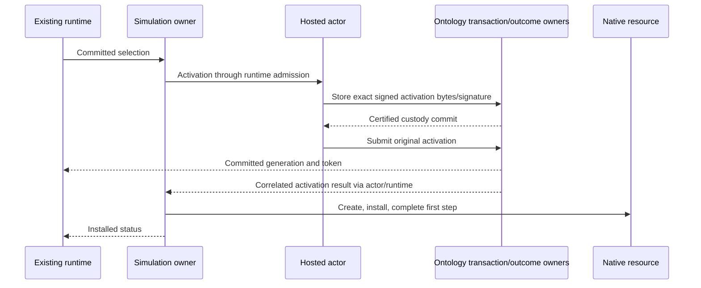

# Retained server physics profile

The authority and lifecycle contract is [world.md](world.md). This first adapter
supports fixed and dynamic cuboids, authored baseline poses, uniform gravity,
and coherent pose/contact snapshots. It does not implement joints, checkpoints,
controls, client transport, general agent queries or durable contact consequences.
A committed checkpoint or joint declaration makes this profile unavailable;
it is never silently replaced by an authored baseline. The door slice extends
this profile through the same resource owner.

## Installation and policy

Load [quod_physics.pl](../priv/ontologies/quod_physics.pl) with the existing agent
hosting ontology, and include `quod_physics_predicates` in the ontology's founding
external-predicate manifest. Give the selected actor explicit `can_invoke`
grants for `physics_store_request/6` and `physics_activate/3` through ordinary
signing policy. The real-owner server fixture in
[quod_physics_tests.erl](../test/quod_physics_tests.erl) supplies those grants,
a ground collider and one falling body; run `rebar3 as test eunit
--module=quod_physics_tests`.

`physics_space(World, disabled, Instance)` suppresses both hosting that physics
agent and allocating its native world. Enabling it selects only the node in the
actor's committed hosting assignment. Other nodes have no local simulator for
that assignment. Each space can select a different host.
Each space uses a dedicated physics actor in this profile; sharing one actor
between independently enabled spaces is unsupported. The fixture uses one
world per containing ontology. Existing per-predicate OCC also means activation
custody changes in one ontology can conflict across its worlds.

The Prolog selection supplies:

- `physics_run(World, Generation, IncarnationToken)` and
  `physics_structure(World, Revision)`;
- `physics_allowances(World, limits(Bodies, Poses, Contacts, CoordinateMm),
  StepMicroseconds, GravityMmPerSecondSquared, RequestBudgetMs)`;
- `physics_body(World, Id, Revision, fixed|dynamic, vector(X,Y,Z),
  box(HalfX,HalfY,HalfZ), DensityKgPerM3)`.

The limits are policy inputs, not Erlang constants. The native numeric envelope
bounds positions and cuboid dimensions. Gravity, velocity, density and all
other numeric values must be finite and representable as Rapier `f32`; density
is not compared to a distance allowance. IDs and body revisions use unsigned
64-bit native fields. Positive mass, dimensions and step are representation
requirements. The ordinary hosted-agent admission policy still owns actor
population and request capacity. Body/contact limits are not a hard byte or
wall-clock allocation guarantee: broad/narrow-phase pairs can grow quadratically
with the admitted body count. Policy authors must budget aggregate worlds too.

## Owner and recovery

The existing ontology runtime selects `physics_worlds` from its retained
snapshot. One registered `quod_physics` process per anchored WorldRef owns all
native mutation. The runtime waits for its DOWN before replacing its slot;
the registration also prevents overlap when the runtime itself restarts.
Every native operation verifies the creator PID. The runtime authenticates
selection, status, result and death messages by current PID/reference.

The activation compares the expected committed generation and exact preceding
custody record. Its original bytes/signature are committed before submission,
using the existing transaction path. A successor resolves those exact bytes
through the existing outcome service. Even if its predecessor's activation
committed, the successor must activate a fresh generation with its own token.
It never adopts the dead incarnation's generation. Result-before-selection and
selection-before-result both wait for matching evidence.

`physics_activation_status(World, OriginalRequest, Status)` derives pending,
activated or cancelled from committed custody/run facts. It is not a separately
updated “sent” flag: a crash between send and recording send would still be
ambiguous. A successor resolves the saved original operation; it does not
resubmit an uncertain activation or adopt an older incarnation's token.

Pending, unknown, timeout and an unresolved custody-write result leave physics
visibly unavailable. None means rejection. Capacity waits retain the original
absolute deadline. Confirmed unsent failure, certified terminal rejection and
failed resolution reads have distinct statuses. A newer custody or run-generation
selection that arrived before a failed reply is processed once after that reply. Explicit
resource reconciliation can re-resolve unavailable activation using the same
original request, without recreating native state. A certainly unsent attempt may
start a new request on explicit reconciliation; it does not extend its old
deadline. An uncertain custody write stays closed while its issued
generation/token/custody selection is unchanged, including when it still shows
a predecessor's completed request. `activation_custody_unresolved` means the new
custody has not been observed: if it never lands, there is no matching request
to cancel. Explicit lifecycle retirement (for example disabling then enabling
the space) permits a fresh incarnation. Any late old store still competes on
its exact prior custody and generation; it cannot overwrite the new request.
If old custody does land first, recovery resolves it and policy cancellation
provides the pending-request exit. There is no retry timer.

A stored request might never have been submitted, so an outcome need not ever
appear. `physics_cancel_activation(World, ExpectedGeneration, ExactRequest)`
provides the explicit safety exit. The current principal must satisfy
`can_cancel_physics_activation(World, Principal)` as well as ordinary entry
and signing policy. No default policy authorizes it. In one transaction it
requires ground arguments, compares current custody and the still-unactivated generation, removes that
request's activation permission, and retains its exact bytes/signature in
`physics_cancelled_request/2`. It does not assert a backend operation outcome.

Cancellation and activation conflict on ordinary OCC dependencies, including an
activation whose proof already read/staged the old state. If activation commits
first, cancellation fails. If cancellation commits first, the old request cannot
later install a world or be restored as current custody. The waiting simulator retires and its replacement
activates a fresh token/generation. Cancellation never runs automatically due
to elapsed time, absent outcome or ordinary reconciliation. Policy decides who
may invoke it, including for a certified terminal failure.

For an active world, unchanged reconciliation sends no installation message, creates no resource,
and performs no ledger fold or file write/sync. Changed body definitions install
at a step boundary: unchanged IDs keep their live state, removed IDs retire,
and changed IDs require increasing revisions and reset to their authored pose
and zero velocity. The owner completes a step before exposing a coherent frame.
Changes to engine allowances, timestep or gravity require a new run.

At most one selection is in flight to the simulator; subsequent selections
coalesce into the runtime's latest desired specification. Frames stay with the
simulator and do not enter the runtime queue each tick. One timer exists while
awake, with no elapsed-time catch-up queue. A sleeping world cancels it and does
no stepping or publishing until a changed physical input wakes it. Explicit
queries copy the retained frame rather than call Rapier again.
The timer waits the timestep rounded to milliseconds after the previous call;
simulation time advances by the fixed timestep per completed integration and
can lag wall time under load. Installing changed bodies completes an immediate
step. This profile makes no real-time cadence guarantee.

Frames contain the anchored world/authority/host-epoch/run-generation fence,
structure revision, incarnation token, completed tick, per-body revisions,
metre/second units and world coordinate space. The owner snapshot API requires the expected fence/structure. A newer tick
returns a frame; the same tick returns `unchanged`, including for a sleeping
world. A stale fence, structure or future tick is unavailable. This is an internal server API, not yet a remotely authorized query
or contact-proof interface.

Replay, runtime queue collapse, actor death, changed assignment and explicit
disable retire the current simulator. Replay reconstructs desired resources
without replaying historical reactions. A recoverable native error retires the
resource and leaves a visible failed selection in its existing owner; unchanged
reconciliation cannot loop on the poison definition. A changed physical
specification or an explicit lifecycle restart can start a new incarnation.
An unexpected simulator crash leaves a failed slot in the runtime until the
physical inputs/assignment change, explicit cancellation removes custody, or
the containing lifecycle restarts. Late custody/generation-only changes do not
clear that slot. It does
not repeatedly activate the same crashing selection. Normal retirement and an
explicit process kill still restore through original-operation recovery. Actor
death is conservatively a lifecycle boundary, including an unrelated actor
request-worker crash; a simulator never outlives its selected signing executor.

## Native safety audit and port decision

The Quod adapter is independent of ontology semantics. Exact dependencies are
Rapier 0.36.0 and Rustler 0.36.2, with the complete Cargo lockfile committed;
Rapier 0.36.0 was verified as the latest stable crate on 2026-10-05 against
Cargo and the upstream changelog. Rapier's `parallel` and `simd8` features are
disabled; its normal solver still uses upstream vector math. Enable
`solver-bounds-checks`: stale solver IDs and empty contact lanes must raise an
unwind panic before unchecked solver gathers. This does not remove every
upstream unsafe operation.
There are no native worker threads, event channels, foreign callbacks or unsafe
blocks in the adapter. Upstream Rapier/Rustler and their dependencies do contain
unsafe code. This is a boundary and lifecycle audit, not a formal verification
of all upstream code. The evidence record includes a dated check of every
locked package name against a pinned RustSec advisory-database snapshot and
review of its affected version ranges.

All entry points, including creation, decoding, queries and explicit retirement,
run on dirty CPU schedulers. The mutex uses `try_lock`, never an ordinary
scheduler-blocking lock. One step is one fixed Rapier integration; it cannot
yield halfway through or be safely interrupted. Solver iterations remain
Rapier's finite defaults. The benchmark includes both separated cuboids and
a densely overlapping case; body count alone does not predict cost.

The resource owns its entire Rapier graph. No Erlang term, environment or borrowed
input pointer survives a NIF call. A bounded list decoder checks the body
allowance before allocating another decoded row. Full validation precedes
mutation. Sampling allocates at most the actual admitted bodies and configured
active solver-contact pair output count, with finite checks before returning a
complete snapshot. These are Rapier contact candidates, not Prolog domain
consequences. An overflow returns a named failure instead of a partial snapshot. Input,
retained definitions and returned terms still occupy distinct bounded copies.
No growing pose history or contact-event channel is retained.

Typed native errors, Rapier non-finite-state quarantine and unwind panics
discard the world. The required soft-body container stays empty in this profile.
The improper-list boundary test exercises a real Rustler panic under the adapter's unwind catch,
then checks that the retired handle cannot be reused and the VM still runs.
The release uses `panic=unwind`. Allocator abort, process abort, memory corruption,
segmentation fault, double panic during unwinding and undefined behavior can
still terminate the entire BEAM. Catching unwinds does not contain those risks.

Explicit retirement frees the graph on dirty CPU. If an owner is killed without
termination, Rustler's final resource destructor runs wherever BEAM releases the
last reference; it is not guaranteed a dirty scheduler. The measured owner-death
case covers this small graph, not a general destructor latency bound. A killed
process executing a dirty NIF also cannot release that graph before the NIF
returns.

Keep the recorded in-process choice for this small, policy-admitted cuboid
profile. The fixture admits 64 bodies/64 poses/256 contact pairs, and measurements
include four simultaneous 64-body worlds. Do not infer suitability for arbitrary
untrusted geometry, unconstrained quotas or hard real-time service. If native
crash isolation is required, or measured scheduler/destructor/memory cost at the
intended policy limits is unacceptable, replace this adapter's execution boundary
with the recorded supervised-port fallback before enabling that profile. Keep
the same authority, activation custody, fences and resource owner; a second
physics domain engine is unnecessary.

Build/release hooks compile with `--locked` and atomically rename the completed
library into place, preserving any inode already mapped by a running BEAM.
Native hot-code upgrade is unsupported; a release restart loads a new library.
CI/release images install Rust
1.90.0 and package the resulting library under application `priv/native`.
Availability is an Erlang read of the retained module-load result. A missing
or incompatible library leaves the module loadable with availability false, so optional physics does not break embedded node startup. An enabled
selection reports `native_unavailable` with the retained load error before
submitting activation.
Native tests precede the normal sequential Erlang gates. Measured costs and
retained verification logs belong in the [evidence record](evidence/physics/README.md).
