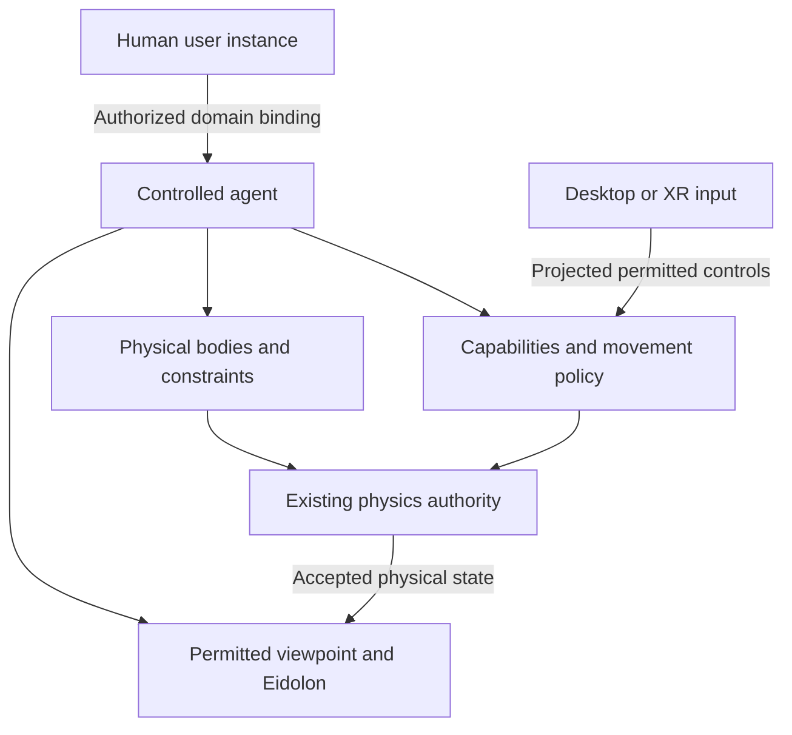

# Collision aware control of played agents

Movement follows the physical definition and permitted actions of the agent
controlled by a human user. There is no universal human-shaped player body.
Desktop and VR are input and presentation adapters for that relationship.
A capsule is appropriate only when an ontology explicitly defines that shape
or authorizes that collision approximation.

The explicitly requested Fable review is recorded in the
[review evidence](evidence/player-movement/review-01.md), with a
[predicate-interface follow-up](evidence/player-movement/review-03-predicate-interface.md)
and [implementation review](evidence/player-movement/review-04-implementation.md).
Its advice is consultative and must be checked against the production owners.

## Project model and evidence

[The agent vocabulary](../priv/ontologies/quod_agent.pl) defines
`isa(agent, thing)`; [the human vocabulary](../priv/ontologies/quod_human_user.pl)
defines `isa(human_user, agent)`. The shared vocabulary is not a global table
of humans. [Signup](../priv/ontologies/quod_signup.pl) creates a concrete
human instance and active key in its own ontology; the
[instance template](../priv/ontologies/human_user_instance.pl) currently
provides ownership and personal-lobby behavior.

[Agent identity](../src/quod_agent_ref.erl) is the exact
`agent_instance_ref(Namespace, GenesisAnchor, Instance)`. Identity, keys,
permissions, physical bodies and hosted processes are different concepts.
[Login](../src/quod_client_auth.erl) authenticates a key; each signed request
selects its agent principal. [The client reference store](../client/src/agent-references.js)
and [session selector](../ui/src/Session.tsx) support multiple references.
Selecting one locally does not grant control of a physical entity.

Yan's requirement is that a human-user instance can bind to different agents,
with different physical forms. Do not conflate that domain relationship with
selecting the signer for a request. The shipped human/agent templates and
client paths inspected here do not implement a general played-agent binding
or physical embodiment selector. Its exact relation, actions and projection
are a concrete missing domain capability, not an existing API to assume.

[Signed ingress](../src/quod_client_goal_ingress.erl) preserves the authenticated
principal across ontology scopes. Binding a human to another agent cannot
silently impersonate that agent, grant its signing key or change the principal
of a foreign call. The action must be authorized under the existing principal
model. The [actor design](outdated/ontology-actor-architecture.md#4-acting-and-signing)
leaves generalized `subject/3` delegation outside the implemented protocol.

[The world design](outdated/client-world-direction.md#43-eidolon-selection-and-visual-identity)
already distinguishes acting identity, controlled character and visual
representation. It allows an acting identity with no visible body, multiple
views of one entity, and composed limbs/equipment. Camera placement within an
agent is definable; a presentation-only camera adjustment does not itself
rewrite physical collision, reach or attachment. That archived section supplies product
context; current [world](world.md) and [runtime](runtime-and-agents.md)
contracts govern authority and recovery where older proposals differ.

[The current physics contract](world.md#identity-revisions-and-structural-edits)
gives bodies stable identities under anchored subjects. Physical definitions
include colliders, frames, body types, joints and attachments. A controlled
agent may require a body or related body group; an input adapter must not
replace that composition with its own player collider.

[Modelling](../priv/ontologies/quod_modelling.pl) describes representation.
[The mesh contract](eidolon-mesh-support.md#identity-and-future-physics)
denies collision authority to visual bounds. Physical and visual definitions
may share an authored source, but adopting physical geometry remains an
authorized, revisioned domain change. The [native profile](physics-native.md)
supports declared solid primitives, convex hulls, rigid compounds, fixed triangle
surfaces and vertical hinged doors. These are adapter capabilities, not a
restriction on the forms of agents or worlds.

## Required control contract



The diagram describes the relationships implemented by the first profile below.
The required transitions are:

1. Establish control of an existing agent with the human principal and target
   agent/world's permission. Binding does not inherently create, spawn,
   resize or move the target.
2. Project its available movement controls, effective physical definition,
   allowed viewpoint and current authority/revisions.
3. Switch or release control with expected-binding guards. Retire old input
   acceptance before enabling the new binding. Old commands cannot affect
   either the former target or the new target.
4. Change physical definition, viewpoint or capabilities through their owners.
   Appearance-only changes preserve physics; physical changes invalidate
   affected collision and placement evidence.

Binding cardinality, exclusivity and disconnect behavior are explicit policy.
Related binding and receiver changes use the
existing [atomic multi-ontology transaction](multiwrite-architecture.md).
There is no new global player registry or durable Erlang control database.

## Concrete first profile

### Ownership and control actions

The containing ontology of the physical world also contains the controlled
agent instances for the initial profile. This uses Quod's existing allowance
for multiple classed agent instances in one ontology; it does not require a
separate ontology or Erlang process for every agent. The human principal may
belong to a different ontology. Its ordinary signed request calls the exact
world scope without changing principal.

This scope keeps the resource selector local, as the existing physics profile
requires. Separately owned agent geometry/control policy needs an explicit
authorized adoption/coordination contract before it can be projected locally;
the runtime must not silently make foreign calls or cache a private copy of
another ontology's rules. This initial placement is a supported profile, not
a general restriction on the Quod agent model.

World-owned vocabulary:

```prolog
% Local agent instance -> existing physical body and movement definition.
physics_agent(World, Agent, Revision, Body, Motion).
% Camera mount is relative to the named installed body/component frame.
physics_viewpoint(World, Agent, Name, Body, LocalPose, Tracking).
% One current selection per principal in this world, with an enduring epoch.
physics_control(World, Principal, Epoch, Selection).
% Selection is none or controlled(Agent, Viewpoint).
can_control_physics_agent(World, Principal, Agent).
```

The body refers to the authoritative physical description, not a mesh name.
An asymmetric compound may be one rigid body with several local collider
parts; articulated groups require explicit supported constraints and cannot
be silently flattened. The agent and viewpoint definitions have ordinary
authored revision guards. Their exact shape encoding remains subject to native
representation tests; no capsule fallback is permitted.

`physics_control_agent(World, ExpectedEpoch, ExpectedSelection, Selection)`
derives the principal from `current_principal/1`. It compares the exact prior
selection and epoch, validates the requested agent/viewpoint and current
permission, then advances the epoch and replaces the selection in one ordinary
transaction. Initial state is logically `control(0, none)`; later releases
retain an epoch tombstone so old commands cannot become valid again.
Selecting `none` releases this principal's binding, without deleting or moving
the agent. Repeating a stale expected epoch fails rather than rebasing.

The one-active-control-per-principal-per-world rule is the first explicit
profile. Independent worlds retain independent bindings. A domain that requires
a cross-world switch composes the old release and new bind in one ordinary
atomic transaction. For a physical agent, the initial policy admits one
controller at a time; target contention is checked in the same world transaction.
Neither rule creates a global population limit. Future shared control needs
domain conflict-resolution semantics, not last-packet-wins input.

The caller needs both normal `can_invoke/4` admission and the domain control
grant. View-only access never establishes a control selection. Control
projection and runtime selection re-evaluate local grants; revocation removes
the derived live control without discarding the enduring epoch. Editing an
agent's physical/motion definition invalidates its installed control profile.

### Predicate interface and transport

VR and desktop interact with the world through Prolog predicates and governed
Erlang external predicates. A simulation socket is transport and presentation;
it must not grow a parallel domain command API. The human principal, permitted
agent, locomotion policy and authored camera mount remain Prolog decisions.

The BBSvx reference implements this distinction in
[/home/yan/src/bbsvx/src/ontologies/bbsvx_physics_predicates.erl](/home/yan/src/bbsvx/src/ontologies/bbsvx_physics_predicates.erl):
commands prepare effects during proof and execute afterward; `body_position/2`,
`body_rotation/2` and `body_velocity/2` expose live observations. Its
[/home/yan/src/bbsvx/priv/ontologies/bbsvx_physics.pl](/home/yan/src/bbsvx/priv/ontologies/bbsvx_physics.pl)
owns body descriptions and actions. Quod must retain its own stricter authority,
replay, effect-custody and live-observation rules when applying this pattern.

The missing transient capability is implemented as explicit signed `control`
mode (wire tag 3) through the existing proof owner. It reuses the distributed
savepoint and immutable overlay: at most one staged live operation is released
after the first surviving answer and successful scope finalization. It does not
change ordinary read/execute/cursor behavior or create a second executor.
Commands still enter public Prolog predicates; the socket transports views.
Live queries cannot authorize a durable diff. Current reposition is explicitly
live motion; future durable placement must use the established request,
authenticated observation and committed consequence path.

### Projected configuration and ephemeral input

The existing signed simulation view will include this principal's optional
control configuration: exact controlled agent, binding epoch, agent revision,
current body revision, named camera mount, motion policy and tracking mapping.
Opening the view never binds or spawns an agent. The endpoint must accept a
bounded anchored world read under a foreign human principal through ordinary
ingress, rather than assume the signer's containing ontology is the world.
Subscribe before reading, then verify read height and current installation.

The existing physics owner alone holds the transient control registration and
current input. It derives durable admissibility from installed ontology state;
the socket does not supply grants or choose a different principal. Inputs bind
registration, binding epoch, agent/body revisions, full run fence, structure,
sequence and original expiry. A switch invalidates old registration and queued
intent before publishing the new control. A native step must not consume input
after the relevant committed invalidation is known but before its replacement
configuration is installed; test the runtime/endpoint/owner ordering race.

Continuous input is a desired bounded linear/angular motion, interpreted under
the selected mode and server timestep. It is coalesced, not accumulated by
packet count. Teleport is a discrete sequenced request; revalidate its current
path and complete destination configuration at application. A lost transient
reply is resolved from current state, never replayed under a fresh identity.
Per-frame input is not a durable action and confers no commit acknowledgement.

### Mechanical and view profiles

The first mechanical examples are authored rigid agents: a compact rounded
body and an asymmetric compound body with an off-centre camera. Their physical
shape is supplied by ontology, and the same object may be controlled by a
human or another principal admitted by the domain. The common adapter must
validate full translation/rotation without applying movement-induced impulses
to other dynamic objects in this slice.

Motion policy supplies supported modes, speed/turn limits, gravity/support
requirements, contact response, query-work allowances and input freshness.
Fixture policy chooses grounded movement, stop-and-slide contact and no push.
Other modes are rejected until supported, not silently interpreted as walking.
Stationary-body checks still handle moving doors and collider edits.

Camera `LocalPose` supplies position and orientation in its named component
frame. `Tracking` specifies the calibrated XR mapping, allowed view offsets
and whether input requests physical rotation/translation. Desktop and XR share
that authored mount. View-only look is distinct from moving a physical part.
Changing mount or controlled agent clears old calibration and pending queries.

Disconnect clears voluntary control input but does not remove the binding or
body. The selected mode continues its mechanical behavior (including gravity
where defined). Reconnection makes a new signed read and ephemeral registration;
it does not reapply commands. An occupied authored spawn freezes travel. Explicitly permitted live
reposition validates the complete destination and can repair that placement.
Neither binding nor reposition silently rewrites a durable baseline. Native restart restores the existing
compatible checkpoint/baseline contract and makes any correction visible.

### First executable obligations

- Bind, switch and release under a signed human principal; reject stale epochs,
  a view-only caller, conflicting controllers and a forged target/reference.
- Same opening, different results for the compact and asymmetric bodies;
  rotation collides even when its endpoints fit; a camera mount change does
  not change either physical shape.
- Revocation or switching races queued input and installation; zero old-target
  motion after new control becomes installed, with no principal substitution.
- An idle controlled body blocks a moving door; the existing door consequence
  and required recovery state remain one atomic transition.
- Repeated unchanged selection/view/query/neutral input reuses retained state
  without history reads, rebuilding or writes/syncs; a changed input/definition
  still applies through the real owner.

## Movement follows the agent

Shape and locomotion are separate. A shape does not imply walking, flying,
rolling or any movement ability. Gravity, support, turning, speed and contact
response come from the agent/world's policy and selected physical mode.
No generic API assumes feet, human eye height or an upright axis.

Collision checking covers the effective physical configuration throughout the
requested transformation, including rotation. An elongated body can fit at
both endpoints and hit a wall while turning. Compound bodies require all
relevant parts; constrained bodies cannot move independently of their joints.
A centre ray, bounding capsule or translation-only sweep is insufficient.

A walking controller may implement an explicitly selected walking profile.
It is not the common domain abstraction. Evaluate the retained engine against
representative ontology definitions before selecting mechanical APIs.
Unsupported shapes or motion modes produce a visible unsupported result,
never an implicit capsule or bounding-box substitution.

Spawn is separate from control binding. Authorized placement/teleport validates
the full body configuration and destination orientation. Floor support applies
where the movement profile requires it. Path restrictions belong to
world/agent policy, enforced by mechanical queries against current state.

Moving-door contacts use actual controlled geometry, including stationary
agents. Reuse the existing obstruction and signed consequence path. Define
and test the no-pushing response for the supported modes without changing
their shapes. Edits into occupied space require an explicit invalid-placement
outcome, not unbounded depenetration.

## Desktop and VR mapping

The requested adapters support continuous travel, teleportation and snap turn
where the controlled agent offers those capabilities. Device features do not
create domain abilities. Locomotion and menus must arbitrate input gestures.

Raw human head/controller tracking, the agent's physical configuration and the
selected viewpoint remain distinct. Direct one-to-one tracking is one mapping,
not a universal rule. A nonhumanoid agent does not acquire a physical human
head or room-scale walking merely because the human uses a headset.

The agent/avatar's ontology must be able to define the camera location and
orientation relative to its body or a named component: for example an eye,
cockpit or sensor mount. Define that attachment frame and local pose explicitly;
do not impose a browser-owned eye height, body centre or humanoid camera mount.
The camera follows its attachment's current transform. Multiple named viewpoints
may be offered where domain policy permits selection.

Define how calibrated XR tracking maps relative to the selected camera mount,
including allowed view translation/rotation and any mapping to physical part
movement. Desktop look uses the same authored viewpoint with its permitted
input mapping. If looking actuates a physical head or sensor assembly, its
motion goes through that component's normal physical control path, and both
its collider and attached camera follow the accepted transform. A view-only
offset changes the view without silently changing the agent's physical shape.

Define scale and input frames per control/view profile.
Head turning may be view-only; body rotation requires
its authorized collision-checked operation. Snap turning cannot rely on a
capsule's symmetry. Room-scale motion needs an explicit mapping to a view
offset or agent movement. Immersive contact masking protects the human's view;
it does not redefine the agent's body.

Switching agents/view profiles resets tracking mappings and retires old inputs
and queries. Do not carry the previous agent's scale, camera offset or control
frame into its replacement. The original HTC Vive remains the first hardware
target; portable Babylon/WebXR component discovery and configurable bindings
remain required. Qualify its browser/runtime and test hardware separately.

## Existing owners and the implementation boundary

Reuse [physics policy](../priv/ontologies/quod_physics.pl),
[runtime selection](../src/quod_runtime.erl),
[the retained physics owner](../src/quod_physics.erl),
[the native adapter](../native/quod_physics/src/lib.rs) and
[the simulation endpoint](../src/quod_client_view.erl).
The endpoint provides one local signed view, including an anchored foreign-world
read under the original human principal. Opening it does not grant control;
that comes from the Prolog binding and policy. Multiple simultaneous viewers
and remote simulation forwarding remain outside this profile.

Inputs/results must bind the control relationship, controlled agent, body
identities/revisions, motion configuration, structure and existing authority
fence. Check current installed state at application. Binding changes,
revocation, body replacement and owner changes retire old inputs. Live collider
motion also invalidates previews even without a structural revision.

Keep hot input bounded and transient; reconnect must not replay movement.
Disconnect behavior comes from the domain: it cannot universally freeze a
flying agent, delete a body or transfer authority. Durable changes retain
ordinary custody, deadlines and exact outcome resolution.

Evaluate local prediction only after physical/movement profiles are defined.
A retained authorized collision projection may help, but the previous plan's
browser Rust/WASM controller is not settled architecture. Demonstrate its need,
access policy, retained cost and correction behavior before adding it.
Local rendering/tracking does not itself claim authoritative movement.

## Complex shapes and generated worlds

Complex geometry concerns the controlled agent as well as obstacles.
Do not defer every non-capsule controlled shape to future terrain work.
Define ontology-owned shape/composition descriptions and allowed approximations
first, then evaluate triangle surfaces, convex shapes and compounds against
them. A hull that fills an intentional opening changes physical semantics.

Any geometry preparation must identify its physical asset, exact version,
frame, resource policy and validation. Generated non-cubic cells may produce
surfaces or compound volumes. Movement queries depend on physical geometry
and normals, not cubic indexing or visual meshes. Chunk edits install coherent
revisions; unavailable collision coverage is unknown, never empty.

Terrain generation, mesh decomposition and arbitrary articulated-body support
are not claimed implemented. Establish which capabilities the accepted domain
examples need before freezing implementation scope.

## Revised sequence and acceptance

1. **Define the domain relation.** Specify binding ownership, authorization,
   switch/release behavior and physical-world references using ordinary actions.
2. **Author representative agents.** Include materially different forms, such
   as a compact convex body and an elongated/asymmetric compound body, with
   controls and viewpoints. A humanoid can be another authored example.
3. **Derive mechanical requirements.** Specify translation, rotation, support,
   contact response and placement for those examples; evaluate the native
   engine before choosing a character controller or query API.
4. **Design the smallest production extension.** Add only demonstrated gaps in
   selection, admission and native mechanics. Measure before fixing prediction.
5. **Integrate desktop/XR.** Replace direct camera translation and visual-floor
   teleport permission with the selected control/view profile.
6. **Test physical behavior.** Cover clearance differences between agents,
   sliding, rotational sweeps, compound parts, stationary door contact,
   occupied placement, edits/deletion and explicit unsupported results.
   Changing an Eidolon alone must not change any physical result.
   Test distinct authored camera mounts, moving attachment components and
   switching viewpoints without inheriting another agent's camera placement.
7. **Test binding and authority changes.** Race input/teleport against switching,
   revocation and host/run changes. Local reference selection grants no control.
   Keep required consequences/checkpoints atomic and uncertain writes resolved
   through their original operations.
8. **Measure and validate hardware.** Repeated unchanged work reuses retained
   state without history replay, rebuilding or writes/syncs; real changes still
   install. Retain sequential gate logs and actual production deltas. Test
   Vive mappings, switching and comfort separately from browser emulation.

Movement remains the priority before pushing and held objects. The exact
implemented predicate, geometry, input, recovery and camera contracts are in
[the native profile](physics-native.md#played-agent-movement). Hardware
qualification remains a separate acceptance gate; browser emulation cannot
establish Vive device mappings or comfort.
