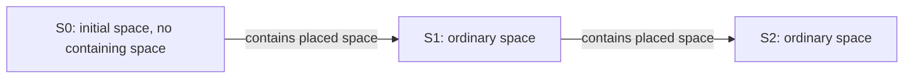

# Governed spaces

A **space** contains placed instances and can display references to other
instances or information. A **physical_space** adds explicitly governed physical
participation. Location and display membership are independent of ontology
membership: an ontology owns code, committed facts, authorization and history.
An ontology is reflected as a space whose ordinary display contents are its
predicate instances. Its class-selected contents Eidolon uses the same exposure
and scene projection as other spaces. This reflection grants no entry, placement,
founding, ownership or physical permission; those operations retain their
explicit authored policy.

[quod_space.pl](../priv/ontologies/quod_space.pl) defines the space class at
`quod:space`. A storing ontology holds `instance_of(quod:space:space, Id)`,
its slots and its ACL facts. Shared behavior reads and writes that exact storing
ontology through `::` under its ACL.
The [ordered founding recipe](godot-foundation-contract.md#reproducible-founding-recipe)
does not rewrite existing histories or grant deployment authority.

## Classes and dispatch

The vocabulary declares `isa(space, thing)` and
`isa(physical_space, space)`. Shared `isa/2` rules compute reflexive/transitive
ancestry, including authored multiple inheritance. `instance_of(Class, Entity)`
is class-first, remains authored, and does not itself expand ancestry.
`quod:space::space_instance(EntityRef, Class)` combines membership in the
storing ontology with ancestry at the class owners.
Neither declaration imports behavior or grants invocation rights. The existing
lobby likewise explicitly expands its device classes before recipe selection.
Class-selected Eidolon recipes run at their declared owners; the ordinary
most-specific selection applies, and differently named recipes remain separate
choices.
Ontology reflection specializes space for display; it does not change lobby classes.

An `entity_ref(Namespace, GenesisAnchor, Entity)` refers to an existing entity
in its owning ontology. It is a reference term, not a new object registry or
class. The owner establishes class or instance identity using existing `isa/2`
and `instance_of/2`. Every cross-owner call checks the exact history. Moving
membership changes neither the entity reference, code, ACL nor history.

## New-user onboarding and parentless spaces

[Normal-user signup provisions a distinct personal agent A and an ordinary empty
space S0 for human U; S0 is the initial personal lobby, has no containing space,
and initially contains A.]{decided by="yan.guiborat" email=yan.guiborat@gmail.com on=2026-10-27 over="a dedicated lobby subclass for this delivery"} [Y](https://console.nimbalyst.com/app/cite/ed9cd520-b2a4-4607-a8f5-ff99d08f3e46/prompt/80fe5d70d8db7a67f1cc071ad91cced3 "by=yan.guiborat email=yan.guiborat@gmail.com at=2026-10-27T14:04:14.517Z quote='some points before starting :%0A- I would like to clarify new users onbording. These should only prolog if possible:%0A%2A When a normal user is created atm we will create for it a simple empty space. It will be later the user lobby %28 we will create a dedicated subclass for it %29 but for now we will use a simple space class. So I guess when registering a new user, we should create a space and an agent…'")

The setup form uses `quod:space:space` and its defaults, including the 100-metre
box extent, after signup has allocated the user's ontology. S0 is an ordinary
space instance; a dedicated user-lobby subclass is later work.

The [M0 contract](godot-foundation-contract.md#ordinary-onboarding-and-storage)
selects the user's existing ontology explicitly for S0 and records that exact
selection. Additional spaces use explicit selected storage, including permitted
foreign storage. The setup transaction binds A's host/key, asserts S0 and runs
`quod:space::goal(inside(S0, A, transform(0,0,0,0,0,0)))`. S0's staged membership
uses its class policy until commit. No constructor or initial-occupants part is
involved; both membership and placement commit in the same transaction.

Having a containing space is optional for every ordinary space. S0 is unplaced
while A is placed inside it; these are different assignments. Other spaces may
also remain unplaced. A placed instance has at most one containing space, with
independent display references still allowed. No synthetic outer space, second
parent registry, universal parent tree or inherited access rights follow.

The initial interior has a black background, with controllers visible when
available and the ordinary GUI accessible. It has no required floor, sky,
terrain, physical simulation or visible agent body. This presents an empty
ordinary space; it does not trigger rebuilding the old physical lobby.

From S0, U uses the offered GUI to instruct A to create another space S1.
Storage remains an explicitly selected existing ontology and default owner is
U; near-agent placement puts S1 inside A's current space. S1 appears there via
the ordinary default exterior Eidolon, the shared half-metre marker, whose
size is independent of its interior extent. Creating S1 does not enter it.
Authorized GUI entry moves the same A to S1; navigation follows the committed
assignment. The same creation and entry rules apply inside S1 to create S2,
and at further levels, without a separate agent, class or storage ledger per
level. The selected exterior Eidolon may display a mesh or the space's contents;
the marker is one recipe, not a restriction on exterior views.
If both S1 and S2 select contents exteriors, their contents are recursively
displayed in S0 as one continuous space, subject to physics and each source
owner's disclosure policy. No entry into S1 or S2 is required for that display.



Signup composition, ownership, initial placement, offered operations and grants
belong in Prolog. Reuse existing governed founding, key custody, actions,
assertion, atomic writes and recovery; Godot renders descriptors and sends
authenticated instructions. The onboarding composition must explicitly select
and record its authorized storage after any required existing founding step;
automatic onboarding does not introduce an implicit storage default for later
Create operations. M0 specifies the exact lifecycle and permissions. Related
instance facts and admission changes forming one transition commit together;
ontology founding retains its existing lifecycle. A lost reply or restart must
recover the original U/A/S0 references, not provision replacements. Initial A
placement reuses existing placement; later travel uses the committed operation
described below.

See the [space architecture plan](../nimbalyst-local/plans/space-conceptual-architecture-review.md)
for the existing Stage 1/Stage 2 boundaries, and [QUO-60](nimbalyst://QUO-60)
for delivery status. Recursive rendering/exposure and ontology predicate editing
have their own integration obligations. They must not be used to impose a
mesh-only exterior or require entry before a contents-displaying exterior works.

## Empty creation

U instructs the distinct personal agent A through the existing immediate signed
route, selecting an **existing** ontology explicitly. The space class owner
holds the forms, recipes, validators and `measure_vocabulary(Namespace, Anchor)`
pin used for finite dimensions. The storing ontology admits the requested
assertion and the class owner's scoped reads and writes through its ACL. No
automatic lobby storage selection or ontology founding occurs.

The shared assertion mechanism creates the instance. A goal inside the selected
anchored scope can return both durable outputs:

```prolog
with_build_plan([attribute(name, <<"Workshop">>)],
                assert(instance_of(quod:space:space, Space))),
current_ontology_identity(Ns, Anchor),
Ref = entity_ref(Ns, Anchor, Space),
attribute(Space, name, Name).
```

The default name is `<<"Space">>`; supplied names override it. Names are stored,
mutable and nonunique. The generated ULID and anchor form the identity. Named
outputs `Ref` and `Name` use the ordinary selected-result machinery: a lost
reply is recovered from the original operation, including after restart or
later instance deletion. Recovery does not create the instance again.

`dimensions` defaults to `box(q(10, <<"m">>), q(10, <<"m">>),
q(100, <<"m">>))`: X, Y and Z lengths centred on the local origin, extending
50 metres in each direction. It also accepts `infinite` or three strictly
positive exact length quantities. Existing measurement conversion validates
compatible units and rational values without floats or rounding. Malformed,
unitless, non-length, zero and negative dimensions fail creation. Supplied
quantities remain stored as supplied; interior extent does not impose a resource
budget, allocate geometry or establish collision boundaries.

The default `owner` is U, read through `quod:user`. An explicit owner is a slot
input subject to the storing ontology's ACL and class policy. Ownership, storage
and containing space remain independent. `quod:space` supplies class ACL defaults;
the storing ontology may declare per-instance ACLs. The shared guard checks a
new instance using its original class and inputs until the transaction commits;
staged instance grants cannot supply permission. See
[creation authorization](proofs.md#class-and-instance-operation-permissions).

After assertion, `quod:space::goal(inside(DestinationRef, Ref, Pose))` chooses an
exact destination and transform. A pose is a scene pose, decided by the scene
vocabulary's own `placed/1`: whole millimetres and turns from 0 to 359.
`space_transform/1` asks that rule for every pose written (the `transform`
slot's type, placing and representing), so a stored pose is never re-checked
on reading. The action stores the pose in the instance's `transform` slot. The creation
form's placement choice is an input to this action, not a stored slot.
`near_agent` ("In front of me") reads A's exact location at `quod:space`; a
successful `unplaced` result leaves the new space unplaced. A
`placed(Destination, Transform)` result places it in front of the viewer. The
form's `space_view` field is a `viewer_pose` the client fills itself: in a
headset, where the eyes are and the level direction they look along
(`view(transform(…), forward(FX, 0, FZ))`, the eyes as a scene pose turned to
the look, the direction in thousandths). The
space then stands that near distance along the look, at A's floor height,
turned to face the viewer (Yan, 2026-11-14). Without a viewer pose (`none`,
any client without a head) it stands in front of A along that frame's −Z
axis, with A's turn. The near distance is 2 m plus half the shared marker's
depth, read from the scene vocabulary's `marker_size/1`: with the 0.5 m
marker the new space appears 2.25 m away, whatever it measures inside (Yan,
2026-11-12). On the line across that point it takes the first free place:
straight ahead, then alternately one and a half markers to the viewer's right
and left, until no placed thing whose location can be read stands within one
marker of it on every axis. A viewer pose whose direction is not a level unit
vector, or whose turns are outside 0 to 359, is refused. Things already placed are never
moved. This is one-time placement, not following A. A denied, unavailable, ambiguous or incomplete location read
fails creation. A placed agent needs its ordinary `attribute(Agent, transform,
Transform)`; missing pose does not prove absence. Physical-pilot entry and live
body poses remain the separate physical/entry integration.
The explicit `unplaced` form choice skips that location lookup and requests
no admission. It is distinct from treating a failed near-agent read as absence.

Creation asserts the space and runs `goal(inside(…))` in the same transaction.
Refused placement rolls back the instance and all admission writes; it never tries another destination or unplaced creation. Physical
destinations retain their mandatory physical hook and checks. Creation does not
prepare a simulation, terrain, sky or walls, and stores no `interior`
choice. The defined solid Eidolon uses a
half-metre cube independently of finite or infinite interior extent, through the
existing scene/model/rendering path. Contents remain empty. The landscape/terrain
creation route is unchanged.

The space class owner offers **Create space** and **Create infinite space**
through its recipes and forms. Its `gui_vocabulary/2` pins the component
vocabulary. Forms compile at that owner and their goals run in the selected
storing ontology. The forms initialize finite dimensions from class defaults
and the name with a place name drawn from `quod:names`
(`draw(<<"place">>, Salt, Name)`); leaving those fields unchanged uses those
values, while edits supply explicit ones. Each read of the form draws again, so
an untouched suggestion can change while the form is open. Finite controls accept positive
integers in mm, cm, m or km (1–1,000,000 per axis); the domain model still accepts
the wider exact measurement contract above. The placement selector supplies
`near_agent` and authored exact destinations. The class owner authors its options for each selected storing ontology,
including permitted local or foreign references. Submission returns both
`result(space, entity_ref(...))`, the committed `result(location, ...)` and
`result(owner, ...)`.
The [shared operation panel](gui-implementation-plan.md#offered-class-and-instance-operations)
displays these bindings and can open the returned subject's offered operations.
Source composition in an already founded ontology requires its existing owner
authority; installing client files does not rewrite ontology data.

The shared form also offers **Create space with rational lengths**, with a
positive integer numerator/divisor per axis and an explicit length unit. The
ordinary finite form retains its integer defaults; both use the same Stage 1
assertion and binder. Names may be empty binary values. A space asserted
without a name takes one from its class default, `default_from(space_name)`,
which draws a place name for that instance from `quod:names`; when that
ontology cannot answer, creation fails rather than falling back to a fixed name. Every form selects placement. No form offers
an outside choice: a new space is shown by the marker. The creation subject is `class_ref(<<"quod:space">>, Anchor, space)`;
its class identity is independent of the selected storing ontology. Each storing
ontology separately authorizes the acting principal's request and the class
owner's scoped callbacks. Class defaults and per-instance ACLs remain subject to
the committed guard.

## Relations and owners

| Relation | Sole owner | Assertion |
| --- | --- | --- |
| `space_member(Space, EntityRef)` | Space ontology | Independent display reference, possibly many-to-many |
| `space_assignment_state(Entity, Revision, DestinationRef)` | Entity ontology | Exclusive admission assignment, or `none` after withdrawal |
| `space_placement(Space, EntityRef, Revision)` | Space ontology | Admission corresponding to that assignment revision |
| `space_contains(SpaceRef, EntityRef)` | Derived query at `quod:space` | Direct view subjects: display references or placed instances |

The assignment and placement facts express the entity's exclusive assignment
and the space's admission. They contain no duplicate pose, body, code or geometry.
Their transition is one existing atomic transaction. Assignment absence means
revision zero and `none`; after first use the empty slot retains its revision,
so withdrawal cannot let an obsolete admission reuse revision zero. Multiple
assignment rows are invalid configuration and fail explicitly.

Display members may be classes, ordinary instances or other spaces. Removing
a display reference deletes neither the instance nor its assignment, stored
state or ownership. A placed instance has one containing space; it can still
appear in several spaces through independent references. The view-subject query
`space_contains/2` is a direct graph relation: it does not flatten descendants,
propagate access rights, infer parent transforms or imply physical presence.
Self-containment and self-placement are refused. Longer display or
placement cycles need explicit domain constraints where inappropriate;
the relation does not claim a physical frame tree. Class membership and
containment alone do not establish a depicted occurrence. Existing lenses,
Eidolons and anchored `depicts/3` marks remain the representation path.
A local view layout is transient presentation, requiring no domain transaction.
Persisting a display reference or changing containing-space assignment requires
an authorized action. Hot controls retain their existing transient path.

## Governed transitions

`quod:space::goal(shown_in(SpaceRef, EntityRef))` uses the `show` action to
check both owners' committed operation policy in `display` mode and write
`space_member/2` in the destination's storing ontology. `goal(not_shown_in(…))`
uses `hide` when destination policy allows removal or source policy allows
withdrawal. Display grants provide no placement, disclosure or ownership
authority.

`quod:space::goal(inside(SpaceRef, EntityRef, Pose))` uses the `place` action.
Its `goal(unplaced(EntityRef))` prerequisite withdraws the entity first if needed;
`placement_pose/3` binds an omitted pose. Source `space_enter` and destination
`space_admit` checks use committed policy. The action writes the next source
assignment, its pose and the matching destination admission through their
storing ontologies' ACLs, with the required physical consequence. An already
satisfied desired state writes nothing. Two completed proofs from the same
assignment conflict at its sole owner; refusal and conflict leave no partial
assignment.

`quod:space::goal(unplaced(EntityRef))` uses `withdraw` and requires source
`space_leave` permission. It writes the next empty assignment, performs the
required physical consequence and removes the exact old admission in one
transaction. Changing a future-entry grant alone does not revoke existing
membership; compose the policy edit with the applicable action when immediate
revocation is required. Neither a missing owner nor a timeout authorizes
unilateral release. An unavailable required ontology makes the transition
unavailable.

Participant entries cannot create or release a slot independently: `place`
requires an empty assignment and the exact destination; `withdraw` removes the
matching assignment and admission together. Failed candidates use ordinary
transaction savepoints.

## Same-agent travel

The same `goal(inside(…))` and `goal(unplaced(…))` actions move the existing
personal agent. A placed-to-placed move consumes a withdrawal and an admission
revision. Its pose is staged before destination admission so the physical
consequence sees the same transform as the committed assignment. Source leave
and entry permission, destination consequences and pose changes form one atomic
transaction; refusal or conflict restores all owners.

The offered Enter and Leave forms bind the existing personal agent and its
exact assignment revision. Their ordinary U-to-A instruction executes this
operation; navigation reads the resulting assignment. Leave returns the agent
to the space the left space stands in, near in front of its marker and facing
it, where its creator stood (`space_leave_to/2`, the same near distance as
`placement_pose/2`); leaving a space that stands in no other makes the agent
unplaced. A parent that refuses the agent refuses the leave; it never falls back
to unplaced. Storage and display references do not supply an inferred
parent or destination. A newly asserted instance uses its class policy; later operations use its
committed membership and per-instance ACLs.

The user class owner's `quod:user::account_navigation/1` returns
`navigation(AssignmentRevision, Location, Modes)` from the same assignment and
location queries, including an explicit `unplaced`. Its signed `navigation` view
uses the existing view owner and retained dependency lifecycle. Setup's original
S0 result remains immutable. A client retires scene/control on invalidation and
opens only the current exact placed space; an unplaced client keeps navigation
subscribed and may open an explicitly selected existing subject's ordinary Enter
offer. `quod:user::account_navigation/2` remains the placed-location query for world reads.

The signed `client_world_view/4` result is
`world_view(ExactSpace,Name,Marks,Selection)`. `Name` is the selected owner's
single binary `attribute(Space,name,Name)`, or `unnamed` when absent; conflicting
or non-binary names refuse the view. The existing endpoint checks the exact
space before exposing this optional name (`name` string or null) alongside
the projection. It has the same retained read dependencies and authorization;
it is neither a naming service nor a second current-location record. The
marker and the inside walls use the same authored name in their scene label.
An empty permitted scene remains black; its context belongs to the GUI chrome.

`quod:space::space_represent(SpaceRef, BeforeExterior, BeforePose, BeforeInterior,
Exterior, Pose, Interior)` changes the instance's own choices and pose, for
every viewer who made no choice of their own. It checks the exact source values
and committed `space_represent` instance policy. For the inside, `none` in an
argument means no fact: the class default, which is none. A changed exterior or
pose invokes the admitting destination's physical consequence in the same
transaction. An unchanged representation performs no state mutation. No pie
wedge calls it.

Inside a space, its walls are its `interior` Eidolons: `wireframe` and
`matrix`. The class has no default for the inside, so a space shows no walls
until its instance or the viewer chooses one. Both nest the scene vocabulary's
shared `extent` recipe: a corner outline whose lengths equal the exact interior
dimensions, never rounded. The interior projection places it at the space's
origin after its contents, depicting the space itself. `matrix` draws that
outline in emissive green over translucent faces. Walls need a finite size: an
infinite space draws none and its pie offers none.

The space's pie offers **Show as** in slot 2. Inside the space it lists the
`interior` Eidolons, from outside the `playing` ones, without the one the
viewer already sees, and **Default** once the viewer has chosen one. It
changes only what the viewer sees (see [Eidolons](gui-plan.md#eidolons)).

## Invocation policy

The class owner admits its public reads and desired-state goals through
`can_invoke/4`. Each storing ontology separately admits the actor's scoped reads
and writes, including the exact operation guard. The authenticated principal is
unchanged through `::`; the call chain identifies the class owner. Calling from
a space does not impersonate the entity owner.

An anchored call has the shape `(current_ontology_identity(Namespace, Anchor),
Goal)`. Placement needs both storing ontologies' ACLs and operation permissions;
disclosure remains subject to each source's ACL. A curator's destination grant
does not supply the entity's `space_leave` or invocation permission. Raw
assertions and retractions remain governed by the storing ACL. An unrestricted
administrative ACL authorizes source and state editing independently of these
domain actions. Configuration conflicts return reasoned failures; denied
operation policy remains ordinary Prolog failure.

## Shared operation authorization

All four permissions use [the shared committed guard](proofs.md#class-and-instance-operation-permissions).
The operation inputs are `space_enter(SourceRef, DestinationRef, Mode)`,
`space_leave(SourceRef, DestinationRef, Mode)`,
`space_admit(DestinationRef, SourceRef, Mode)` and
`space_remove(DestinationRef, SourceRef, Mode)`. `Mode` is `placement` or
`display`. The executing owner supplies its own exact reference; the other
reference comes from the requested transition. Placement requires instance
subjects; display consent also accepts class subjects.

The class owner declares `class_permission/3` defaults and compulsory
`class_requirement/3` checks; the storing ontology declares `instance_permission/3`
overrides. `space` allows creation, entry, admission, leave, removal, visit and
representation by default. Each operation checks committed membership, ancestry
and policy through the shared guard, following qualified classes to their owners.
A membership asserted in the current transaction uses its original class and
inputs without staged instance overrides. Compulsory requirements survive
overrides, and policy reads enter the ordinary conflict checks. Scope invocation
remains separately required.

The lobby's `lobby_admission/4` supplies its instance ACL checks and the existing
anchored physics projection. Physical consequences retain their own checks
independently of the class defaults or per-instance ACL overrides.

## Direct depiction

[A space's exterior Eidolon may display its contents instead of a mesh.]{decided by="yan.guiborat" email=yan.guiborat@gmail.com on=2026-10-27} [Y](https://console.nimbalyst.com/app/cite/ed9cd520-b2a4-4607-a8f5-ff99d08f3e46/prompt/0ed00d8751e1d31d9ff931cbc71dfcc9 "by=yan.guiborat email=yan.guiborat@gmail.com at=2026-10-27T14:14:39.228Z quote='please remember that a space, can have an external eidolon pourposed to display its content instead of a mesh, I wish you remember taht%0A%3CNIMBALYST%5FSYSTEM%5FMESSAGE%3E%0AThe user is currently looking at this document. They are not necessarily asking you about this document, but they may be. Use your best judgement to decide if they are making a general request or asking specifically about this…'")

Outside and inside are what an Eidolon is for, its purpose: showing contents
does not require entering the space, moving A or changing containment.

Seen from outside, a space has two Eidolons: `solid`, the shared fixed-size
**marker** of the scene vocabulary and the class default, and `contents`, its
permitted contents. The instance's choice is its `exterior` slot; a viewer's
own choice overrides it for that viewer only. The marker is half a metre
whatever the space measures inside, finite or infinite: see-through sides,
corner lines that fade along each edge, gold while pointed at and once
selected. It creates no collision surfaces or physical bodies. Its `edition`
Eidolon is the same marker with the real size written beneath it as authored,
for example `10 m × 1/3 mm × 2 km`, or `Infinite`. A client reads it for the
one space being edited and draws it in that space's place; the other things
keep their display Eidolon. A class may also offer a `selected` Eidolon, read
the same way on selection; the space class offers none. The earlier full-size
`wireframe` exterior is retired: it is not a valid new `exterior` value, and a
space still storing it is shown by the marker. The real size is shown
from inside by the `interior` walls, where exact rational lengths are never
rounded: Prolog converts the stored quantities and the engine converts only
when rendering. The contents recipe returns a source-owned exposure, never a
substitute mesh. Physical composition follows the instance's `exterior`, never
a viewer's own choice.

[When S0 contains S1 containing S2, and both S1 and S2 select contents exteriors,
their contents are displayed recursively in S0, subject to physics, as if all
were one space.]{decided by="yan.guiborat" email=yan.guiborat@gmail.com on=2026-10-27} [Y](https://console.nimbalyst.com/app/cite/ed9cd520-b2a4-4607-a8f5-ff99d08f3e46/prompt/34b88d269f157c7d9f9af331466e44d4 "by=yan.guiborat email=yan.guiborat@gmail.com at=2026-10-27T14:18:41.935Z quote='of course I wish it isn%27t necesseray to say that if S0 include S1 that include S2, if S1 and S2 are set to show their content eidolon, then all contents are recursively displayed into S0, subject to physics, as if al this would be a single space'")

This is required composition, not an optional later visual effect. Apply it at
each level selecting a contents exterior, composing relative transforms through
the existing view owners. A mesh exterior selects that mesh representation;
there is no artificial one-level display limit for contents exteriors. Preserve
exact subjects, disclosure/revocation, cycle handling and Prolog-governed
resources. Physical behavior must agree with the composed scene through the
existing authoritative physics owners; rendering alone does not establish that
agreement. Visual composition does not merge identities, storage or grants.
The cube described under Empty creation is the installed solid recipe, not a
restriction on authored exterior forms.

The [physics profile](physics-native.md#shared-domain-contents-frames) explicitly
admits a continuous component into one existing simulation domain. Independently
enabled runs cannot join through contents selection. Empty ordinary spaces
allocate no physics solely because they are spaces; admission, custody and
transfer guarantees still apply.

The shared projection at `quod:space` projects the union of placement and display
references, deduplicating each exact subject within that view. It resolves `entity_scene/3` through the existing source and class owners and uses the existing Eidolon, `place_model/5`, local
`transform/6` and anchored `depicts/3` contracts. Ordinary placement uses the
scene's local transform. Display references use that same presentation path;
no domain facts, ownership or storage move to the viewing space.

`space_projection(Space,Mode,scene(Marks,Exposures))` supplies the same marks as
`world_view/3`, with portable exposure receipts. Interior projection and selected contents use the same
class-owned contents recipe, bound to the requested namespace, genesis and space.
The ontology class requires its authorized predicate catalogue before collecting
reflected members; a refused catalogue cannot be collected as zero members. Each occurrence hashes the full
anchored edge path from the viewed interior. Direct placement/display duplicates
share one occurrence; independent paths keep distinct identities and exact
depicted source subjects. Receipts retain the selected recipe/revision, source
frame, permitted subjects and local-to-parent pose. Parents precede children.
An ancestry cycle with the same exact subject and representation purpose emits
the cycle occurrence without expansion. Independent branches remain valid.
Traversal imposes no separate mark-count allowance. Exact ancestry ends cycles;
resource admission remains with the existing proof and physical owners.

Changes in C must reach A's retained view when A exposes B and B exposes C.
The proof retains every source, recipe, containment and authorization dependency
along that path through the existing view owners. A relevant delta refreshes
the affected consumers; access revocation withdraws their source content.
Containment does not copy C's knowledge base into A or grant disclosure. A denied
or missing dependency makes the contents view unavailable, including a denied
empty source; it cannot become an empty successful scene.

Physical placement requires one matching live body definition and uses its
`body_pose/2`. Missing or ambiguous physical bindings do not fall back to a
decorative transform. Retained client views keep their existing dependencies,
renewal and installed-change notification lifecycle. Unchanged projections
allocate no physics resources and require no history replay or projection rebuild.
A committed source update refreshes each subscribed display through those owners.

## Reflected ontology contents

The ordinary ontology instance derives display members from the authorized
predicate catalogue. Each local `predicate(Name/Arity)` is an ordinary predicate
instance, referenced with `entity_ref/3`. Its class owns its model and source
recipes. A transient grid positions appearances without storing transforms,
changing clause order or assigning predicates or agents to a containing space.
Empty-but-defined predicates retain the existing catalogue semantics.

An authorized committed `abolish/1` removes the predicate definition and its
derived contents membership. Existing subscribed views invalidate on the owner
change; the next source-authorized projection omits that occurrence and refuses
its stale selected source Eidolon. Retracting the final clause leaves an empty
definition and does not withdraw its occurrence. Recovery preserves this
distinction through the existing durable operation owner. This establishes no
deletion/recreation identity or individually selectable clause semantics.

Pure exposure and model composition share the common presentation owner.
The space class owner retains assignment, admission and physical transitions;
the shared assertion hook initializes slots. A configured modelling vocabulary remains the exact owner pin;
when none is composed, the root catalogue supplies the installed GUI vocabulary
for presentation. Source policy still governs every reflected catalogue read.
There is no client predicate identity type or domain-type selection branch.

The presentation vocabulary imposes no population or display-text quota over
complete contents. Occurrence groups and geometry retain their exact identities;
labels are not shortened. Descriptor coordinates keep their declared numeric
types, and adapters reject values outside their actual finite rendering range.
Explicit authored resource allowances remain enforceable. Editing a predicate
does not require rendering its whole containing ontology. Source workspaces
carry their exact lens binding in authored representation data.

## Optional physical integration and recovery

`space_physical_change(Space, EntityRef, admitted|withdrawn|represented)` is
required for a physical destination or an explicitly admitted shared-domain
frame inside the same transaction, with no default success. An ordinary
unsimulated destination skips the hook and allocates no physics resources.
Withdrawal still releases an existing live physical binding after
the destination is reclassified or loses its space membership. That binding
remains the physical owner's cleanup obligation; missing or refused composition
rolls back both owners. An unsimulated physical space explicitly supplies a
no-effect rule; class membership does not
supply it. Unsimulated physical admission allocates no native body and does not
prove physically fulfilled placement.

The [native physics composition](physics-native.md#live-definitions-and-atomic-admission)
supplies `physics_space_change/3` for simulated membership. Its live binding
names the exact source entity, assignment and definition revisions; the
destination owns body identity and placement. Admission, definition edits and
withdrawal compose their source and receiver changes in the same transaction.
Unsupported constraint groups, agent bindings or unresolved original physical
operations refuse removal. Live collider dependencies advance through existing
subscriptions and retained verified projections; this vocabulary supplies no
alternate update mechanism. Several rooms may share one
simulation domain. There is no class-level one-ontology or one-simulator-per-room
rule. The current physics adapter's narrower limits remain explicit integration
constraints, not class semantics.

Commit records governed admission/removal. Runtime installation is a separate
owner notification, and physically fulfilled placement requires the applicable
authenticated observation transition. Neither `space_contains/2` nor a commit
receipt proves that an object physically arrived. Enablement, hosting, body
admission, observation/control and budgets remain separate Prolog policies.

After restart the existing ontology owners recover their committed slot and
admission facts and complete existing atomic obligations. They do not replay
historical reactions or manufacture new placement operations. A caller retaining
an uncertain signed request resolves that exact operation through existing
outcome resolution; absence or timeout is not rejection and must not trigger a
fresh admission/withdrawal. Physical recovery additionally obeys current run
fences, compatible checkpoints and custody described in [world.md](world.md).
Creation destination selection uses the form and storing ontology's transform
slot described under [Empty creation](#empty-creation). Until commit, the new
instance uses committed class policy through its creation context; existing
instances use committed membership and per-instance ACLs. Installed desktop entry and recursive
rendering qualification are distinct from these server transitions and receipts.
General transfer between independent simulations is outside this slice: atomic
membership delete/add is insufficient and provides no authority-transfer claim.

The production-owner tests are [quod_space_tests.erl](../test/quod_space_tests.erl).
They use non-lobby identities and signed requests, including distinct principals,
competing prepared proofs, rollback, replay and exact operation resolution.
Physics resource selection is present during the no-allocation checks. The
simulated integration is exercised through production owners in
[quod_physics_tests.erl](../test/quod_physics_tests.erl).


A goal that creates a space and places existing occupants asserts the space and
runs one `quod:space::goal(inside(NewSpace, OccupantRef, Pose))` per occupant in
the same transaction. Each exact occupant may reside in any permitted storing
ontology. Source entry and destination admission still require committed policy;
new staged ACLs cannot authorize the placement. Failure rolls back the assertion
and all placements. Loading and recovery restore the decided facts and do not
repeat those actions.
