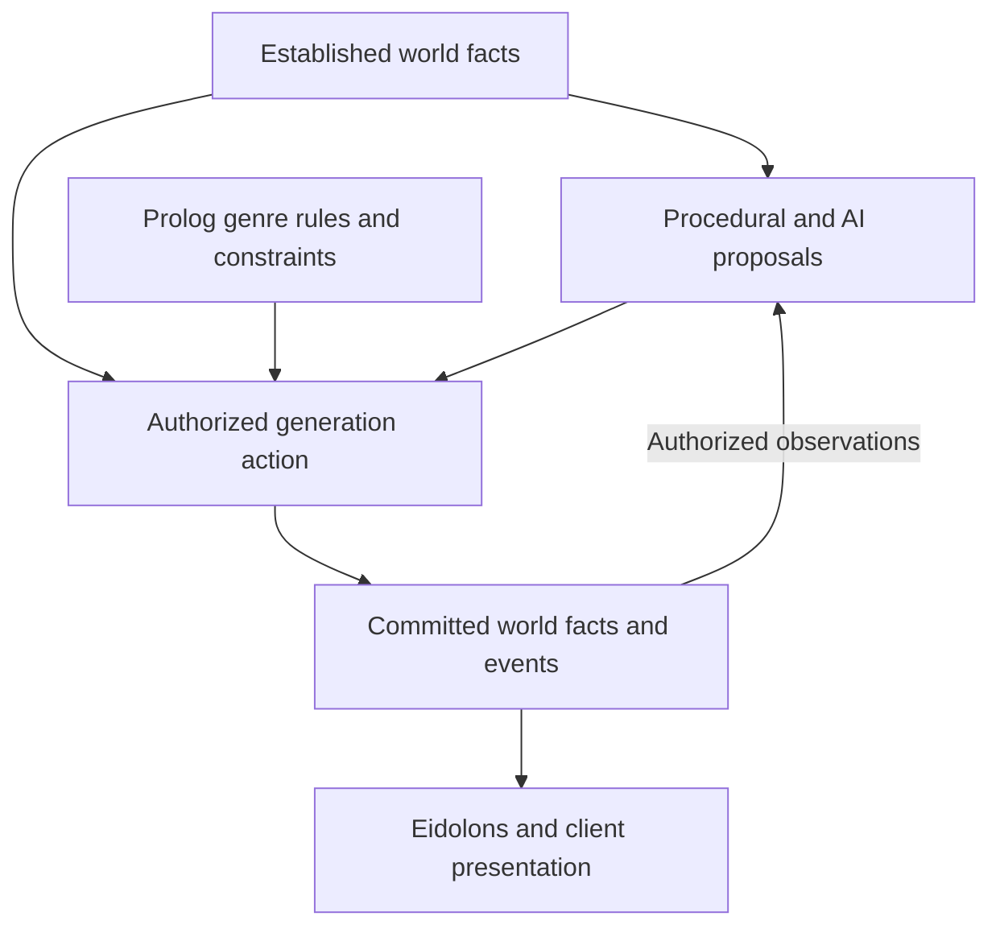

# World generation brainstorming

Design exploration, 11 October 2026.

Quod could host generated worlds whose geography, inhabitants, resources and
consequences are governed by Prolog ontologies. An AI game master could help
invent situations, play characters and narrate outcomes. Eidolons would give
the same persistent entities visual and audible representations.

The working direction is to generate connected situations that can evolve
through play. Fantasy is the example genre; the runtime must remain usable by
other ontologies. The generation, MCP, skeletal animation and sound integrations
described below are proposals. Existing capabilities are identified separately.

## Ideas from the books

The Soulseek folder contains seven relevant PDFs representing six distinct
books. The two Book of Names PDFs contain the same text after whitespace
normalization.

- [D100 Dungeon World Builder](/home/yan/Downloads/soulseek/D100%20Dungeon%20-%20World%20Builder.pdf)
  offers progressive exploration and conditional hex generation. New terrain,
  settlements, roads and rivers can be constrained by adjacent established
  features. For Quod, the useful adaptation is an exploration action that
  develops a bounded area and persists its result.
- [Tome of Adventure Design](/home/yan/Downloads/soulseek/Frog%20God%20Games%20-%20Tome%20of%20Adventure%20Design%20%28with%20bookmarks%29.pdf)
  offers adventure situations, motivations, backstory and clues. Its dungeon
  approach separates areas and their connections from detailed geometry. This
  suggests generating a meaningful graph of places before realizing it in 3D,
  with several ways to respond to a situation.
- [Savage Worlds Fantasy World Builder Toolkit](/home/yan/Downloads/soulseek/Savage%20Worlds%20-%20Fantasy%20World%20Builder%20Toolkit.pdf)
  connects terrain, culture and settlements to practical needs such as water,
  food, defense and trade. These dependencies can become world facts that give
  inhabitants reasons to cooperate or disagree.
- [TSR World Builder's Guidebook](/home/yan/Downloads/soulseek/TSR%209532%20-%20World%20Builder%27s%20Guidebook.pdf)
  combines geographic, social, historical and local approaches to building a
  world. Its climate, terrain, subsistence and trade material can inform
  conditional generation at several scales.
- [Gary Gygax's World Builder](/home/yan/Downloads/soulseek/D20%20-%20Troll%20Lord%20Games%20-%20Gary%20Gygax%27s%20World%20Builder.pdf)
  provides descriptive categories for materials, buildings, rooms, furnishings
  and occupations. These are useful vocabulary and recipe ideas when turning
  an abstract settlement into places that can be represented and used.
- [Gary Gygax's Extraordinary Book of Names](/home/yan/Downloads/soulseek/GFW%20vol.4%20Gary%20Gygax%27s%20Extraordinary%20Book%20of%20Names.pdf)
  provides naming patterns and cultural vocabularies. Its
  [second copy](/home/yan/Downloads/soulseek/Gary%20Gygaxs%20Book%20Of%20Names.pdf)
  adds no distinct text. Quod already uses a documented subset of its Open
  Game Content in [quod_names.pl](/home/yan/src/quod/priv/ontologies/quod_names.pl),
  so naming should reuse that capability where appropriate.

These books combine tables with interpretation by a human game master. Turning
their ideas into Quod requires explicit rules, constraints and authored content;
the books do not supply a complete executable world model.

## The world model

A useful generated region would contain several connected kinds of facts:

- Places and routes: regions, terrain, settlements, buildings, rooms, passages,
  rivers and roads.
- Resources and dependencies: water, food, materials, production, transport and
  the places or people that depend on them.
- Inhabitants and groups: identities, affiliations, capabilities, relationships
  and goals.
- History and knowledge: established events, their consequences, evidence,
  rumors and who can know which facts.
- Situations: unmet needs, disagreements, hazards and opportunities for action.

Generation should respect existing facts. A new road needs compatible endpoints;
a settlement needs a plausible support system under its genre rules; a rumor
needs to be distinguished from the truth it claims to describe. Prolog can
enforce the constraints that have actually been formalized. Narrative coherence
still needs suitable authored rules and judgment.

Spaces, physical spaces and ontology ownership remain distinct, following
[spaces.md](/home/yan/src/quod/doc/spaces.md). A region or room does not require
its own ontology or Erlang process. Ownership, governance and access boundaries
determine where facts belong.

## Generation through ordinary actions

A proposed generation action would read established facts and genre rules,
produce candidates, validate their constraints and commit an accepted result.
Candidates could come from procedural rules, random draws or AI proposals.

The existing action, transaction, reaction and recovery paths should carry this
work. Related facts that form one transition commit atomically, including across
ontology owners when necessary. Generation limits and resource allowances belong
to Prolog policy. Choosing a small region does not justify splitting a single
domain transition to evade an allowance.

Progressive generation can develop nearby territory when exploration requires
it, while preserving already established geography and shared boundaries.
Concurrent attempts to generate the same area must resolve against its existing
owner and revision through normal transaction checks.

Generated choices become persistent facts. Reading a place, reconnecting or
recovering an ontology must not reroll its inhabitants or layout. Quod's existing
`proof_draw` is stable within a proof for the same salt; it is not by itself a
persistent world seed across separate requests. Reproducible regeneration would
need an explicit seed/version policy in addition to preserving accepted results.

## Composable roleplaying rules

Generated worlds need rule ontologies that give their inhabitants capabilities,
risks and meaningful choices. Combat is one application alongside exploration,
crafting, treatment, magic and social interaction. A campaign could select a
coherent composition of rule bundles and parameters, with explicit precedence
where rules overlap. Combining bundles must not accidentally apply damage twice
or let clause order silently select a different game system.

Candidate responsibilities include:

- Anatomy and capabilities: body parts, their functions, movement, perception,
  manipulation and the differences between creatures or constructs.
- Equipment and materials: what an object can do, how it is used, armor coverage,
  protection, wear and relevant material properties.
- Action resolution: skills, intent, difficulty, stance, opposition, resource
  costs, uncertainty and the meaning of success or failure.
- Conditions and recovery: injuries, fatigue, impaired functions, ongoing effects,
  treatment and recovery requirements.
- Encounters and time: turns or phases, initiative, opportunities to react,
  duration and the rules for advancing an ongoing condition.
- Genre rules: the chosen lethality, heroic resilience, magic and exceptions
  appropriate to a particular world.

These are proposed Prolog responsibilities. They can share vocabulary and be
composed into the ontologies owning the affected state. They do not require a
new Erlang combat engine, separate process per fighter or parallel action queue.

### Critical strikes as structured consequences

Rolemaster's critical tables are the inspiration for consequences that change
the situation during a fight. The publisher emphasizes critical strikes and
tactical exposure in its [Rolemaster overview](https://ironcrown.com/rolemaster/).
The proposed extension is to represent a critical as structured facts whose
effects follow from the target's actual capabilities and circumstances.

A candidate resolution would consider the attack's mechanism, resolved success,
target anatomy, affected location, protection, stance and existing conditions.
Rules would produce eligible consequence templates with explicit severity and
probability weights. Selection would produce one consistent result, including
any immediate changes and enduring conditions.

Curated tables can remain useful for pacing, rarity and evocative descriptions.
Their entries could instantiate constrained consequence templates. A target
without a circulatory system would not receive a bleeding condition; a damaged
wing could impair flight, while a damaged construct joint could impair movement.
These distinctions follow from authored anatomy and material rules. The AI game
master narrates the accepted result without inventing additional mechanical
effects during narration.

For example, an accepted critical could leave a character's shield arm impaired.
The condition reduces that arm's grip capability. Shield use, a two-handed
weapon and climbing can each consult their own capability requirements, so the
same injury has consequences outside the original attack. A treatment may stop
an ongoing effect while leaving the functional impairment until another recovery
condition is met. Exact severities and recovery rules are game design choices.

Store the authoritative condition and derive its current consequences where
possible. Do not maintain independently mutable copies of every affected skill
penalty, animation restriction and equipment limitation. An immediate dropped
object, when required by the rules, is a real state change and belongs in the
same accepted transition as the injury that causes it.

### What relational rules make possible

The same relationships could support queries for currently available actions,
the conditions preventing an action, applicable treatments, and candidate
outcomes under a different stance or equipment choice. NPCs could plan around
those facts, and players could receive explanations tied to visible causes.
Explanations need an authored relation or retained result evidence; a useful
explanation is not automatically supplied by a raw failed proof.

Probabilities likewise require an explicit resolution model and weights; Prolog
does not infer balanced odds merely because a consequence is expressible. Keep
the first model at a manageable level of detail and measure outcome distributions
and playability. More rules alone do not guarantee a better game.

The campaign should identify the selected rule versions and randomness policy.
Resolve an action occurrence once and retain its accepted outcome. The existing
proof-bound draw does not establish adversarially fair dice, and a fresh request
must not become a free reroll of an unresolved attack.

### Resolution authority and presentation

A combat resolution is an ordinary authorized domain transition. Where they are
one resolution, costs to the actor, changes to equipment, target conditions and
the result event commit together through the existing atomic transaction paths.
The world's rules authorize consequences on the target; an attacker receives no
general permission to edit another character's state.

An authored encounter clock can advance conditions at turns or phases. Each
advance is a governed action with an identity and expected state. It must not
apply an ongoing effect again because of a redraw, repeated query or recovery.
Later required work uses existing domain obligations and recovery mechanisms.

RPG resolution can operate over abstract positions and capabilities before
physical hit detection exists. A version that uses physical impacts would need
authenticated distinct occurrences with exact acceptance and outcome recovery.
A persistent contact level cannot count separate hits, and a skeletal animation
callback cannot authorize damage. The existing physics profile does not yet
provide general impact delivery; see the observation contract in
[world.md](/home/yan/src/quod/doc/world.md).

Animation and sound bindings follow the selected action, its phases and the
accepted conditions. An impaired arm can select an appropriate posture and limit
gestures; recovery can restore the available representations. Presentation uses
the same domain facts as the action rules.

## An AI game master through MCP

An AI game master could operate as a scoped Quod agent. It would observe permitted
world state, reason about inhabitants' goals, propose developments, request
actions and narrate committed outcomes. Genre and campaign rules would determine
its authority to reveal information, control characters or generate territory.

Durable characters, secrets, goals and consequences belong in Quod. The model's
conversation is working context. Ordinary NPCs can be domain instances; they do
not each need a continuously running model or dedicated runtime process.

A thin MCP adapter could expose conceptual tools such as:

| Proposed tool | Purpose |
| --- | --- |
| `observe` | Read the world facts and events visible to the acting identity. |
| `available_actions` | Describe applicable domain actions under the current rules. |
| `act` | Submit an ordinary authorized action with its expected state. |
| `resolve_operation` | Resolve the exact original operation after an uncertain reply. |

These are proposed MCP interfaces. Quod already exposes signed read, execute and
outcome routes in [quod_client.erl](/home/yan/src/quod/src/quod_client.erl:109),
which an adapter should reuse. Action discovery would need an appropriate
ontology contract. Committed events could prompt another agent turn through the
existing reaction machinery and an integration with the AI host.

The adapter must preserve identity, access scopes, original deadlines and exact
outcome resolution. A game master can know a secret that a player cannot read;
narration and player observations must respect that distinction. AI proposals
still pass the same authorization and domain checks as other actions.

## Models and spatial representation

Generate the relationships and functional requirements before choosing detailed
assets. A building can be assembled from modular recipes, with distinctive
generated models where they add value. Features that need independent movement
or interaction require suitable parts, pivots and explicit physical definitions.

Quod already supports imported static GLBs through Eidolon recipes, digest
verification, resource allowances and shared asset lifetimes. See
[eidolon-mesh-support.md](/home/yan/src/quod/doc/eidolon-mesh-support.md). Visual
geometry and collision geometry have separate authority; an imported mesh's
node names or metadata do not create domain actions or permissions.

An AI game master could specify an asset brief and request generation through a
governed service. Generation and validation happen asynchronously outside a
durable proof. An authorized action attaches an accepted asset to the entity's
representation. Preparing reusable assets ahead of exploration can reduce waits
when a place becomes visible.

Replacing an appearance should preserve the entity's identity, relationships
and gameplay state. Asset production needs a contract for scale, orientation,
parts, materials and, where relevant, rig compatibility.

## Skeletons and animations linked to actions

Animated characters will need skeletal and clip support in the shared asset
contract, importer, validation and clients. The current static GLB profile
rejects skins and animation; this requires more than enabling a renderer flag.

The proposed binding belongs in the ontology and Eidolon model: a character's
representation maps an action, activity phase or persistent state to compatible
clips and sound cues. A humanoid and a different creature can perform the same
domain action with different motions.

An instantaneous logical action may emit a presentation cue. An interaction with
duration may expose preparation, execution, completion and interruption through
domain state. Idle breathing, locomotion and injured posture can follow current
state. The existing `action/3` relation is not automatically a temporal animation
state machine.

Clients would blend clips and maintain independent playback for each occurrence,
including combinations such as walking while gesturing. Immutable asset data
can be shared; each actor needs its own playback and pose state. Unrelated
refreshes should preserve ongoing playback, and stale asset loads or callbacks
must not restart an obsolete activity.

Quod remains responsible for movement, ownership, collisions and successful
outcomes. A clip ending does not establish that an interaction succeeded. For
physical actors, an initial in-place animation policy would let the existing
physical pose owner control movement. Root motion would need an explicit
governed contract before it could drive physical displacement.

The current door implementation exposed an architecture defect: door-specific
control and observation handling extends into Erlang and native code. The
[runtime architecture ticket](nimbalyst://bug_1791718464912_3j9mtg) records the
required replacement with reusable controls and observations, while keeping
domain meaning in Prolog. That specialized path should not become the foundation
for general animation support.

## Sound and speech

Sound would combine persistent ambience, event sounds and character speech.
Ambience follows the current place and conditions. Significant event sounds
follow accepted outcomes. Local presentation cues such as footsteps can follow
animation timing, while collision sounds need suitable physical observations.

NPC speech could use a stable voice associated with the character. The game
master supplies dialogue consistent with the character's permitted knowledge;
the client handles spatial placement, mixing and playback.

Recovery should reconstruct current ambience and ongoing state without replaying
historical one-shot sounds, gestures or speech. The AI agent requests meaningful
actions; clients handle frame-by-frame animation and audio.

## A small valley example

A village depends on a river-powered mill. During a drought, upstream farmers
divert water to save their crops. The miller wants the flow restored, while the
farmers cannot afford to stop irrigating. Nearby abandoned waterworks may offer
another solution, depending on their actual condition and water source.

The generated facts establish geography, a resource dependency, competing goals
and evidence the player can discover. Negotiation, repairs or importing supplies
can lead to different outcomes. A quest can express an inhabitant's desired
state while leaving several possible ways to reach it.

This example should exercise the ordinary domain mechanisms. Mills, farmers,
droughts and quests must not introduce specialized runtime branches.

## Candidate first prototypes

The world-generation prototype would contain one valley, one village, three
connected sites and two groups competing over one resource. It should demonstrate
consistent generation, persistent choices, scoped discovery and more than one
meaningful response to a situation. Initial representations can be simple.

A separate presentation prototype would use one furnished room and a rigged NPC
with idle, walk and gesture clips, speech and spatial ambience. It would test
action bindings, independent playback, interruption and recovery. Keeping these
acceptance goals distinct lets semantic generation progress while animation
support is developed.

A roleplaying-rules prototype could exercise a small encounter with two body
plans, a few attack mechanisms, armor coverage, functional injuries and a
treatment action. It should demonstrate consequences shared by combat and an
exploration action, explain a refusal from visible facts, and preserve exactly
one accepted outcome through a lost reply or restart. It can begin with simple
presentation and a discrete encounter clock.

## Decisions still to make

- The initial genre vocabulary, geographical scale and amount of detail generated
  before exploration.
- The division between authored rules, random tables and AI proposals.
- The constraints that define acceptable geography, resources and history.
- Game-master authority, player knowledge and secret information boundaries.
- World time and the conditions under which NPC goals or situations advance.
- The initial roleplaying rule bundles, their composition and version policy,
  and the level of injury detail and lethality.
- The encounter clock, reaction opportunities and uncertainty model, including
  whether competitive play requires a stronger dice protocol.
- Rig conventions, clip bindings, asset production and audio integration.
- A persistent seed and generation-version policy if reproducibility beyond
  committed world facts is required.

Implementation should follow the [working agreement](/home/yan/src/quod/AGENTS.md)
and the existing [runtime](/home/yan/src/quod/doc/runtime-and-agents.md),
[transaction](/home/yan/src/quod/doc/multiwrite-architecture.md) and
[world](/home/yan/src/quod/doc/world.md) contracts.
