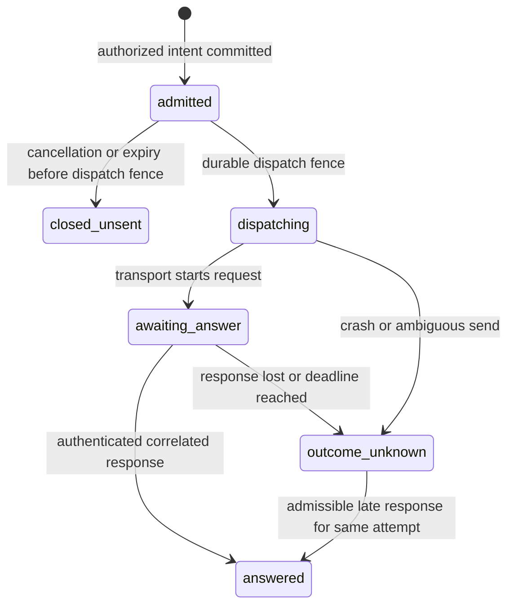
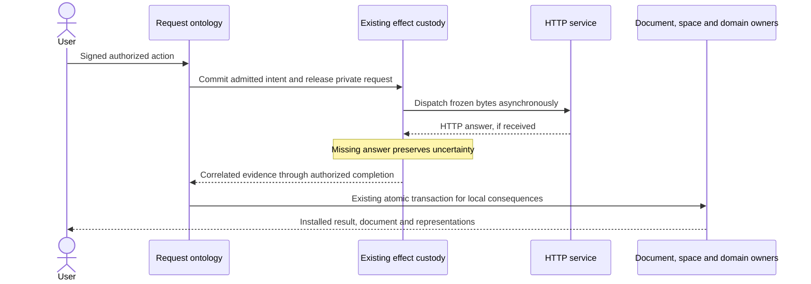

---
planStatus:
  planId: plan-http-json-ontology-design
  title: HTTP, JSON documents and interactive entities
  status: draft
  planType: system-design
  priority: low
  owner: Yan
  stakeholders: []
  tags: [ontology, http, json, design]
  created: "2026-10-16"
  updated: "2026-11-17"
  progress: 0
---

# HTTP, JSON documents and interactive entities

Written on 2026-10-16 from the code of that date and not built. Two things it lists as missing have since been built for other reasons: class and instance permissions, and the shared pie of offered actions for any thing. Some files it cites have moved or are retired. Read it against today's code before building from it.

Status: exploratory design. No implementation, migration or deployment is authorized by this document. Predicate and class names marked proposed are design vocabulary, not installed APIs.

[Ownership and interaction diagram](http-json-ontology-architecture.excalidraw "width=1100 height=650")

## Intended experience

A user chooses an existing space or creates a space instance. They fetch JSON with HTTP GET, or create a JSON document by another means. The document is an ordinary class instance, editable when its ACLs permit. Its class offers several Eidolons for inspecting, editing and laying out its contents. Users can add keys and values, edit through a mapped entity's edition mode, and explicitly publish a chosen revision with PUT or POST. A map owned by the document instance describes how selected JSON values become classed entities. All durable changes are Prolog predicate changes, propagated through Quod's existing committed-diff/subscription path.

The first release includes GET, PUT and POST. This is an outbound HTTP client library for calling services; exposing new inbound REST endpoints is a different scope. JSON is independently useful without HTTP, a space, a GUI or physics. The later entity-mapping slice should demonstrate the computer inventory example without making arbitrary JSON into executable policy.

## Existing foundations and concrete gaps

These findings are from source inspection, not a claim of live GUI or headset validation.

| Capability | Existing evidence | Consequence for this design |
| --- | --- | --- |
| Classes and inherited Eidolons | [common predicates](../../priv/ontologies/common_predicates.pl): `isa/2`, class-first `instance_of/2`, `class_eidolon/4`, `entity_eidolons/2` | Reuse. Multiple inheritance and most-specific recipe selection exist; unresolved alternatives remain choices. |
| Ontologies as instances and metaclasses | [common predicates](../../priv/ontologies/common_predicates.pl), [ontology inspection](../../doc/system-ontology-acls.md) | Ontology self-membership exists. A class term can also be an instance, but a governed metaclass definition/editing vocabulary is not installed. |
| Class/instance ACLs | [scope admission](../../src/predicates/quod_ask.erl), [source-access contract](../../doc/system-ontology-acls.md) | Current entry policy is `can_invoke/4` at an ontology. Shared subject permissions and class-policy inheritance need design; arbitrary source editing would otherwise bypass instance-only restrictions. |
| Space membership and exact references | [space contract](../../doc/spaces.md), [space vocabulary](../../outdated/ontologies/prolog/space.pl) | Reuse organizational membership. An ontology owns a document; a space contains its anchored reference. |
| Rendering space members | [space view](../../outdated/ontologies/prolog/space_view.pl): `world_view/3`, `entity_scene/3`, `eidolon/3` | The member must supply scene context, appearance and layout. Class membership alone does not make it visible. |
| Models and semantic picking | [modelling](../../outdated/ontologies/prolog/quod_modelling.pl), [world scene](../../client/src/world-scene.js) | Reuse parts, marks and `depicts(Namespace, Anchor, Entity)`. A visual occurrence is not another domain instance. |
| Shared forms | [GUI examples](../../doc/gui-examples.md), [instance behavior](../../priv/ontologies/gui_instance.pl), [questions](../../outdated/ontologies/prolog/gui_question.pl) | Text, numbers, selection, tables, menus, dialogs and spatial presentation exist. Reuse their accepted-input and completion lifecycle. |
| Pie/radial menu | [world scene](../../client/src/world-scene.js): `radialIndex`, `bindRadialControl`; [world controller](../../ui/src/World.tsx) | Implemented VR menu, currently fed by lobby tool entries and Questions. A generic per-instance domain-action menu is missing. |
| Generic representation opening | [world decoding](../../client/src/world.js): `readEidolonRepresentation`; [world controller](../../ui/src/World.tsx): `openEidolon`, `sourceChoices` | Existing client supports source workspaces and ontology inspection lenses. JSON inspectors and general instance forms require a shared extension, not merely a new recipe declaration. |
| JSON bytes | [client HTTP adapter](../../src/quod_client_http.erl), [explorer HTTP adapter](../../src/quod_explorer_http.erl) use OTP `json` | A codec exists in the runtime. There is no domain JSON document model or governed Prolog JSON API in the inspected predicate catalogue. |
| HTTP | [HTTP listener](../../src/quod_http_listener.erl), [client HTTP adapter](../../src/quod_client_http.erl) | These serve incoming Quod requests. No outbound REST ontology/bridge was found. Transport selection remains implementation work. |
| Actions, atomicity and reactions | [proofs](../../doc/proofs.md), [multiwrite](../../doc/multiwrite-architecture.md), [runtime](../../doc/runtime-and-agents.md), [action mechanics](../../src/predicates/quod_action_predicates.erl) | Reuse the current signed-goal, action, transaction, recovery and notification paths. |
| Private effect custody | [effect catalogue](../../src/quod_effect.erl), [journal](../../src/quod_effect_journal.erl) | Reuse the owner, but HTTP is a demonstrated missing capability: only create/join/present are admitted today. Remote uncertainty needs distinct handling. |
| Node identity | [node class/enrollment](../../priv/ontologies/quod_node.pl), [node execution](../../outdated/ontologies/prolog/node_execution.pl) | Today `isa(node, agent)` and `instance_of(node, me)` have privileged hosting implications. Generalizing this name requires a deliberate class and policy migration. |

Existing coverage includes [class semantics](../../test/quod_class_semantics_tests.erl), [spaces](../../test/quod_space_tests.erl), [GUI components](../../test/quod_gui_components_tests.erl), [GUI questions](../../test/quod_gui_question_tests.erl), [GUI examples](../../test/quod_gui_examples_tests.erl), [effect custody](../../test/quod_effect_journal_tests.erl) and [client world decoding](../../client/test/world.test.js). Their presence establishes verification seams, not HTTP/JSON coverage.

## Ownership and composition

Proposed library scopes are `quod:json` and `quod:http`, with JSON recipes in `quod:json:eidolons`. The proposed document class is `quod:json:document`. Final naming and founded-versus-composable packaging remain to be settled; follow the existing library vocabulary plus locally composed instance behavior pattern. A class reference does not import behavior or install native predicates.

- The JSON library defines value semantics, validation, access and editing rules. An application or user's ontology owns document instances and their revisions.
- The HTTP library defines request/response semantics and Prolog policy. The requesting application owns request state. The existing custody owner retains only the private material and dispatch evidence needed for an admitted native effect.
- A space's ontology owns `space_member(Space, EntityRef)`. It neither copies the document nor becomes its permission authority.
- A recipe derives a view from the exact document owner. The client owns only presentation state and unsaved drafts.
- Each document instance owns its mapping predicates and exact references to target classes. Class libraries define domain meaning and permitted operations. Mapped entities have stable identities; each represented field retains one authoritative owner, described below.

Use `entity_ref(Namespace, GenesisAnchor, Entity)` for durable membership/provenance references and the existing `subject(ontology_ref(Namespace, Anchor), Entity)` recipe context. Preserve exact anchors on every foreign call and pick. Distinct namespace histories with the same name are not interchangeable.

For document creation plus membership, compose the creation action and `space_contain/2` inside one existing transaction. If owners differ, the existing atomic multiwriter lane commits them together. Entry ACLs, document disclosure, owner consent and space admission must all succeed. Offer explicitly creating an unplaced document as a separate operation; do not silently do that after failed placement.

Organizational membership is sufficient for a 3D representation. A readable document does not need a rigid body. Use physical admission only when the application explicitly requires collision, manipulation or simulation, with the existing placement lifecycle.

## Classes as instances, and subject-level permissions

Yes: the current relational model can express a class that is itself an instance of a metaclass. Subclassing and instantiation remain different relations. Proposed declarations, in the appropriate exact owning scopes, could include:

```prolog
isa(meta:class, thing).
isa(meta:document_class, meta:class).
isa(quod:json:document, thing).
instance_of(meta:document_class, quod:json:document).
instance_of(quod:json:document, document(DocumentId)).
```

These are conceptual declarations. `meta:document_class` classifies the JSON class definition; `quod:json:document` classifies documents. It does not follow that a document is itself a class. A metaclass ontology owns vocabulary, while a class definition is an entity in its own exact ontology; it need not have a dedicated ontology or process. Qualified names alone do not import ancestry, code or authority: use ordinary anchored composition/queries.

The existing `entity_eidolons/2` examines both direct instance classes and the class represented by the subject itself. That makes metaclass-associated definition editors structurally plausible, but the present code does not provide a complete reflective class editor or metaclass lifecycle. Distinguish representing/editing the JSON class definition from representing/editing one document; explicitly separate purposes so their recipes do not become accidental competing defaults. Test this interaction before declaring metaclass support complete.

Ontologies already are instances of `ontology`: common predicates derive `instance_of(ontology, ontology_ref(Namespace, Anchor))` from the current proof-bound identity. This is implemented, not a new registry to add.

The ACL refinement should be shared across all classes and instances. Keep `can_invoke/4` as the existing admission boundary and have declared owner operations consult shared Prolog subject-policy rules. Those rules can themselves be represented as classed ACL/policy instances with Eidolons. Do not introduce a second Erlang authorization engine.

Distinguish permissions to read a document, edit its values, edit its mapping, change its policy, edit a class definition, admit it to a space, and publish externally. A class provides an instance-policy contract; editing the class is a separate authority. A node editor cannot grant access denied by the document owner, nor can document editing grant a node operation's external authority.

Proposed conservative composition: class policy establishes allowed operations/delegation, instance policy can restrict them and can extend only where class policy explicitly delegates that power. Effective policy requires the owner gate and every applicable constraint; missing/ambiguous policy fails closed. Multiple inheritance, explicit denial, revocation and metaclass-policy precedence need a formal rule set before implementation. Evaluate policy from the committed authorization baseline; changing the mapping, class or policy in a candidate must not grant that same candidate new permission.

This affects source editing and disclosure, not only menu buttons. The current source-read permission covers an entire ontology, and privileged source editing can change arbitrary facts/rules. An instance-edit grant therefore must use constrained subject actions or a governed subject-edit lens; it cannot also grant arbitrary source editing in a shared ontology. Keep whole-ontology administration as an explicit broader authority. Field/instance visibility must apply to projections, mappings and subscriptions as well as direct queries. Migrating existing ACLs requires a separately refined scope, preserving current authority and existing histories.

## JSON value and document model

A JSON object is a key/value collection, but a JSON document may also have an array or scalar root. The value model must preserve objects, arrays, strings, numbers, booleans and null, including empty objects and arrays. Array order is significant; object member order is not semantic. [RFC 8259](https://www.rfc-editor.org/rfc/rfc8259.html)

Proposed value algebra:

```prolog
object([member(<<"name">>, string(<<"worker-a">>)),
        member(<<"online">>, boolean(true)),
        member(<<"load">>, number(<<"0.125">>))])
array([string(<<"worker-a">>), null])
```

Use a fixed, small set of functors. Keys, string values and external identifiers are UTF-8 binaries, never dynamically allocated Erlang atoms or predicate names. Require ground acyclic values and reject invalid Unicode, trailing non-whitespace input, non-JSON numeric tokens and duplicate object keys. Duplicate rejection is a proposed Quod interoperability profile, rather than silent first/last-wins behavior.

`number(Token)` retains a validated JSON numeric lexeme. This avoids silently rounding large integers or decimals in Erlang floats or JavaScript numbers. Provide explicit checked conversion predicates for arithmetic, units and GUI controls. Define structural document equality on the retained representation initially; numeric-value equality is a separate query. Therefore `1`, `1.0` and `1e0` can have distinct document revisions without losing their arithmetic relationship. Unchanged means the same retained value, not an unspecified numerical normalization.

Use one authoritative predicate-backed tree per document, so key/value edits yield ordinary fact diffs. The tagged whole-value terms above are decoded/encoded values and query results, not a second persisted copy. A proposed illustrative storage shape is:

```prolog
instance_of(quod:json:document, document(DocumentId)).
json_document(document(DocumentId), Revision, Provenance).
json_value(document(DocumentId), [], object).
json_value(document(DocumentId), [key(<<"name">>)], string(<<"worker-a">>)).
json_value(document(DocumentId), [key(<<"online">>)], boolean(true)).
json_mapping(document(DocumentId), MappingId, MappingRevision, MappingSpec).
```

This is a schema sketch, not executable source. Every path has exactly one value or container marker. Every non-root path has a matching container parent; objects have unique binary keys, arrays have contiguous ordered indices, and scalars have no children. Empty container markers preserve `{}` versus `[]`. Creation, add/remove key, insert/remove array value, subtree replacement and mapping edits use authorized actions, expected revisions and the ordinary transaction boundary. They validate the final tree and affected mappings together. Replacing/removing a subtree removes its descendants in the same transition. Array shifts may change several paths; they never change a mapped entity's stable external identity.

Update only changed facts and increment the document revision for a real semantic edit; normalized object-key order is not an edit. Full historical state already belongs to ontology history. Do not persist a whole-value blob alongside this mutable tree or keep a separate native domain tree. A wire body frozen for an HTTP attempt is immutable request evidence, not another current document.

Proposed pure API: `json_decode(Bytes, Value)`, `json_encode(Value, Bytes)`, `json_at(Value, Path, Subvalue)`, and value-replacement operations. Paths use typed steps such as `[key(<<"nodes">>), index(0), key(<<"name">>)]`; an object key `"0"` differs from array index zero. Missing is failure, distinct from a present `null`. Document reads and mutations are separate owner-governed predicates that use these pure operations.

OTP's [JSON module](https://www.erlang.org/doc/apps/stdlib/json.html) supplies decoding callbacks for numbers and objects. Evaluate it with the deployed OTP version for exact lexemes, duplicate detection, Unicode handling and incremental limits before writing a new parser. A pure conversion bridge is acceptable; ownership and document policy stay in Prolog. Encoding validates the tagged value and must not concatenate unchecked numeric tokens.

Bound parsing, body size, nesting, member counts, output and materialization through explicit Prolog-selected budgets enforced while work is performed. Separate these from real wire/VM encoding constraints and name the resource exceeded. Do not parse an unbounded body and check its size afterwards, invent a population constant, or split one transition to evade its budget.

### Editing and provenance

Editing is governed by ACLs, including for fetched documents; HTTP provenance does not impose read-only status. The JSON class supplies key/value editing and the mapped class supplies its own edition mode. Both operate on the same governed underlying fields. Local client drafts remain transient; saving commits ordinary predicate changes under the owner. Publishing is separately authorized, selects one exact saved revision and freezes its encoded request bytes. A later edit cannot change an admitted request. Immutable snapshots or editable copies are optional authored lifecycle policy, not a separate mandatory document kind.

Keep provenance of the received revision: request identity, authorized executor, response status, selected safe headers, original content digest and relevant observation metadata. Later local edits do not rewrite that observation or pretend to have come from the remote service. Preserve the original received bytes only when an explicit retention policy requires them; the typed value is not a claim of byte-for-byte source formatting. No second mutable payload is introduced.

Refresh is an authorized revision change with explicit conflict behavior when local edits occurred. It never silently overwrites an edited document. After ordered apply, existing subscriptions carry the committed changes to retained projections, including mapping, value, class-policy and representation dependencies. Consumers update affected entities/marks; they do not refetch HTTP to discover local changes. Scene framing may initially remain the existing bounded projection protocol; prove incremental owner work before promising a new per-mark wire-delta format. Policy revocation must invalidate or withdraw an existing readable/editable view.

Removal from a space removes membership; it does not delete the document or its entities. Document deletion/retention, referenced-path removal and detaching mapped entities require explicit domain lifecycle rules. Refuse a dangling binding unless an authorized removal/remap consequence is included atomically.

## HTTP request contract and transaction boundary

Proposed `http_get`, `http_put` and `http_post` wrappers share one request model. Inputs identify the service/endpoint, method, structured headers, optional exact JSON document revision, destination policy and original deadline. Return an anchored request reference promptly. Completion exposes a response/result reference; the API must not imply a synchronous network call within a proof.

### A request expects an answer

Model the exchange explicitly in Prolog. Proposed `quod:http:request` and `quod:http:answer` are ordinary classes whose instances live in the requesting application's ontology. A request is an intention with a lifecycle; an answer is the correlated observation of the service's response. Neither is itself a JSON document. An answer may refer to a JSON document when its body can be decoded and admitted.

The request fixes the initiating principal, exact service/target, method, frozen body revision/digest, authorized executor, original deadline and expected answer contract. The expectation describes acceptable statuses/body formats and the authored interpretation or consequence. It is policy, not a promise that the service will comply. Freeze its version for this exchange; later edits to the source document or mapping cannot silently reinterpret an in-flight request. Current authorization and revision checks still apply when installing consequences.

The answer identifies the exact request and admitted dispatch attempt, observed target, status, safe headers, body evidence/digest and observing executor. The transport adapter binds the response to its existing request handle/connection or stream; an arbitrary server need not echo a Quod identifier. A remote body that happens to contain an `id` is not correlation or authentication evidence. The ordinary authorized completion path verifies that binding before accepting the answer.

Keep three facts distinct:

- **An answer arrived:** the service returned a final HTTP response, including an error or an empty body.
- **The answer met the expectation:** its status and body satisfy the request's declared contract.
- **The local consequence committed:** JSON creation, membership and any domain transition actually succeeded in Quod.

A response reporting acceptance of background work is an answer; it does not prove that work finished. Any later service-job status is a separate, explicitly modeled domain interaction. An unexpected status or malformed JSON remains an observed answer with an interpretation failure, not a timeout. A transport failure is a local observation, not an answer attributed to the remote service.

Proposed request lifecycle:



`dispatching` means transmission may occur or may already have occurred; `awaiting_answer` does not prove remote receipt or execution. A durable fence is required before a possibly effectful send. Closing an unsent request requires positive evidence that dispatch was prevented, not merely an absent acknowledgement. Cancellation races with dispatch through the existing custody owner. After dispatch, stopping the wait or transport does not cancel remote effects.

Timeout ends the caller's wait but does not invent an answer, prove failure at the service or permit resubmission. Preserve the request reference and report `outcome_unknown`. A late answer can resolve that same attempt under its recorded admission policy without extending the caller's deadline. If no answer can be recovered, uncertainty may remain; the first release need not automatically resolve it. Service-specific resolution can be added through authored policy, never a generic blind retry.

Accept at most one final answer per admitted attempt. Duplicate delivery of the same evidence is a no-op; contradictory evidence is refused and surfaced, never last-writer-wins. Persist answer acceptance and its applicable local consequences in the same existing atomic transaction. If a domain transformation is refused, preserve the actual response evidence for an authorized failed-result transition; do not invent that the request was unsent or partially populate the document's entities. Pending private custody is not a second public request state.

After ordered apply, subscriptions expose changed request/answer state and ordinary unification-based reactions may wake interested actors. Recovery restores those facts and pending custody without replaying historical reactions or sending the request again. A reaction wake-up is not an acknowledgement that its consequence committed.

The existing [FIPA request rules](../../priv/ontologies/fipa_request.pl) already demonstrate correlated waiting/completion facts and atomic local consequences. Reuse the same actions, transactions, runtime and work owners. Their internal receiver participates in Quod's atomic writes; an HTTP server does not. In particular, FIPA's guarded internal completion continuation does not authorize repeating an uncertain external POST. Extract shared pure request/answer vocabulary only where both domains have the same semantics; introduce no general conversation executor or message ledger.

GET retrieves a representation; PUT requests creation/replacement at the selected target; POST asks the target to process the supplied representation. PUT's idempotent method semantics do not establish whether a particular timed-out request succeeded. HTTP status, transport failure and Quod commit outcome are distinct. [RFC 9110](https://www.rfc-editor.org/rfc/rfc9110.html)

Proposed completion cases include JSON body, no body, non-JSON body and malformed JSON, alongside status and safe headers. A 204 response creates no fabricated document. A valid JSON error body can be a document without declaring the HTTP operation successful. Redirects and non-success statuses must remain visible under explicit service policy. A JSON parse or placement failure after remote success must preserve that remote result; it does not turn a successful POST into an unsent request.



The diagram describes the desired boundary, not an already supported journal API. All related local facts and receiver consequences within each transition commit together. HTTP service state is outside Quod consensus: no local transaction can roll it back. Admission and response installation are necessarily separate transitions around external I/O. This is different from unnecessarily splitting document creation, membership and mapped consequences into separate commits.

### Demonstrated runtime gaps to resolve before coding HTTP

1. The closed effect catalogue only accepts `create`, `join` and `present`. Its `validate_plan/2` accepts one effect only when `diff_ops` is zero. Consequently the desired request-state-plus-effect admission cannot simply be written as an ordinary mixed plan today. Trace the corresponding proof sealing and validation rules, then extend that shared boundary deliberately if selected. Do not work around it with an extra outbox, a receiver copy or independently committed request facts.
2. The journal's lifecycle recovery checks a locally observable desired state before deciding whether work remains. Arbitrary HTTP services offer no equivalent proof of absence. Extend the same custody owner with an HTTP-specific dispatch/recovery contract; do not apply the existing lifecycle retry path to POST.
3. Record a durable dispatch fence before the possible send. Recovery after that fence without a retained response is uncertain, even if the crash occurred just before sending. A conservative unresolved result is preferable to inventing evidence that no request happened. Disabling automatic client/proxy retries and redirects that resend bodies is part of enforcing the contract.
4. Retain the exact response observation long enough to install its local consequence without fetching it again. The public request state is the ontology's truth; private custody stores the response evidence needed to discharge that obligation. Define when custody is released and how the exact local completion operation is resolved after a lost reply. Reuse the hosted actor/work and operation-outcome mechanisms where applicable, rather than creating another executor.
5. Completion must authenticate the admitted executor and bind request digest, attempt identity, target, deadline and response digest. A user-supplied JSON body is not proof of an HTTP response. Consensus certifies acceptance of the executor's observation, not independent agreement by validators about a remote server; validators must not repeat HTTP reads during proof validation.

Use existing owner notifications and direct monitored worker messages. No readiness polling, reaction replay or blocking I/O in the ontology owner. Restore committed obligations on recovery. Late responses may resolve an already dispatched attempt under its recorded completion policy; they never extend the dispatch deadline or authorize another send. Cancellation before dispatch can prevent sending; after dispatch it cannot promise remote rollback.

No automatic replay of an uncertain request, including PUT. A service-specific idempotency key or status endpoint can support an explicitly specified resolution protocol, but its guarantees must be established for that service. Do not advertise exactly-once remote execution for generic HTTP.

### Policy and private material

Prolog chooses who may call which service, target, method, credential reference and response destination, with limits on concurrent requests, bytes and duration. The Erlang bridge enforces those selections and transport correctness. TLS verification, URL parsing, header validation, redirection and resolved-address restrictions must be explicit; a redirect must not bypass endpoint policy or forward credentials to an unauthorized origin.

Credentials remain private runtime custody behind governed references. Public ontologies, URLs in diagnostics, marks and logs must not contain access tokens or authorization headers. Existing agent-key custody is evidence of an ownership pattern, not an implemented vault for arbitrary HTTP credentials. Generic credential storage/resolution is a gap; an unauthenticated local fixture can establish the first transport seam before authenticated integrations.

## JSON Eidolons and interaction

Propose three complementary recipe families associated with the document class:

- **Document object:** a compact labelled spatial object showing document name, root type, revision and status. Use the existing model vocabulary and exact `depicts` reference. This is the default world appearance.
- **Inspector/editor:** an expandable object/array view in the shared desktop or spatial workspace. Show keys/indices, types and scalar values, with a breadcrumb and bounded pages for large containers. Offer add/remove/rename key and typed value editing under ACLs. A homogeneous array may offer a table, with missing versus null explicit.
- **Mapped collection layouts:** the JSON document class supplies selectable 2D grid, 3D grid and star-layout Eidolons. They arrange the instances described by its map, delegating each item's appearance and edition mode to its own class. Every occurrence depicts its real domain entity; a provenance link returns to the document revision and JSON path. A star arrangement is a visual layout, not evidence of a real network topology; actual links require authored domain relations.

Only the first recipe is the default for the ordinary world mode/style. Alternative inspectors and collection layouts are explicit choices, so recipe ambiguity does not arbitrarily select an appearance. Reuse existing lens/encoding layout and modelling functions where applicable; add missing layout algorithms as shared pure construction. Switching a layout changes the presentation, not instance identities or facts. Persist a shared layout preference only through its declared policy. Class inheritance should allow a specialized document type to replace the default for the same purpose/style using existing most-specific selection.

A JSON field is initially a value/path in a document, not a durable entity with an automatically invented class. Inspection can use a structured subvalue subject derived from document identity, revision and path; this is not the stable identity of a future computer node. Local expand/collapse, selection and layout create no ledger writes.

The shared scene projection currently collects all members and parts. A large JSON tree or mapped inventory therefore needs bounded projection/paging through the existing view/cursor owners; do not render one permanent mesh for every scalar. Retain verified views for their real consumers and process installed changes. A read or unchanged refresh must not parse history, rebuild disk indexes or write/sync storage.

### General instance affordances

The earlier [client-world design](../../doc/outdated/client-world-direction.md#6-gui-ontologies-and-human-interaction) did specify pie menus: separate self/target contexts, ray selection, a menu bound to the selected instance, parameter forms before submission, and equivalent desktop interactions. It also puts action-menu metadata primarily on the requested goal/desired state because proof selects the transition. These are useful prior design intentions; its older GUI implementation-status statements are superseded by the current source and GUI documents.

The missing reusable concept is a read-only projection of **offered interactions for an exact subject**, not a JSON-specific menu. Propose stable entry IDs, labels, parameter-form references, availability and a bounded explanatory reason where useful. The owner maps an ID to its declared goal or shared GUI form; reuse `goal/1` and `action/3` for desired-state attainment rather than choosing an action implementation in the client. The client must not obtain arbitrary executable goals from JSON or infer authority from a visible button. Projection must not execute a mutation merely to decide whether to display it.

Selection flow: pick anchored mark → read subject's offered interactions/representations → open inspector or shared form → submit through existing signed entry and GUI lifecycle → show the actual committed/uncertain outcome. Suggested document actions are Inspect/Edit, Add key/value, Edit mapping, Select layout, Save, Publish PUT/POST, Refresh source and Place/remove in space. A computer-node occurrence opens the node class's edition representation, not a generic source editor forced on every object. Mapped nodes expose only authored domain operations.

Reuse the existing radial and desktop renderers over this shared model, replacing the lobby-specific discovery/dispatch path when generalized. Preserve source/ACL inspection and Questions behavior. Recheck ACLs, expected revisions and action preconditions at invocation; discovery is advisory. Disabled/missing entries are not an authorization mechanism. Pie-menu pagination, keyboard access and headset ergonomics need explicit acceptance criteria; the current radial control is not evidence of a finished general interaction design.

## Later: JSON objects become governed domain entities

For a service returning `{"nodes":[{"id":"n-17","name":"worker-a","online":true}]}`, an authored mapping selects the `nodes` array, validates each object and maps the service-scoped external ID to one stable domain instance. The source path records provenance; array index is not entity identity.

The mapping is contained in the JSON document instance as Prolog predicates, as requested. It is semantic metadata associated with the document, not automatically an extra member exported in the external JSON payload. Editing it is an authorized document operation. A reusable class-level template may initialize it, but must not become a second mutable owner of that instance's map.

Proposed mapping contract: exact source/service and document revision; selected path; anchored target class definition; stable external-key rule; typed attribute conversions; target owner; permitted update/deletion behavior; target space and admission policy. Mapping definitions have their own revision and explicitly selected conversion predicates. Remote JSON fields cannot select executable goals, grant privileges or replace the authorized mapping. Changing a map produces ordinary committed diffs and atomically reconciles affected bindings and memberships; a read-only render must not instantiate entities as a side effect.

Proposed initial ownership for an editable mapped document: the document owns the represented JSON fields; each instantiated entity has a stable identity and an explicit binding to those fields. Its class-specific attribute queries derive values through that binding, and its edition actions translate authorized changes back to the document owner. Domain-only state can live at the entity owner. This permits a key/value editor and a node editor to edit the same fact without synchronizing two mutable copies. A retained projection is rebuildable presentation, not a second authority. Conversions must either define a validated inverse edit or expose that particular field as read-only.

For example, editing worker-a's name through its node Eidolon changes the bound JSON string and document revision. A 2D grid and a star layout subscribed to that document both update their labels. Editing the same key through the JSON editor has the same consequence. Neither edit sends HTTP unless an explicitly authorized publish action is requested. This ownership arrangement is a design proposal to verify against domain needs; detaching an independent copy is a separate explicit lifecycle operation.

For one import/edit/remap transition, validation, identity allocation, bound field updates, provenance, binding lifecycle and space membership commit in one existing atomic transaction. Duplicate external keys, ambiguous classes, unavailable owners or admission refusal fail the transition with no partial population. Budgets are Prolog policy; a too-large atomic import is refused rather than secretly chunked. Explicit service pagination can be modeled later with visible partial/completeness semantics.

Refreshing the same external IDs updates those instances. Missing objects are not automatically deleted: absence can mean filtering or an incomplete response. Destructive reconciliation requires an explicit complete-snapshot contract and domain lifecycle authority. A node action can request an HTTP change, but the entity does not claim remote success until the authorized response is installed.

## Generic node and Quod node specialization

The intended hierarchy is reasonable: a generic node should not automatically be an executing agent. Proposed qualified names are `node:node` (generic node), `node:computer_node` (the example) and `node:quod_node` (Quod runtime participant). The last has both generic-node ancestry and the existing agent behavior. Agree the meaning of generic node—network participant, computer or graph vertex—before freezing the public vocabulary.

Keep the existing `quod:node` policy ontology identity separate from the proposed class name. Renaming a class does not require replacing the policy ontology's history. A future migration must cover enrollment templates, founded node instances, `node_instance_reference/1`, hosting/signing checks, renderings, fixtures and cross-ontology declarations. Ordinary JSON-created computer nodes must never inherit hosting, signing or peer-admission authority. Update exact checks to the specialization rather than merely broadening `instance_of(node, ...)`.

Do not rename deployed identities as part of JSON parsing. First define the taxonomy and migration authority, then migrate the old class path without leaving permanent parallel implementations. The HTTP/JSON first release can proceed independently; the computer mapping milestone depends on this class decision.

## Delivery slices and acceptance

1. **Shared subject policy and JSON independently of HTTP.** Refine class/instance permission composition and metaclass reflection separately from deployment. Establish a minimal reusable subject gate through current admission; do not require an unapproved global ACL migration to test the value model. Implement decode/encode/access and document key/value actions over one predicate-backed tree. Verify nested/scalar roots, empties, Unicode, duplicate keys, missing/null, exact numbers, malformed input, budgets, structural invariants, OCC edits and source-edit bypass refusal through real proof seams.
2. **Document in a space.** Compose creation and membership atomically; supply the document class appearance and inspector/editor using existing recipe/view owners. Verify denied cross-owner admission, wrong anchors, deterministic recipe selection, bounded projections, semantic picking and source disclosure. Generalize representation opening as needed rather than adding a JSON-only workspace fork. Verify a class-definition Eidolon does not replace an instance's edition mode.
3. **HTTP GET, PUT and POST.** Resolve the mixed-effect and uncertain-send gaps above, choose the transport and implement the governed bridge. Test against a deterministic local service, including exact request body/status/headers, redirects, no-body and error responses. Verify request/answer correlation, wrong-request/executor rejection, duplicate and contradictory answers, frozen expectation versions, late answers and cancellation/dispatch races. Inject crashes before/after dispatch and response retention, deadline expiry and lost local replies. Prove no send before authorization/commit and no resubmission of uncertain writes. Remote success followed by local placement refusal remains observable; an error answer remains distinct from a missing answer.
4. **Shared instance interaction.** Replace lobby-only action discovery with the shared subject/action/form model. Verify desktop and spatial use of the same contract, stale drafts, revoked permissions, stable target identity and explicit outcome states. Reuse existing GUI admission/completion machinery. Keep physical headset acceptance distinct from automated adapter tests.
5. **Computer inventory mapping and layouts.** After taxonomy refinement, implement a document-owned map, one meaningful authorized interaction and shared 2D-grid, 3D-grid and star layouts. Verify stable identity across reordering/refresh, duplicate IDs, partial responses, conflicts, atomic membership and lack of Quod-node privilege escalation. Editing through JSON and node Eidolons must change the same authoritative field; subscribed layouts update from committed changes without HTTP refetch, duplicate instances or local-state polling. Include mapping changes, inverse-conversion refusal and removal of bound keys.

At implementation boundaries run the applicable standing clean sequential gates with full logs and true child exits. Include retained-state measurements: repeated unchanged inspection/resolve/recovery through the real owners does no history replay, state rebuild, file write or sync; a real update remains observable. New functionality will add production code, but shared GUI generalization must replace its obsolete path and report the actual delta.

## Agreed direction and remaining design decisions

- Editing is ACL-controlled, the mapping belongs to each document instance, class-specific edition modes and multiple layouts are required, and changes are Prolog diffs propagated to subscribers. These are requirements, not outstanding choices.
- Generic nodes and Quod runtime nodes have separate class semantics; runtime authority remains attached to the Quod-specific specialization and its existing identity/policy checks.
- HTTP explicitly models a request expecting a correlated answer. Missing answers preserve uncertainty; error answers, successful remote operations and committed local consequences remain distinct.
- Refine the shared class/instance ACL composition, protected class-definition editing and metaclass vocabulary. A project-wide ACL migration is not implicitly approved by this brainstorm.
- Confirm the proposed document-owned field bindings for mapped entities, including lifecycle and inverse edits; retain one authority for each field.
- Exact library packaging/names; generic node meaning and class migration.
- HTTP mixed admission/effect contract and response custody/completion binding. These are architecture questions to resolve before implementation, not permission to weaken current checks.
- Authenticated service requirements, retention of sensitive response bodies, intended document sizes and a representative first service.
- Default inspector presentation and general action descriptor shape. A domain schema can choose richer Eidolons later; JSON alone cannot infer operational meaning.

## Inspection provenance

This design was prepared on `design/http-json-ontologies` in an isolated worktree from `6404ec95b4703203b5bd08a82b0b4d4b5f98961f`. The main working tree contains ongoing movement, material-policy and voxel-world changes; they were preserved and are not silently included in this branch's implementation inventory. Its current multiwrite document was also read for standing policy direction. Reconcile those changes before implementation. No production files were modified and no runtime/release validation was performed for this planning artifact.
