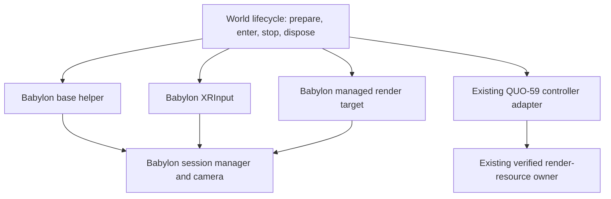

---
planStatus:
  planId: plan-quo-58-webxr-startup-correction
  title: Production WebXR startup correction
  status: in-development
  planType: bug-fix
  priority: high
  owner: Yan
  stakeholders: []
  tags: [webxr, startup, controllers, acceptance]
  created: "2026-10-26"
  updated: "2026-10-26"
  progress: 65
---

# Production WebXR startup correction

Agreed source correction for [QUO-58](nimbalyst://QUO-58), committed and deployed with the completed [QUO-59](nimbalyst://QUO-59) controller implementation. The fresh-ledger demo reached real stereo frames, both controllers, app exit and re-entry. Yan rejected its head-movement blackout, so usable physical acceptance remains incomplete. The follow-up below removes that restriction; its release qualification is blocked by the repeated source-edit timeout recorded below. Bare-hand tracking remains excluded.

The initial launch authorized diagnosis and planning. After the requested Claude Fable plan review and the dependency-owner investigation, Yan explicitly approved implementation of the revised scope on 26 October 2026. At the initial software checkpoint, no commit, deployment, ontology update, ledger reset or hardware launch had occurred. Yan subsequently authorized committing the work and deleting/recreating the candidate ledgers for the demo, as recorded below. No additional coding session or worktree was started; failed evidence remains intact.

## Diagnosis evidence and pre-correction baseline

Read [AGENTS.md](/home/yan/src/quod/AGENTS.md), [multiwrite architecture](/home/yan/src/quod/doc/multiwrite-architecture.md), the complete [QUO-59 design and final verification](/home/yan/src/quod/nimbalyst-local/plans/quo-59-controller-ontology-design.md), its latest tracker comments, [failed physical assessment](/home/yan/src/quod/doc/evidence/stage1-vive-20261025/campaign-06/vive-live-02/assessment.md), [prior-test comparison](/home/yan/src/quod/doc/evidence/stage1-vive-20261025/campaign-06/vive-live-02/prior-test-comparison.md), [GUI acceptance](/home/yan/src/quod/doc/gui-hardware-acceptance.md), the requested client/UI owners and installed dependency source. The prior acceptance session summary was also read. `work_radar` showed no shared-item activity signal; this session, `7c45b431-c08b-4bfd-a145-3246cf120a05`, is linked to the existing ticket.

The inspected tree is HEAD `e026d2a42333dbe90d3af4b0c42bcf5ed4940781` **plus existing working-tree changes**, including untracked QUO-59 modules, tests, Prolog source and Vive asset. HEAD alone does not identify it. QUO-59's latest comment reports completed source corrections/reviews and 161 distinct passing software tests; deployment and physical acceptance remain separate. Those are prior results, not tests rerun by this session.

Installed core, GUI and loader packages are pinned to Babylon 9.18.1 in [client dependencies](/home/yan/src/quod/client/package.json). UI imports the client modules; there is no separate UI Babylon installation. A [diagnosis manifest](/tmp/quo-58-diagnosis-YHqfLatu/source-manifest.json) records relevant source and installed XR module hashes; SHA-256 `f5b4f989986f0576dbc38eab09b68e3116c1551af30f862b007e106d8368a929`. The pre-correction [world owner](/home/yan/src/quod/client/src/world-scene.js) hashes to `545e1e2491cd21cf615dd59120a1bdeb0bba263e5c076e37155d202565fd9535`.

### Verified pre-correction causes, historical facts and limits

These findings describe the frozen diagnosis baseline, before the implementation recorded below. Linked source files now contain the correction; the diagnosis manifest and probes preserve the original evidence.

1. **Historical fatal exception:** the deployed campaign recorded a real session, the missing InstancedMesh registration exception, zero frames and Yan's “Allowed; still black.” Hand-joint initialization calls `createInstance()` in the pinned library. Attribution to that enabled hand feature is source-based inference: the physical recording did not capture a full stack or enabled-feature list. Its CSP violations were separate, not the recorded fatal exception. Native Vive/controller detection and successful display acquisition after HDMI reconnection do not prove rendered output or repeatable native readiness.
2. **Current source can fail earlier:** [world entry](/home/yan/src/quod/client/src/world-scene.js:252) disables teleportation, pointer selection and near interaction, but does not disable hand tracking. [DefaultExperience](/home/yan/src/quod/client/node_modules/@babylonjs/core/XR/webXRDefaultExperience.js:96) imports the hand implementation's pure module and attempts to enable it; that does not register it. QUO-59 removed the old feature registration imports. A fresh-process import of the actual current world and dynamic entry dependencies reports `features: [], controllers: [], online: true`. Enabling the default hand feature throws `feature not found - xr-hand-tracking (latest)`. DefaultExperience catches initialization errors and returns a partial object; the caller currently accepts it. Therefore adding only InstancedMesh would not correct current startup. Do not restore hand tracking to reproduce the old setup.
3. **Profile fetching remains reachable:** [XRInput](/home/yan/src/quod/client/node_modules/@babylonjs/core/XR/webXRInput.js:62) prefetches the online profile list unless `disableOnlineControllerRepository` is set. `doNotLoadControllerMeshes` suppresses model loading only. Current imports register no offline Vive decoder; after online failure, component initialization can fail as well. The existing signed mapping requires named trigger, squeeze and touchpad components. Registering the pinned local Vive decoder supplies those without fetching profiles or models; the diagnostic probe verified this through the real motion-controller manager.
4. **Unwanted helper UI remains reachable:** default UI is still enabled. [EnterExitUI](/home/yan/src/quod/client/node_modules/@babylonjs/core/XR/webXREnterExitUI.js:109) injects a style element, creates its own button and installs automatic `sessiongranted` entry. Its icon also has a remote-image fallback. Quod already owns the Enter VR button. Source inspection found no application-owned exit method/button: the existing button becomes disabled “VR active.” Complete that control in the same UI owner when removing Babylon's UI.
5. **Failed-entry cleanup remains absent:** world entry awaits `enterXRAsync` without cleanup. [ExperienceHelper](/home/yan/src/quod/client/node_modules/@babylonjs/core/XR/webXRExperienceHelper.js:190) sets NOT_IN_XR and rethrows on failure; its exit method returns immediately unless already IN_XR. [SessionManager](/home/yan/src/quod/client/node_modules/@babylonjs/core/XR/webXRSessionManager.js:242) assigns the session and notifies initialization observers **before installing its native end listener**. An observer exception can skip that listener. Manager exit also clears `inXRSession` before awaiting `end()` and suppresses rejection. Neither helper state nor that flag proves device release.
6. **Repeated entry has additional lifecycle exposure:** entry resolves before the first XR frame, whereas IN_XR is published on that frame. The UI's promise-finally clears its separate `enteringVR` flag too early. Also, world entry omits the helper's already-owned render target; the method's default argument creates another target on each call, with more session observers. Disposal during the dynamic imports/session request has no world-level generation fence.

The [Node diagnostic](/tmp/quo-58-diagnosis-YHqfLatu/probe.mjs), [full result](/tmp/quo-58-diagnosis-YHqfLatu/probe.log) and [true exit](/tmp/quo-58-diagnosis-YHqfLatu/probe.exit.json) establish items 2, 3 and the early-init cleanup hole using the installed Babylon owners and NullEngine. After a controlled init-observer exception, helper exit made **zero** session-end calls and the manager retained a live session; explicit diagnostic cleanup ended it, but delivered **zero** manager end notices because its listener had never been installed. The probe exited 0. This is software evidence, not browser permission, CSP or hardware acceptance. Early exploratory commands also exposed a nonexistent UI-local package path and a mistaken diagnostic method name; neither was a product failure, and neither supports a passing claim.

## Agreed correction

### Explicit supported features and resources

Replace the default-experience convenience wrapper with explicit construction of Babylon's existing base helper, input and managed render target. Keep one world-owned XR lifecycle. In [world entry](/home/yan/src/quod/client/src/world-scene.js:252):

- Import `WebXRExperienceHelper` and `WebXRInput` directly, create the base helper with `CreateAsync(scene)`, then create input and one managed target. Enable no optional feature plugins. This removes default UI, hand tracking, teleportation, pointer selection and near interaction by construction, together with the default wrapper's extra anonymous scene-disposal callback and its catch-and-return-partial-object path. Do not request hand-tracking, hit-test, anchors, plane detection, DOM overlay or other optional feature packs. Retain immersive-vr/local-floor and Babylon's current reference-space behavior; record the actual selected space during acceptance.
- Pass `disableOnlineControllerRepository: true` alongside `doNotLoadControllerMeshes: true` directly to `WebXRInput`. Explicitly load the registering `webXRHTCViveMotionController.js` module before constructing input. Its existing component decoder describes hardware observations only; actions, roles and appearance remain selected by Prolog. Do not force every input source to a Vive profile or add generic guessed bindings. Unknown sources remain unsupported under QUO-59's existing rules.
- Retain the existing `{ baseExperience, input, renderTarget }` shape consumed by the controller adapter; it is one owned set, not another implementation of Babylon's default wrapper. Pass the one render target explicitly to every `enterXRAsync` call and use the existing engine canvas. Connect controllers and permit entry only after construction completes. If any construction stage fails, dispose the resources already acquired in reverse dependency order and report the original error.
- Remove entry's broad Babylon-file loader, glTF barrel, Node Blocks and color-curves imports after verifying the remaining paths independently. They served the old automatic model/hand setup. The [render-resource owner](/home/yan/src/quod/client/src/render-resources.js:16) already imports the specific GLTF2 loader, which explicitly registers both the GLTF2 decoder and GLB SceneLoader plugin. Do not replace the removed imports with a broad Babylon barrel.

Add explicit `Meshes/instancedMesh.js` registration at the existing render-resource model decoder, before GLTF2 decoding. The [current mark occurrence path](/home/yan/src/quod/client/src/scene.js:183) defaults to cloning, but the GLTF2 loader can itself instance a mesh referenced by several nodes, without an extension. A locally admitted two-node GLB reproduces the missing-registration exception through `createRenderResources` with both minimal and current broad imports; explicit registration fixes it. The pinned Vive GLB has six mesh references with no repeated mesh, so this finding does not establish a new historical Vive failure cause. Preserve the general static-GLB contract and add a shared-mesh regression; do not reject otherwise valid assets to avoid loading a dependency. Hand tracking remains disabled. [Checked probe and results](/tmp/quo-58-plan-fable-es0h2pmr/instancing-probe-02.mjs).

The resource audit must remain explicit:

| Resource/path | Required disposition |
| --- | --- |
| XR plugin registrations | No optional Babylon interaction/hand plugin enabled. Headset camera, session/layer and XRInput are supplied by the explicitly imported helper/input dependency graph. |
| Vive hardware layout | Bundle the existing pinned Babylon Vive decoder. No online profile-list/profile JSON requests, fallback downloads or copied profile cache. Its legacy model URL must never be called. |
| Controller appearance | Preserve the signed class-selected Eidolon and [packaged Vive GLB](/home/yan/src/quod/ui/public/assets/models/bd201855c8114b9b0e9cdd465d6f08413d18604894c839fb78d54d890c2adc94.glb), SHA-256 `bd201855c8114b9b0e9cdd465d6f08413d18604894c839fb78d54d890c2adc94`, plus [MIT notice](/home/yan/src/quod/ui/public/assets/models/vive-LICENSE.txt). One verified template, separate appearances, existing lease owner. |
| GLB buffers/images/codecs | Existing digest, transfer, bounds and cost checks precede decode. [Static GLB validation](/home/yan/src/quod/client/src/glb-profile.js) rejects external buffers/images and extensions. Embedded PNG/JPEG only; no Draco/KTX/remote shader dependencies are required by this asset. |
| UI styles/icons | Quod's emitted CSS and ordinary controls. No helper style element, helper button, remote icon or automatic session-granted handler. Existing canvas avoids the managed-output canvas's inline-style creation branch. |
| Bundle/transport/security | [Vite](/home/yan/src/quod/ui/vite.config.ts) emits the two production HTML entries, CSS/chunks and public assets into the release bundle. [HTTP headers](/home/yan/src/quod/src/quod_http_headers_h.erl) require self-origin scripts/styles/connections; images allow self/data/blob. Preserve these headers, Permissions-Policy, HTTPS validation and browser sandboxing. Development proxy settings are not production evidence. |

No new resource owner, asset host, CSP allowance or model-loading path is needed. Verify actual outgoing requests and security violations, including after exit/re-entry; searching bundle strings alone cannot establish reachability.

### Failure and exit through the scene's existing lifecycle

Extend the existing world-owned XR lifecycle, not a new session service. A small internal lifecycle extraction is acceptable only if it replaces the inline implementation and is used by production and tests. Babylon still owns session/input/rendering; QUO-59 still owns controller interpretation and leases.

1. **Prepare before the user gesture; serialize entry and exit in the scene.** Resolve imports and construct/validate the helper as part of world XR preparation, without requesting a session. Enable Enter VR only after preparation succeeds; a replacement must be prepared before re-enabling that control. Keep large imports and network waits out of the click-to-request path. Verify transient user activation at the actual request in the built HTTPS app under a cold/throttled load. `NotAllowedError` alone cannot distinguish permission refusal from lost activation: preserve the error, inspect available activation evidence and offer a deliberate retry without guessing the cause. Retain one pending operation and an owner generation/disposed fence. Duplicate clicks must not create another helper or request another session. Hold the starting state until first-frame entry, terminal failure or explicit cancellation; a successful request alone is not presenting. Publish this state to the existing UI instead of relying on its independent promise-finally flag.
2. **Observe the actual session before fallible initialization.** Install a first-priority `onXRSessionInit` observer before entry, capture the exact session and install a native `end` listener. The listener must be installed before feature/input observers can throw. The catch path also inspects that attempt's manager session, so an earlier callback failure cannot lose the created session. Fence all completions to their attempt; never capture/end another owner's session.
3. **Use one idempotent stop operation for failed entry, explicit exit and disposal.** Cancel controller gestures/navigation immediately. For an attempt whose actual session is not already known ended, request its `end()` once independently of helper state. A native end event or successful end promise confirms session termination; a later end rejection must not undo an already observed native end. Never call end again merely because two stop callers race. Preserve the original entry error and separately report a rejection that leaves termination unconfirmed. A flag reset or swallowed manager error cannot enable another entry. Keep entry blocked when release remains unconfirmed, expose platform/browser exit guidance, and allow the later native end event to complete cleanup without polling or blindly repeating the request.
4. **Join entry settlement before disposing its dependencies.** The early native end listener records termination only; it must not dispose or restore the scene during that event dispatch, ahead of Babylon's later listener. Stop records cancellation and ends an available session, then joins the underlying Babylon entry promise, distinct from the public operation promise that includes cleanup. Keep the capture listener and manager alive while consent/layer initialization is pending. After entry settles, inspect that attempt's session again, end a newly arrived session at most once, and finish after the end dispatch and any entry continuation can no longer mutate the scene. Do not create a cleanup/entry promise cycle. Let normal Babylon end handling restore its state. Where partial initialization skipped it, retire the incomplete helper/input/target and restore the scene-owned camera, controls and rendering through existing owners. Remove pending first-frame callbacks and owned observers. Do not manually broadcast a synthetic session-ended notice. Only the failed XR helper may be reconstructed; the world, signed projection and resource owner stay alive. Use the dependency-owner correction below so replacement releases its inherited disposal hooks as well.
5. **Make controller attachment detachable as part of this correction.** In [controller scene](/home/yan/src/quod/client/src/controller-scene.js), factor its existing observer removal, session-listener removal and source retirement into an idempotent disconnect used for helper replacement and final disposal. Preserve the current signed mapping for the still-live world consumer. Ensure every departing source retires its pointers, captures, rays and model occurrences, including when Babylon did not deliver its removal notices. Reconnection uses the same adapter and fresh source incarnations.
6. **Finish the existing controls.** Expose an awaited exit/cancel operation in [WorldScene's type](/home/yan/src/quod/client/src/world-scene.d.ts); wire the existing [World controls and menu dispatcher](/home/yan/src/quod/ui/src/World.tsx) to it. The desktop button supports exit/cancel, and the existing radial action menu offers Exit VR when appropriate. No parallel overlay or controller gestures. Platform exit remains available when signed mappings are unavailable. A request awaiting browser consent cannot be aborted by inventing an API: cancellation records intent, then ends any session that subsequently arrives.
7. **Visibility interruption preserves QUO-59's completed behavior.** Hidden/visible-blurred cancels immediately without waiting for a frame; return requires current poses and neutral rearming. Temporary visibility loss does not itself destroy the session or renew authorization. Native end goes through normal exit. Late imports, session resolution, first frame, model decode and old-session notices after exit/disposal must not restore input or touch a replacement scene. On component unmount, synchronously invalidate input/callbacks and arrange awaited owned-session teardown before dependent engine destruction, with surfaced cleanup errors.

8. **Contain failures in Quod-owned callbacks.** Wrap the existing Quod XR frame, controller/source and scene-render callbacks at their registration boundaries so exceptions from their work are reported and routed once to the same stop operation. Do not rethrow into Babylon's frame requester, swallow the error and continue, add a second frame scheduler, or install a watchdog. Preserve a usable Cancel/Exit control before the first frame. Test a first-frame callback failure, a later frame failure and a source callback failure. This is an additional verified failure class, not a replacement explanation for the historical hand-attachment exception. It does not claim to contain arbitrary failures in library callbacks outside these boundaries.

The browser's actual session-end event or successful end promise supplies termination evidence; entry settlement and completion of end dispatch separately fence teardown; hidden/blurred sessions may withhold input/frames. These requirements follow the [WebXR session contract](https://www.w3.org/TR/2026/CRD-webxr-20260609/#xrsession-interface). Do not poll for readiness or add a recurring retry timer. Do not extend caller/authorization deadlines to make cleanup or re-entry appear successful.

### Exact edit boundary and removal

Primary production edits: the world owner (with one internal XR lifecycle module if needed), its type and World UI; controller-scene disconnect/reconnect and callback-error routing; one explicit InstancedMesh registration in the existing render-resource model decoder; the three-module Babylon patch, pinned installer/lockfile, and build/test integrity checks described below. Retain controller-input semantics (only route its asynchronous initialization callback through the world guard), controller-view, render-resource ownership/admission, Prolog descriptions/preferences, signed-view subscription, GUI/personal-agent/control and physics behavior. No server/domain edit is expected for the startup correction itself. Any newly demonstrated requirement outside these boundaries must be explained before expansion.

Remove the obsolete entry imports and `WebXRDefaultExperience` construction, implicit default hand/UI enablement, online repository defaults, extra render-target creation and UI-only entry guard as their replacements land. Do not restore old hardcoded handedness dispatch, pointer/near plugins, model loads or automatic session-granted entry. Adjust current lifecycle consumers/fixtures only where the changed interface requires it. Historical evidence and old runner recordings are immutable. Report actual production and test line deltas against the preserved working baseline; bounded lifecycle code may grow to close the demonstrated failure paths, but do not create parallel implementations or compress formatting to claim a reduction.

### Concrete dependency-owner correction

Babylon 9.18.1 does not expose the anonymous scene/engine disposal observers through a supported public handle. Keeping a failed helper forever would retain partially initialized state; inspecting private observer arrays or wrapping `Observable.addOnce` in the application would give the client responsibility for library internals. Fix registration/removal in the objects that own those callbacks.

The [candidate patch](/tmp/quo-58-owner-cleanup-qZXJVcsT/candidate.patch) changes three installed JavaScript modules in an **isolated dependency copy only** (12 added lines, 6 removed). Its SHA-256 is `c189c54e9f50774dd9cd02075e7ea607f1207cd360bdeb6790c1c70ee24827f7`. That was the isolated prototype. The approved implementation now packages and applies the corresponding [versioned patch](/home/yan/src/quod/client/patches/@babylonjs+core+9.18.1.patch), with private declarations and stale source-map links corrected, to the client installation.

- `WebXRExperienceHelper`: retain the token returned by its scene-disposal registration and remove it on explicit `dispose()`.
- `WebXRSessionManager`: do the same for its scene-disposal registration. Move its existing native `end` listener installation before `onXRSessionInit.notifyObservers(session)`. This closes the reproduced initialization-exception gap at its owner; no synthetic end notification or duplicated engine-restoration implementation is needed in Quod.
- `WebXRManagedOutputCanvas`: retain its engine-disposal token and its session-init/session-end tokens; remove all three in `dispose()`, even when the manager remains alive. Keep existing canvas/layer disposal behavior. Do not change rendering, security, permissions or feature policy.

Quod still owns cancellation intent, end-at-most-once, confirmation of actual termination and waiting for entry continuations to settle. Moving the native end listener does not make helper state a release receipt or fix late setup continuations by itself. After those fences, disconnect controller interpretation, dispose input and render target, dispose the helper's feature manager, then dispose the base helper. The world, signed mapping and verified resource consumer remain alive for retry. Retain a healthy set across normal sessions where its session callbacks have completed; reconstruct only an incomplete/failed set. Final world disposal joins the same teardown before destroying the scene/engine.

**Reproducible packaging:** retain exact Babylon 9.18.1 pins. Add `patch-package` 8.0.1 as a pinned client build dependency with a lockfile update, a version-named patch under `client/patches/`, and `postinstall: patch-package --error-on-fail`. Use that standard mechanism rather than a bespoke patch runner or an unrecorded node_modules edit. This follows the tool's [installation and failure-handling instructions](https://github.com/ds300/patch-package#readme); its [package metadata](https://github.com/ds300/patch-package/blob/master/package.json) identifies 8.0.1. No upgrade to Babylon or parallel vendored renderer is proposed.

Include declarations for the new private observer fields in the packaged patch. Remove stale source-map links from the three modified generated JavaScript files unless maps are regenerated accurately; do not ship misleading original mappings. Record exact before/after file digests and package version in the patch manifest. An explicit read-only dependency check must run before client tests and from Vite configuration for both direct build and development entry points, so skipped install hooks or a cached unpatched dependency cannot produce an apparently qualified bundle. The check rejects mismatches; it never repairs dependencies during a build. No new runtime guard or environment-dependent fallback belongs in browser code.

Use a disposable dependency-install directory for a clean locked-install proof; never run a cleaning install over the shared client's current node_modules. Prove patch application, idempotent reapplication, rejection of wrong version/content, and rejection when install hooks were skipped. Preserve all failure logs. Include patch, manifest, installer lockfile and applied module digests in the release freeze/cache key. The production Dockerfile consumes the already built `priv/explorer` bundle; it does not install Node dependencies, so do not add a second UI build there. Document the existing client-install → UI-install → UI-build sequence with the patch requirement. Remove the local patch only when a separately qualified upstream release supplies these same fixes.

**Evidence so far:** the [real-owner diagnostic](/tmp/quo-58-owner-cleanup-qZXJVcsT/probe-03.mjs) compares unmodified installed modules with the copied patch, using NullEngine and browser-boundary doubles. Four prepare/dispose cycles accumulate scene observers `0,2,4,6,8` and engine observers `0,1,2,3,4` without the patch; the patched counts remain zero, and camera counts return to zero. Disposing the target while keeping its manager alive also restores both manager observer counts. Repeated disposal is harmless in this probe. A throwing init observer produces zero manager end notices in stock Babylon and exactly one with the patch when the actual session emits `end`. Preparation makes no session request, enables no optional feature, leaves the online profile repository disabled and writes no canvas style. Both final comparison children exit 0: the unpatched child asserts the defect, not a product pass. [Stock log](/tmp/quo-58-owner-cleanup-qZXJVcsT/stock-03.log), [patched log](/tmp/quo-58-owner-cleanup-qZXJVcsT/patched-03.log), [receipts](/tmp/quo-58-owner-cleanup-qZXJVcsT/receipts-03.json), [module hashes](/tmp/quo-58-owner-cleanup-qZXJVcsT/manifest.json).

Two earlier diagnostic runs failed on incomplete browser doubles (missing canvas styling context, then missing document event methods). Their scripts/logs/receipts remain preserved separately; the corrected fixture uses the existing-engine-canvas path and an EventTarget document. These are diagnosis/proposal checks, not client integration, clean-install, production HTTPS or physical acceptance results.

Implementation must promote these obligations into tests against the actual installed owners and Quod's actual lifecycle. In addition to the lifecycle matrix below, cover failed preparation, end-before-first-frame, normal end/re-entry, target disposal with manager alive, repeated helper replacement on the same scene/engine, double disposal, and parent disposal after explicit teardown. Assert observer/camera/controller/resource counts against the original baseline, allowing Babylon's documented deferred removal bookkeeping but no live retained callbacks. Do not inspect private callback identities or remove them from production code.

## QUO-59 integration and founded-state prerequisite

The shared vocabulary owns controller classes, named components, bindings and the Vive appearance. The human ontology owns revisioned preferences and the offered U→A settings operation. Browser sources stay ephemeral. Reuse the existing signed subscription, invalid-settings Reset recovery, source disarming, pointer cancellation, retained inert models during refresh, and existing movement authorization. No controller ontology redesign is requested. The later Claude request reviews this startup plan, not QUO-59 anew.

Startup can be corrected without changing domain state. **Later acceptance of both controllers with this UI requires compatible founded sources**, which a rebuilt package does not install. Before separately authorized deployment/acceptance, prepare a read-only inventory of exact network/ontology anchors and source revisions, then an explicit governed update proposal:

- Update the existing shared lobby/device vocabulary's controller descriptions, validation and class Eidolon under its current source-edit authority; preserve the device owner and existing instances.
- Update existing human source composition to include the reviewed GUI instance/operation and controller-preference rules, applicable personal-agent policy and the exact GUI vocabulary pin. Compare installed predicates first to avoid duplicate composition. Preserve private saved preferences and revision fences; do not seed defaults or silently repair invalid rows.
- Update the founded signup policy's [source-component recipe](/home/yan/src/quod/priv/ontologies/quod_signup.pl:108) and its reviewed source-directory/anchor configuration for future accounts. Updating only existing humans leaves new accounts inconsistent; updating only signup leaves existing humans unchanged.
- Verify compatible client-view endpoint support and source predicates on all target nodes. Apply logically related receiver changes in the existing atomic transaction mechanism, under current authorization; never split a transaction to evade a material limit. Record committed outcomes and exact resulting revisions. Resolve uncertain original operations without resubmission.

The deployment inventory/update proposal requires separate authority; no live ledger was inspected here. Default reads must remain write-free. Single invalid-settings rows retain QUO-59's explicit Reset path; duplicate/malformed rows or true denial require authorized repair/reload as already documented. Missing founded rules are a visible prerequisite failure, never justification for a reset or hardcoded controller fallback.

## Meaningful verification after implementation agreement

Run focused software checks through real owners before the full release boundary. Add a startup/lifecycle test file using the actual production XR lifecycle and installed Babylon classes; fake only browser/platform boundaries and controlled failure points. A test of a newly invented state machine or an import-string assertion is insufficient.

| Test through production seam | Required evidence |
| --- | --- |
| Fresh-process import and real helper creation | Explicit feature set, complete helper, offline Vive components for left/right/none, no hand feature request. Repeat decoder/component assertions on the frozen production bundle using test-boundary XR sources; inspect requested profiles and reject unsupported sources without guessed bindings. No test barrel import may accidentally register missing modules. |
| Real XRInput → controller adapter → GUI/navigation | Two supplied XR sources initialize real Vive components; trigger/squeeze/pad map through signed descriptions. Source removal, re-add, missing components and late init preserve neutral rearming and produce no ghost click. No automatic model, duplicate pick or raw-index domain mapping. |
| Entry failures at each stage | Permission refusal (no session to end); init observer failure before manager end-listener installation; reference-space failure; layer creation/update failure; failure after render-loop switch but before first frame; exceptions in Quod-owned first/later-frame and source callbacks. Assert actual end invocation and completion, input/resource retirement, restored desktop rendering and successful deliberate retry through the same world owner. |
| Races and termination refusal | Double entry; exit while starting; dispose while imports/consent/initialization are pending; session ends before first frame; delayed prior-generation callback; `end()` rejection with and without a previously observed native end; native end racing app exit; delayed layer completion after native end. No second session, stale IN_XR, duplicate release or false retry availability. Evidence comes from delivered/processed events, not sleeps. |
| Normal end and interruption | Quod exit and native/platform exit each end once; visible-blurred/hidden with no frames cancels captures and movement; visible return requires fresh pose/neutral controls; repeated exit/re-entry leaves observer/controller/target counts stable. |
| Actual pinned GLB through render-resources/paintMarks | Verify digest, declared bounds/costs, embedded textures and two distinct occurrences from one fetch/decode. Include an admitted GLB with shared mesh references, independently of the Vive asset, in a fresh process after broad-import removal. No mocked empty container for this case. Corruption, missing asset and external-URI/extension rejection cannot fetch an alternate model or install partial appearance. |
| Repeated-operation cost | Unchanged authorized renewal and mapping refresh keep existing model leases; invalidation withdraws input while retaining inert verified resources. A real model-description change revalidates; final source departure releases. Re-entry legitimately creates new session sources, without accumulating helpers/observers. Retained signed-view checks must not replay history or write defaults. |
| Built HTTPS application with real response headers | Load the production world HTML and emitted chunks/assets through the actual HTTPS serving/header path; collect CSP violations, page errors and all resource requests. No helper styles/profile requests/hand shaders/remote models, unchanged security headers, normal permissions. Exercise refusal, controlled post-session failure, cleanup and retry; verify click-time user activation under cold/throttled preparation and both real decoder component sets from the emitted bundle. A Vite/meta-CSP fixture is supplementary only. |

Retain and run [controller-scene regressions](/home/yan/src/quod/client/test/controller-scene.test.js), [controller-input regressions](/home/yan/src/quod/client/test/controller-input.test.js), [resource tests](/home/yan/src/quod/client/test/render-resources.test.js), [scene tests](/home/yan/src/quod/client/test/scene.test.js), real GUI cancellation, controller-view/operation/navigation/simulation and server controller/GUI/lobby/physics tests. Existing controller-scene tests use a fake manager and empty model container; they cannot establish XR startup or real model loading. Existing [mesh browser checks](/home/yan/src/quod/ui/test/mesh-browser.browser.mjs) use a Vite fixture and mirrored meta policy; they cannot establish production headers or WebXR permission compatibility. The older hardware fixture does not install the new signed mapping and is not the acceptance application. Keep each still-valid obligation in an appropriate owner test instead of reviving obsolete startup setup.

Do not use `Browser.grantPermissions(['vr'])`: the old fixture thereby denied hand tracking and did not exercise normal production startup. Browser-boundary failure injection must be test-only, named and recorded; remove it before the successful physical run. No production debug switch, global permission override or security bypass. The approved software verification includes the supplementary offscreen browser fixture. Production HTTPS execution and physical acceptance remain later phases; the software fixture supplies no normal-permission or production-CSP acceptance evidence.

## Sequential gates, source freeze and later deployment

After scope agreement and implementation, review the task delta independently and run focused checks. At the release boundary follow the existing [clean sequential gate runner's obligations](/home/yan/src/quod/doc/evidence/stage1-vive-20261025/correction-08/run-release-gates-04.py), with a fresh label and new receipts, not its historical paths or pinned hashes:

1. Native package clean in a disposable build area only.
2. Locked native debug tests.
3. Locked native release tests.
4. Native clippy, all targets, warnings denied.
5. Complete client tests.
6. TypeScript/production UI build.
7. UI lint.
8. Verbose EUnit.
9. Common Test.
10. Xref.
11. Dialyzer.
12. Production release build.

Preserve full logs, actual child exits, complete test summaries and source-integrity checks before/after each gate. Stop on failure, retain the failure/stop marker and triage it before any newly labelled run. Use no concurrent release gates or “green” inference from truncated output. No blanket workspace cleanup. Keep release-label bumps separate from the reviewed functional delta. Run production HTTPS/security/startup checks against the resulting frozen bundle; software XR doubles are labelled as such.

Freeze the exact intended source, dependencies/lockfiles, build inputs and output manifests. **Include all required untracked QUO-59 files and the GLB/license explicitly:** the historical tracked-files-only copy recipe would omit them. Preserve unrelated user work and record whether it is included or excluded; do not silently build a different tree. The freeze/build artifact is not a new development worktree. Verify every packaged public asset against its source, including the Vive digest. Changes after freeze invalidate affected evidence and require qualification of the changed source.

Only with separate deployment authority: identify the current target fleet/URL/allocations, preserve network/ontology anchors and ledger volumes, resolve the founded-source update prerequisites above, and deploy a content-digest-pinned image built from the qualified release. Check the resolved digest, health and compatible code/source on every intended node, then served HTML/chunk/asset hashes and HTTPS/header behavior. Record source, bundle, image, configuration and governed-update receipts together. The old campaign's image and endpoint are historical references, not assumed current targets. No ledger reset, refounding, blanket cleanup or uncertain-write replay is part of this correction.

## Fresh physical acceptance, separately authorized

Use a new evidence campaign; never resume/overwrite the failed physical attempt or silently modify code while measuring. [QUO-58](nimbalyst://QUO-58) owns startup; native detection/display repeatability stays with [QUO-38](nimbalyst://QUO-38), and the broader GUI/comfort checklist stays with [QUO-24](nimbalyst://QUO-24). Completed [QUO-45](nimbalyst://QUO-45) and [QUO-46](nimbalyst://QUO-46) remain completed. No space stages 2–3 or lobby rebuild.

1. Verify the qualified browser/driver/Monado paths, versions and hashes against [current hardware evidence](/home/yan/src/quod/doc/evidence/stage1-vive-20261025/campaign-06/vive-preflight-01/binaries.json), then record the actual current binaries. Use original Vive, both tracking base stations and charged wands. Preserve the normal browser profile and use only the dedicated test profile with normal sign-in/restoration.
2. Reuse the qualified Wayland/OpenXR setup: the recorded Chromium binary under client/_build/webxr-linux, Monado's openxr_monado-dev manifest, SteamVR lighthouse path, `SIMULATED_ENABLE=0`, `STEAMVR_LH_ENABLE=1`, `XRT_COMPOSITOR_FORCE_WAYLAND_DIRECT=1`; Chromium `--enable-features=OpenXR --ozone-platform=wayland`. Recheck actual runtime/loader configuration; do not assume a service-start message means headset readiness.
3. Save complete monitor state/desktop geometry, identify the actual HMD output and only then temporarily enable it if needed. Historical description is exactly `HTC Corportation HTC-VIVE`. Follow [the latest physical runner's setup/restoration evidence](/home/yan/src/quod/doc/evidence/stage1-vive-20261025/campaign-06/vive-live-02/session.py), without executing that evidence-writing script in place. Guide Yan through HDMI reconnection only if current display evidence requires it. Preserve desktop configuration and restore the original HMD state on exit.
4. Open the **built real HTTPS application**, confirm pinned image/bundle and current signed controller descriptions, both model resources and account prerequisites on desktop. Keep sandboxing and certificate checks; if exact test-certificate trust is required, scope and record it and restore it afterward. No `acceptInsecureCerts`, ignore-certificate flag, CSP weakening or VR-only permission override.
5. Wait for Yan's explicit readiness **before each intended VR entry**. First exercise a normal browser permission refusal and confirm usable desktop state. On a separately identified entry, inject the agreed controlled post-session setup failure at the browser boundary, confirm native end/device release and restored application state. Remove the injection and obtain Yan's readiness for the clean attempt. Do not use runner-forced cleanup as proof of application cleanup.
6. Record request options, enabled features when exposed, selected reference spaces, session identity/end events, first-frame timing, per-eye view/viewport evidence, frame/stereo-frame counts and changing head poses. Detect both physical Vive sources and changing target/grip poses, each source's actual profile list, gamepad button/axis counts and named component indices, initialization and correctly attached signed Eidolons. Match observed capabilities to the signed description; a generic-only profile is an explicit unsupported prerequisite, not permission to force a Vive layout. Record Yan's actual visible-output observation; frames alone do not establish legibility or comfort.
7. Exercise both wands through the installed binding: pointer selection, menu, cancel and existing permitted movement where prerequisites allow it. Check model orientation/scale and no duplicate input. Hide/blur and resume while a gesture is held; confirm no stale click or renewed travel. Test the app's Exit VR, platform exit, then deliberate re-entry and a fresh usable frame/controller cycle. Record forbidden/absent prerequisites as untested, not passed.
8. Keep the session interactive while Yan tests; guide one short step at a time and wait for observations. Continue the relevant [GUI physical checks](/home/yan/src/quod/doc/gui-hardware-acceptance.md) under its ticket: text, keyboard, focus, panel placement/recentering, scrolling, cancellation, draft retention and comfort. Domain operations retain normal permissions and original-result recovery; uncertain creation is never resubmitted.
9. End only the owned XR session and stop only campaign-owned browser/driver/runtime processes. Record their true exits, restored headset/desktop geometry and trust removal. Preserve console, network/CSP, runtime and frame evidence with Yan's observations. Distinguish software pass, startup physical pass, GUI physical pass, failure and untested items. A clean runner exit signifies cleanup only.

## Agreement and remaining decisions

**Agreed scope:** the bounded source correction above: explicit held-Vive-only features and local decoder, existing governed appearance, Quod-owned enter/exit controls, and actual-session cleanup with lifecycle regressions. No additional controller architecture choice is required; QUO-59's completed decisions stand.

Yan confirmed implementation of the revised scope, including the explicit base-helper assembly and reproducible dependency patch, in the interactive scope prompt on 26 October 2026. Source implementation and focused software verification are complete. Later deployment needs its own exact founded-source update proposal and target authority, and physical entry needs Yan present and ready. These remain phase prerequisites; QUO-59's controller ontology decisions stand.

- [x] Diagnose current source and installed dependencies; read tracker/evidence and link this session.
- [x] Prepare this concrete plan with production-owner tests and release/physical boundaries.
- [x] Yan agrees the revised correction scope (interactive confirmation, 26 October 2026).
- [x] Implement and software-verify the agreed source correction (289 client tests, UI build/lint, supplementary browser fixture; limitations below).
- [ ] Qualify frozen release; separately authorize governed updates/deployment.
- [ ] Complete fresh physical startup acceptance and record GUI/native outcomes separately.

## Claude Fable plan review — 26 October 2026

Yan explicitly requested this review. Claude reviewed the frozen plan SHA-256 `ab48ef6abe77e6eebd80792048beffbf2b97e3ba532b59eb8e2107ff62965613`, with repository/tools/hooks disabled. Its true child exit was 0 and `is_error` was false. The receipt reports `claude-fable-5-1` and auxiliary `claude-haiku-5-5`; this was not a Fable-only usage receipt.

[Full review](/tmp/quo-58-plan-fable-es0h2pmr/review.md) · [Receipt](/tmp/quo-58-plan-fable-es0h2pmr/receipt.json) · [Frozen input manifest](/tmp/quo-58-plan-fable-es0h2pmr/manifest.json) · [Source-checked dispositions](/tmp/quo-58-plan-fable-es0h2pmr/checked-review.md). The amended plan has not been sent for another review.

Accepted clarifications cover callback-error containment, settlement before teardown, preparation before user activation, native-end races, frozen-bundle decoder checks, and loader-level instancing. The revised text above incorporates them. The source check rejected three unsupported claims: a frame exception is not established as the historical cause; the pinned package explicitly preserves the Vive registration module as a side effect; and the current offline manager does not silently invent a generic-trigger controller for unmatched nonempty profiles. Actual hardware profile/layout evidence is still required.

**Lifecycle gap identified after review (proposal now resolved above):** a local real-helper create/dispose probe leaves live scene-disposal observers at counts `0 → 2 → 4 → 6`. The helper and manager install anonymous scene hooks that their disposal does not remove; the managed target similarly retains an engine-disposal hook. Merely adding controller disconnect cannot fix these inherited callbacks. [Probe result](/tmp/quo-58-plan-fable-es0h2pmr/helper-dispose-probe.json).

The follow-up owner investigation above supersedes the unresolved recommendation: no suitable public removable-hook seam was found, and the copied dependency patch demonstrates the direct owner fix. The agreement boundary now names the patch and packaging rather than leaving implementation to invent a workaround. This follow-up was independently checked; no additional Claude review was initiated.

At the plan-review checkpoint, only this plan and review/diagnostic artifacts had changed; production sources and the inspected dependency hashes were unchanged then. The subsequently approved implementation is recorded below. The shared-mesh diagnostic's first positive-control run failed because its fixture supplied zero resource allowances; that log is retained. A separately labelled corrected fixture uses valid positive allowances: minimal/current imports reproduce the missing registration and explicit registration succeeds, with all three diagnostic child exits 0. These are local NullEngine checks, not production browser or hardware acceptance.

## Implemented source and software verification — 26 October 2026

The [world XR lifecycle](/home/yan/src/quod/client/src/world-xr.js) now prepares the explicit helper/input/target before entry, retains actual session ownership across failures, requests termination once, waits for entry settlement and native-end dispatch before teardown, and reuses healthy owners across normal sessions. Failure recreation and final disposal remove the dependency-owned callbacks. Quod exposes enter/cancel/exit in its existing controls; controller actions, signed descriptions and verified appearance remain QUO-59-owned. The render-resource decoder explicitly registers InstancedMesh. Installation applies the pinned patch; builds/tests reject missing or modified patched dependencies.

The sequential [software assessment](/home/yan/src/quod/doc/evidence/quo-58-webxr-20261026/software-01/assessment.md), [receipts](/home/yan/src/quod/doc/evidence/quo-58-webxr-20261026/software-01/results.json) and [source checkpoint](/home/yan/src/quod/doc/evidence/quo-58-webxr-20261026/software-01/source-checkpoint.json) record 289 passing tests in 30 client files, successful TypeScript/Vite build and lint (11 existing warnings), and byte-preserved public assets. New tests exercise real production owners with browser boundaries controlled: permission refusal, initialization/layer/frame/source failures, cancellation, termination refusal, late native end, disposal/retry, two Vive decoders, visibility rearming, normal reuse and observer-count restoration. Real shared-mesh and packaged Vive GLBs pass through the governed resource owner. Clean/idempotent patch installation and deliberate mismatch rejection were checked separately.

The offscreen workspace fixture passed on a fresh document using the real world, controller and rendering owners. The initial document failed with Ray registration during Vite's first dependency optimization/reload; both results remain recorded. This is supplementary software evidence, not a production HTTPS/CSP or headset pass. Other initial fixture failures and the discovered retirement-callback suppression defect are retained and explained in the assessment; the defect was corrected before the final frozen check.

Against the preserved dirty working baseline, browser production code/types grew by 226 lines; build verification/configuration adds 23 lines. The dependency patch itself adds a net nine implementation/declaration lines (the stored patch file is 147 lines); the package lock adds 742 lines. The added lifecycle contract covers pending entry, actual termination and dependency disposal that the replaced inline path lacked. [Per-file deltas](/home/yan/src/quod/doc/evidence/quo-58-webxr-20261026/software-01/line-deltas.json) distinguish code, tooling and tests; no parallel helper/model path remains. Existing domain sources, security headers and controller-view source were verified unchanged.

The twelve release gates, final release-tree freeze and pinned image, real HTTPS/header/resource verification, governed founded-source updates and physical stereo/controller acceptance remain incomplete. The temporary built output and its manifest identify software evidence only. No new Claude review was initiated; no release-ready or physical-pass claim is made.

## Deployed controller-source correction — 26 October 2026

After Yan authorized committing both tickets and deleting/recreating the candidate ledgers for the demo, commit `480ba266` passed the full twelve-gate release sequence and was deployed on a freshly founded eight-node candidate. HTTPS headers, world HTML and all 195 assets matched. The real signed controller read then exposed unevaluated unary-minus terms in the Vive model bounds; the existing client fixture had supplied evaluated numeric literals. Physical entry did not start.

The existing Prolog class Eidolon now evaluates its three negative bounds before projection. Client validation and resource policy remain unchanged. The real source/mapping/signed-read regression fails before the correction and all six controller tests pass afterward. [Full deployed assessment and retained evidence](/home/yan/src/quod/doc/evidence/quo-58-webxr-20261026/demo-01/assessment.md). A corrected frozen release and a separately labelled fresh candidate founding remain required; the failed demo01 evidence is retained, and no live ontology update is planned. No new Claude review was requested or initiated.

## Head-movement correction after the real demo

Commits `480ba266`, `1daac001` and evidence commit `5c1a90e6` preserve the
completed startup/controller work and the demo results. The
[demo-02 assessment](/home/yan/src/quod/doc/evidence/quo-58-webxr-20261026/demo-02/assessment.md)
records all twelve passing release gates, the pinned deployed image, fresh
candidate founding, production HTTPS checks and real stereo/controller evidence.
Yan observed repeated blackout during small head movements. This is a failed
usability result, not final GUI acceptance.

Yan explicitly rejected any fixed head-movement bubble. The restriction was an
implementation choice, not his requirement. The correction removes the complete
sensory-clearance path: radius decoding, eye-distance comparison, opaque Layer
and texture, frame clearance field, native View query and its extra mechanical
terrain demand. The existing `view_only` mapping now supports both desktop and
tracked viewing. Entry calibration, stereo-eye parenting, QUO-58 session cleanup,
QUO-59 controller interpretation/appearance, controlled-body collision checks
and camera-driven visual terrain interest remain owned by their existing paths.
No replacement head collision or automatic recentering path is introduced.

A read-only desktop restoration of the deployed account captured clearance
`0.498 m` and `tracking(view_only,500)`. That is the configured half-metre radius
minus the existing 2 mm skin. It confirms the limit in the deployed projection;
it does not resolve whether every physical pose change was real movement or
native tracking drift. The previous renderer timeout remains a separate
unresolved observation. See the
[correction evidence](/home/yan/src/quod/doc/evidence/quo-58-webxr-20261026/view-correction-01/assessment.md).

The obsolete native clearance test is retired with the feature. Existing body
travel, placement and landing tests remain. Repeated view renewal is now tested
through the real physics owner for no added head-collision terrain demand and no
I/O; visual-interest streaming retains its existing signed-owner tests. Client
regressions check unrestricted head movement, stereo eye separation, retained
calibration on renewal/tracking recovery, paused body input on tracking loss,
exit/re-entry and the absence of a full-view layer in the rendered world.

This is an explicit source-format change: freshly founded lobby instances use
`view_only`; an existing lobby containing `tracking(view_only,500)` does not
change when packaged sources are rebuilt. A matching founded source is required
for the new client. The existing governed new-account/lobby creation path can
load the corrected packaged recipe without updating existing ontologies or
resetting ledgers. A read-only candidate query confirmed its release-owned
lobby source path at version 0.7.275, which this correction retains. Use a fresh
demo account and verify its actual signed control after rollout; existing old
lobbies remain in their prior format. Yan ruled out an in-place ontology
update. No further data deletion is part of this correction.

The release sequence is a new frozen tree with all twelve sequential gates,
then an image pinned by digest and verified packaged sources/assets. A fresh
physical campaign must use that exact HTTPS app, normal permissions and the
qualified Vive setup. Save/restore display and trust state; wait for Yan before
entry; record stereo frames and changing poses, both controllers, unrestricted
leaning/standing, app exit/re-entry and Yan's observations. Keep it interactive
and stop only owned processes. Native readiness remains QUO-38; GUI physical
acceptance remains QUO-24. No additional Claude review or agent was launched.

### Follow-up release blocker

The unrestricted-view source and focused regressions are complete. Two clean
full release sequences each stopped after 4,039 passing EUnit tests at the same
unchanged source-edit test's five-second timeout. The isolated 20-test editor
module passes on both the correction and the previous release, but this does
not replace the failed full gate. All failed logs and STOP markers remain.
No new image, rollout, ledger reset, ontology update or physical launch followed.
The next investigation must isolate full-suite state/work behind this timeout;
it must not raise the deadline, suppress the test or repeatedly rerun the whole
release without a causal correction. The completed head-view fix is kept
separate from that qualification blocker.

The subsequent bounded diagnosis reproduced the timeout with a nine-module
prefix and measured excess full garbage collection from retained fixture
snapshots. Endpoint teardown left results/history carrying its stopped owner's
PID; hosted-ontology teardown left full commit observations for its stopped
namespaces. Both lifecycle owners now dispose only their scoped observations.
Three regressions exercise real owners, repeated use, exception cleanup and
preservation of unrelated messages. The corrected reduced sequence passes all
157 tests, with the editor case taking 0.600 seconds under its unchanged limit.
Production compiler code and test deadlines remain unchanged. See the
[causal investigation and retained failures](/home/yan/src/quod/doc/evidence/quo-58-webxr-20261026/view-correction-01/timeout-triage-14/assessment.md).

A third, separately frozen qualification ran after that concrete correction.
Its build inputs differ from the failed second sequence only in the two test
fixtures. Its retained failure is described below. No image packaging or rollout is authorized by a partial
result; all twelve gates still have to pass. The original user-owned patch is
unchanged, and the head-view production correction remains committed as
`de1e9af4`.

The third gate cleared the original editor timeout (1.153 seconds) but stopped
after 4,243 EUnit passes and one space-creation readiness failure. The retained
STOP and logs are under `view-correction-01/release-gates-03`. Bounded fresh
fixtures reproduce an active runtime event runner at immediate-request admission,
with a live actor and no pending actor request. This is a new release blocker;
the cause is now established: an atomic operation receipt becomes terminal
before its group Complete record. The fixture completion helper must observe
that group publication through its existing subscribed owner and unchanged
deadline before starting another independent instruction. A real signed-write
regression holds the existing coordinator at its terminal-phase barrier, then
releases Complete and checks the next refused instruction. Production semantics
are unchanged. No image or rollout has been attempted, and no operation is
resubmitted. The diagnostic build-cache mistakes and their failed runs are
retained in the [readiness investigation](/home/yan/src/quod/doc/evidence/quo-58-webxr-20261026/view-correction-01/readiness-triage-04/assessment.md).

The final rebuilt, uninstrumented readiness check passes all 34 tests, including
twenty fresh repetitions. The prior helper fails the deterministic held-Complete
regression. Only `test/quod_ct.erl` and `test/quod_space_creation_tests.erl` change
from gate 03. The fourth separately frozen twelve-gate sequence passed with
these corrections; all earlier failures remain. No production change, deadline
increase, operation resubmission, ontology update or further reset was made.

The line-count audit separates the 12 removed lines of the obsolete embedded
native test from implementation code: production adds 22 and removes 119
(net −97). The previous −109 source-file total included that test. Coverage
retirement and its replacement obligations are documented in the correction
assessment; source behavior and the frozen gate inputs are unchanged.

All twelve gate-04 checks passed sequentially, including 4,245 EUnit and 149 CT
tests. Both previously blocking cases and the new held-Complete regression pass
in the full run. The tested source stayed frozen, and the original user-owned
patch is unchanged. The next authorized steps are scoped commit, verified image
packaging and image-only rollout, then the fresh HTTPS demo after Yan is ready.
No further ledger reset or in-place ontology update is part of those steps.
