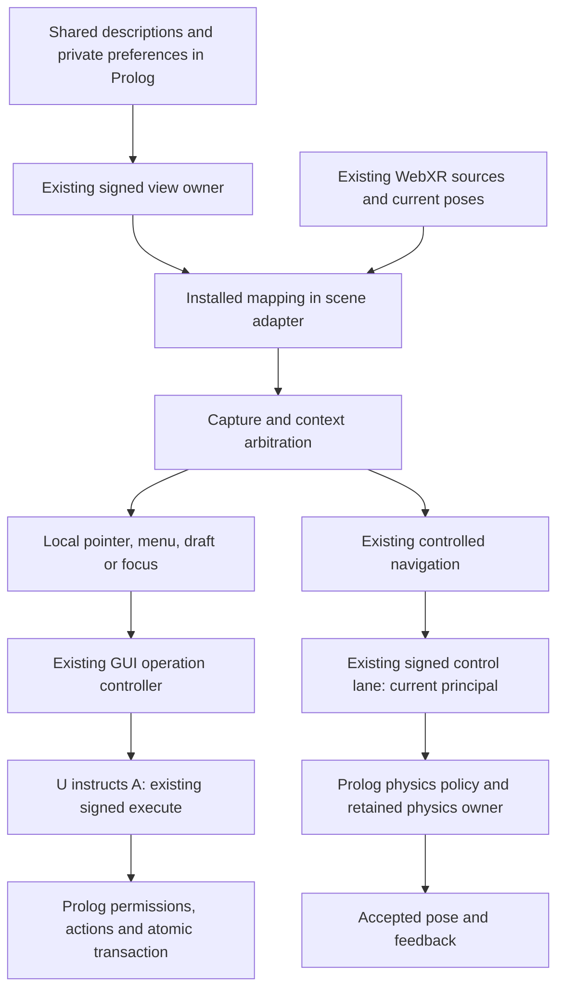

---
planStatus:
  planId: plan-quo-59-controller-ontology-design
  title: Controller descriptions and input bindings
  status: in-review
  planType: system-design
  priority: medium
  owner: Yan
  stakeholders: []
  tags: [vr, ontology, input]
  created: "2026-10-26"
  startDate: "2026-10-26"
  updated: "2026-10-26"
  progress: 100
---

# Controller descriptions and input bindings

Design for [QUO-59](nimbalyst://QUO-59). **Implementation requested by Yan on 26 October 2026.** Start with the original HTC Vive and both wands. Describe their common components and configurable bindings in Prolog, keep connected-device observations in the browser, and send each resulting instruction through its existing authorized owner.

The proposed durable objects are preferences, not a list of connected hardware. Left and right are roles assigned to distinct session sources; they are not different controller classes or different ledgers. A controller does not become the user's personal agent, an agent's hand, or a physical body in a Quod space.

## Implementation checklist

Implementation authority: Yan invoked `/planning-implement` and explicitly selected **Keep existing movement checks**. D1 and source implementation scope are agreed. The concrete class, Eidolon and temporary-source choices below are implemented in the working tree. Original prohibitions on commits, deployment, ledger resets, runtime/browser launches and display changes remain.

- [x] Agree the live-movement authority boundary and approve the bounded scope below.
- [x] Add shared Prolog descriptions, private preference operations and their signed projection.
- [x] Replace the hardcoded XR gesture routing with one capability-based adapter in the existing scene owner.
- [x] Verify authorization, lifecycle, arbitration and repeated-operation cost through production seams.
- [x] Correct the confirmed implementation-review defects and add the missing regression checks.
- [x] Have Claude Fable review the corrected implementation and check its findings.

The source corrections, regressions and requested Claude Fable review are complete. Physical qualification remains separate and unchecked below.

No space stages 2–3, grabbing, attachments, bare-hand support, lobby rebuild or new movement ability belongs here. [QUO-58](nimbalyst://QUO-58) owns production VR startup correction and can proceed independently. This document does not authorize commits, deployment, source migration, refounding, browser/runtime launches or display changes.


### Concrete implementation choices

- **Placement refined during implementation:** controller descriptions and validation extend the existing `quod:lobby` shared device vocabulary, which already owns `device`. The human already pins that vocabulary. GUI continues to own form semantics, and the new form composition pins GUI through ordinary signup policy. This replaces the original generic-device extraction proposal: no class migration, duplicate declaration or cross-scope ancestry query is introduced. A future deployment must add the new shared rules and compose the private settings/GUI sources and exact GUI reference into existing human ontologies under their existing source-edit authority. Related edits use the existing atomic transaction owner. This session performs no migration.
- `class_eidolon(htc_vive_controller,input,solid,...)` selects the recipe. Its `tracked_model(grip,asset(...))` description enters the signed preference projection. The scene converts that description into an ordinary mesh occurrence through `paintMarks` and the existing verified render-resource owner, then parents it to that source's XR grip transform. This is a class representation attached to a temporary source, not an invented durable controller entity. The human's settings form remains a separate offered operation.
- The unchanged Vive model from WebXR Input Profiles is pinned at SHA-256 `bd201855c8114b9b0e9cdd465d6f08413d18604894c839fb78d54d890c2adc94`. Both wands share verified bytes and instantiate separate appearances. Its measured bounds and resource costs are declared in Prolog and checked by the existing GLB admission path. The packaged model includes its MIT notice. Runtime downloading of a replacement controller appearance is removed for this path.
- Temporary role choices use the existing workspace model and desktop/spatial adapters. Their `edit` callback calls the scene's local role-choice method; it never invokes a Prolog action. Source loss discards the choice. The same panel opens the human's offered settings operation for durable bindings.
- Stored settings use `preferences(Revision,settings(Roles,BindingSet,Overrides))`; roles, binding-set name and overrides form one validated settings value. Each existing action has configurable role/component/modifier/threshold fields where supported, plus enable/disable and reset. The initial form does not offer arbitrary executable outputs or a macro language.
- Babylon has no public mesh-GUI cancellation that guarantees no click: its force-up helper clicks. A narrow adapter calls the installed control's existing pointer-up method with click notification disabled, clears its existing capture, then releases the scene pointer with an empty pick. This pinned-library integration requires a real GUI-control test; no Babylon fork is introduced.

## 1. Verified behavior and gaps before replacement

Evidence is source inspection on 26 October 2026 at base `e026d2a42333dbe90d3af4b0c42bcf5ed4940781`, including the existing uncommitted working tree. This is not a deployed-state census or fresh headset acceptance. The prior session summary `bcf9e26a-2ac6-4f06-a3bc-39c914de2aeb` and full ticket description were read; `work_radar` reported no shared-item work signal. The current session is linked to the existing ticket.

Read [the working agreement](/home/yan/src/quod/AGENTS.md), [multiwrite architecture](/home/yan/src/quod/doc/multiwrite-architecture.md), [space architecture plan](/home/yan/src/quod/nimbalyst-local/plans/space-conceptual-architecture-review.md), [movement plan](/home/yan/src/quod/doc/player-movement-plan.md), [native physics contract](/home/yan/src/quod/doc/physics-native.md), [world contract](/home/yan/src/quod/doc/world.md) and [GUI plan](/home/yan/src/quod/doc/gui-plan.md). Some older “current” paragraphs in the plans predate completed stage-1 work. The table records behavior verified before this implementation replaced it. The implementation evidence below describes the current working tree.

| Verified source | Behavior and concrete gap |
| --- | --- |
| [Scene input](/home/yan/src/quod/client/src/world-scene.js:184) | `bindRadialControl` prefers a touchpad, otherwise a thumbstick. Left squeeze + axes drives travel; a left click without squeeze snaps horizontally or requests a forward teleport. Every **non-left** source gets the menu branch, including `none`. This is not a Prolog-selected mapping. |
| [Menu and picking](/home/yan/src/quod/client/src/world-scene.js:90) | Picking resolves `metadata.depicts` to an anchored subject, or activates a menu entry. Radial press opens a menu, axes select, release activates. The menu has no source owner: another non-left source can change/release it. Movement is blocked while a workspace or menu exists, but trigger selection is a separate path. |
| [XR lifecycle](/home/yan/src/quod/client/src/world-scene.js:278) | Babylon default experience owns input discovery, controller models and pointer/near interaction; its mesh teleportation is disabled. A removal clears movement axes globally. There is no source-scoped gesture cancellation or mapping revision. Importing hand-tracking code does not establish implemented bare-hand domain support. Startup behavior here is QUO-58's separate concern. |
| [Controlled navigation](/home/yan/src/quod/client/src/controlled-navigation.js:17) | It uses the installed agent's speed, snap, teleport and viewpoint; follows accepted poses; resets on binding/body/mount changes; masks unavailable headset tracking/clearance. It does not check an individual controller's current ray pose before using its mesh ray. Head tracking and controller tracking are different checks. |
| [Babylon input source](/home/yan/src/quod/client/node_modules/@babylonjs/core/XR/webXRInputSource.js:120) | Missing `getPose` results leave the previous pointer/grip mesh transform in place. A visible mesh or retained transform therefore cannot prove current tracking. Session `uniqueId` is a generated adapter identifier, not a hardware serial. |
| [Babylon pointer selection](/home/yan/src/quod/client/node_modules/@babylonjs/core/XR/features/WebXRControllerPointerSelection.pure.js:530) | Default gamepad picking attaches to the main component, independently of Quod's radial handlers. It simulates scene pointer events and can switch the active controller on a press. Quod must arbitrate before delivery, not merely block movement after a click has reached a form. |
| [UI menu owner](/home/yan/src/quod/ui/src/World.tsx:404), [spatial controls](/home/yan/src/quod/client/src/workspace-panel.js:210) | Menu activation opens existing workspaces/operations. Spatial buttons call the same model's `invoke`; fields call `edit`. Pointing, focus and draft changes are local. No controller-specific domain executor is needed. |
| [Operation controller](/home/yan/src/quod/client/src/operation-controller.js:168), [operation binding](/home/yan/src/quod/priv/ontologies/gui_operation.pl:76) | Offered-operation submission uses `personalGoal`, then `gui_operation` binds and checks the authored goal. Discovery is advisory. Revisions, values and permission are checked again at execution. Existing console/editor and deferred-question paths retain their own contracts; not every old UI action already uses personal-agent instructions. |
| [Personal-agent policy](/home/yan/src/quod/priv/ontologies/personal_agent.pl:41) | U and A share an ontology but have different identities/keys. A accepts an exact U instruction, signs an **execute** request and retains its authenticated association for outcome recovery. This is not an API for signing each transient control sample. |
| [Simulation commands](/home/yan/src/quod/client/src/simulation.js:113), [control policy](/home/yan/src/quod/priv/ontologies/quod_physics.pl:335) | Live movement uses the current view principal, normally U, and signed `control` mode. World policy owns selection, exclusivity, epoch, abilities and viewpoint. The real physics owner checks registration, revisions, sequence and expiry. Device possession grants none of these. |
| [Device vocabulary](/home/yan/src/quod/priv/ontologies/quod_lobby.pl:120), [human preferences boundary](/home/yan/src/quod/doc/gui-plan.md:130) | `device < thing` already exists, currently in lobby vocabulary. Targeted packaged-source searches found no XR controller/handedness vocabulary. GUI policy already places private preferences in an authorized user ontology, not shared human vocabulary. |

**Demonstrated additions:** a shared device/component description, a validated binding language and private preference operation, a signed preference projection, and source-scoped gesture arbitration/cancellation. Existing classes, GUI operations, signed views, proof/control lanes and physics ownership cover the rest.

### Hardware facts versus a supported mapping

WebXR exposes handedness, profiles and target/grip spaces; profile names must not identify individual hardware. A change of handedness/profile can replace the input source. The proposed identity discipline therefore uses the current session/source lifetime, never a cross-session serial inferred from these fields. [WebXR input specification](https://www.w3.org/TR/webxr/#xrinputsource-interface).

The registry's `htc-vive` profile describes trigger, squeeze and touchpad, with the menu button reserved. It supports left/right/none layouts. Use the trigger, squeeze and pad for the initial mapping; do not promise access to the platform menu/system button. [Vive profile registry](https://raw.githubusercontent.com/immersive-web/webxr-input-profiles/main/packages/registry/profiles/htc/htc-vive.json).

The installed [Babylon 9.18.1 dependency](/home/yan/src/quod/client/package.json) also has a [Vive adapter](/home/yan/src/quod/client/node_modules/@babylonjs/core/XR/motionController/webXRHTCViveMotionController.pure.js:88) whose static layout includes a menu index. That does **not** prove the qualified browser/runtime exposes that button. Resolve actual named components and their supported fields; do not copy raw button indices into Quod policy or assume the runtime selected this particular adapter.

## 2. Smallest proposed model

### Keep four things distinct

| Concept | Identity and owner | Meaning |
| --- | --- | --- |
| Physical controller | Browser XR session + source incarnation; class `xr_controller < device` | A real wand supplying observations. Two wands are two live sources of the same class/profile. No durable hardware inventory is created. |
| Tracked bare hand | Separate source kind, if supported in future | Not a wand with missing buttons. No new hand tracking or inferred pinch/grab mapping in this scope. |
| Visual controller/hand | Class-selected Eidolon rendered through the existing mark/resource owner and attached to its live XR grip | A picture and pointer feedback, not proof of tracking, ownership, reach or physical contact. |
| Agent's virtual hand/tool | Existing exact domain entity/body reference, when such a domain defines one | Governed by that agent/world's actions and physics. It need not resemble the human's hand. No automatic binding from a wand to a virtual limb. |

**Recommendation:** two new class declarations, `xr_controller < device` and its initial `htc_vive_controller` specialization; no new class for left versus right, buttons, axes or preferences. Components are named parts of a description, not independently mutable entities. Keep hardware profile, observed handedness and chosen functional role separate. `navigation` and `menu` are roles; `left`, `right`, `none` are observations/selectors.

Reuse `isa/2`, `have_attribute/3` and `attribute/3`, and the human's existing `instance_of/2` classification. Keep the existing `device` declaration and new controller descriptions together in `quod:lobby`. Its exact anchor is already held by the human. This avoids moving the generic class, duplicating its ancestry or creating a new ledger. The controller classes describe source types; this slice creates no persistent controller instances.

The human's existing ontology composes the preference action/form rules and pins the GUI vocabulary reference already published by its pinned lobby vocabulary. GUI remains the form vocabulary. Shared descriptions are publicly readable through narrow lobby queries and edited under that ontology's governance; preferences remain private. A separate input ledger would require a demonstrated independent publisher, governance or lifecycle need. There are **zero new ontology ledgers or runtime processes**.

### Illustrative Prolog contract

The following excerpt matches the implemented contract in [shared descriptions](/home/yan/src/quod/priv/ontologies/quod_lobby.pl) and [private preferences](/home/yan/src/quod/priv/ontologies/controller_preferences.pl). The live source determines which described facilities are actually usable.

```prolog
% Shared device vocabulary; left/right are not subclasses.
isa(xr_controller, device).
isa(htc_vive_controller, xr_controller).

controller_description(htc_vive_controller,
    controller([<<"htc-vive">>],
      [component(trigger,<<"xr-standard-trigger">>,trigger,[press,value]),
       component(grip,<<"xr-standard-squeeze">>,squeeze,[press]),
       component(pad,<<"xr-standard-touchpad">>,touchpad,[press,touch,axes2])],
      [target_ray,grip], Appearance)) :-
    class_eidolons([htc_vive_controller], input, solid,
        [eidolon(input,solid,recipe(Ns,A,Recipe))]),
    current_ontology_identity(Ns,A),
    eidolon(Recipe,class(htc_vive_controller),Appearance).

controller_bindings(vive_default,[
    bind(select,any,trigger,press_release,local(select)),
    bind(menu,menu,pad,radial(240),local(menu)),
    bind(drive,navigation,pad,axes_while(grip),control(drive)),
    bind(snap,navigation,pad,sector(horizontal,500,grip),control(snap)),
    bind(teleport,navigation,pad,sector(forward,500,grip),control(teleport(500)))]).
controller_default(settings(
    [role(navigation,hand(left)),role(menu,hand(right))],vive_default,[])).

% In U's private ontology, only after explicit Save:
have_attribute(human_user,controller_preferences,controller_preferences).
attribute(me,controller_preferences,preferences(1,settings(
    [role(navigation,hand(left)),role(menu,hand(right))],vive_default,[]))).
% Overrides: disable(Id) or replace(bind(Id,Role,Component,Gesture,Output)).
% Absence means shared defaults at revision 0, without a write.
```

Integer values above are permille gesture settings: radial dead zone 240, directional threshold 500, and teleport fraction 500 (half the **permitted** reach). They preserve the present defaults and become Prolog-described, validated settings. They are not physics budgets. Snap angle, speed, teleport reach/support and leases continue to come exclusively from `physics_agent`'s motion policy. The meaning of sectors and edges is a small fixed adapter contract; authors configure its data rather than upload JavaScript or an arbitrary event program.

The first argument of `bind/5` is its stable identity. An override replaces one identified binding; it cannot silently add a second competing consumer. Allow changes of role selector, declared component, supported gesture, thresholds and output from the closed set. Validate ground terms, known references, parameter ranges, usable cancellation/selection, and overlap in each context. Reject ambiguity; source order must not decide a winner. `any` supplies selection on either accepted controller, including a controller without a navigation/menu role, subject to the capture rules below.

The two live controller instances can be expressed **as read/adapter values**, never asserted facts:

```prolog
% Example parameters/results, not ledger assertions:
controller_source(source(xr_session_7, source_12), htc_vive_controller,
                  left, [trigger, grip, pad], [target_ray, grip]).
controller_source(source(xr_session_7, source_19), htc_vive_controller,
                  right, [trigger, grip, pad], [target_ray, grip]).

% Resolving the preference above selects these distinct runtime associations:
controller_role(source(xr_session_7, source_12), navigation).
controller_role(source(xr_session_7, source_19), menu).
```

These symbolic source IDs illustrate browser object lifetimes, not a new Prolog inventory or serial-number format. No source ID, current pose, button value, tracking flag or connection flag is saved in `controller_preferences`. The two wands can change hands without changing the physical-device class; a new reported handedness causes role resolution and cancellation, not a hardware identity claim. A durable, user-named hardware asset is a different future use case and must not be auto-created on connection.

### Component resolution and persistence

The signed projection returns the effective default/overrides, their digest, profile descriptions and the fixed arbitration contract version. It contains no reported live devices. Intersect it locally with Babylon/WebXR capabilities. This implementation resolves named profile components and checks their type/features. Additional device descriptions can reuse the same semantic component names; they need an explicit authored profile, not a guessed substitute. Touchpad-to-thumbstick substitution is an authored choice with matching semantics, not a silent fallback. Two candidates without a declared selector are ambiguous. Unknown profiles may use an explicitly declared capability profile; otherwise show unsupported mappings. A missing component disables each binding that depends on it, including its modifier requirement; other usable bindings remain. Missing pad disables pad gestures. This Vive contract requires current grip and target-ray poses before delivering mapped input. Never substitute button zero.

Preference storage is fixed by this domain's privacy requirement: the exact human ontology, not whichever space is visible. This is not a default storage choice for general object creation. U can read preferences; A can change them on U's authenticated instruction. Other agents, worlds and public vocabulary readers receive no preference or device data by default. Existing owner-wide source editing remains an administrative ability and is not widened. A new peer never acquires preference access from being a controller or a viewer.

Offer a small controller-settings operation on the human instance through existing `class_eidolon`, `gui_form` and `gui_operation`. Use ordinary controls for role swap, supported binding choices, disable/reset and thresholds; no standalone editor or deferred question is required. First Save replaces logical revision 0 with revision 1; later Save compares the expected revision and updates the complete attribute atomically. Reset selects explicit shared defaults and advances the revision; it must not restore revision 0 and permit an old edit. The action checks `operation_authorized(instance(Human), configure_controller(...))` at its direct entry as well as ordinary scope admission and the exact A→U relationship. Do not grant A arbitrary human-ontology mutation rights.

For example, proposed `controller_preferences_set(Human, Expected, ExpectedMappingDigest, Settings, Next)` validates the whole candidate, checks committed permission, compares the current revision and effective-description digest, then replaces the one attribute inside `transaction/1`. The digest prevents a direct Save against an obsolete shared description; ordinary proof dependencies also fence concurrent edits. Any logically required receiver changes join that same transaction; none are needed for transient browser role assignment. A GUI Save goes through U→A's existing signed instruction and exact outcome recovery. No connection observation is a durable-write prerequisite. Lost replies resolve the original instruction; neither reconnect nor recovery saves defaults again.

Named shared defaults are live references to the pinned vocabulary history, not stored constructor defaults. A governed change to that description changes the effective digest and triggers the cancellation/rearm rules below; it does not rewrite private preference facts. Explicit overrides remain as authored and become visibly invalid if a required component/gesture contract is removed. Do not silently replace invalid overrides with defaults.

## 3. Ownership, delivery and lifecycle

| State | One owner and lifetime |
| --- | --- |
| Shared class/component/default definitions | Existing lobby/device vocabulary ontology and its governed source lifecycle; public description only. |
| Preference revision, roles and overrides | Existing human ontology; survives browsers, spaces and agent switches until explicitly edited. |
| Signed preference projection | Existing client-view subscription owner, retained for the consumer's lifetime and original authorization deadline. Rebuildable, not another authority. |
| Source identity, components, poses, button/axis samples | Existing Babylon/WebXR input objects within the XR session. Adapter state attaches to these objects and is disposed with them. |
| Capture, neutral/rearm state, menu source and current mapping digest | Existing scene/input adapter; bounded by actual attached sources and active gestures. No event queue/history. |
| Selected physical agent, epoch, abilities and viewpoint | Existing world Prolog control policy. Installed registration and live motion remain with the existing physics owner. |

**Projection integration:** extend the existing [view endpoint](/home/yan/src/quod/src/quod_client_view.erl:204) with one exact read shape, proposed `controller_preferences_view(Human, View)` and view kind `controller_preferences`. Its current allowlist only admits world/HUD/question/operation shapes, so this is a demonstrated missing capability. Reuse its existing signed ingress, dependency follows, subscribe-before-snapshot checks, incarnation/height checks, expiry and cleanup, plus [connectSignedView](/home/yan/src/quod/client/src/signed-view.js:15). Do not add a generic arbitrary-query socket or another subscription service.

The projection reads current preferences and pinned vocabulary through ordinary ACLs. It does not prove possession of hardware or enable physics. Keep one subscription per active human/viewing consumer, not per wand, frame or gesture. A change invalidates the affected signed view; the replacement digest installs atomically in the scene. An unchanged renewal must not dispose input listeners, reset held gestures or recalibrate the camera. Existing ontology-level dependency invalidation may reread on an unrelated commit; this design does not claim row-level invalidation. Retained proof/foreign-source owners still reuse verified state, without history scans or disk rewrites. Expiry/renewal timers are the existing authorization protocol, not readiness polling.

| Event | Required handling |
| --- | --- |
| Connection / motion-controller initialization | Bind once to the actual XR source; wait on its existing initialization observable. Resolve against the already retained mapping. Begin disarmed until relevant controls have been observed released/neutral and required pose is current. No domain writes. |
| Tracking loss | Check actual target-ray/grip pose availability in the already running XR frame lifecycle, not the last mesh transform. Cancel the affected pointer/menu gesture without activation and clear its drive contribution. Hide invalid pointing feedback. Headset loss/hidden XR session cancels all gestures. This is sampling delivered frames, not a readiness retry timer. |
| Tracking returns | Accept current poses, then require release/neutral before a fresh gesture. Do not interpret a held pad/trigger as a new press or commit a menu on the first release after loss. Keep the existing viewpoint calibration rules. |
| Disconnect / XR exit / disposal | Remove that source's observers, captures and visual ray; cancel its menu and pending local gesture. Session exit clears all. A late initialization/pointer callback is ignored using the source/session incarnation. Do not delete preferences or physical bindings. |
| Stop during movement | Set desired axes to zero and use the existing control sender when admissible. A disconnected or busy sender cannot guarantee an immediate server stop: admitted drive ends under its original lease; view teardown clears voluntary input through the physics owner. Do not add a second stop transport, queue or deadline extension. Already applied discrete motion cannot be undone by local cancellation. |
| Reconnect | A new source incarnation resolves the current role by observed hand/capabilities; it never inherits a held gesture. A replacement physical view obtains its normal registration/sequence. No replay of buttons, movement or uncertain domain writes. |
| Changed handedness / user swaps roles | Treat replacement/remapping as retirement of old gesture ownership, then resolve roles afresh and rearm. Swapping preferences changes functional roles, not the reported hand or physical identity. |
| Unknown handedness | Remains `none`; never silently receives the right-hand menu. Valid pointer selection remains available. An explicit session-only source choice may assign a role through the settings presentation; it is discarded on source loss. Persistent preferences describe role selectors, not this temporary identity. |
| Multiple controllers / devices | No two-device population ceiling. A role selector must resolve to exactly one live source. Ambiguous roles remain disabled with a reason and explicit session choice; do not choose the first device or steal a capture. One menu owner and one navigation owner are interaction cardinalities, not hardware limits. Other sources may point/select under the capture rules. |
| Missing or changing components | Disable only dependent bindings and explain the missing capability. Re-resolve on source/component lifecycle notification; a replaced layout retires its old callbacks. No guessed indices, implicit grip, emulated hand or fallback to observer flight. |
| Preference/vocabulary change | Invalidate affected captures and zero desired drive before replacing the descriptor. Install the entire revision at once; rearm before new input. A racing Save conflicts normally. Existing submitted operations keep their original identity and target. |
| Preference view unavailable/denied/expired | Stop new mapped gestures and cancel active captures, including pointing. Show the reason, but do not promise an operable Quod settings button in XR. The user can leave XR through the platform's own controls and use desktop settings. Do not use a hardcoded XR fallback or silently continue an expired mapping. Recovery uses owner notices/fresh authorized view, without a polling loop. Qualify the platform exit on the physical setup. |
| Physical agent/viewpoint switch | Retire local navigation gestures before enabling the new control. Existing expected epoch, run/body revisions and registration fence old commands; existing navigation resets calibration for a changed mount/control. Human preferences stay with U, but action availability is recomputed from the new control. Do not carry the former body's abilities or reach. |
| Human/account switch or signout | Tear down the preference subscription, captures and source associations for that human. Dispose the old scene/consumer through its current lifecycle. Never install a late projection into another account. |

Recovery restores committed preferences through ordinary ontology recovery; it does not recreate a physical connection, generate device IDs or replay a gesture/reaction. Preference changes need no new `react_on` rule merely to notify a browser: the existing signed-view dependencies already do that. Genuine domain actions keep their current atomic consequences and reaction contracts.

## 4. Gesture arbitration and end-to-end traces

The adapter interprets Prolog-described gestures and delivers semantic input to existing owners. It never executes arbitrary goals from a hardware profile. The target, permissions, bound action and resulting domain effects remain Prolog decisions.



The control branch is the **verified existing path**, retained by the authority decision in section 6. It is not a proposed new bypass around A.

### One gesture, one consumer

Apply these rules in the adapter from one validated arbitration contract owned by the Prolog vocabulary; do not scatter handedness tests among listeners:

1. Retired source, invalid required pose, hidden session, changed account/mapping or unavailable authorization cancels first. Cancellation never synthesizes a click or menu commit.
2. An existing pointer drag/capture owns that source until release/cancel. A settings/form control owns input delivered to its hit target. GUI edits remain local until explicit submission. A workspace globally suppresses locomotion; it does not submit when hidden.
3. An open radial menu belongs to the source and mapping revision that opened it. That source's pad edits the selection and its valid release activates once. Trigger selection may choose an entry once; doing so consumes the outstanding radial release. Other sources cannot edit or release the menu. Menus suppress locomotion on all sources.
4. With no workspace/menu/capture, grip-held pad axes select smooth travel. A pad press while grip is down cannot also snap/teleport/open a menu. Without grip, disjoint horizontal/forward sectors select the authored discrete operation. One press edge yields at most one request; release rearms it. Changing modifiers during a held discrete gesture cancels it rather than reinterpreting it.
5. Pointer selection is available on either eligible controller when not consumed above. A second source cannot steal a pressed GUI control; free hover is local. When a workspace/menu opens, cancel any prior world pointer press to prevent click-through on release. Closing the overlay requires navigation release/neutral before travel resumes.

Keep pointer IDs correlated with the live source. The current Babylon default pointer plugin autonomously delivers trigger events and has no Quod per-source gesture contract. **Proposed replacement seam:** use the existing scene's Babylon ray picking and pointer-event/GUI delivery APIs from the one input adapter; retire the default automatic far/near activation delivery for the supported wand route. Reuse XRInput’s controller poses and Babylon’s GUI hit testing, capture and controls. The class Eidolon selects the model through the existing verified resource loader. Do not leave a default trigger listener firing alongside configurable selection, fork Babylon, create a second scene graph, or implement a separate GUI action dispatcher. Pointer cancellation must release capture without producing `POINTERPICK`/button activation, including disposal while down. Test that behavior at the real Babylon GUI seam before accepting the replacement. Bare-hand/near-interaction product expansion stays excluded.

### Point and select

**Current:** WebXR/Babylon updates the ray; default pointer selection turns the main trigger into scene events. An anchored object pick reaches `createWorld`'s `onPick`, then [World's selection owner](/home/yan/src/quod/ui/src/World.tsx:134), then authorized Eidolon/operation discovery. A panel hit reaches Babylon GUI and [the shared workspace model](/home/yan/src/quod/client/src/workspace-panel.js:367). A hover, object selection, field edit or slider drag is not a domain write.

**Proposed:** the installed `press_release(trigger) → local(select)` binding and current source pose pass arbitration, which feeds those same scene/GUI consumers once. A selected object's exact `depicts` identity is preserved. If the user explicitly activates Submit, [operationController](/home/yan/src/quod/client/src/operation-controller.js:168) → [personalGoal](/home/yan/src/quod/client/src/signed-client.js:79) → A's acceptance/signing and retained instruction association → `gui_operation`'s current form/revision/value/permission guard → authored action/constructor → existing ordinary or atomic multi-ontology commit. A missing grant fails just as for a directly submitted goal. A lost reply resolves the original instruction; no trigger replay retries it.

Controller settings use this same submission trace. Existing deferred questions still use their own admitted question/response owners and real reactions; selecting a question does not manufacture another one. Existing console/source tools are opened through their current dispatch, not reimplemented or silently converted by this ticket.

### Open and use a menu

**Current:** non-left pad press calls `openMenu`, axes call `radialIndex`, release calls `menu.activate`; [World's menu dispatch](/home/yan/src/quod/ui/src/World.tsx:418) opens a workspace or view. Menu contents mix class-selected choices and existing shell commands. These shell choices need not move into the controller schema.

**Proposed:** the role selector chooses the source, then the binding `press_drag_release(pad, radial(240)) → local(menu)` owns that gesture. Opening, highlighting and dismissing are local. A valid release activates the already offered entry once. It cannot submit an arbitrary Prolog string, infer a world action from a button name, or turn a view change into same-agent space entry. New operation forms continue through the personal-agent trace above. Tracking loss, source removal, mapping change or entry-list replacement closes without activation. A stored preference swapping roles changes this behavior without a new handedness branch in JavaScript.

### Existing authorized movement

**Existing path retained with Yan’s agreement:** source gesture → `playerNavigation.axes/snap/teleport` → [controlled navigation](/home/yan/src/quod/client/src/controlled-navigation.js:101) → `current.command` in [simulation](/home/yan/src/quod/client/src/simulation.js:113) → [movementGoal](/home/yan/src/quod/client/src/locomotion.js:72) → signed `control` proof → [`physics_input_projection`](/home/yan/src/quod/priv/ontologies/quod_physics.pl:404) → [governed external predicate](/home/yan/src/quod/src/predicates/quod_physics_predicates.erl:124) → one surviving transient effect → [existing physics owner](/home/yan/src/quod/src/quod_physics.erl:126) → collision-checked motion and view feedback.

`drive` uses the authored speed and view direction; snap uses the authored angle. Teleport takes a current controller direction, flattened by existing navigation, and a fraction of permitted reach from the **body origin**. No picked floor grants landing permission. The physics owner checks the entire body path/support and current installed control. Queued admission is not completed movement. The browser has one request in flight, waits for discrete feedback and suspends on uncertain replies; no new queue or resend loop is added. Lease renewal of current continuous intent remains the existing control protocol, not controller-discovery polling.

Binding changes continue through `physics_control_agent` with expected epoch/selection and committed domain grants; the mapping never establishes control. Removing a binding's `teleport` gesture changes convenience only. Forging the client mapping still cannot obtain a world ability that Prolog refuses. This preserves existing ACLs and domain checks; it does not add a controller permission layer.

## 5. Bounded implementation sequence and acceptance

Yan invoked `/planning-implement` and selected the existing permission-checked movement path on 26 October 2026. Implement these phases without deployment or a physical headset campaign.

1. **Descriptions and private preferences.** Add the shared class/component/binding declarations and pure validation. Compose the private action and offered settings form into the existing human ontology template, with narrow exact-principal access. Add the pinned vocabulary reference through existing composition. Exercise defaults without writes, revisioned Save/reset and direct-call authorization. Preserve already founded sources: package edits alone do not update them; any later governed migration needs separate deployment authority, never a ledger reset or silent request-time repair.
2. **One signed mapping projection.** Extend the exact view-kind allowlist and decoder using the existing endpoint/client lifecycle. Retain the projection while its human consumer lives. Verify change/revocation/expiry ordering and equal-digest renewal before connecting gestures. No device observation is sent to the server merely to obtain defaults.
3. **Replace XR routing in the existing scene.** A small pure matcher can be extracted for tests; source listeners, captures and disposal remain owned by `createWorld`. Connect effective bindings to existing GUI/menu/navigation functions. Add per-source tracking validity, cancellation and neutral rearming. Replace autonomous pointer activation as specified above and retain equivalent pointer/GUI functionality. Keep XR startup correction independent; integrate against the corrected owner without changing its startup contract.
4. **Settings and integration.** Use the shared operation panel for editing bindings, supported role choices and reset. Present session-only choices for ambiguous live sources locally, without a second persistent inventory. Install a changed mapping atomically, retire old gestures, and test account/agent/view switches. Do not introduce an agent selector, new physical ability, general macro language or new one-handed interaction preset in this slice.
5. **Verification and later physical acceptance.** Run relevant software tests and then the standing clean sequential release gates at the required implementation/release boundary, preserving full logs and true exits. Physical acceptance is a separately authorized campaign with both wands and the qualified browser/runtime. It is not a reason to modify source during a measurement or rerun a failed campaign silently.

### Superseded code and retained obligations

- Remove `bindRadialControl`'s left/non-left semantic branches, implicit touchpad/thumbstick choice, embedded gesture thresholds and anonymous source-unaware menu listeners when their descriptor path replaces them. Retain menu drawing/selection geometry and `radialIndex` as presentation math, with authored threshold supplied.
- Replace the global controller-removal axes callback with source-scoped cleanup. Dispose each initialization/component observer and reject late callbacks. Retain the existing XR session and scene lifecycle.
- Remove duplicate automatic trigger/near activation for this wand route when the single pointer feeder is installed. Preserve ray feedback, pointer IDs, GUI capture, text entry and object picking obligations in behavioral tests. No permanent “legacy Vive” branch remains.
- Keep the sole generic device declaration in the existing lobby vocabulary with its controller subclasses. Console/imported-artifact classes and general class/constructor/permission infrastructure remain there.
- Retain `createControlledNavigation`, locomotion encoding, simulation command handling, signed ingress, personal-agent custody, GUI controllers and physics owner. Add only narrow input cancellation/configuration seams required by this design. Keep desktop key behavior and the existing unchanged-view-renewal guarantee.
- Update mapping documentation with implementation, replacing claims that left/right are hardwired. The initial design session changed only this document and tracker linkage; the subsequent `/planning-implement` request authorizes source implementation. The implementation delta is reported below; vocabulary and validation add lines while the hardcoded gesture dispatch is removed.

### Meaningful software checks

| Check through the real seam | Failure prevented / evidence |
| --- | --- |
| Shared Prolog profile and settings action | Two controller roles use one definition. Swap/disable/threshold edits validate; ambiguous gestures and malformed terms fail atomically. Missing preferences read defaults without creating state. Stale Save/reset conflicts; a permitted raw source edit yielding invalid settings is shown invalid, not silently repaired. |
| Signed U→A preference operation and ordinary outcome recovery | Another human/world cannot read or change private preferences; A requires the existing instruction association and narrow grant. Direct action and GUI have matching authorization. Staged grants cannot authorize their own write. Lost reply/other authorized device recovers the original result without executing Save again. |
| Existing signed-view endpoint | Subscribe-before-snapshot handles a change during opening. Old owner/digest/account replies cannot install. Relevant updates and denial/renewal reach the same consumer; expiry stops use. No polling or per-controller server registration. |
| Babylon source and GUI event seam | Real scene/GUI pointer delivery produces one click. Trigger + pad/grip overlap, two controllers, menu release after trigger selection, world press then overlay opening, duplicate button edges and disposal while down never cause double submission/click-through. Cancellation releases capture without activation. |
| Controller lifecycle | Connect already pressed; lose ray pose while mesh remains; recover held; disconnect menu owner; change hand; late motion-controller initialization; ambiguous duplicate-hand sources; missing grip/pad; unsupported bare hand. No ghost selection, guessed input or resurrected drive. |
| [Controlled-navigation tests](/home/yan/src/quod/client/test/controlled-navigation.test.js), [simulation tests](/home/yan/src/quod/client/test/simulation.test.js), [physics-control tests](/home/yan/src/quod/test/quod_physics_control_tests.erl) | Body/viewpoint/epoch/run/registration changes reject old commands; changed mappings require fresh gestures. Unchanged renewal preserves valid input/calibration. Unsupported abilities, obstruction and uncertainty retain current failure semantics; no direct camera translation or mesh teleport bypass. |
| [GUI-operation tests](/home/yan/src/quod/test/quod_gui_operations_tests.erl), [operation-controller tests](/home/yan/src/quod/client/test/operation-controller.test.js) | Pointer input submits the existing exact operation, with stale-form checks and original-outcome recovery. Settings use the same path, without a form-specific helper actor. |
| Repeated-work measurements through real owners | Repeated unchanged mapping reads/renewals and reconnects cause zero new preference writes, source-history folds, retained-state rebuilds or file writes/syncs. Count listener attachments and view refreshes separately. One actual Save updates the affected view once per installed revision; live poses/buttons generate zero ledger writes. Required Save/custody durability remains intact. |

Synchronize tests using observed delivery/processing/installation and explicit frame/button events, not sleeps or send traces. Tests of pure matching complement, rather than replace, source/GUI/signed-control integration. Do not run browser or runtime acceptance as part of preparing this document.

### Physical Vive acceptance, later

- [ ] Qualify both physical Vive controllers in a separately authorized hardware session.

Record exact source revision, deployed ontology versions/anchors, browser/runtime, reported profiles/components and both source lifetimes in a fresh campaign. First verify the independent startup correction under QUO-58; controller ontology work is not its prerequisite.

With Yan present, verify each wand's pointing/trigger selection, right-role pad menu, left-role grip travel, snap and teleport only where the current agent permits them. Confirm the platform menu remains platform-owned. Swap roles using settings and repeat without changing code. Test a controller powered off, controller occlusion with headset still tracking, release while untracked, reconnect held, unknown/reassigned handedness where the runtime exposes it, overlay suppression and exit/re-entry. Verify no movement resumes merely by closing a menu or regaining tracking. Check selection/keyboard/slider capture and that cancellation preserves drafts.

Use an already authorized physical test agent/viewpoint for movement; do not require new same-agent space entry, embodiment, grabbing or lobby work. Test a refused action and missing ability, and observe actual collision/feedback. Record handedness ambiguity, mapping unavailability or inaccessible components as such. Measure unintended activations and ask Yan about reach/comfort; automated frames cannot establish either. Software passes, physical passes, failures and untested cases stay separate.

## 6. Decisions requiring Yan

**D1 — Resolved: retain existing permission-checked movement.** Yan selected this option in the implementation prompt on 26 October 2026. The following explains the choice.

Must the personal agent mediate each live movement command? There is a concrete boundary to settle, not just terminology. The task says hardware must not bypass the personal agent. Today ordinary offered domain operations use U→A, but movement intentionally uses U-signed `control` proofs and world-owned permissions. A's current instruction API accepts durable `execute` only, and the lobby's control grant is to its human owner. Routing each sample through that API would change authority, lifetime and persistence, rather than merely replace a controller mapping.

**Recommendation:** retain the existing explicitly authorized transient-control lane for movement; require personal-agent instructions for new durable preference/domain operations. In plain language, the personal agent handles “save these settings” or “create this space”; the existing authorized movement controller handles “move while I hold this pad.” Yan explicitly agreed to this interpretation in the implementation prompt.

If every live command must instead be A-mediated, stop that implementation slice and design the narrow extension in the existing personal-agent/control owners first. It must preserve transient, non-ledgered input, exact identity/delegation, original deadlines, no replay, current view registration and installed world policy. A new executor, durable sample queue, per-frame instruction custody or fake principal substitution is unacceptable. That expansion is not specified or authorized here.

**D2 — Source implementation authorized by `/planning-implement`; deployment and physical acceptance remain separate.** No further architecture choice is pending. The working tree implements the bounded source scope, including class-selected controller appearances and a session-only choice panel. Existing founded human/lobby ontologies require a separately governed source update before these features can be used there; this work does not migrate them, reset ledgers or add request-time repair. Deployment and a physical Vive campaign are the remaining decisions for Yan.

Hardware exposure, visual alignment and comfort need the physical campaign. The real Babylon cancellation seam has software coverage; no memory-based hardware answer is needed from Yan.

## Validation

Initial design evidence came from the documents and actual call paths listed above. Subsequent implementation checks and retained failure evidence are recorded in the implementation verification section at the end. Source tests do not establish deployed ontology state or headset behavior.

## Requested Claude review — 26 October 2026

Yan explicitly requested this review. Claude Fable reviewed the frozen plan alone, with tools and repository access disabled. It judged the ownership model close to minimal but recommended clarification before agreement. This is consultative advice, not source verification or implementation approval. The reviewed snapshot has SHA-256 `333f7c497f224f5a834fdb7c64dfdac63d73952858adb137ef33c56c09cb755d`; the corrections above came afterward. Full review and checked dispositions are linked from QUO-59. The items below record that earlier review; the implementation choices at the top resolve placement, temporary selection and Eidolon integration.

The successful CLI receipt reports exit 0, `is_error: false`, and model usage for `claude-fable-5-1` plus `claude-haiku-5-5`; it is not a Fable-only usage receipt. The first attempt failed with DNS resolution and produced no review. Automatic approval rejected a subsequent request to send repository rules and architecture alongside the plan; the successful request sent only the explicitly requested plan. No source files were disclosed for the reviewer to inspect.

### Checked findings from the design review

1. **Remove unused controller attributes — accepted and corrected.** `input_profile` and `handedness` were declared instance attributes although this design never stores controller instances. Shared profile descriptions and session source values already cover them. The human preference attribute remains.
2. **Explain loss of pointing — accepted and corrected.** Expiry stops selection as well as movement. Recovery in a headset uses the platform exit, then desktop settings; there is no promised Quod button that depends on the disabled mapping.
3. **Keep a settings conflict check — Claude's proposed removal is not supported by the code.** [The operation revision](/home/yan/src/quod/priv/ontologies/gui_operation.pl:47) hashes the form/recipe/schema, not the ontology's current height or an automatic attribute version. [Editable defaults](/home/yan/src/quod/priv/ontologies/gui_instance.pl:164) are separate. The preference revision protects stale direct action calls and two concurrent editors; it is application state, not another ledger authority. Its expected value must also be bound into the offered operation. Keep the proposed revision unless a concrete equivalent using existing state checks is demonstrated.
4. **Resolve shared `device` placement before agreement — valid concern, alternative not adopted automatically.** Package edits do not migrate founded ontologies. The proposed extraction must specify the governed transition and exact dependency path; no automatic migration belongs here. Claude recommends leaving the declaration in lobby vocabulary and referencing it. That avoids extraction but makes reusable controller vocabulary depend on lobby vocabulary. Existing lobby instances already pin GUI vocabulary ([creation options](/home/yan/src/quod/priv/ontologies/quod_lobby.pl:61)); this alone does not establish that either proposed class-resolution path works. Resolve this design detail before implementing it, without adding a duplicate declaration or compatibility path.
5. **Make temporary source choice concrete — accepted as an open design gap.** The document mixes a saved Prolog settings operation with session-only selection of an ambiguous source. Local role selection must never become a preference Save or contain a durable source identifier. Claude suggests a new overlay by the wand; that is not approved and would add presentation work. First specify a reusable local presentation path and its callback/owner, or narrow initial support to unambiguous source selectors. Do not claim the current offered form already supplies that path.
6. **Do not expand the preference schema for hypothetical devices yet.** Claude recommends a list keyed by binding set. No demonstrated requirement needs multiple simultaneous sets: one effective set can already contain component-based bindings. Keep the smaller shape until a concrete mixed-device case cannot be expressed. Distinguish hardware facilities from world abilities in prose; the changed text makes that clearer.
7. **The existing teardown claim is supported.** [Physics `clear_viewer`](/home/yan/src/quod/src/quod_physics.erl:1042) cancels the exact registered control's input; [cancellation](/home/yan/src/quod/src/quod_physics.erl:726) sets its expiry to zero. Controller loss alone is different and still uses the ordinary stop/lease behavior. Opening a workspace while driving must also use that ordinary zero-axes path; it cannot promise instantaneous remote stopping.
8. **Personal-agent mediation remains a real boundary.** Claude proposes A handling only the durable control-enabling act while U sends transient samples. This is worth considering, but it is not a wiring-only solution: [physics_control_agent](/home/yan/src/quod/priv/ontologies/quod_physics.pl:346) records control under `current_principal`, and [the lobby grant](/home/yan/src/quod/priv/ontologies/lobby_instance.pl:63) authorizes the human owner. Calling it as A would not automatically install U's control. D1 must distinguish preserving today's authorized U path from adding explicit A-mediated delegation in the existing owners. Neither requires or authorizes per-frame ledger writes.

### Controller Eidolons: the review does not settle Yan's question

Claude recommends excluding controller Eidolons and keeping Babylon's model plus the human's settings operation. Its stated reason, that Eidolons can only depict ontology instances, is incorrect: [existing discovery](/home/yan/src/quod/priv/ontologies/common_predicates.pl:56) accepts classes as well, and [class operation subjects](/home/yan/src/quod/priv/ontologies/gui_operation.pl:60) are explicit.

The narrower verified gap is that the two transient `controller_source(...)` values are not currently subjects of that discovery path. A class-selected controller description is possible without durable hardware instances, but selecting a recipe and attaching its appearance to the exact live wand needs an explicit integration design. Calling today's Babylon model an Eidolon would conceal that missing step.

**Recommendation for the next design revision:** specify the shared controller class's description/appearance recipe, the exact session source to which the browser attaches it, and the human's existing settings operation as distinct subjects/owners. Keep poses, tracking and connection state in XRInput. Explain what is actual Eidolon selection and what is merely local feedback. This is a design recommendation, not approval for another inventory, a new rendering owner or controller appearance implementation. If that integration materially expands the agreed scope, present the concrete added work to Yan rather than silently excluding his requested representation.


## Implementation verification — 26 October 2026

The source implementation is ready for review; it is not deployed or physically qualified. The original verification below covers the first four source milestones; the correction verification follows it. The separate physical checkbox remains open.

The common controller class and Eidolon are in [the existing device vocabulary](/home/yan/src/quod/priv/ontologies/quod_lobby.pl). [Private preferences](/home/yan/src/quod/priv/ontologies/controller_preferences.pl) compose the existing GUI form/action behavior. [The signed projection](/home/yan/src/quod/client/src/controller-view.js), [scene-owned routing](/home/yan/src/quod/client/src/controller-input.js), [Babylon integration](/home/yan/src/quod/client/src/controller-scene.js) and [local workspace model](/home/yan/src/quod/client/src/controller-panel.js) connect the existing owners. The old handedness dispatch and default automatic controller activation/model loading are removed. XR startup detection and entry ownership remain independent of QUO-58.

**Passed software checks, with true process exits:**

- Four [controller integration tests](/home/yan/src/quod/test/quod_controller_tests.erl): shared configuration, actual U→A GUI Save, stale revision/reset, original outcome recovery, denied direct U Save and another authenticated human's reads/writes, real signed subscription refresh and denied subject. Three repeated default reads through the production owners observed zero traced ledger opens/folds/replays, disk writes/syncs or instance allocation calls; this is the measured fixture scope, not a claim about an entire deployed cluster. [Final log](/tmp/quo-59-eunit-final-02.log).
- Account/lifecycle regression: 63 tests passed, including three controller tests present at that point. GUI-operation/lobby regression: 30 tests passed, including the two controller tests present then. Physics-control regression: five tests passed. [Lifecycle log](/tmp/quo-59-eunit-integration-02.log), [GUI/lobby log](/tmp/quo-59-eunit-regression-01.log), [physics log](/tmp/quo-59-eunit-physics-01.log).
- 114 focused client tests across twelve files passed. They include real Babylon component observations, scene picking with a stale mesh pose during tracking loss, actual GUI button/slider capture cancellation, mapping expiry/renewal, ambiguous sources, temporary-choice conflict, modifier changes while held, missing components, removal/disposal, existing movement/simulation owners and original operation recovery. The final disposal-only edit was rechecked with the controller-input and controller-scene files. [Suite results](/tmp/quo-59-client-suite-02/results.json), [final affected results](/tmp/quo-59-client-final/results.json).
- TypeScript and the production UI bundle passed; output is under `/tmp/quo-59-ui-build-02`, leaving the tracked production bundle untouched. Lint exited 0 with existing workspace/React-hook warnings; it reports no warnings in the new controller modules. [Types](/tmp/quo-59-types-05.log), [build](/tmp/quo-59-ui-build-02.log), [lint](/tmp/quo-59-lint-03.log).
- The unchanged 1,114,152-byte Vive GLB passes the existing static-GLB admission checks against its authored bounds/costs and SHA-256. Both appearances share its verified resource and get distinct scene occurrences. Its MIT notice is packaged. The model is static; animated button/squeeze visuals are not claimed.

**Failures retained and resolved:** the first source test exposed a Prolog lexical error; a fixture then used an unrelated default foreign cache and was corrected to its own isolated directory without touching that cache. Subsequent failures corrected the expected zero read-work count, the offered form's `requires_input` state, and a real committed-permission bug (runtime identity lookup was replaced with existing retained instruction/hosting facts). A signed-view client mock was corrected to compute the real request identity. The first lifecycle run failed because signup used a new global GUI catalogue lookup; it now reads the exact GUI pin already held by its lobby vocabulary, and the complete lifecycle rerun passed. A scene test counted Babylon's deferred-removal array entries; it now checks the library's live-observer API and proves late notifications produce no click. The first lint invocation rejected parent-relative paths; the root-relative invocation ran normally. Earlier numbered `/tmp/quo-59-*` logs remain intact; no failed campaign evidence was overwritten.

**Remaining verification boundary:** no production process, browser, headset or display was launched; no commit, deployment, ontology migration, ledger reset or physical campaign occurred. Software fixtures cannot prove runtime button exposure, model scale/orientation in the headset, tracking quality, platform exit or comfort. Those require the separate acceptance described above. Existing founded human/lobby sources need governed updating before using this bundle; packaged source edits do not silently migrate them. Desktop mapping documentation and the world feature description now link this plan.

**Measured source delta:** against the preserved pre-implementation copies (including Yan's existing changes), production source/types add 726 lines and remove 73, net **+653**; tests add 449 and remove 5, net **+444**. The model contributes 1,114,152 binary bytes plus its notice. The growth buys shared descriptions/validation, settings and the signed projection, source lifecycle handling and verified-model attachment; no line reduction is claimed. [Exact source/test delta](/tmp/quo-59-implementation-delta.patch) and [file hashes/counts](/tmp/quo-59-implementation-manifest.json) identify this scope separately from other working-tree edits.

## First implementation review — corrected below

Claude Fable completed Yan's requested implementation review on 26 October 2026. The source was frozen and the reviewer had no tools or repository access. Exit 0; the receipt reports Fable plus auxiliary Haiku usage.

[Checked findings and dispositions](/tmp/quo-59-implementation-fable-pgdp3vw_/checked-review.md) and [full Claude review](/tmp/quo-59-implementation-fable-pgdp3vw_/review.md). Confirmed corrections cover hidden-session press cancellation, retained controller-model resources, competing travel sources, repeated menu redraw, overly broad cancellation on status/menu updates, and capture ordering. Invalid-preference Reset is a latent recovery gap. The suspected React identity bug was disproved. Keeping an invalidated mapping active, as Claude suggested, was rejected because it would weaken authorization lifetime.

No ACL bypass was demonstrated. Local reproductions established client defects that the previous passing tests did not cover. That review turn left production source/tests unchanged; Yan then explicitly requested the corrections and another Claude review.


## Corrections and follow-up review — 26 October 2026

The seven confirmed defects are corrected in the working tree:

- Session visibility events cancel/disarm input immediately, including when hidden sessions deliver no frames. Blurred sessions are also noninteractive; old session listeners are removed.
- Signed-view invalidation still withdraws all input authority immediately. The existing scene retains hidden, inert model leases until the live source leaves, and reconciles new descriptions through `paintMarks`. Unchanged models survive refresh and binding changes; changed model requirements still reacquire verification.
- Continuous travel must resolve to the movement or menu role, never both controllers. Shared Prolog validation, offered choices and the projection contract agree on this constraint.
- Menu labels draw on selection changes; unchanged frames perform no label drawing or texture upload. Menu-entry updates cancel only an active menu gesture and its selection, leaving unrelated travel intact.
- Live connection/tracking text uses values under stable workspace fields. Losing one controller's tracking does not replace the other controller's panel targets.
- Acquiring pointer capture zeros/disarms travel immediately, regardless of source iteration order. Release requires neutral rearming before movement resumes.
- A single saved preference row with a valid revision but invalid bindings offers an explicit **Reset to shared defaults** operation, using the same personal-agent/GUI/transaction owners. The exact invalid value and revision fence the repair; stale offers fail. No defaults are installed implicitly. Duplicate or malformed rows remain unavailable and require an authorized source repair because they have no unambiguous revision. The ordinary operation controller treats discovery availability as advisory for the reading human and still submits via A; the repair button is usable through that existing path.

Software verification: [122 client tests across 13 files](/tmp/quo-59-corrections-client-suite-01/results.json), [five server controller tests](/tmp/quo-59-corrections-eunit-01.log), [TypeScript](/tmp/quo-59-corrections-types-01.log), [UI build](/tmp/quo-59-corrections-build-01.log) and [lint](/tmp/quo-59-corrections-lint-01.log) pass. Client files were run individually so each child exit and actual test count is recorded. Regression cases include no-frame visibility cancellation, stale-session listener removal, model acquire/release counts, inactive stalled refresh, same-frame capture ordering in both source orders, stable panel schema, menu texture upload counts, invalid-settings Reset through an offered U→A operation, stale invalid-value offers, duplicate preference rows, and rejecting multi-source continuous travel. The build output is isolated under `/tmp/quo-59-corrections-ui-build-01`.

The cumulative task-only delta is now production **+802/-83, net +719** and tests **+606/-6, net +600**, against the preserved pre-task sources and the verified unchanged tracked test baseline. [Delta](/tmp/quo-59-corrections-delta.patch), [hashes/counts](/tmp/quo-59-corrections-manifest.json). The added lines implement source/session cancellation, inert resource lifetime, repair and regression coverage; no second authority or runtime owner is added. Earlier evidence remains intact. The broader server regression passed 33 tests; the final review and its additional recovery correction follow.


### Final review outcome and recovery correction

Claude Fable accepted all seven fixes for source review and found no new functional defect. Its low recovery observation was confirmed: a failed controller read releases its subscription, so Reset could otherwise leave input disabled until reload. The final correction returns an authorized `controller_view(Revision,Digest,invalid_settings)` for a single revision-valid invalid preference row. The decoder supplies null mapping, keeping input disabled and models inert while the existing signed-view owner retains its subscription and expiry. An explicit Reset through the existing offered operation/personal-agent transaction then produces the ordinary refresh and fresh valid settings. No extra retry, readiness polling, callback executor or stale active mapping is introduced. The local panel keeps generic unavailable text; the repair form explains invalid settings precisely.

Claude reviewed that focused delta as well and found no remaining functional defect. Its omitted-consumer question was checked against the actual World-to-scene callback, the explicitly nullable callback and real scene withdrawal/restoration tests (the UI configuration does not enable strict null checking). The review's deployment claim about the absence of old multi-source travel rows is not accepted: no deployed ledger was inspected. Such a row, if present after a separately governed source update, follows the explicit invalid-state repair path.

- [Full correction review and checked dispositions](/tmp/quo-59-corrected-fable-o0xu4ce2/checked-review.md).
- [Final focused review and checked dispositions](/tmp/quo-59-repair-fable-0g3rge7u/checked-review.md), including frozen source hashes, true child receipts and remaining verification boundaries. Both successful receipts report Fable plus auxiliary Haiku usage; neither reviewer ran tests or accessed the repository.
- Final software scope: **161 distinct tests passed** — 122 client cases, six controller server cases and 33 broader GUI/lobby/physics cases. [Final controller server log](/tmp/quo-59-repair-eunit-01.log), [33-case regression log](/tmp/quo-59-corrections-regression-01.log), [affected client recheck](/tmp/quo-59-repair-client-01/results.json). [TypeScript](/tmp/quo-59-repair-types-01.log), [lint](/tmp/quo-59-repair-lint-01.log) and [isolated UI build](/tmp/quo-59-repair-build-01.log) also pass. Reruns are not counted twice.
- Final cumulative task delta: production **+808/-83, net +725**; tests **+641/-6, net +635**. [Task-only delta](/tmp/quo-59-final-delta.patch), [hashes/counts](/tmp/quo-59-final-manifest.json). The recovery addition keeps the existing view alive for a disabled state; it adds no independent runtime owner.

No source-architecture decision remains open. Deployment/source updates to founded ontologies and a separately authorized physical Vive campaign remain for Yan. Duplicate/malformed preference rows, true read denial and disconnected streams require explicit reload after the underlying condition is repaired; the automatic Reset recovery above applies to the authorized invalid single-row state. No commit, deployment, migration, production runtime/browser/headset launch, ledger reset or display change was performed.


## Deployed controller-source correction — 26 October 2026

After Yan authorized committing both tickets and deleting/recreating the candidate ledgers for the demo, commit `480ba266` passed the full twelve-gate release sequence and was deployed on a freshly founded eight-node candidate. HTTPS headers, world HTML and all 195 assets matched. The real signed controller read then exposed unevaluated unary-minus terms in the Vive model bounds; the existing client fixture had supplied evaluated numeric literals. Physical entry did not start.

The existing Prolog class Eidolon now evaluates its three negative bounds before projection. Client validation and resource policy remain unchanged. The real source/mapping/signed-read regression fails before the correction and all six controller tests pass afterward. [Full deployed assessment and retained evidence](/home/yan/src/quod/doc/evidence/quo-58-webxr-20261026/demo-01/assessment.md). A corrected frozen release and a separately labelled fresh candidate founding remain required; the failed demo01 evidence is retained, and no live ontology update is planned. No new Claude review was requested or initiated.
