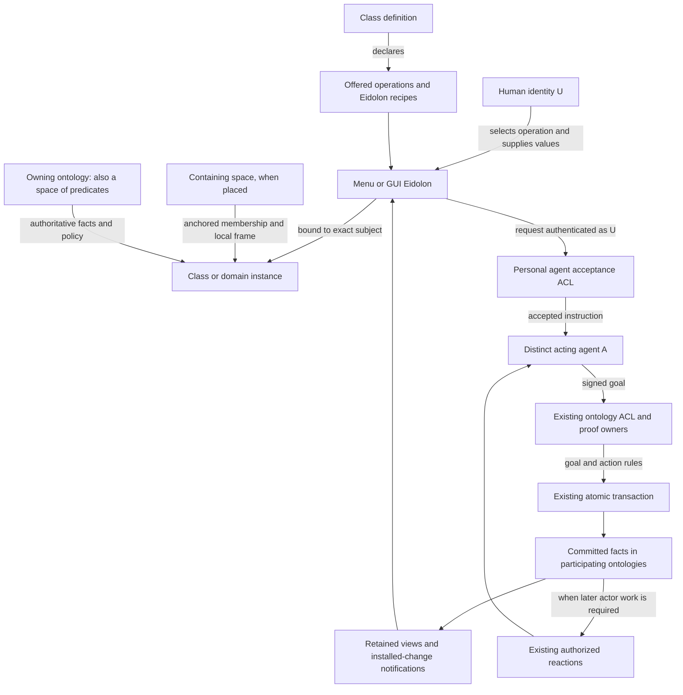

---
planStatus:
  planId: plan-space-conceptual-architecture-review
  title: Space and interaction architecture
  status: in-development
  planType: system-design
  priority: medium
  owner: Yan
  stakeholders: []
  tags:
    - architecture
    - space
    - eidolons
  created: "2026-10-17"
  startDate: "2026-10-24T14:22:52Z"
  updated: "2026-10-24T15:25:58Z"
  progress: 29
---
# Space and interaction architecture — implementation plan

## Purpose and boundaries

The design for **stage 1 — one empty space through the user's agent** is closed and ready for implementation. It includes generic constructors/inheritance, the permission rules, explicit storage, placement, signed submission and recovery of the original result. S1.1 is implemented, verified and committed (`671e1f76`), including ordinary foreign-only recovery; its ticket is completed. The remaining stage-1 tickets and stages 2–3 are unstarted.

**Fixed scope:** the four final choices are settled below. Signing, result lookup, generated-ID binding, source loading and rollback are implementation obligations with acceptance checks, not further design approvals. Routine implementation choices are delegated within the agreed behavior. Recursive displays, ontology contents/founding, terrain/physical embodiment and live specialization remain the already-listed later work; they are not prerequisites for this first stage. Reopen an agreed decision only if concrete implementation evidence requires changing its behavior or guarantees, not to add another preference question.

**Evidence labels:** **Current** describes inspected code; **Confirmed direction** records Yan's choices, including behavior still to implement; **Proposal** is a recommendation; **Later** identifies work outside the first implementation stage; an **Open** item in those later areas does not block stage 1. A difference between current code and the desired model is not automatically a defect.

[Use **space** for the domain container previously called a world. Existing `world_*` names below identify current code. Replacing a path does not authorize deleting pending work, user changes or founded ontology data.]{open by="yan" email=yan.guiborat@gmail.com}


## Implementation checklist

Stage 0 records completed design decisions. Production implementation starts at stage 1; the detailed scope and acceptance checks are in “Smallest staged normalization.”

- [x] **0 — Close the first-stage design**
  - [x] Confirm constructor convention/inheritance, `constructor_order/2`, default 100-metre space dimensions, permission overrides and recovery from existing transaction history.
  - [x] Preserve generated ULIDs, `name`, temporary inputs, explicit storage, optional near-agent placement and recovery from any authorized device.
  - [x] Separate implementation obligations from later features; no further preimplementation design review is required for stage 1.
- [ ] **1 — One empty space through A**
  - [ ] Connect U's authenticated instruction to A's exact signed operation and authorize outcome lookup through existing owners; preserve attempt-now behavior and existing deadlines.
  - [x] Expose the original returned bindings through ordinary outcome lookup, as atomic outcomes already do; recover a lost creation reply from transaction history without repeating creation.
  - [ ] Implement generic assertion-triggered construction, parent ordering, ULID binding, scoped inputs/defaults, `name` and class permissions with existing rollback.
  - [ ] Distinguish live creation, surviving source memberships, loading and replay; restore saved state without rerunning constructors or generating replacement IDs.
  - [ ] Bind class-level creation and instance operations to existing menu/GUI/Eidolon mechanisms, with the same authorization on directly submitted goals.
  - [ ] Support the specified finite space, explicit infinite extent, ordinary-space placement and unplaced creation; verify permissions, conflicts and lost replies.
- [ ] **2 — Same-agent entry and space Eidolons**
  - [ ] Generalize assignment/admission for ordinary entry, preserving A's identity.
  - [ ] Define nested frames/exposure before recursive contents and ontology predicate views.
- [ ] **3 — Terrain and helper retirement**
  - [ ] Separate terrain state from the space and retain physical, ownership and revision protections.
  - [ ] Replace helper-backed forms, then retire their obsolete wiring after accounting for pending work and all callers.

## Implementation tickets

S1.1 is **completed / implemented, verified and committed**; the other eight stage-1 implementation tickets remain **to-do / unstarted**. Stage 1 remains incomplete; stages 2 and 3 are unstarted. Stage 0 is complete and has no additional ticket. The installed task schema has dependencies but no parent/child field, so parentage is recorded by explicit reciprocal links rather than an invented hierarchy field.

| Stage work item | Completion dependency |
| --- | --- |
| [1 — One empty space through the user's agent](/home/yan/src/quod/nimbalyst-local/tracker/tasks.md:5) | S1.9 and its transitive prerequisites |
| [2 — Same-agent entry and space Eidolons](/home/yan/src/quod/nimbalyst-local/tracker/tasks.md:42) | Stage 1 |
| [3 — Terrain separation and obsolete-helper retirement](/home/yan/src/quod/nimbalyst-local/tracker/tasks.md:63) | Stage 2 |

Stage dependencies remain **stage 1 → stage 2 → stage 3**. The parent stage-1 ticket aggregates delivery; it is not a prerequisite blocking its own implementation tickets. Stages 2 and 3 retain their agreed scope and completion checks without speculative subtickets.

### Stage-1 implementation tickets

Each ticket links back to the stage-1 parent and this plan, records inspected code, acceptance/failure checks and the code retirement it owns. Dependencies below are also stored as supported tracker relationships; these are execution ordering, not additional architecture approvals.

| Ticket | Owns | Depends on |
| --- | --- | --- |
| [S1.1](/home/yan/src/quod/nimbalyst-local/tracker/tasks.md:85) | Recover original result bindings through ordinary transaction outcomes | None |
| [S1.2](/home/yan/src/quod/nimbalyst-local/tracker/tasks.md:110) | Submit immediate user instructions as the distinct personal agent | S1.1 |
| [S1.3](/home/yan/src/quod/nimbalyst-local/tracker/tasks.md:136) | Enforce shared class requirements and instance permission overrides | None |
| [S1.4](/home/yan/src/quod/nimbalyst-local/tracker/tasks.md:162) | Define generic constructor inputs, inheritance, defaults and names | None |
| [S1.5](/home/yan/src/quod/nimbalyst-local/tracker/tasks.md:188) | Integrate assertion construction with ULIDs, rollback and source recovery | S1.3, S1.4 |
| [S1.6](/home/yan/src/quod/nimbalyst-local/tracker/tasks.md:215) | Generalize exclusive placement to ordinary nonphysical spaces | S1.3 |
| [S1.7](/home/yan/src/quod/nimbalyst-local/tracker/tasks.md:241) | Create one empty space with explicit storage and optional placement | S1.2, S1.5, S1.6 |
| [S1.8](/home/yan/src/quod/nimbalyst-local/tracker/tasks.md:267) | Describe and bind class operations through the shared Prolog GUI model | S1.3, S1.5 |
| [S1.9](/home/yan/src/quod/nimbalyst-local/tracker/tasks.md:293) | Deliver the bound Create-space interface and verify the complete stage-1 flow | S1.7, S1.8 |

Start with **S1.1, S1.3 and S1.4**. S1.2 follows S1.1; S1.5 follows S1.3/S1.4; S1.6 follows S1.3. S1.7 joins S1.2/S1.5/S1.6, while S1.8 follows S1.3/S1.5. S1.9 joins S1.7/S1.8 and establishes the complete stage-1 acceptance. No parallel agents are implied or authorized.

**Checklist ownership:** numbers below refer to the existing stage-1 parent's eleven implementation checklist entries, in their retained order. Each has one implementation owner; supporting dependencies do not create parallel ownership.

| Parent checklist obligation | Implementation owner |
| --- | --- |
| 1 — U→A signing, attempt-now acceptance and authenticated operation association | S1.2 |
| 2 — Original selected-result recovery | S1.1 |
| 3 — Assertion hooks and generated anchored identity | S1.5 |
| 4 — Scoped inputs, defaults, parent order and class-owned parts | S1.4; proof integration supplied by S1.5 |
| 5 — Compulsory requirements and permission overrides | S1.3 |
| 6 — Rollback, source replacement, loading and replay | S1.5 |
| 7 — Empty-space constructor, dimensions and explicit storage | S1.7 |
| 8 — Ordinary exclusive placement and display references | S1.6; creation placement choice composed by S1.7 |
| 9 — Standard name/default policy | S1.4 |
| 10 — Offered-operation contract and exact-subject GUI binding | S1.8 owns the Prolog contract; S1.9 owns client presentation/integration |
| 11 — Replacement and removal of obsolete support | Each ticket owns removals in its implementation scope; S1.9 verifies aggregate coverage |

The parent's seven acceptance groups remain intact. S1.9 owns the combined signed user journey and delivery evidence, reusing S1.3/S1.5/S1.6 permission/conflict evidence, S1.4/S1.5 constructor/name/source evidence, and S1.1/S1.2 outcome/cross-device evidence. Each ticket includes its own checks; integration does not defer those tests or cleanup to a separate future project.

**Existing-ticket overlap:** [QUD.25](nimbalyst://QUD.25) retains delivered GUI components and outstanding headset acceptance; [QUD.32](nimbalyst://QUD.32) and [QUD.33](nimbalyst://QUD.33) remain completed foundations reused here. [QUD.31](nimbalyst://QUD.31) retains broader terminology documentation; implementation-specific docs accompany their owning ticket. [QUD.35](nimbalyst://QUD.35) remains the graphical workbench after stage 2. [QUD.18](nimbalyst://QUD.18) owns physics-impact occurrences, and [QUD.21](nimbalyst://QUD.21) owns call-chain hardening; neither becomes a new stage-1 prerequisite. These existing tickets were inspected, not recreated or reopened.

Ticket refinement changes no architectural decision, implementation checkbox or stage progress.

## Confirmed directions

- **Identity and authority:** human U and personal agent A are distinct. U instructs A; A acts under its own authenticated identity. U normally owns spaces and terrain A creates for U. Ownership, hosting, storage and containing space are separate.
- **Existing machinery:** Prolog owns state, policy, authorization and protocols. Reuse goals, actions, atomic multi-ontology transactions, recovery, reactions and runtime owners. Adapt the shared mechanism and remove a superseded path when its replacement covers its obligations.
- **Creation:** `instance_of(chair, X)` queries instances; `assert(instance_of(chair, ChairId))` requests creation. The shared construction mechanism generates and binds a fresh ID before class constructors run; the user does not supply it. A missing custom constructor alone must not fail otherwise valid creation; a failing constructor cancels the whole creation.
- **Validation scope:** the proposed generic final-state validation mechanism is deferred and excluded from the first stages. Yan's tentative preference is to let authorized authors break their own domain state rather than add universal protection against arbitrary edits. Constructors/actions still check their own work; authorization and transaction guarantees remain mandatory.
- **Constructor inputs and composition:** `build_plan` means temporary creation inputs, not a persistent blueprint or a fully expanded tree of parts. Supplied values override class defaults; resolved initial attributes are staged before class constructors run. Each class describes its own internal parts and may pass supported overrides to their constructors. Required parts are created in the same atomic transaction. The class-author convention is `constructor(Class, Instance, BuildPlan)`; resolved attributes are read normally.
- **Generic inheritance:** these rules apply to every class, not only spaces. Supplied values override the most specific class defaults, which override inherited defaults. Parent constructors run automatically before descendants, even when a subclass has its own constructor, with each applicable class scheduled once per creation attempt. All operate on the same instance and ID. Authors order unrelated parents; unresolved inherited-default conflicts fail clearly. Sharing a parent does not make siblings inherit from each other.
- **Instance identity:** exact references retain `entity_ref(Namespace,GenesisAnchor,InstanceId)`. Quod generates a full ULID during construction; negligible probabilistic collision risk is accepted. Names are separate, and a replacement receives a fresh ID. No per-deleted-instance tombstone or used-ID catalogue is required. Normal creation does not accept user-chosen IDs; this does not promise protection against arbitrary authorized source rewriting.
- **Names:** `name` is a standard instance attribute, mutable and not required to be unique. A supplied name wins. Classes choose suitable defaults; the existing naming ontology applies to humans, places and other supported kinds, not every class. Store the resolved name during creation instead of generating it again for each view.
- **Lost operation replies:** retrieve the original submitted change's status and returned values from existing transaction evidence. For space creation this is “committed” and the generated reference. Recovery remains available while the original history is retained, including after the instance is deleted; introduce no separate result-expiry policy or deleted-instance list. It must work from any authorized device, so the initiating browser cannot be the only source of the request association. Never repeat creation merely to discover its ID.
- **Storage selection:** create in the explicitly selected target ontology. Do not introduce an automatic personal-ontology/lobby default. Storage remains independent of default near-agent placement.
- **Placement:** nonphysical instances may remain unplaced. By default, represent a new immaterial instance near A using its defined 3D-model Eidolon when A occupies a space. If A has no containing space and no destination was specified, create unplaced. An explicit placement refusal must not silently fall back to unplaced creation. Once placed, an instance has one containing space.
- **Spaces:** space is foundational; an ontology is to become a specialized space of predicates. Physics belongs to `physical_space < space`. Empty ordinary spaces require no terrain or sky. Spaces offer exterior and contents representations. There is **no adopted restriction on displaying infinite spaces inside finite spaces**.
- **Shared appearances:** several spaces can display one instance through exact references. Removing an appearance does not delete the instance. Shared display grants neither shared ownership nor permission.
- **Operations and policy:** classes declare offered operations and permissions, including for ontology instances. Owners may widen or restrict default grants within the compulsory requirements of every applicable class. Ontology admission still applies. Menus and directly submitted goals use the same authoritative checks; discovery grants no authority.
- **Immediate work:** ordinary Save/Create/Enter instructions authorize an attempt now. An unavailable agent must not silently accept them for later execution. Restart must not execute an old unsubmitted instruction. Possibly submitted operations retain their exact identity and recover their original outcome; a lost reply is not failure.
- **Forms and actors:** direct personal-agent operations need no form-specific helper. Keep genuine deferred questions and inter-agent requests. Preserving unsent input is a separate interface concern, not permission to execute later or a requirement for a new autosave engine.
- **Later work:** allow suitable live subclass specialization while preserving identity; define compatibility and constructor behavior first. Add an ownership GUI covering placed and unplaced instances without another inventory.

**Working proposals:** target ontology plus goal text as U's instruction; domain GUIs selected as Eidolons and bound to exact subjects; separate terrain from its containing space, with voxels as one implementation. The construction-input syntax below expresses the agreed temporary-input model. The class constructor convention, inheritance rules and parent-order notation are confirmed; request/result association remains an implementation obligation.

## Inventory and glossary

| Concept | Current implementation and exact reference |
| --- | --- |
| Ontology | An exact namespace/genesis history owning code, facts, ACLs and commits. It reflects itself as `instance_of(ontology, ontology_ref(Ns,Anchor))`; current ancestry declares `ontology < thing`, not `ontology < space`. The latter is Yan's new design direction. [Common predicates](/home/yan/src/quod/priv/ontologies/common_predicates.pl:42). |
| Class / instance | `isa(Sub,Super)` supplies ancestry; `instance_of(Class,Instance)` is class-first and authored. Class membership does not import behavior, grant rights or allocate a process. [Class semantics](/home/yan/src/quod/priv/ontologies/common_predicates.pl:138). |
| Agent / human | `human_user` specializes `agent`. An agent's exact identity is `agent_instance_ref(Ns,Anchor,Instance)`. The browser signs as the selected human-facing agent; no separate personal proxy is currently required. [Human class](/home/yan/src/quod/priv/ontologies/quod_human_user.pl:13), [human instance policy](/home/yan/src/quod/priv/ontologies/human_user_instance.pl:6). |
| Hosting / ownership | Hosting selects a runtime node and active key; domain ownership is Prolog policy. A hosted `quod_agent` process is disposable; the vault owns private key custody. Neither spatial location nor owning an object implies hosting it. [Host assignment](/home/yan/src/quod/priv/ontologies/agent_instance.pl:46), [signing policy](/home/yan/src/quod/priv/ontologies/agent_instance.pl:267), [runtime contract](/home/yan/src/quod/doc/runtime-and-agents.md:60). |
| Space | `space` and `physical_space` exist. Organizational membership is many-to-many; physical assignment is exclusive and revisioned. Source owner and destination admission commit atomically. No general spatial-parent tree or universal containment invariant exists. [Space vocabulary](/home/yan/src/quod/priv/ontologies/space.pl:3). |
| Goal / action | `goal(DesiredState)` checks the state, then tries `action(Transition,Prerequisites,DesiredState)` candidates with rollback and postcondition checks. It is not a catalogue of user-facing commands. [Goal mechanics](/home/yan/src/quod/priv/ontologies/common_predicates.pl:278). |
| Eidolon | `class_eidolon/4` associates purpose/style with an anchored recipe. `entity_eidolons/2` selects applicable most-specific recipes. Several views can depict one instance. [Selection](/home/yan/src/quod/priv/ontologies/common_predicates.pl:46). |
| GUI | Classed controls, attributes, defaults, typed validation and `gui_form/3` field-to-continuation binding exist. Submitted question forms use a responsible actor. [Control classes](/home/yan/src/quod/priv/ontologies/quod_gui.pl:41), [form compilation](/home/yan/src/quod/priv/ontologies/gui_instance.pl:34), [binding](/home/yan/src/quod/priv/ontologies/gui_instance.pl:143). |
| Console / ontology editor | `prolog_console` is a device class; `console` is a personal-lobby instance. Its menu opens fixed workspaces. Ontology instances already use source/inspection Eidolons, but the generic source recipe edits the owning ontology, not a subject-specific field model. [Console classes/menu](/home/yan/src/quod/priv/ontologies/quod_lobby.pl:117), [source recipe](/home/yan/src/quod/priv/ontologies/quod_prolog_eidolons.pl:18). |
| Terrain / space | `voxel_world < physical_space`, plus declared `bounded_voxel_world` and `unbounded_voxel_world`; creation actually instantiates `voxel_world`. `voxel_ground` classifies the derived `terrain(W)` visual subject. A created `world(Id)`, its terrain, sky, authority/pilot and forms currently live in the user's lobby ontology. [Terrain classes](/home/yan/src/quod/priv/ontologies/voxel_world.pl:4), [creation](/home/yan/src/quod/priv/ontologies/lobby_worlds.pl:78), [ground](/home/yan/src/quod/priv/ontologies/voxel_world_view.pl:5). |
| Naming | `quod:names` supplies names from selected pools; its unqualified draw is for personal names. Current landscape creation already selects a place-name pool and stores `display_name`. Reuse the naming rules while adapting consumers to the agreed `name` attribute. [Naming selection](/home/yan/src/quod/priv/ontologies/quod_names.pl:103), [personal-name default](/home/yan/src/quod/priv/ontologies/quod_names.pl:111), [current storage/use](/home/yan/src/quod/priv/ontologies/lobby_worlds.pl:90). |

This inventories declarations and template-created instances in the source, not a census of deployed data.

## Shared model



The diagram is the proposed model, not a claim that all paths are implemented. “Owning ontology” means the ontology storing the authoritative facts, not their human owner. The acceptance box does not require a separate durable task or transaction for every click. Its connection to governed A-signing is an implementation obligation in stage 1.

### Identity, authority and immediate requests

**Current:** the browser signs as its selected human-facing agent. A target ontology and goal text already fit the signed request/parser. Use `goal(DesiredState)` for state-driven action selection; reads and explicit authorized predicates need not be wrapped in it. [Request format](/home/yan/src/quod/src/quod_client_goal.erl:32), [client signing](/home/yan/src/quod/client/src/signed-client.js:46).

Calling `Namespace::Goal` preserves the original principal. The target evaluates `can_invoke(Goal,Principal,CallChain,Namespace)` against committed policy, recording reads for conflict validation. The call chain names ontologies, not agents; routing a U-signed goal through A's ontology does not make A the actor. Hosted A-signing is a separate governed operation over exact request bytes, checked in a committed read-only session. A staged grant cannot authorize it halfway through U's write proof. [Invocation](/home/yan/src/quod/src/predicates/quod_ask.erl:1518), [arguments](/home/yan/src/quod/src/predicates/quod_ask.erl:1809), [signing boundary](/home/yan/src/quod/src/predicates/quod_agent_predicates.erl:181).

**Required behavior:** A authenticates U, checks the instruction under Prolog policy and signs authorized work as A. Each target still checks A's permissions and relevant owner grants; A's approval is not a commit. Separate these cases:

| Evidence | Meaning and interface behavior |
| --- | --- |
| Definitive refusal/unavailability before submission | No operation was submitted. Report that fact; do not save an implicit task for restart. |
| Operation may have been submitted, including loss of A's first reply | Outcome unknown. Retain the original request; resolve it without resubmission or a replacement identity. |
| Existing transaction protocol has durably admitted work | Its existing recovery continues even if A stops. This is not dispatching an old unsubmitted instruction. |
| Terminal outcome established | Report committed or definitively failed. A missing lookup result or timeout alone is not terminal failure. |

**Stage-1 implementation:** connect U's instruction to the exact A-signed request and authorize U to inspect its outcome. Current [HTTP resolution](/home/yan/src/quod/src/quod_client_goal_ingress.erl:168) requires the original signing key; U cannot resolve A's request simply using U's session. The ACL-governed [Prolog outcome read](/home/yan/src/quod/doc/multiwrite-architecture.md:115) is reusable but does not establish this association. Implement and verify these steps through existing ingress, actor, vault and outcome owners; the gap does not justify a second record owner or execution protocol. Do not assume FIPA acceptance for every form.

For genuine deferred work A may request action from B, whose later proof is signed by B. Retain authenticated requester and request restrictions. A supplied list of agent names is not proof of delegation. Current FIPA admits mapped ground desired states and returns `done`; arbitrary goal-text execution and generic answers are not supplied by that vocabulary.

### Class, instance and ontology permissions

**Current:** ontology admission can inspect instance arguments; authored domain checks also exist, for example [terrain editing](/home/yan/src/quod/priv/ontologies/voxel_world.pl:138) and [space consent](/home/yan/src/quod/priv/ontologies/space.pl:16). Class ancestry does not dispatch a shared class-default/instance-override policy.

**Required integration:** keep existing proof owners enforcing access; shared Prolog rules resolve compulsory class requirements and instance policy. Constructor hooks and offered operations use those same rules. A read-only action prerequisite can see staged state; it is not committed-policy authorization. New staged permission facts cannot grant authority to the same write. Creation checks the committed target/class policy against the proposed inputs; the new instance's own grants become usable after commit.

**Confirmed override rule:** the class separates compulsory checks from default grants. The instance owner, acting through an authorized agent, may change the defaults to grant or withdraw access; an explicitly authorized policy administrator may do so too. Overrides cannot waive compulsory requirements inherited from any parent. All such requirements must pass, together with the ontology's admission check. Use the most-specific default when no instance override is supplied; unrelated conflicting defaults need an explicit subclass/instance policy, otherwise refuse clearly. Missing permission never means allow. Constructor order does not decide permission precedence.

Menus display advisory availability; the operation itself enforces the same checks when called directly, including from goal text. Policy edits are governed operations, not permission to grant oneself access inside an already-running write. An administrator allowed to rewrite the entire ontology can already change its source and policy; this broader authority is outside the narrower instance-operation guarantee. [Current broad lobby rights](/home/yan/src/quod/priv/ontologies/lobby_instance.pl:4).

### Storage, placement and representations

An instance's identity already appears in `instance_of(Class,Instance)` and related facts. Membership can also be derived by rules. A reference uses that identity; across ontologies it includes the exact history. It is not another domain object. A mark's own id distinguishes an appearance; `depicts(Ontology,Anchor,Entity)` identifies what it displays. Several marks can depict one instance, which can also exist without a mark. [Mark contract](/home/yan/src/quod/priv/ontologies/quod_rendering.pl:34).

**Confirmed storage choice:** the instruction explicitly selects the target ontology holding the new instance's facts; its policy must authorize creation. There is no automatic personal-lobby storage default. The selected ontology describes the instance; the containing space holds admission/reference information. This does not make the ontology administrator, domain owner, containing space or runtime host interchangeable. Creating an ordinary space does not require founding another ontology. Moving it need not move its stored facts.

**Proposed location model:** generalize the existing instance-owned exclusive assignment and destination-owned admission to ordinary spaces. Keep useful many-to-many display references. `enter` checks expected location, applicable parent/travel rules and destination permission, then commits assignment and admission together; navigation follows the result. Viewing another space is not entry. Roots, removal/eviction and A's physical body/pilot relationship remain open. [Assignment/admission](/home/yan/src/quod/priv/ontologies/space.pl:56).

Exterior, contents and information GUIs depict the same subject. The proposed acyclic frame hierarchy composes authorized child appearances and relative transforms. Child disclosure and viewer rights apply; parents may restrict exposure further. Reuse retained views and installed-change notifications, not an agent per space. Current [space views](/home/yan/src/quod/priv/ontologies/space_view.pl:3) enumerate direct contents; [model transforms](/home/yan/src/quod/priv/ontologies/quod_modelling.pl:151) compose visuals. Recursive exposure, scale, revocation and dependencies remain to define. Nested display does not imply another simulation; general cross-simulation transfer remains outside the current [contract](/home/yan/src/quod/doc/spaces.md:155).

### Ontology as a space

**Confirmed direction:** `ontology < space`; an ordinary space need not be an ontology or physical. Entering, reading predicates, editing source and joining/hosting consensus are separate permissions.

**Proposal:** derive predicate subjects from the existing catalogue and exact ontology history. Reuse source/inspection Eidolons and guarded edits without copying mutable source. Predicate versus clause granularity and layout remain open. A predicate describing A can appear inside ontology O while A occupies S; this does not place A in O. Infinite ontology extent expresses room for more predicates, subject to resource policy, not a decided spatial layout. [Self-reflection](/home/yan/src/quod/priv/ontologies/common_predicates.pl:42), [recipes](/home/yan/src/quod/priv/ontologies/quod_prolog_eidolons.pl:18), [catalogue/editor](/home/yan/src/quod/priv/ontologies/quod_prolog.pl:65).

An eventual ontology constructor must use the existing founding/history lifecycle. A membership assertion alone does not establish a founded ontology; the construction integration below does not yet prove this special lifecycle can join ordinary instance creation.

### Offered operations and GUI Eidolons

**Already reusable:** class-selected recipes, interface descriptions, typed controls, inherited defaults, validation, authored forms and field-to-goal binding. **Missing shared contract:** how a class advertises an operation's label/help, exact subject, inputs/defaults, bound goal, result and advisory availability, and how an instance GUI opens for that subject. [Interface descriptions](/home/yan/src/quod/priv/ontologies/quod_prolog.pl:18), [binding](/home/yan/src/quod/priv/ontologies/gui_instance.pl:145).

A class-level Create affordance can prepare an assertion of a new instance; no existing space instance or separate public `create_space` executor is required. Other operations target existing instances. A GUI author may arrange arbitrary information and controls; a generated operation form is one possible Eidolon. Menus, ordinary panels and spatial panels should bind the same authorized operation. A class-definition editor and an instance editor have different subjects and permissions.

Discovery is advisory. Recheck parameters, permissions and revisions on submission; some permissions depend on values not yet entered. Do not execute mutations to discover availability or expose every `action/3` as a public command. The console can offer target ontology plus goal text without declaring every Prolog predicate as a class operation. BBSVX supplies interaction precedents, not the missing authoritative metadata. [Radial input](/home/yan/src/bbsvx/priv/bubblepod/src/ui/RadialMenu.ts:6), [argument entry](/home/yan/src/bbsvx/priv/bubblepod/src/main.ts:1018).

Unsent editor/form buffers remain separate from submitted operations. Reuse existing draft/baseline behavior; closing/reload survival needs an explicit interface requirement. Shared authoritative drafts belong in Prolog. Neither retained input nor a disabled button grants later execution. A labelled orb and information GUI are optional agent representations, without new execution roles.

## Construction: requested behavior and existing seams

### Authoring, defaults and placement

**Confirmed behavior:** querying membership stays a read; asserting creation asks the shared mechanism to allocate the identity and run the applicable constructors. U supplies values, not an ID. A executes the goal in the explicitly selected ontology.

**Working syntax for the agreed behavior, not implemented:**

```prolog
instance_of(space, SpaceId).           % query existing instances
assert(instance_of(space, SpaceId)).   % create with defaults; bind a fresh ULID

with_build_plan(
    [attribute(name, <<"Workshop">>)],
    assert(instance_of(space, SpaceId))
).
```

`SpaceId` is the generated local ID; the selected ontology's namespace and genesis anchor complete its exact reference. The wrapper supplies temporary inputs to this creation and uses the same assertion path. It is not another executor, a stored plan instance or global scratch facts. The class author's constructor is invoked automatically; a separate public `create_space` call is unnecessary. The caller may ignore the returned value, but creation and recovery must retain the generated identity.

**Confirmed input order and lifetime:** allocate the ULID; resolve supplied inputs against class defaults and validate them; stage the resulting initial attributes for that ID; then run the applicable constructors. Required checks, parts and placement share the original transaction. Invalid supplied values fail rather than falling back to defaults. Temporary inputs disappear when their creation scope ends; the resulting instance facts remain on commit. Do not assert attributes against an unbound future ID: ordinary Prolog assertion stores a variable-containing clause, not a promise to fill in that ID later.

**Confirmed composition:** each class describes its own internals. An avatar constructor can create a head; the head class defines its eyes. The caller and avatar do not have to repeat the head's internal tree. The containing instance passes only supported part overrides, such as a role-specific `name`; its temporary inputs do not implicitly leak into part construction. Every newly created part gets its own generated ID through the same mechanism. Failure of a required part rolls back the whole creation. This is composition: unlike inherited constructors, the avatar, head and eyes operate on different instance IDs. **Proposal:** distinguish creating a part from referencing an existing instance explicitly; a reference back to the parent must not recursively create the parent again. Deletion/ownership rules for composed versus shared parts are later contracts, not an adopted automatic cascade.

**Confirmed class-author convention:**

```prolog
constructor(Class, Instance, BuildPlan).
```

This is the signature an author defines with a body, not a fact to insert or a second creation entry point. `Class` identifies whose constructor is running; `Instance` is the generated local ID; `BuildPlan` carries the scoped temporary inputs and supported part overrides. A constructor may ignore the third argument. It reads resolved stored values normally, for example `attribute(Instance, dimensions, Dimensions)`; it does not reapply its class defaults. Inherited constructors receive the same instance and creation inputs. A newly created part starts its own scoped inputs.

The agent still calls `assert(instance_of(space, SpaceId))`, optionally inside `with_build_plan`. The shared mechanism calls each applicable class constructor. Authors can use class-named helper predicates, but dispatch does not guess between `space/1`, `space/2` and other argument variants. **Tradeoff:** one predictable convention adds a reserved predicate name; it avoids a separate calling convention for each class.

Slots/property descriptions can help describe types, allowed values and defaults; they do not supply authorization or an executable lifecycle. Quod already has [typed/defaulted attributes](/home/yan/src/quod/priv/ontologies/animals.pl:24) and GUI [defaults](/home/yan/src/quod/priv/ontologies/quod_gui.pl:85) and [validation](/home/yan/src/quod/priv/ontologies/quod_gui.pl:201). Reuse these before inventing another schema. Some attributes are [derived](/home/yan/src/quod/priv/ontologies/quod_measure.pl:281), so not every property should become a stored constructor input. A simple class may need only shared defaults and validation. Missing custom code must not waive the declared creation checks or permissions. Those checks concern construction; they do not promise validity after arbitrary later edits.

**Confirmed default inheritance, for every class:** supplied value, then the most specific class default, then an inherited default. Resolve these values once before running constructors; parent defaults are not reapplied between constructors. Reuse the existing class relationships and selection rules. The current GUI property code already selects a most-specific declaration; its treatment of ambiguity is a precedent, not an adopted general multiple-inheritance policy. [Class selection](/home/yan/src/quod/priv/ontologies/common_predicates.pl:150), [GUI precedent](/home/yan/src/quod/priv/ontologies/quod_gui.pl:201).

**Confirmed parent constructors, for every class:** a subclass constructor does not replace or suppress its parents' constructors. Every applicable parent constructor must run automatically, including when the subclass has its own constructor; the class author need not remember a separate parent call. They work on the same instance, with the same ID and resolved attributes, within the same transaction. Space is only an example of this generic class mechanism. No constructor mechanism has been implemented in this review.

**Missing versus failing constructor:** a class without its own constructor remains creatable if the other creation checks succeed; applicable parent constructors still run. Detect the class's own declaration without executing its body. A declared constructor whose body fails is not missing. If any required constructor ultimately fails, the entire creation rolls back, including inherited-constructor writes and required parts. Do not implement an unconditional success fallback that swallows failure. Constructor clauses and nested alternatives must use the existing rollback discipline; ordinary Prolog backtracking alone is not a guarantee that writes are undone.

**Confirmed multiple-inheritance rules:**

1. Run ancestors before descendants, scheduling each applicable class once per instance-creation attempt. A shared ancestor reached through two parents is not scheduled twice.
2. The author declares the order between unrelated parents. Reject an ambiguous or contradictory order, or a cycle in the constructor ancestry, before running constructor bodies. Do not use source order, alphabetical sorting or whichever proof answer arrives first.
3. Resolve defaults separately from execution order: supplied value, then the most specific default, then inherited defaults. If unrelated parents supply different defaults and neither the caller nor subclass resolves the choice, fail clearly. A chosen value still has to pass applicable creation checks; choosing a default grants no permission.
4. Sharing a parent does not make sibling classes inherit from one another. Explicit additional inheritance remains possible; there is no blanket ban on relationships between classes sharing an ancestor.

Example: `car` and `boat` both inherit `vehicle`; `amphibious_vehicle` inherits both. With car ordered before boat, the constructors run `vehicle → car → boat → amphibious_vehicle`, using one instance ID. This order does not automatically make the car's default win over the boat's. Authors remain responsible for compatible constructor writes; no generic final-state validator is added.

**Confirmed parent-order notation:**

```prolog
constructor_order(amphibious_vehicle, [car, boat]).
```

The list names each direct parent exactly once and orders those parents' constructors. It describes no new inheritance: `isa/2` remains authoritative. Omit it with zero or one direct parent. With multiple direct parents, require one ground, consistent declaration; reject omissions, duplicates, extra parents or contradictory ancestry/order constraints. Expand ancestors before descendants, respect the declared parent orders and schedule shared ancestors once. A deterministic traversal of the declared parent order resolves otherwise independent branches; do not use source order or alphabetical sorting. This convention applies to every class.

**Current code and missing capability:** [generic ancestry](/home/yan/src/quod/priv/ontologies/common_predicates.pl:138) already supports multiple parents, and [selection](/home/yan/src/quod/priv/ontologies/common_predicates.pl:150) returns all most-specific alternatives. It supplies neither constructor dispatch nor an order. Its cycle-tolerant queries must remain valid; rejecting a construction cycle does not change `isa/2` query semantics. Use the confirmed Prolog ordering declaration below over the existing class relationships. The earlier single-constructor/manual-parent proposal is superseded. **Tradeoff:** explicit order makes side effects predictable but asks authors to resolve conflicts; it cannot make incompatible parents safe.

**Confirmed defaults:** resolved stored attributes are fixed at creation; changing a class default later does not rewrite existing instances. Derived properties may remain derived.

**Confirmed first space class:** ordinary space defaults to a finite **100 × 100 × 100 metre** interior, centred on its own origin. The `dimensions` attribute is either `infinite` or `box(Width, Height, Depth)`, with each finite length expressed as the existing `q(Value, Unit)` quantity and strictly positive. The axes are X, Y and Z respectively. Use existing [exact unit conversion](/home/yan/src/quod/priv/ontologies/quod_measure.pl:114); physics adapters retain their existing [millimetre contract](/home/yan/src/quod/priv/ontologies/quod_physics.pl:3). Extent is distinct from the exterior Eidolon's size and from runtime resource budgets. Finite extent creates neither walls nor physics; an empty ordinary space stays empty.

**Class-author sketch for implementation:**

```prolog
have_attribute(space, name, binary, default(<<"Space">>)).
have_attribute(space, dimensions, space_dimensions,
    default(box(q(100, <<"m">>), q(100, <<"m">>), q(100, <<"m">>)))).

constructor(space, Space, _BuildPlan) :-
    attribute(Space, dimensions, Dimensions),
    space_dimensions(Dimensions).
```

`space_dimensions/1` is the class's Prolog check for `infinite` or three positive length quantities; it is to be implemented using existing measurement rules. The shared mechanism has already bound the ID and staged defaults before this constructor runs. A caller may override `name` or `dimensions`, including `attribute(dimensions, infinite)`, through the agreed `with_build_plan` syntax. No separate creation API or general final-state validator is introduced.

**Confirmed naming policy:** use the standard attribute `name`, separate from the immutable reference. Supplied names take precedence and may be changed without changing identity; duplicates are allowed. The class may choose an appropriate naming-ontology pool for humans, places or another supported kind. Other classes can supply ordinary defaults such as “Chair” or “Console”; a head constructor may supply “Left eye” when creating that part. This is Prolog policy, not a universal naming-service call. The selected name is stored during creation and does not change merely because a view refreshes or the naming catalogue changes.

**Current reuse:** [quod:names](/home/yan/src/quod/priv/ontologies/quod_names.pl:103) already selects names within the running proof, and [landscape creation](/home/yan/src/quod/priv/ontologies/lobby_worlds.pl:108) uses a specific pool when no name was entered. Unqualified draws select [personal names](/home/yan/src/quod/priv/ontologies/quod_names.pl:111); they are unsuitable as a blanket fallback for all instances. Current consumers still use `display_name`, including [world creation](/home/yan/src/quod/priv/ontologies/lobby_worlds.pl:90); adapt the relevant declarations, readers and writers together to `name` when implementing this model.

Creation commits identity, U's ownership, required state, validation and any requested placement together. Class code must be composed into the chosen state owner or called through existing anchored paths; knowing a class does not import its implementation or redirect writes. Default near-A placement is one-time placement, not following A. A failed location lookup is not evidence that A is unplaced. Runtime preparation may follow through existing owners, but a representation becoming ready is distinct from successful domain creation.

### Assertion hook, authorization and rollback

**Current seam:** pinned Erlog dispatches `assert/1`, `asserta/1` and `assertz/1` through predicate-specific hooks before ordinary insertion, passing the complete clause and proof state. Quod preserves these hooks in writable overlays and clears them for strict read-only checks. No `instance_of/2` constructor hook is installed. [Interpreter](/home/yan/src/quod/_build/default/lib/erlog/src/erlog_int.erl:477), [dependency pin](/home/yan/src/quod/rebar.config:41), [overlay](/home/yan/src/quod/src/quod_erlog_db_local_prove.erl:135), [read-only protection](/home/yan/src/quod/src/quod_erlog_db_local_prove.erl:181).

**Proposed adaptation:** a small governed hook dispatches into Prolog-owned class policy and constructor execution, within A's original proof and existing transaction scope. Reuse [action candidates](/home/yan/src/quod/src/predicates/quod_action_predicates.erl:50) and the [shared proof savepoint](/home/yan/src/quod/src/quod_proof_savepoint.erl:44), not a new executor, process or constructor queue. A failure must restore membership, constructor writes, events, effects and bindings even when an enclosing alternative subsequently succeeds. Ordinary assertion/backtracking alone does not provide that guarantee.

**Action ordering matters:** `goal/1` and `run_declared_action/1` skip transitions when their desired state is already true. If the hook stages membership and then asks an action to establish that membership, constructors could be skipped. The selected action must establish the complete valid initial state, with deliberate insertion/validation ordering; membership alone is not a sufficient constructor postcondition. [Goal/action semantics](/home/yan/src/quod/priv/ontologies/common_predicates.pl:278).

**Authorization:** the receiving ontology's current invocation gate checks the authenticated caller and submitted goal, not a separate class policy on every internal assertion. The hook must connect class creation checks to existing committed-policy enforcement. Newly staged ACLs cannot authorize the same creation. Writing a membership fact does not automatically check a containing space's admission or the class-definition ontology: those are separate governed accesses when the constructor needs them. All participating owners retain their existing conflict and atomic-commit guarantees.

**Deferred — automatic final-state validation:** Yan does not want the proposed shared validation mechanism for now. No new generic before-commit class check or affected-instance dependency mechanism belongs in the first implementation stages. His tentative “let it break” policy leaves the consequences of permitted raw edits with the author, instead of promising that every committed domain state satisfies every class rule.

Constructors and actions retain their checks at their own boundaries. An action checks its postcondition before returning to the remaining goal; a later permitted raw write can invalidate that state, for example by removing required dimensions. The constructor does not catch this later change. This applies to all classes, not just spaces. It is an explicit limit of the proposed scope, not a solved invariant guarantee. [Action boundary](/home/yan/src/quod/src/predicates/quod_action_predicates.erl:45). This finding comes from source inspection, not a runtime test.

This policy does not authorize bypassing permissions, weakening atomicity/recovery, or removing existing safeguards such as [material-policy validation](/home/yan/src/quod/src/quod_material_admission.erl:20) and [policy-preserving apply](/home/yan/src/quod/src/quod_diff.erl:132). Shared domains still need appropriate write permissions and domain action checks. AI-written ontology code has the same responsibilities as human-written code; expected AI authorship is not a correctness guarantee. The broader question of enforcing domain invariants after arbitrary authorized edits remains open, with no replacement mechanism proposed now.

**Reactions are different:** current `react_on/2` matches applied changes and schedules a later signed goal. It cannot veto the earlier commit or guarantee the same actor. Construction belongs inside the original transition; reactions may observe the completed instance afterward. [Reaction lifecycle](/home/yan/src/quod/doc/runtime-and-agents.md:11).

### Lifecycle routes that must agree

| Route in current code | Required construction behavior / unresolved boundary |
| --- | --- |
| Live creation assertion with an output variable | Generate/bind the ID, apply scoped inputs/defaults and run the applicable constructors atomically. Cover all three assertion spellings. This deliberate allocation behavior is new; ordinary assertion does not already allocate or return an ID. Membership rules with variables remain rules, not creation requests. |
| Repeated original operation or assertion of an existing membership | Existing request/outcome handling resolves a repeated operation. A surviving ground membership must not allocate a new ID or reset its instance or rerun its constructors. Exact handling of direct ground assertions remains to specify; they are not the public way to choose a new ID. Commit-time duplicate elimination is too late to prevent proof-time constructor effects. |
| Concurrent creations | Each construction generates its own ULID; no shared per-ontology counter is selected. Proofs can overlap even when commits are ordered. Preserve existing conflict handling for actual overlapping state and detect a collision with a live identity without overwriting it. Probabilistic uniqueness is the accepted model, not a proof from commit ordering. |
| Querying membership, including inferred memberships | Read only; no constructors run. Current derived ontology, GUI, authority and pilot subjects remain valid. |
| Additional class membership on an existing identity | Distinguish membership from new identity allocation. Generic live specialization is later work; do not accidentally implement it by rerunning every class constructor. |
| Guarded source editing | Reordering or replacing a suffix can retract and reassert surviving memberships. This must not be mistaken for deletion/recreation or reset existing state. Actual additions/removals need an explicit lifecycle rule. |
| Founding/source compilation | The compiler also proves assertions in a fresh interpreter, without the normal signed live-creation context. Define constructor ordering and authority deliberately; installing a hook globally must not execute constructors while their source is only partly loaded. |
| Commit apply, recovery and projection rebuild | Restore the already-decided IDs, names, facts and results; never regenerate identities, rerun constructors or replay historical reactions. |

These are concrete integration constraints, not hypothetical reasons for another lifecycle engine. [Source editing](/home/yan/src/quod/priv/ontologies/quod_prolog.pl:215) replaces changed suffixes with retracts followed by `assertz`; [founding compilation](/home/yan/src/quod/src/quod_prolog.erl:7586) proves asserted terms; [common loading](/home/yan/src/quod/src/quod_committed_projection.erl:613) uses a lower-level insertion path. [Commit apply](/home/yan/src/quod/src/quod_diff.erl:284) inserts directly and deduplicates there, after a live hook would have run.

**Stage-1 engineering obligations:** bind generated IDs through the hook and existing savepoint; keep chosen IDs stable in sealed material/results; recognize surviving identities during source replacement; and define loading/founding behavior without accidental allocation or constructor execution. The time/random inputs for ULID generation must fit the existing proof/material contract; independently generating them again during validation or recovery is not acceptable. Preserve source round-trip checks when constructors add facts. The constructor signature, multiple-inheritance rules, parent-order declaration, space dimensions, default precedence, temporary inputs and class-owned composition are settled. Implement source-edit/loading integration under the route distinctions above. Do not make absolute prevention of malicious retired-ID reuse or a per-deletion registry a prerequisite for the accepted normal-creation guarantee.

Ontology creation has an additional boundary: existing [effects](/home/yan/src/quod/src/quod_effect.erl:39) support founding/joining/presentation, but [effect-bearing plans](/home/yan/src/quod/src/quod_effect.erl:93) reject material diffs in the same plan. Ordinary membership-plus-constructor atomicity therefore does not prove that founding a new ontology can be combined with those writes. An ontology constructor must retain the existing history lifecycle; its integration is separate from the first ordinary-space instance slice.

### Identity, results and lost replies

**Confirmed reference:** `entity_ref(Namespace,GenesisAnchor,InstanceId)`. `InstanceId` is the automatically generated ULID; `name` is a separate attribute. The anchor distinguishes ontology histories reusing a namespace, while the local ID distinguishes instances in that history. Colon segments qualify names; they do not encode containing-space ancestry or require an ontology per instance. Extra-colon instance syntax remains set aside. [Qualified names](/home/yan/src/quod/doc/proofs.md:9), [name resolution](/home/yan/src/quod/priv/ontologies/common_predicates.pl:250), [history identity](/home/yan/src/quod/doc/consensus-signatures.md:5).

**Confirmed generation policy:** Quod generates full ULIDs during shared construction, before class constructors run; class authors and users do not choose new IDs. Preserve the full uniqueness capacity and use a suitable secure randomness source. Negligible probabilistic collision risk is accepted; no absolute uniqueness promise is made. Distinct creations, including nested parts and replacements, receive distinct generated IDs. Reusing a readable name does not reuse identity. No separate creation-date field in the reference, per-ontology instance counter or operation-derived identity scheme is selected.

**Deletion and authority boundary:** retain no per-deleted-instance tombstone or used-ID catalogue. Normal creation generates a new identity; it never treats an old supplied ULID as a request to restore an object. The supported creation API does not offer caller-selected reuse; arbitrary authorized source rewriting remains outside that guarantee. Existing transaction history and outcome recovery remain; they are not a new deleted-instance registry. Source reordering of a surviving membership is not deletion. Keep revision protections and the agreed responsibility of authors for permitted raw edits.

**Result and recovery flow:**

1. Retain the original submitted operation and its authenticated association with U's instruction. The instance ID does not exist at the client before construction.
2. Construction binds the generated ID, commits the instance state and retains the selected result through the existing transaction machinery. The ontology's exact history completes the reference.
3. If the reply is lost before the reference arrives, use the original operation to recover its outcome and returned ID. Never execute creation again to discover the result.
4. Once the reference is known, it identifies the instance for later actions and can locate associated creation evidence through authorized lookup. It cannot, by itself, describe every later operation on that instance.

This replaces the earlier assumption that the caller supplied an identity and could always start recovery with that reference. The caller need not display or use a returned ID, but creation requests needing later result recovery must retain a named output. The request identity and instance identity serve different purposes; neither is a replacement for the other.

Reading current membership answers whether an instance exists now, not what happened to its original creation. Absence could mean pending, refused, never submitted or later deleted. **Confirmed:** recovery must work from any authorized device without the initiating client's records. Use existing request/outcome owners; do not add a parallel status registry, replay ledger prefixes on ordinary reads or resubmit creation to find its result.

**Current local recovery:** the browser saves optional `operation.context` alongside the original request before sending it; account and space controllers use that context to resume outcome handling. It can describe the pending operation and later received reference, but cannot contain an instance ID not yet generated. This local context is outside the signed request: it may locate evidence, not grant authority or prove creation. [Context capture](/home/yan/src/quod/client/src/signed-client.js:59), [save before send](/home/yan/src/quod/client/src/signed-client.js:157), [current consumer](/home/yan/src/quod/client/src/space-library.js:40).

**Confirmed recovery and retention:** “result” here means the recorded answer to one submitted change: its final status and any returned values. For creation, that includes the generated instance reference; for an edit, it may include the returned revision. Retrieve that original answer from the existing transaction evidence while the original history is retained, even if the reply was already received or the instance was subsequently deleted. This concerns submitted operations, not unsent form values or an archive of every read-only query. No separate retention timer, acknowledgement protocol, per-deleted-instance list or duplicate result archive is introduced.

Use the existing [outcome index](/home/yan/src/quod/src/quod_outcome.erl:3) and authoritative transaction result. Ordinary index rows are compact references/status, not copies of the complete result; use the existing owner's indexed exact record/result access rather than scanning history prefixes or rerunning proofs. A terminal answer can clear the browser journal without deleting authoritative transaction evidence. [Browser settlement](/home/yan/src/quod/client/src/signed-client.js:188), [journal contract](/home/yan/src/quod/client/src/operation-journal.js:10).

**Implementation obligation:** preserve the authenticated U→A request association and authorized outcome access through existing owners, including loss of A's first reply. Local browser context cannot be the sole source. Missing or unavailable evidence remains uncertainty, not failure or permission to resubmit. This is the already-agreed recovery work, not an unresolved retention choice.

**Existing results:** normal replies carry [named bindings](/home/yan/src/quod/src/quod_client_result.erl:439), selected results are [encoded durably](/home/yan/src/quod/src/quod_prolog.erl:5303), and the [client](/home/yan/src/quod/client/src/signed-client.js:111) retains original signed requests. Only [named outputs in the submitted goal](/home/yan/src/quod/src/quod_client_goal.erl:520) are selected, not anonymous/internal variables.

**Confirmed gap relevant to the chosen creation model:** [atomic-group outcomes](/home/yan/src/quod/src/quod_outcome.erl:1133) expose selected bindings; [ordinary outcomes](/home/yan/src/quod/src/quod_outcome.erl:1120) expose status without them. Because the ID is now generated during construction, ordinary lost-reply recovery must also expose the retained original selected bindings. This adaptation belongs in the first creation stage, together with U's authorized access to A's outcome. Do not force multiwriter transactions just to retrieve a result, rerun a constructor or generate a replacement ID during recovery.

### Terrain boundary

**Proposal:** a terrain instance owns generator settings, patches and revisions; a space contains or displays it; voxel generation is one terrain implementation. Preserve physical binding and checks. A landscape preset can compose ordinary-space and terrain constructors through existing transactions; empty-space creation must not require landscape defaults. Extent relationships remain open, and infinite extent never means eager infinite allocation. Current [terrain creation](/home/yan/src/quod/priv/ontologies/voxel_world.pl:34) already combines state and class membership; refactor that responsibility rather than adding a second implementation.

## Why `world_responder` exists today

**Current:** it is an ordinary `agent` instance, not an agent subclass. It completes submitted questions through the generic GUI mechanism:

1. [Library setup](/home/yan/src/quod/priv/ontologies/lobby_worlds.pl:8) prepares its hosted key.
2. U opens a form; policy selects the responder and `gui_open` commits question/HUD state. [Selection](/home/yan/src/quod/priv/ontologies/lobby_worlds.pl:44), [opening](/home/yan/src/quod/priv/ontologies/gui_instance.pl:231).
3. U's signed `gui_submit` validates and commits accepted values plus exact completion bytes. [Submission](/home/yan/src/quod/priv/ontologies/gui_question.pl:94).
4. A reaction schedules the responder's retained `gui_complete(Q)`. It calls the bound `gui_continue`; domain effects and question/HUD consumption commit together. [Reaction](/home/yan/src/quod/priv/ontologies/gui_question.pl:164), [continuation](/home/yan/src/quod/priv/ontologies/gui_instance.pl:206).

| Library operation | Bound continuation and responsibility |
| --- | --- |
| Create space with terrain | [world_creation_entered/2](/home/yan/src/quod/priv/ontologies/lobby_worlds.pl:78) creates `world(Id)` in the existing lobby, with a question-derived identity, human owner, name, generator settings, arrival, sky and physical definitions. It does not found an ontology. |
| Change viewing distance | [voxel_view_entered/3](/home/yan/src/quod/priv/ontologies/voxel_world_gui.pl:154) calls `voxel_set_view` against expected prior settings. |
| Edit terrain | [voxel_excavation_entered/7](/home/yan/src/quod/priv/ontologies/voxel_world_gui.pl:132) calls `voxel_edit` with a spherical brush and expected terrain/patch revisions. |

These are authored continuations, not a builder-specific operation system. Terrain editing still enforces permission, revision and resource policy and commits required physical-definition changes with the edit. Generation settings have another existing form, absent from this library mapping. Physical setup and client entry are separate.

**Retirement condition:** personal-agent operations must first cover acceptance, exact target/attempt identity, validation, authority and feedback. Then remove the helper's declarations, setup, question-derived identity and responder permission coupling together. Removing only the agent breaks current grants and correlation. Preserve pending questions and key custody obligations; source cleanup does not authorize deleting them. Keep generic questions for real deferred human answers. `world_authority` and `world_pilot` have separate physical roles.

## Concrete examples

These describe the proposed shared model. Current limits are stated separately; they are not implementation commitments.

| Example | Actor, target and ownership | Representation and offered operation | Authorization, commit and feedback |
| --- | --- | --- | --- |
| **1. Change generation settings on owned terrain** | U instructs A; A signs. Target is the exact terrain instance. U is its domain owner; its ontology stores its state; containing space is separate. | Class-selected settings GUI bound to the terrain, sharing the menu's change-settings operation. | A's acceptance, target policy and owner grant, expected terrain/patch revisions and physical constraints. Commit generator changes and required physical consequences together. Views show committed settings; readiness is separate. Rejection leaves no partial change; unknown outcomes retain the original operation. |
| **2. View/edit a JSON document** | U instructs A. Target is one exact document. For this example U is its domain owner, a selected ontology stores it, and placement is optional. | Document object or editor Eidolon; read or revise a typed value/path. | Document read/edit policy, A's authority and expected revision. Commit document facts and required bound-entity consequences atomically. All authorized views see that state; drafts remain separate. Saving does not send HTTP. Publishing a revision is another operation. |
| **3. A requests work from B** | A signs a request to B's exact identity. A's ontology holds waiting state; B's holds accepted work. Requested resources keep their own owners. | Request-status GUI or result view; B's advertised supported operation. | B admits the requester/content under its policy. A-waiting and B-pending commit together. B later signs fulfillment; effects and both completion states commit together. The correlated outcome updates A's view. |

**Example 1 — current limits:** `voxel_generation(W)` and `voxel_regenerate` exist, but the library exposes creation/view/edit forms and grants through the responder. Regeneration refuses edited or occupied terrain; retain that protection. [Generation form](/home/yan/src/quod/priv/ontologies/voxel_world_gui.pl:82), [regeneration](/home/yan/src/quod/priv/ontologies/voxel_world.pl:70).

**Example 2 — proposal:** no JSON-document ontology/outbound bridge was found in the current predicate catalogue. Reuse the source editor's identity, baseline, draft and outcome discipline, not its whole-ontology write authority. The [HTTP/JSON design](/home/yan/src/quod/_build/http-json-design/doc/http-json-ontology-design.md:36) remains a proposal. Its unplaced-document option fits this model; its assumption that ordinary forms reuse the deferred-question lifecycle needs revision. JSON schema and document-owned mapped fields remain open.

**Example 3 — current limits:** [FIPA Request](/home/yan/src/quod/priv/ontologies/fipa_request.pl:13) maps admitted content to ground desired states and reports `done`. It does not supply arbitrary answers or a complete refusal/failure lifecycle. Extend the Prolog vocabulary only for an actual operation needing them. For an external service, remote state cannot join Quod's commit; receiving an answer and installing local consequences are separate. Outbound HTTP also needs the demonstrated effect/result integration described above. Reuse existing owners, preserve uncertain outcomes and do not blindly resend. [HTTP proposal](/home/yan/src/quod/_build/http-json-design/doc/http-json-ontology-design.md:126).

### Shared-instance check: a chat thread

One `chat_thread` can appear in both users' spaces through references to the same identity. It remains one conversation, unplaced or with one canonical placement. Each user's A posts under the thread's Prolog policy; if only the thread changes, neither user's space needs a write and the other user's agent need not process a request.

Transactions save messages. Existing [view dependencies](/home/yan/src/quod/src/quod_client_view.erl:265), [change handling](/home/yan/src/quod/src/quod_client_view.erl:604) and [refresh](/home/yan/src/quod/client/src/signed-view.js:63) let authorized displays read the changed state. This does not promise simultaneous screen updates or prove a human read a message. Current view entry points still need the shared instance-GUI adaptation.

Removing a local appearance does not delete the thread. Shared display grants no read/post/admin rights. Behavior after deletion or revocation, thread ownership/storage/moderation, and message identity/order remain to specify. No chat implementation was found; this is a design check, not added feature scope. Keep useful many-to-many display references when normalizing single spatial containment.

## Confirmed differences and gaps

- **Earlier proposals superseded:** mandatory user-facing `create_space`; implicit deferred acceptance for every direct form; a finite-parent/infinite-child display prohibition; caller-chosen creation IDs; and a reference known before construction as a universal recovery prerequisite. ULID selection replaces the earlier open ID-generator comparison. Temporary construction inputs replace the open input-delivery question. The single-constructor/manual-parent proposal is superseded by automatic parent constructors; the fixed signature and multiple-inheritance rules above are now confirmed.
- **Requested model differs from current code:** `ontology < thing`, many-to-many organizational membership and exclusive physical assignment do not yet implement the proposed ontology-space and ordinary-location model. The earlier [space specification](/home/yan/src/quod/doc/spaces.md:3) must change with implementation.
- **“Enter world” is not personal-agent movement:** it sets up a per-space pilot and switches view. [Entry](/home/yan/src/quod/client/src/space-library.js:129), [navigation](/home/yan/src/quod/ui/src/World.tsx:58).
- **GUI generalization is incomplete:** recipes bind exact subjects, but opening handles particular source/inspection representations and discovery is lobby-specific. The [GUI specification's question-backed forms](/home/yan/src/quod/doc/gui-implementation-plan.md:243) implement the old choice; they are not already dead.
- **Identity/permission integration is missing:** account flows act as the human-facing agent; distinct U/A acceptance, signing and authorized linked outcomes are not established. Shared class-default/instance-override enforcement is also missing.
- **Construction is not implemented:** there is an interpreter hook seam and generic multiple inheritance, but no registered constructor lifecycle, constructor ordering metadata, generated-ID binding or shared temporary-input adapter. Source replacement, founding and replay take different paths. Commit deduplication cannot guard proof-time constructor execution, and an action's postcondition does not validate later raw writes in the same goal.
- **Terrain is coupled to its container:** `voxel_world` combines both with physical binding. Bounded/unbounded subclasses are declared but not selected by the inspected creation path.
- **Names need shared adoption:** typed/defaulted attributes and naming-pool selection exist, but `name` as the common instance attribute is a design choice; current `display_name` consumers have not been refactored.
- **Result recovery differs by lane:** ordinary public outcomes omit selected bindings exposed by atomic-group outcomes. Recovering a generated instance ID after losing its first reply makes this gap part of the initial creation work.

## Decision register

“Confirmed” and “requested” record user direction, not completed implementation. All choices required for stage 1 are closed. The final column separates implementation tasks from later feature scope; it is not a queue of further approvals before coding.

| D4 — Construction | Generic `constructor(Class, Instance, BuildPlan)`, called automatically after generated-ID binding and resolved inputs/defaults. Ancestors before descendants, each class once per creation attempt; authors order unrelated parents. Supplied values override most-specific then inherited defaults; unresolved conflicts fail. Missing own constructor is allowed; required constructor/part failure rolls back creation. Inheritance shares one ID; each new part gets another. Stored defaults stay fixed. | Implementation: `constructor_order(Class, Parents)` over existing ancestry; the specified finite 100-metre-box space default with optional `infinite`; hook binding, committed-policy checks, scope/rollback, collision handling and source-edit/founding boundaries. |
| D8 — Operations and policy | Class-declared operations and default grants. Owners/authorized policy administrators may grant or withdraw default access within all compulsory inherited checks and ontology admission. Menus and direct calls enforce the same rules; missing/ambiguous permission is not a grant. | Implementation: compose existing metadata/binding and committed-policy checks, including governed policy edits. Routine predicate/field naming belongs to implementation. |
| D9 — Identity and outcome | Exact anchored reference with a full system-generated ULID; accepted probabilistic uniqueness; user supplies no ID. Fresh identity for replacements; no deleted-instance registry. If the reference is lost, recover it from the original operation from any authorized device. Original answers remain recoverable through existing transaction history while that history is retained. Extra-colon syntax stays set aside. | Implementation: proof-safe generation, stable returned bindings, U-to-A request association and authorized indexed outcome access. No separate result-retention system or deleted-instance registry. |
| D10 — Names | Standard `name` attribute, separate from identity, mutable and nonunique. Supplied name wins; class policy selects an ordinary default or an appropriate naming-ontology pool. Store the chosen name once. | Class-specific default choices belong to their authors. Refactor affected `display_name` declarations/readers/writers together; no universal naming-ontology fallback. |
| Decision | Settled direction | Implementation or later scope |
| --- | --- | --- |
| D1 — Placement | Nonphysical instances may be unplaced; near-A default when placed; one containing space; multiple display references allowed. | Implementation: use the shared placement/transform vocabulary for optional explicit destination and near-A defaults. Later: roots, removal and eviction beyond existing governed behavior. |
| D2 — Ownership and storage | U normally owns spaces/terrain A creates for U. Explicitly selected target ontology; no automatic personal storage default. Storage, hosting and location remain distinct. | Implementation: an explicit target selector using existing ontology identity. Later: shared-instance administration UI. |
| D3 — U instructs A | Distinct authenticated actor; attempt-now behavior; no restart of unsubmitted instructions; exact submitted-operation recovery. | Implementation: bind the instruction to A's exact signed request and provide U's authorized outcome access through existing owners; acceptance is an attempt now, not a queued promise. |
| D5 — Frames and exposure | Exterior and contents depict one subject; no adopted infinite/finite display prohibition. | Later recursive-view scope: authorized recursion, normalization/scale, cycles, revocation and physical coordinates. Not a stage-1 prerequisite. |
| D6 — Ontology contents | Ontology becomes a space; owning facts differs from spatial containment. | Later ontology-view/founding scope: predicate/clause subjects, editing/layout and history creation. Not required to create an ordinary space in an existing ontology. |
| D7 — Terrain and embodiment | Physics belongs to physical spaces; A retains its identity. Live subclass specialization is later. | Later terrain/physical-entry scope: terrain extent and A's body/pilot relationship. Keep current physical protections until their replacement covers them. |

D3/D4/D8/D9 are implementation obligations within the first complete creation stage, not further design gates. Implement the agreed A-signed route directly; do not substitute a temporary U-signed creation path. D5/D6 belong to later recursive ontology contents; D7 belongs to pilot/physical-entry retirement. Ontology founding, composed-part deletion and live specialization stay in their own later scopes. The generic final-state validator remains excluded. Wire encoding and routine predicate naming are implementation choices under the agreed semantics.

**Design closure for stage 1:** permission overrides, operation-result recovery/retention, finite-space defaults and parent-order notation are settled. There are no remaining known user decisions before starting this stage. The implementation must connect the authenticated instruction, A's signed request and original returned values; generate IDs through the existing proof owner; preserve rollback/conflict handling; recognize surviving source memberships; and restore state without rerunning constructors. These are coding and verification responsibilities, not invitations to reopen the agreed model or add another planning round.

## Smallest staged normalization

Stage 0 is complete. The next work is stage 1 implementation, with the fixed scope and acceptance checks below. Later features remain sequenced after it; this review does not implement or deploy them.

| Stage | Scope | Completion evidence |
| --- | --- | --- |
| **0 — Design closed** | Constructor/inheritance conventions, `constructor_order/2`, permission overrides, 100-metre finite-space defaults and recovery from existing transaction evidence are settled. Scope and engineering obligations are explicit. | Decisions recorded; class-author example and acceptance checks included. No runtime validation is claimed. |
| **1 — One empty space through A** | Implement governed U→A submission/outcome access, including ordinary result-binding recovery. Add generic assertion construction for all classes, automatic parent constructor calls under the agreed inheritance rules, ULID binding, scoped inputs/defaults and `name`, with minimal class operation/GUI binding. Create in the selected existing ontology; use the specified finite/infinite dimensions, generalize authorized ordinary placement and support unplaced creation. | An absent class constructor does not suppress parent constructors or fail otherwise valid creation. Parent and subclass constructors run on one ID; created parts get separate IDs. Verify shared ancestors run once per creation attempt, declared parent order is respected and unresolved inherited-default conflicts fail. A failing constructor or required part rolls everything back, including caught failures. Supplied/default names and scoped overrides behave correctly. Source reorders/replay do not rerun constructors or regenerate IDs. Lost-first-reply recovery returns the original generated reference in both transaction lanes from another authorized device. No helper is required. |
| **2 — Same-agent entry and space Eidolons** | Build same-agent entry on that generalized assignment/admission; move A only after authorization. Resolve D5/D6 before recursive contents and ontology predicate views. Reach guarded source edits through the same editor. | Entry and navigation agree; denial leaves no partial move. Exact subject binding, private contents, revocation, cycles and reconnect work through existing view owners. Retain direct-reference displays. Do not replace physical pilots until D7 is resolved. |
| **3 — Terrain and helper retirement** | Resolve applicable D7 choices; separate terrain from space and bind its construction/edits through the shared model. Compose a landscape preset. Remove replaced helper/setup/question coupling in the same scope. | Ownership, revisions, edited/occupied-terrain refusal and physical consequences survive. Replacement covers pending obligations, uncertainty, feedback and all current helper callers before retirement. Preserve physical authority and useful embodiment roles. |

Each slice removes the old route it fully replaces; stage 1 need not remove terrain continuations that only stage 3 replaces. Do not retain a permanent alternate executor. JSON is a later independent consumer, not a space prerequisite. Outbound HTTP, ontology founding integration, generic live specialization and the ownership GUI remain later work. Result-binding recovery belongs in stage 1 because the chosen creation model generates the ID after submission.

## Code retention and retirement map

Source investigation through 20 October 2026. These are proposed implementation boundaries, not code changes or declarations that the current paths are already unused. **Keep** means preserve the mechanism and its owner. **Refactor** means adapt that implementation in place. **Retire** means remove the old path when the replacement covers its responsibilities, without a permanent compatibility fork.

### Keep and reuse

| Code section | What remains useful |
| --- | --- |
| [Goal/action selection](/home/yan/src/quod/priv/ontologies/common_predicates.pl:278), [transaction controls](/home/yan/src/quod/src/predicates/quod_transaction_predicates.erl:1), [proof owner](/home/yan/src/quod/src/quod_prolog.erl:1), [atomic recovery](/home/yan/src/quod/src/quod_dtx_recovery.erl:1) | Existing proof, rollback, atomic commit and recovery guarantees. Shared operation descriptions must invoke these, not introduce another executor. |
| [Assertion dispatch](/home/yan/src/quod/_build/default/lib/erlog/src/erlog_int.erl:477), [writable overlay](/home/yan/src/quod/src/quod_erlog_db_local_prove.erl:135), [proof savepoints](/home/yan/src/quod/src/quod_proof_savepoint.erl:44) | Existing seams for constructor dispatch and complete rollback. Keep policy and constructors in Prolog; preserve read-only rejection and direct replay apply. |
| [Signed goal format](/home/yan/src/quod/src/quod_client_goal.erl:32), [ingress](/home/yan/src/quod/src/quod_client_goal_ingress.erl:3), [client submission](/home/yan/src/quod/client/src/signed-client.js:46), [operation journal](/home/yan/src/quod/client/src/operation-journal.js:13) | Goal text, authenticated identity, exact request/outcome handling and uncertainty. Change which actor accepts/signs domain work, not the transport guarantees. |
| [Agent state and hosting](/home/yan/src/quod/priv/ontologies/agent_instance.pl:46), [vault](/home/yan/src/quod/src/quod_agent_vault.erl:1), [hosted actor](/home/yan/src/quod/src/quod_agent.erl:1), [runtime owner](/home/yan/src/quod/src/quod_runtime.erl:1) | Existing identity, key custody, hosted execution, reactions, subscriptions and recovery. Removing a form helper does not obsolete these owners. |
| [Class-selected Eidolons](/home/yan/src/quod/priv/ontologies/common_predicates.pl:46), [class relations](/home/yan/src/quod/priv/ontologies/common_predicates.pl:138), [model composition](/home/yan/src/quod/priv/ontologies/quod_modelling.pl:151) | Class inheritance, recipe selection, exact subject identity and nested visual transforms. Generalize their use rather than rebuilding selection. |
| [GUI controls and schemas](/home/yan/src/quod/priv/ontologies/quod_gui.pl:41), [form compilation](/home/yan/src/quod/priv/ontologies/gui_instance.pl:34), [value binding](/home/yan/src/quod/priv/ontologies/gui_instance.pl:145), [desktop adapter](/home/yan/src/quod/ui/src/GuiForm.tsx:11), [spatial adapter](/home/yan/src/quod/client/src/workspace-panel.js:23) | Authored controls, typed fields, defaults, revision checks and both presentations. Direct instance forms should reuse these pieces. |
| [Attribute/default descriptions](/home/yan/src/quod/priv/ontologies/animals.pl:24), [inherited GUI defaults](/home/yan/src/quod/priv/ontologies/quod_gui.pl:201), [naming pools](/home/yan/src/quod/priv/ontologies/quod_names.pl:103) | Reuse attribute metadata, validation and class-appropriate naming rules. These are building blocks for shared construction, not an already-installed generic constructor. |
| [Ontology editing](/home/yan/src/quod/priv/ontologies/quod_prolog.pl:65), [source/inspection recipes](/home/yan/src/quod/priv/ontologies/quod_prolog_eidolons.pl:18), [client edit preparation](/home/yan/src/quod/client/src/prolog-edit.js:38) | Predicate catalogue, source reads, guarded edits and draft/baseline handling. Spatial predicate editing should reach the same authoritative source. |
| [Deferred GUI questions](/home/yan/src/quod/priv/ontologies/gui_question.pl:94), [authored continuation](/home/yan/src/quod/priv/ontologies/gui_instance.pl:206), [agent Request](/home/yan/src/quod/priv/ontologies/fipa_request.pl:13) | Genuine later answers and work between distinct actors. Stop requiring a question for every direct form; retain questions where an agent actually needs a human answer. |
| [Physical setup](/home/yan/src/quod/priv/ontologies/quod_physics.pl:22), [simulation owner](/home/yan/src/quod/src/quod_physics.erl:1), [terrain arithmetic](/home/yan/src/quod/src/quod_voxel.erl:1) | Governed preparation, physical state and existing terrain generation. These are not replaced by the space/Eidolon model. No rendering or gameplay extension is part of this preparation. |

### Refactor in the shared model

| Code section | Required change and boundary |
| --- | --- |
| [Human-account policy](/home/yan/src/quod/priv/ontologies/human_user_instance.pl:6), [lobby owner policy](/home/yan/src/quod/priv/ontologies/lobby_instance.pl:4), [account flow](/home/yan/src/quod/client/src/accounts.js:17) | Add the explicit U–A relationship and governed instruction path; target ontology plus goal text is the proposed input. Adapt domain callers and authorization together; preserve human authentication, signup and identity encoding. Governed acceptance/signing and authorized outcome access are prerequisites; arbitrary FIPA answers need not be generalized for every direct operation. |
| [Class/membership rules](/home/yan/src/quod/priv/ontologies/common_predicates.pl:138), [invocation checks](/home/yan/src/quod/src/predicates/quod_ask.erl:1518), [source replacement](/home/yan/src/quod/priv/ontologies/quod_prolog.pl:215), [founding compilation](/home/yan/src/quod/src/quod_prolog.erl:7586) | Add shared Prolog creation/default/policy rules via the existing assertion seam, with generated-ID binding and scoped temporary inputs. Implement agreed default precedence and automatic parent constructors generically. Use the confirmed fixed signature, `constructor_order/2` and inheritance rules; implement the documented source-edit/loading boundaries. Reuse `isa/2` for ancestry, adding only the missing Prolog ordering metadata. Keep ontology founding integration separate. Preserve derived memberships, committed-policy evaluation and no-constructor replay. |
| [Exclusive assignment/admission](/home/yan/src/quod/priv/ontologies/space.pl:56), [current organizational membership](/home/yan/src/quod/priv/ontologies/space.pl:13) | Generalize the existing assignment owner for one containing space and same-agent entry, including nonphysical spaces. Replace many-to-many membership **as a location model** while retaining/adapting references that display the same subject in several spaces. The chat-thread example is a concrete consumer. Do not delete existing users before their placement/contents meaning is defined. Keep revisions, both owners' consent and atomic consequences. |
| [Ontology ancestry/self-instance](/home/yan/src/quod/priv/ontologies/common_predicates.pl:42), [space contents projection](/home/yan/src/quod/priv/ontologies/space_view.pl:3) | Make ontology a specialized space and derive editable predicate subjects from the existing catalogue. Extend direct contents once nested-space rules are specified, with source permissions; do not create a second mutable copy of predicates or an independent contents registry. |
| [Interface descriptions](/home/yan/src/quod/priv/ontologies/quod_prolog.pl:18), [class menus](/home/yan/src/quod/priv/ontologies/quod_lobby.pl:140), [form binding](/home/yan/src/quod/priv/ontologies/gui_instance.pl:145) | Combine the existing pieces into class-declared offered operations: label, inputs, exact class or instance subject, bound goal and result. A class-level Create affordance prepares the requested assertion without an existing instance; it does not introduce a second creation API. The missing shared contract is description/binding, not execution. Apply the confirmed D8 limits on instance customization through the same operation guard. |
| [Interactive representation decoder](/home/yan/src/quod/client/src/world.js:411), [Eidolon opening](/home/yan/src/quod/ui/src/World.tsx:367) | Generalize the current source-workspace/inspection handling to instance GUI Eidolons. Preserve exact target checks and the existing editors' capabilities. Extend the shared opening path instead of adding a domain-specific branch for every class. |
| [Terrain creation/lifecycle](/home/yan/src/quod/priv/ontologies/voxel_world.pl:34), [existing terrain subject](/home/yan/src/quod/priv/ontologies/voxel_world_view.pl:5), [generation parameters/forms](/home/yan/src/quod/priv/ontologies/voxel_world_gui.pl:35) | Separate the space identity from the terrain identity and its settings. Reuse `terrain(W)` as a starting point, generator definitions, patches and revisions; preserve physical binding and ownership checks. Regeneration currently refuses edited or occupied terrain, and that protection must not disappear in a rename. |
| [World creation composition](/home/yan/src/quod/priv/ontologies/lobby_worlds.pl:78), [lobby founding](/home/yan/src/quod/priv/ontologies/quod_lobby.pl:37) | Extract class constructors for space and terrain from the authored landscape/lobby preset. Terrain, sky and physical defaults can remain useful preset composition; empty space does not require them. Replace question-derived identity with the shared generated ULID and recoverable result; keep instance identity separate from operation identity. Adapt `display_name` consumers to `name`, retaining the appropriate naming-pool selection. Preserve atomic creation, explicit storage/placement authority and physical setup. |

Adapt [ordinary outcome results](/home/yan/src/quod/src/quod_outcome.erl:1120) to expose the retained original selected bindings, as the atomic path already does. This is required to recover IDs generated during creation when the first reply is lost; it must reuse the committed result, not rerun creation.

### Paths to retire after replacement

| Current path and callers | Retirement condition |
| --- | --- |
| `world_responder` declarations, hosting setup, allowances and form-specific grants in [lobby world wiring](/home/yan/src/quod/priv/ontologies/lobby_worlds.pl:8) and [question policies](/home/yan/src/quod/priv/ontologies/lobby_worlds.pl:51) | Personal-agent operations provide the required acceptance, authority and feedback. Account for existing pending questions and custody before retirement; removing source declarations does not authorize deleting that state. Keep generic hosting and questions. |
| `world_library_status/preparation/initialize`, [client setup export](/home/yan/src/quod/client/src/space-entry.js:18), its [library caller](/home/yan/src/quod/client/src/space-library.js:127), and [“Set up world tools” control](/home/yan/src/quod/priv/ontologies/quod_gui.pl:302) | Remove the helper-only setup dependency together with its UI gating and [type export](/home/yan/src/quod/client/src/space-entry.d.ts:6). **Keep** shared physics setup: [account setup also calls it](/home/yan/src/quod/client/src/accounts.js:74). |
| Question-occurrence identity and active-question checks in [world creation](/home/yan/src/quod/priv/ontologies/lobby_worlds.pl:76), plus responder-derived [terrain permission hooks](/home/yan/src/quod/priv/ontologies/lobby_worlds.pl:176) | Replace them with exact operation/instance identity, personal-agent authorization and replay/conflict protection before removing the coupling. Retain domain ownership, generation validation and creation effects. |
| Lobby-only discovery and fixed-view dispatch: [lobby menu/workspace](/home/yan/src/quod/priv/ontologies/lobby_instance.pl:134), [client menu lookup](/home/yan/src/quod/client/src/world.js:97), [UI dispatch](/home/yan/src/quod/ui/src/World.tsx:318) | Shared class-operation discovery and Eidolon opening cover the same interactions. Retire the lobby-specific route, not the console, the library's useful content, GUI controls or editor functionality. |
| “Enter world” treated as setup plus navigation: [library entry](/home/yan/src/quod/client/src/space-library.js:129), [view switch](/home/yan/src/quod/ui/src/World.tsx:58) | An authorized same-agent `enter` transition has committed before navigation. Keep view switching for its presentation role and physical preparation where required; neither alone proves entry. |

**Decision-dependent candidates, not confirmed dead code:** `world_pilot(W)` and its [control/admission wiring](/home/yan/src/quod/priv/ontologies/lobby_worlds.pl:156) need the personal-agent/physical-body relationship settled. Retire the assumption that entry substitutes a new acting identity; the physical embodiment may still have work to do. `world_authority(W)` remains a physical authority and is not obsolete merely because the form helper is removed. The thin [SpaceLibrary wrapper](/home/yan/src/quod/ui/src/SpaceLibrary.tsx:6) can be folded into a shared GUI host if that makes it redundant; its controller's uncertainty and cancellation behavior must survive.

**Best unused-declaration candidates:** `bounded_voxel_world` and `unbounded_voxel_world` are [declared](/home/yan/src/quod/priv/ontologies/voxel_world.pl:5), but the inspected creation path instantiates `voxel_world`. Searches of current source, clients, scripts and tests found no other explicit references to those two class names. That is not a proof that no authored ontology refers to them. Confirm the extent model and deployed/authored references before removing the declarations. This does not make bounded/unbounded terrain generation obsolete.

Conversely, `voxel_generation(W)` is **not dead**: it has a [real form and continuation](/home/yan/src/quod/priv/ontologies/voxel_world_gui.pl:82) and a [composed integration test](/home/yan/src/quod/test/quod_gui_examples_tests.erl:209). The [current library mapping](/home/yan/src/quod/priv/ontologies/lobby_worlds.pl:44) simply does not expose it. Rebind it to the terrain operation instead of implementing another generation form.

### Checks that must survive the refactoring

Preserve the following behavioral obligations through existing tests and production seams when implementation is authorized. This review adds or runs no tests:

- Constructor lifecycle must cover generated-ID binding for all assertion spellings, omitted versus failing constructors, inherited/default resolution, automatic parent constructor calls even when the subclass defines one, input validation, scoped overrides, class-owned part composition and complete rollback after an inherited constructor, subclass constructor or required part fails. Verify the shared rules on classes beyond spaces. Source reordering, derived memberships, loading/founding and recovery must not accidentally regenerate IDs or rerun constructors. Reuse [action savepoints](/home/yan/src/quod/test/quod_action_savepoint_tests.erl), [proof savepoints](/home/yan/src/quod/test/quod_proof_session_savepoint_tests.erl) and [transaction controls](/home/yan/src/quod/test/quod_transaction_predicates_tests.erl); these are future cases, not a claim of current coverage.
- Multiple-inheritance behavior must verify a shared ancestor runs once per creation attempt, unrelated-parent order is explicit, default conflicts need a caller/subclass choice, and constructor cycles/order conflicts fail before constructor bodies run. Preserve existing cycle-tolerant class queries and unrelated selection alternatives in [class semantics coverage](/home/yan/src/quod/test/quod_class_semantics_tests.erl:45). Constructor ordering must not silently change Eidolon selection or GUI default behavior.
- Identity/name behavior must cover supplied and default `name`, appropriate naming-pool use, stable stored defaults, renaming without identity changes, independent generated IDs for parts/replacements and refusal to overwrite a live identity on collision. Normal creation accepts no caller-chosen ID; deleted-instance bookkeeping is outside the design.
- Permission behavior must cover owner changes to defaults, compulsory checks inherited from every parent, denial on missing/conflicting grants, direct-call parity with menus and refusal to authorize a write with its own staged policy change. Finite-space checks must cover positive unit-bearing dimensions, the 100-metre default, explicit `infinite`, separation from exterior size and no implicit physical setup.
- Exclusive location, conflicting entries and different owners' permission checks: [space tests](/home/yan/src/quod/test/quod_space_tests.erl:91). Add the chosen nonphysical/same-agent behavior through these production seams.
- Question opening, answers and atomic continuation: [GUI question tests](/home/yan/src/quod/test/quod_gui_question_tests.erl:182). Retain this coverage for genuine deferred questions; direct forms need shared-operation coverage rather than retaining an obsolete responder fixture.
- Ownership and stable creation identities: [world-library integration](/home/yan/src/quod/test/quod_gui_examples_tests.erl:12). Replace helper setup assertions when replacing that path.
- Exact outcomes, recovery of the original generated ID after losing the first reply in ordinary and atomic paths, authorized cross-device access, recovery after clearing the local journal or deleting the created instance while retaining history, no resubmission, cancellation and revocation: [client library tests](/home/yan/src/quod/client/test/space-library.test.js:53). Extend the existing outcome/controller coverage for these obligations; do not claim the current fixtures already cover the new behavior.
- Terrain revisions, edits, occupied-space refusal and rollback: [terrain lifecycle tests](/home/yan/src/quod/test/quod_voxel_world_tests.erl:115). Preserve the protections while separating space and terrain identities.
- Guarded source edits and atomic actor requests: [source-edit tests](/home/yan/src/quod/test/quod_prolog_ontology_tests.erl:114), [Request recovery tests](/home/yan/src/quod/test/quod_agent_hosting_tests.erl:355).

Source reachability is not a deployed-state census. Lobby behavior is assembled from authored `lobby_source_file/1` entries and [frozen into founding material](/home/yan/src/quod/priv/ontologies/quod_lobby.pl:34); the [lifecycle fixture](/home/yan/src/quod/test/quod_lifecycle_single_path_tests.erl:1332) shows the current composition. Removing a repository file neither removes already-founded rules nor grants permission to rewrite user ontologies. No production path is authorized for deletion by this map.

At every implementation stage, reuse and adapt the existing mechanism; refactor the shared abstraction instead of adding a special-case path. When a replacement is implemented, verify callers and runtime reachability, then remove the superseded path and its unused support in that same scope. Preserve still-valid test obligations, user-owned changes and data; this is not permission to delete them or to start implementation during the design review.

Future implementation verification must use signed production seams: denied agents, changed permissions, stale form/instance revisions, competing entries, atomic rollback, lost replies and recovery without historical reaction replay. Measure unchanged repeats for history reads, rebuilds and disk writes; verify a real update reaches all relevant views. Retain existing valid test obligations when replacing fixtures. No tests were run here and no production-line reduction is claimed before a concrete refactor.

## Evidence and validation limits

Source investigation began 17 October, with targeted checks of actions, source editing, class selection, lobby permissions and outcome recovery repeated on 21 October 2026 (Europe/Paris). This refinement follows the installed Nimbalyst [planning-design skill](/home/yan/src/quod/.agents/skills/.nimbalyst-generated/planning-design/SKILL.md); it preserves the existing plan identity and decisions. Read [AGENTS.md](/home/yan/src/quod/AGENTS.md) and [multiwrite architecture](/home/yan/src/quod/doc/multiwrite-architecture.md). References describe the inspected working tree, including pre-existing uncommitted work, at base `6404ec95b4703203b5bd08a82b0b4d4b5f98961f`. The installed Erlog dependency matches configured pin `535395c60b2133703308bbe529a63309672cb7a0`. This is source investigation, not a deployed-state census or runtime validation.

The 24 October refinement incorporates automatic ULIDs, separate `name`, temporary inputs, class-owned composition, generic default precedence, automatic parent constructors and operation-first recovery when the generated reference was not received. Yan confirmed the fixed `constructor(Class, Instance, BuildPlan)` convention and the multiple-inheritance rules through the design prompt: ancestors first, shared ancestors once, explicit unrelated-parent order and no silent inherited-default winner. Targeted reads rechecked generic ancestry/selection, GUI defaults, assertion hooks, action/savepoint rollback, committed authorization/signing, source replacement and ordinary/atomic outcome results. Earlier same-day reads checked naming selection. Other source claims retain the investigation limits above. Only this design document was changed. Yan subsequently closed permission overrides, the finite 100-metre default and `constructor_order/2`, and directed lost-reply recovery back to existing transaction history. The first implementation stage is ready; no additional preimplementation design review is required. The historical Claude review was read as supporting critique, not used to reopen later decisions or treated as fresh code verification.

Earlier targeted MCP history reads covered these sessions beyond their last-turn summaries:

- Voxel/world: `31047ea6-3aa7-4bcb-acd1-7d2324435b6f`.
- HTTP/JSON: `fa209d93-db4b-45b0-9e6a-0a550c64e550`.
- GUI framework: `22de5b94-8c21-4aaf-a901-7d046d264772`.
- Ontology Eidolons: `fdc05bab-9d31-4838-8390-484a42bc8f59`.
- Ontology editor: `169eeccf-b968-4142-a4d5-d39d80ceed0c`.

The existing [Claude review and locally checked corrections](/home/yan/src/quod/nimbalyst-local/plans/space-conceptual-architecture-claude-review.md) remain supporting evidence, not approval of its recommendations. No new review or agent session was launched. Historical test reports are not fresh validation. Document checks cover references, decision consistency and preservation of the complete page-width diagram; no production tests or builds were run.
