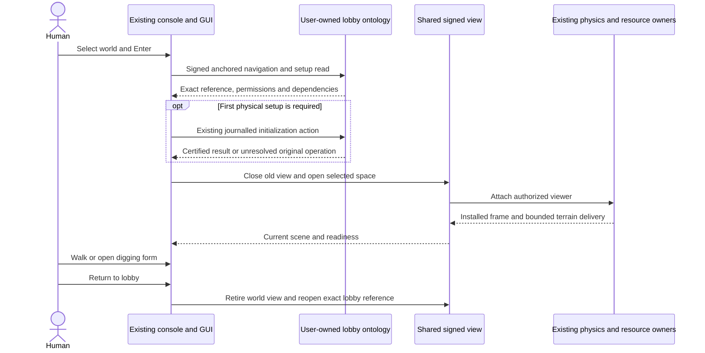

---
archivedPlan:
  planId: plan-voxel-world-lobby-entry
  title: Create and enter terrain worlds
  status: in-development
  planType: feature
  priority: medium
  owner: yan
  stakeholders: []
  tags:
    - ontology
    - voxel-world
    - gui
    - physics
  created: '2026-10-16'
  updated: '2026-10-24'
  progress: 95
  trackerStatus:
    type: plan
  archived: "true"
---

# Create and enter terrain worlds

> [!NOTE]
> Archived on 24 October 2026. The [Space and interaction architecture](space-conceptual-architecture-review.md#smallest-staged-normalization) is the current implementation plan. This document preserves the earlier milestone, its recorded 95% progress and outstanding acceptance work; archiving does not declare that work complete. Its helper-backed creation and per-world pilot navigation are historical designs, superseded by the three-stage normalization plan. Earlier implementation, review and deployment authorizations below belong to that historical scope and do not authorize resuming it now.

Make the implemented smooth terrain usable from the personal lobby: open **My worlds** on the console, create a named landscape, enter it, explore, return to the lobby, and reopen the edited world. Terrain configuration and edits remain owned Prolog state. The browser selects a view and submits existing governed actions.

This plan extends the [terrain ontology plan](voxel-world-generation-ontology.md). The current [implementation checkpoint](../../doc/evidence/voxel-world-20261016/implementation-acceptance.md) covers the terrain core and local geometry preview; it does not establish this user journey. Yan authorized implementation of the shared world-library controller and exact-space selection/setup on 2026-10-16, with Fable validation. World creation, management and exploration are the main user journey; terrain editing is an optional capability. The later overnight authority below covers deployment and a labelled candidate-ledger reset.

## First usable milestone

1. Open **My worlds** from the existing console, on desktop or through its spatial panel.
2. Choose **Create world**, optionally enter a display name (otherwise use the naming ontology), and use the existing landscape, seed, detail, bounded/unbounded size, biome size, terrain height and cave controls.
3. Submit once. Show the actual saved-operation/completion status. A failed or uncertain submission preserves its original identity and the user's work.
4. Select the created world and choose **Enter**. Initialize its ordinary physics authority if necessary, load the signed view and required terrain, then enable existing walking controls.
5. Adjust **Viewing distance** through the existing form system. Terrain editing remains an optional advanced tool using the existing centre/radius form.
6. Choose **Return to lobby**. Reenter the world later and see the same seed, settings and edits. A restart recovers current terrain through the normal ontology/runtime owners.

World switching changes the viewed space. Each world has its own controlled body. This milestone neither transfers the lobby's pilot between simulations nor moves the flying lobby. Terrain persists; exact walking position after a process restart follows the existing checkpoint/baseline contract and is not a new save-position promise.

## Ownership and composition

### Compose into the personal lobby

Compose the terrain and GUI source bundles into the existing user-owned personal-lobby ontology. It can contain several `voxel_world` instances alongside `personal_lobby`. It owns their definitions, names, patches, policies, physical structures and form declarations. **My worlds** is a projection of those facts, not another mutable registry. No new ontology, human workspace reference, root creation policy or provisioning protocol is needed for this milestone.

The human ontology's existing exact personal-lobby reference discovers the owner scope. Each library entry carries its own exact space reference. Sharing an ontology does not place worlds inside the lobby or make the lobby their physical parent. World identity, physical membership and ownership stay distinct.

The [lobby founding options](../../priv/ontologies/quod_lobby.pl) already include `quod_agent_predicates`. A focused [capability experiment](../../doc/evidence/voxel-world-20261016/planning-gui-profile-01/assessment.md) passed the real signed terrain GUI open/submit/automatic completion and stale-submission fixture with that module alone. The GUI documentation's additional `quod_agent_work_predicates` requirement is too broad: its only external predicate is `continue_agent_work/2`, which this GUI lifecycle does not call. Correct that documentation and make the existing fixture exercise the actual required capability set during implementation. Do not add an unnecessary founded capability or refound an existing lobby.

Navigation always carries `entity_ref(Namespace, Anchor, World)`; another correctly composed owner can expose a world later without moving or copying these histories. Multiple worlds in one owner already work in [the physics projection](../../priv/ontologies/quod_physics.pl) and [runtime](../../src/quod_runtime.erl); each enabled world must retain its own dedicated physics actor under the current adapter profile. Do not reuse `personal_lobby`'s physics authority for every terrain world.

Proposed domain additions, with final names chosen during implementation:

- Lobby owner: `attribute(World, display_name, Name)` and ordinary `instance_of(voxel_world, World)` plus the existing `voxel_world_owner/2`, definition, patch and physics relations.
- Read projection: a bounded list of exact world references and labels derived from the owner's current facts. No separately writable library rows.
- Each world: a distinct `world_authority(World)` actor and `world_pilot(World)` entity. The existing body allocator owns body IDs; display names are never IDs.
- One explicitly authorized GUI responder in the lobby scope, hosted through the existing actor lifecycle. The shared GUI supports source and responder in the same scope; no new executor is needed.

User ownership, the responder's limited authority, world viewing, walking, editing and resource policy are separate grants. A GUI completion runs as its responder; it must not impersonate the human. The existing form policy identifies the owning human and exact permitted continuation. Neither a library link nor a visible button grants execution rights.

### Install through the existing source and hosting paths

Extend fresh-lobby source composition with the shared terrain, GUI and library domain sources, plus the responder's explicit hosting and GUI policies. Compose the existing question receiver/HUD into the human source where needed. Keep the owner reference, existing lobby instances, genesis manifest and history intact.

Inventory installed source components first and add only what is missing; shared space, physics and GUI definitions keep one implementation. Scope application policies, pilot presentation and physical admission to their exact world so composing terrain does not change the ordinary lobby's behavior.

For this release, Yan authorized a fresh candidate ledger rather than a compatibility migration. The candidate was refounded through ordinary creation and source composition, with exact image and immutable module profiles verified. No live founding manifest was patched. The existing hosting owner still supplies actor readiness and recovery; source installation alone does not grant responder privileges.

Do not make opening **My worlds** silently install source, found an ontology or repair a missing application. If composition is absent, expose the actual setup requirement. Merely deploying files does not update existing ontologies; live source installation remains an explicit authorized operation with its original request identity and normal recovery.

## Existing paths and necessary extensions

| Responsibility | Existing path | Planned change |
| --- | --- | --- |
| Application composition and hosting | Lobby/human source installation and existing actor hosting | Compose shared domain sources and narrow responder/HUD policies in the current scopes |
| Generate, dig and view distance | [Domain](../../priv/ontologies/voxel_world.pl), [forms](../../priv/ontologies/voxel_world_gui.pl), [view](../../priv/ontologies/voxel_world_view.pl) | Reuse actions/forms; add world-name and creation composition around shared generation logic |
| Form presentation and completion | `gui_open/2`, GUI question/HUD, signed operation journal, hosted responder | Supply application policies and normal actor hosting; no new answer or recovery queue |
| Desktop and spatial controls | `GuiForm`, `WorkspacePanelModel`, workspace panel | One shared space-library controller using existing selection, status and button controls |
| Console actions | `lobby_menu/2`, `lobby_workspace/3`, `readDeviceMenu`, `openWorkspace` | Extend the shared typed workspace dispatch for the space library and anchored form opening |
| Open a space | `readPersonalLobby`, `connectWorldView`, `/api/views` | Generalize selection to an exact space reference; lobby becomes one selection in the same path |
| First physical setup | [Account initialization](../../client/src/accounts.js), `physics_preparation/2`, `physics_initialize/3` | Extract the existing exact-reference setup helper and use it for both lobby and terrain |
| Walking and camera | Existing controlled navigation, signed control, origin and terrain credit | Reuse unchanged semantics; retire the previous view before activating the next |
| Persistence and recovery | Committed definitions/patches, resource selection, compatible checkpoints | Reuse; no separate save system or generated mesh store |

Two shared client capabilities are missing today: a space-library workspace controller and selecting a non-lobby space in the normal shell. Existing controls render both; they do not already provide their behavior. These are the concrete extensions authorized by Yan for this implementation. They must replace the lobby-only assumptions in the shared entry flow, not introduce a voxel-specific page, renderer, socket endpoint or browser-side authorization model.

The library workspace controller has a fixed, validated semantic contract: select an offered world, enter it, open an offered form, refresh the library, and return. Prolog supplies labels, permitted exact targets and form references. The controller maps these typed actions to existing signed APIs; it does not execute arbitrary supplied JavaScript or Prolog goals. Keep normal submitted forms' server-owned continuations intact—navigation is not a new form callback protocol.

Use signed catalogue reads on open, explicit refresh, and after known completion of this client's create operation. Before entering or opening a form, re-read the selected target and authority. A stale library snapshot must not authorize access or setup. No new subscription channel or polling timer is needed for the first library.

## Creation and editing transaction

The create form adds a display name to the existing generator controls. Extract shared field declarations and recipe construction where needed so that creation and existing generation/regeneration have one implementation. The display name can be duplicated; the stable world identity cannot. A blank name uses the existing anchored naming ontology and its world-name recipe during the creation transaction. The generated result is stored once as the ordinary display-name attribute; reads and reopening never draw again. Derive the identity from the original creation/question occurrence through the existing canonical digest mechanism, not from a name, clock or browser retry counter.

Its normal GUI continuation performs one transaction:

1. Validate the accepted question, current form schema, exact human/responder policy and resource admission.
2. Allocate the world identity and store its name/owner, declared configuration and explicit physics policies.
3. Call `voxel_create/3`; do not assemble its physical binding or patches in a second implementation.
4. Declare the world-specific authority, pilot definition, initial host/control and presentation, with current shared vocabulary references and pure spawn baseline.
5. Complete/consume the question and remove its HUD reference through the existing atomic GUI lifecycle.

Any failure rolls back all related domain changes. Publication to the library is derived from the committed state. Do not publish a separate optimistic world record and repair it later. Physical key custody/installation is the existing subsequent setup lifecycle; creation does not claim that collision geometry has already been installed.

Digging calls the existing versioned edit action and preserves its affected-patch checks. Viewing distance remains an appearance/policy edit and must not revise or regenerate terrain. Regeneration retains its empty-world/no-edits requirements. This milestone offers **Create another world** instead of adding destructive reset behavior around those guards.

## Entering and returning

Refactor [the current setup helper](../../client/src/accounts.js) so it accepts an exact world reference and caller-owned journal context. Account creation and world entry both use it; preserve account handoff/replacement semantics and avoid retaining a second initializer. Ordinary reads do not silently start a new execute request. Entry is an explicit action, and any already pending initialization is resolved by its original bytes before proceeding.

Refactor [the shell](../../ui/src/World.tsx) to hold a validated selection containing namespace, genesis anchor and world instance. Include that full identity in projection/request cancellation keys, together with the acting identity and representation mode. A label or world-local body number is insufficient. Reprove all dependencies from the navigation read when opening the signed view, as `readPersonalLobby` already does.

Inventory all browser and native-client consumers before changing a shared menu/projection contract. Replace the old lobby-only implementation in that scope; do not leave two initialization or navigation implementations connected by a permanent compatibility shim.

On a switch, stop outgoing input and release its registration, view credit and render consumers before enabling the new view. Late reads, chunks, texture loads, control replies and frames from the previous space cannot update the current scene. Return remains available while the destination is loading, denied, busy or recovering. It is a view change, not an atomic transfer between independent simulations.

Closing a view removes its visual demand. Existing physical bodies still retain their needed terrain; navigation must not disable the world, delete its pilot or discard checkpoints to reclaim memory. Conversely, opening the library alone must not initialize every world's physics or generate its terrain. The current one-viewer limit still reports `view_busy`; this milestone does not promise simultaneous control from two tabs.

### Spawn and return safety

Compute a deterministic initial candidate using the chosen versioned field and an authored bounded sampling/search allowance. Use the existing pure field sampler and existing body-placement/coverage checks. If an extraction is needed, make the numerical helper shared and pure; add no private spawn engine. A surface-height guess alone is not proof that a capsule or viewpoint is clear of cave roofs and overhangs.

For the supported presets, acceptance must demonstrate a useful starting point on or above reachable terrain. Failure of the pure candidate step aborts creation with the user's form retained. The native owner remains the final authority for whole-body placement and required coverage during entry. A later native rejection blocks entry with its actual reason and preserves the already committed world; it cannot roll back an earlier creation receipt or justify creating again. Neither phase may use a hidden observer fallback, an unbounded search or spawning inside solid ground.

The initial authored baseline is pinned to the created definition. Reentry must not rerun creation, rewrite that baseline, reset current patches or recreate a live controlled body. After restart, existing compatible checkpoints or the authored baseline apply; missing/unsafe coverage keeps the view paused under the current recovery contract. Do not invent a safe arrival claim from a creation or initialization receipt.

## Implementation slices and acceptance

### 0 Correct the two reproduced review defects — complete

The two defects from the original [Fable implementation review](../../doc/evidence/voxel-world-20261016/implementation-review-01/fable-review.md), and three related contact/recovery defects found during validation, are corrected. The [checked repair assessment](../../doc/evidence/voxel-world-20261016/review-fixes-01/assessment.md), [complete final Fable report](../../doc/evidence/voxel-world-20261016/review-fixes-01/fable-review-04.md) and [passing clean gates](../../doc/evidence/voxel-world-20261016/clean-fixes-04/PASSED.json) identify the exact final scope.

1. Occupied/ambiguous geometry is distinct from missing chunks and reports the affected body. Unchanged reselection performs no work; governed body or terrain correction resumes in the same native incarnation. Existing placement queries still require an installed body identity; the integration must respect that admission contract.
2. Visual demand is checked before generation against the shared coordinate allowance. Incoherent requests are refused per view while physical consumers remain valid. Legitimate observer rebasing and arbitrary absolute world coordinates are covered.
3. Same-chunk edits compare changed surfaces against the last integrated geometry, preserving unchanged solver contacts without exempting newly added rock. Pending checkpoint restoration retains its original demand and insertion, and cannot advertise readiness after an intervening coordinate refusal.

The fixes reuse existing owners and remove obsolete branches without compatibility shims. The final scope passed 57 native tests in both builds, 206 client tests, 4,057 EUnit tests, 148 Common Test cases, lint/build, static analysis and release assembly. Additional review questions remain integration acceptance work below; they are not represented as reproduced defects or as already-tested behavior.

### 1 Compose the existing lobby

Compose the shared domain sources, library projection, normal responder hosting and narrow GUI/HUD policies into the existing lobby/human scopes. Correct the overstated GUI capability requirement and exercise the minimal founded module set in the existing fixture. Prove wrong-owner and forged-continuation denial, rollback, uncertain-result recovery, responder restart and unchanged repeated opens without history replay or disk writes. Verify both fresh-account composition and authorized installation into an existing lobby while preserving its identity, history, pilot and console/source tools. Include several terrain worlds alongside `personal_lobby` in the same ontology.

### 2 Create and list worlds

Compose the name field and generator forms with shared logic. Derive the library from current definitions. Verify two differently named worlds and duplicate display names have separate identities, revisions, pilots and authorities; failed generation leaves no partial world; a completion cannot create twice; stale/revoked forms fail through existing policy. Reject aggregate limits at their policy owner without splitting a creation/edit into smaller transactions to evade admission.

### 3 Generalize entry once

Introduce the shared library workspace and exact-space selection. Extract physical initialization from the account-specific helper. Keep normal lobby startup, console/source tools, expiry/restoration and the licence lens working. Verify rapid lobby/world A/world B switching, stale callbacks, revoked access, wrong anchors, an unresolved initializer and two tabs contending for the same viewer. A signed projection must contain only the selected world's bodies and chunks even when world-local IDs overlap. Exercise ordinary authorization renewal while walking; avoid unnecessary movement interruptions while preserving expiry and delivery fencing.

### 4 Complete the live user journey

Run the actual browser against a local authenticated Quod instance. Create a world using real GUI presentation and automatic responder completion, enter using the shared signed view, walk onto a slope and through a cave, dig across a chunk boundary, change viewing distance, return and reenter, then restart the runtime and reopen the edited world. Verify both visible geometry and collision behavior, with current patches and exact world references unchanged by navigation. This acceptance must not substitute the offline preview or test-only direct assertions for the real path.

Include the repair review's remaining edge cases: dig directly at a contact during impact; move physical consumers near the shared coordinate limit while terrain is generated; exercise pending teleports and terrain removal/re-addition; and show the actual blocked/coverage state to an attached user. Start with deterministic reproductions through existing owners. Preserve collision safety and do not replace these questions with blanket contact exemptions or automatic retries.

Measure unchanged catalogue reads, view renewals and reentry without edits through the real owners: no repeated sampling/meshing/native replacement, history replay or persistence writes except the documented need to recreate genuinely evicted resources or restore after restart. A real edit must still change the affected chunks and collisions. Report actual work counts alongside latency; do not infer terrain multi-node performance from unrelated CT passes.

### 5 Package and release readiness

Run the applicable clean sequential gates on one frozen source tree after implementation and any accepted review corrections. Keep failures and full logs. Package exact validated browser output and check source/asset identity. Record production line delta and retired lobby-specific duplication. A release/source-install plan must identify compatible binaries, immutable capability manifests, affected exact human/lobby histories, and the explicitly authorized ledger reset or preservation strategy. The overnight instruction below supplies deployment/reset authority; no commit is claimed.

## Deliberately later

Visual smoothing and texture blending, richer biome catalogue editing, pointer sculpting, cubic terrain/Minecraft pack import, public world discovery, multiplayer control, moving the flying lobby, cross-simulation body transfer and world aggregation remain later milestones. The initial library can expose the existing forms without claiming any of those capabilities.

## Approval boundary

Yan approved the bounded extension consisting of the shared space-library controller and generalized exact-space selection/setup, with ordinary source composition in the existing user-owned lobby. These two client gaps are identified in existing code above. No new ontology type, runtime owner type, creation protocol, terrain transport or rendering engine is proposed. If implementation demonstrates another missing capability, present its concrete use case and extension before adding it.

On 2026-10-17 Yan selected **Fix shared admission policy** in the scope widget
after the composed founding failure was measured. This authorizes designing,
implementing and reviewing Prolog-owned material limits through the existing
creation, transaction and recovery owners. Transitions stay atomic, existing
histories are preserved, and actual VM/encoding safety bounds remain separate.
It does not authorize deployment, a data reset or a substitute review model.

On 2026-10-17 Yan subsequently authorized overnight completion and deployment,
including deleting deployment ledgers if needed, and reaffirmed that backward
compatibility is unnecessary. This supersedes the earlier deployment/reset
boundary for this milestone. Validation, exact evidence and the requested Fable
consultation still apply; unrelated jobs and user-owned source remain outside
the deployment scope. See the [recorded authority](../../doc/evidence/world-library-20261016/overnight-authority.md).

The terrain [repair stage](../../doc/evidence/voxel-world-20261016/review-fixes-01/assessment.md) and the first usable library milestone are implemented. [Release 0.7.273](../../doc/evidence/world-library-20261016/deployment-273/acceptance.md) is deployed: all twelve frozen gates pass, including 4,080 EUnit and 148 Common Test cases. Fable's [complete integration review](../../doc/evidence/world-library-20261016/review-06/fable-review.md) finds no remaining confirmed application defect and was checked independently. The fresh-account deployed journey passes two-world creation, generated naming, walking, return, saved-world reentry and walking after reentry, with zero pending operations and page errors. All eight nodes pass the final installed-state check with zero restarts. The exact retired candidate ledgers were deleted under the overnight authority; main and ingress remain unchanged. Source is uncommitted. The plan stays in progress for the broader exploratory acceptance matrix above, including physical VR and terrain-specific distributed measurements; those are not claimed by this headless milestone. All failed campaigns, the corrected founding recipe and the additional Fable recipe consultation's provider-limit receipt remain in the [evidence](../../doc/evidence/world-library-20261016/status.md).

The [naming provenance check](../../doc/evidence/world-library-20261016/naming-provenance.md) confirms that more book material was left to import. The original landscape pool in this draft uses the existing naming engine; it does not represent completion of those imports.
