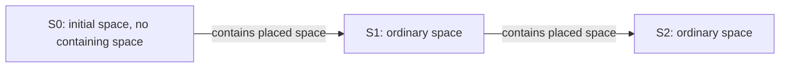

# Governed spaces

A **space** contains placed instances and can display references to other
instances or information. A **physical_space** adds explicitly governed physical
participation. Location and display membership are independent of ontology
membership: an ontology owns code, committed facts, authorization and history.
An ontology can be depicted or edited in 3D without acquiring space semantics.
An instance can carry both roles only through explicit authored membership and policy.

[quod_space.pl](../priv/ontologies/quod_space.pl) defines the shared space
foundation and is composed into the ontologies owning individual spaces through
ordinary founding or authorized source editing. Each selected storage owns its
local class and instances; the shared foundation's exact pin and source hash
certify the composition without becoming a remote constructor or class alias.
The [ordered founding recipe](godot-foundation-contract.md#reproducible-founding-recipe)
does not rewrite existing histories or grant deployment authority.

## Classes and dispatch

The vocabulary declares `isa(space, thing)` and
`isa(physical_space, space)`. Shared `isa/2` rules compute reflexive/transitive
ancestry, including authored multiple inheritance. `instance_of(Class, Entity)`
is class-first, remains authored, and does not itself expand ancestry.
`space_instance(Entity, Class)` explicitly combines membership with ancestry.
Neither declaration imports behavior or grants invocation rights. The existing
lobby likewise explicitly expands its device classes before recipe selection.
This vocabulary does not change lobby classes or ontology-instance reflection.

An `entity_ref(Namespace, GenesisAnchor, Entity)` refers to an existing entity
in its owning ontology. It is a reference term, not a new object registry or
class. The owner establishes class or instance identity using existing `isa/2`
and `instance_of/2`. Every cross-owner call checks the exact history. Moving
membership changes neither the entity reference, code, ACL nor history.

## New-user onboarding and parentless spaces

[Normal-user signup provisions a distinct personal agent A and an ordinary empty
space S0 for human U; S0 is the initial personal lobby, has no containing space,
and initially contains A.]{decided by="yan.guiborat" email=yan.guiborat@gmail.com on=2026-10-27 over="a dedicated lobby subclass for this delivery"} [Y](https://console.nimbalyst.com/app/cite/ed9cd520-b2a4-4607-a8f5-ff99d08f3e46/prompt/80fe5d70d8db7a67f1cc071ad91cced3 "by=yan.guiborat email=yan.guiborat@gmail.com at=2026-10-27T14:04:14.517Z quote='some points before starting :%0A- I would like to clarify new users onbording. These should only prolog if possible:%0A%2A When a normal user is created atm we will create for it a simple empty space. It will be later the user lobby %28 we will create a dedicated subclass for it %29 but for now we will use a simple space class. So I guess when registering a new user, we should create a space and an agent…'")

The user-owned setup composition uses the existing `space` class and defaults,
including its 100-metre box extent, after signup has allocated the exact account.
A dedicated user-lobby subclass is later work. S0 is a space instance, not the
root ontology, a shared lobby foundation or a new ontology per room.

The [M0 contract](godot-foundation-contract.md#ordinary-onboarding-and-storage)
selects the existing private account ontology explicitly for automatic S0
provisioning and records that exact selection. Additional spaces still use
explicit selected storage, including permitted foreign storage; this is not a
universal account-storage default. Its Prolog setup transaction binds A's
host/key, constructs S0 and places the existing A inside it. An optional
initial-occupants part must run during S0 construction so the committed class
guard can authorize the new destination; placing A after that context ends
cannot use staged S0 membership as authority. The normal empty-space defaults
and existing constructor/placement machinery remain the foundation.

Having a containing space is optional for every ordinary space. S0 is unplaced
while A is placed inside it; these are different assignments. Other spaces may
also remain unplaced. A placed instance has at most one containing space, with
independent display references still allowed. No synthetic outer space, second
parent registry, universal parent tree or inherited access rights follow.

The initial interior has a black background, with controllers visible when
available and the ordinary GUI accessible. It has no required floor, sky,
terrain, physical simulation or visible agent body. This presents an empty
ordinary space; it does not trigger rebuilding the old physical lobby.

From S0, U uses the offered GUI to instruct A to create another space S1.
Storage remains an explicitly selected existing ontology and default owner is
U; near-agent placement puts S1 inside A's current space. S1 appears there via
the ordinary default exterior Eidolon (currently the half-metre cube), whose
size is independent of its interior extent. Creating S1 does not enter it.
Authorized GUI entry moves the same A to S1; navigation follows the committed
assignment. The same creation and entry rules apply inside S1 to create S2,
and at further levels, without a separate agent, class or storage ledger per
level. The selected exterior Eidolon may display a mesh or the space's contents;
the current default cube is one recipe, not a restriction on exterior views.
If both S1 and S2 select contents exteriors, their contents are recursively
displayed in S0 as one continuous space, subject to physics and each source
owner's disclosure policy. No entry into S1 or S2 is required for that display.



Signup composition, ownership, initial placement, offered operations and grants
belong in Prolog. Reuse existing governed founding, key custody, actions,
construction, atomic writes and recovery; Godot renders descriptors and sends
authenticated instructions. The onboarding composition must explicitly select
and record its authorized storage after any required existing founding step;
automatic onboarding does not introduce an implicit storage default for later
Create operations. M0 specifies the exact lifecycle and permissions. Related
instance facts and admission changes forming one transition commit together;
ontology founding retains its existing lifecycle. A lost reply or restart must
recover the original U/A/S0 references, not provision replacements. Initial A
placement reuses existing placement; later travel uses the committed operation
described below.

See the [space architecture plan](../nimbalyst-local/plans/space-conceptual-architecture-review.md)
for the existing Stage 1/Stage 2 boundaries, and [QUO-60](nimbalyst://QUO-60)
for delivery status. Recursive rendering/exposure and ontology predicate editing
have their own integration obligations. They must not be used to impose a
mesh-only exterior or require entry before a contents-displaying exterior works.

## Empty creation

U instructs the distinct personal agent A through the existing immediate signed
route, selecting an **existing** ontology explicitly. Compose `quod_space.pl` into
that storage owner and A's ontology, and `quod_space.pl` where space exteriors
or contents are projected. Finite dimensions use the storage owner's exact
`measure_vocabulary(Namespace, Anchor)` reference to the measurement ontology.
No automatic lobby storage selection or ontology founding occurs.

The shared assertion mechanism creates the instance. A goal inside the selected
anchored scope can return both durable outputs:

```prolog
with_build_plan([attribute(name, <<"Workshop">>)],
                assert(instance_of(space, Space))),
current_ontology_identity(Ns, Anchor),
Ref = entity_ref(Ns, Anchor, Space),
attribute(Space, name, Name).
```

The default name is `<<"Space">>`; supplied names override it. Names are stored,
mutable and nonunique. The generated ULID and anchor form the identity. Named
outputs `Ref` and `Name` use the ordinary selected-result machinery: a lost
reply is recovered from the original operation, including after restart or
later instance deletion. Recovery does not run construction again.

`dimensions` defaults to `box(q(100, <<"m">>), q(100, <<"m">>),
q(100, <<"m">>))`: X, Y and Z lengths centred on the local origin, extending
50 metres in each direction. It also accepts `infinite` or three strictly
positive exact length quantities. Existing measurement conversion validates
compatible units and rational values without floats or rounding. Malformed,
unitless, non-length, zero and negative dimensions fail construction. Supplied
quantities remain stored as supplied; interior extent does not impose a resource
budget, allocate geometry or establish collision boundaries.

The default `owner` is U, proved by A's anchored `personal_agent_owner/1` query.
An explicit owner is a construction input subject to the storage/class policy.
Ownership, storage and containing space remain independent. The bundle supplies
no invocation or class permission grants: authors admit A's exact request and
declare `create` and `space_enter` policy. The destination separately enforces
`space_admit` and its invocation policy. During a constructor, the shared guard
checks committed class policy using the scoped
`construction(Class, Id, Inputs)` subject; staged instance grants cannot supply
permission. See [construction authorization](proofs.md#class-and-instance-operation-permissions).

An optional `attribute(placement, at(DestinationRef, transform(X,Y,Z,RX,RY,RZ)))`
chooses an exact destination and exterior transform, using existing integer
millimetres/degrees. The constructor consumes this input; it stores no second
location record. Omission or explicit `near_agent` reads A's `space_location/2`. A successful
`unplaced` result creates an unplaced space; `placed(Destination, Transform)`
places it one metre along that frame's X axis from A. This is one-time placement,
not following A. A denied, unavailable, ambiguous or incomplete location read
fails creation. A placed agent needs its ordinary `attribute(Agent, transform,
Transform)`; missing pose does not prove absence. Physical-pilot entry and live
body poses remain the separate physical/entry integration.
Explicit `attribute(placement, unplaced)` skips that location lookup and requests
no admission. It is distinct from treating a failed near-agent read as absence.

Creation and placement use the existing assertion savepoint and `space_place/3`
transaction. Refused explicit placement rolls back the instance and all admission
writes; it never tries another destination or unplaced creation. Physical
destinations retain their mandatory physical hook and checks. Creation does not
prepare a simulation, terrain, sky or walls. The defined solid Eidolon uses a
half-metre cube independently of finite or infinite interior extent, through the
existing scene/model/rendering path. Contents remain empty. The landscape/terrain
creation route is unchanged.

Compose `quod_space.pl` and `gui_instance.pl` in the storage
owner to offer **Create space** and **Create infinite space**. The existing
`gui_vocabulary/2` must pin the component vocabulary. The forms initialize name
and finite dimensions from class defaults; leaving those fields unchanged uses
the defaults, while edits supply explicit values. Finite controls accept positive
integers in mm, cm, m or km (1–1,000,000 per axis); the domain model still accepts
the wider exact measurement contract above. The placement selector supplies
`near_agent` and authored exact destinations. Storage authors may replace its
options with permitted local or foreign references. Submission returns both
`result(space, entity_ref(...))` and the committed `result(location, ...)`.
The [shared operation panel](gui-implementation-plan.md#offered-class-and-instance-operations)
displays these bindings and can open the returned subject's offered operations.
Source composition in an already founded ontology requires its existing owner
authority; installing client files does not rewrite ontology data.

The shared form also offers **Create space with rational lengths**, with a
positive integer numerator/divisor per axis and an explicit length unit. The
ordinary finite form retains its integer defaults; both use the same Stage 1
assertion and binder. Names may be empty binary values; leaving the supplied
default unchanged keeps `Space`. Every form selects placement and an exterior
recipe. Creation and form definition check the unique anchored
`space_vocabulary/2` plus `space_source_digest/1` against the shared source's
`space_template_hash/1`; missing, ambiguous or mismatched composition refuses.
This certifies the original composition without aliasing the target's class.

The account composition separately authorizes its personal A's new-space
constructor to place a newly constructed space, and that A's admission into
completed U-owned destinations for other source subjects. These are committed
class and destination policies. They grant no later A entry/leave permission
and no blanket invocation. Foreign storage independently authorizes the exact
operation and source assignment callback. Its owner, U and destination remain
distinct.

## Relations and owners

| Relation | Sole owner | Assertion |
| --- | --- | --- |
| `space_member(Space, EntityRef)` | Space ontology | Independent display reference, possibly many-to-many |
| `space_assignment_state(Entity, Revision, DestinationRef)` | Entity ontology | Exclusive admission assignment, or `none` after withdrawal |
| `space_placement(Space, EntityRef, Revision)` | Space ontology | Admission corresponding to that assignment revision |
| `space_contains(Space, EntityRef)` | Derived query at space ontology | Direct view subjects: display references or placed instances |

The assignment and placement facts express the entity's exclusive assignment
and the space's admission. They contain no duplicate pose, body, code or geometry.
Their transition is one existing atomic transaction. Assignment absence means
revision zero and `none`; after first use the empty slot retains its revision,
so withdrawal cannot let an obsolete admission reuse revision zero. Multiple
assignment rows are invalid configuration and fail explicitly.

Display members may be classes, ordinary instances or other spaces. Removing
a display reference deletes neither the instance nor its assignment, stored
state or ownership. A placed instance has one containing space; it can still
appear in several spaces through independent references. The view-subject query
`space_contains/2` is a direct graph relation: it does not flatten descendants,
propagate access rights, infer parent transforms or imply physical presence.
Self-containment and self-placement are refused. Longer display or
placement cycles need explicit domain constraints where inappropriate;
the relation does not claim a physical frame tree. Class membership and
containment alone do not establish a depicted occurrence. Existing lenses,
Eidolons and anchored `depicts/3` marks remain the representation path.
A local view layout is transient presentation, requiring no domain transaction.
Persisting a display reference or changing containing-space assignment requires
an authorized action. Hot controls retain their existing transient path.

## Governed transitions

`space_contain(Space, EntityRef)` executes at the destination and checks both
owners' committed operation policy in `display` mode. Only the destination
writes `space_member/2`. `space_remove/2` removes that reference when destination
policy allows removal or the entity owner allows withdrawal. Display grants
provide no placement, disclosure or ownership authority.

`space_place(Entity, ExpectedRevision, DestinationRef)` executes at the entity
owner. It checks that owner's `space_enter` permission in `placement` mode,
an empty slot at the expected revision and the destination's `space_admit`
permission. It stages the next assignment and calls `space_accept_placement/3`,
which checks `space` membership and reads the staged assignment back through
the existing re-entrant proof scope before admitting the entity. This supports
ordinary and physical spaces, in the same ontology or different ontologies.
Two completed proofs from the same empty slot conflict at the single assignment
owner. Refusal, stale revision and conflict leave no partial assignment.

`space_withdraw(Entity, ExpectedRevision, DestinationRef)` is the common entry
for instance withdrawal and destination revocation. It stages the next empty
assignment and calls `space_release_placement/4`. Destination policy must allow
removal, or the instance owner must allow that principal to leave. The callback
checks the new empty slot, performs any required physical consequence and removes
the exact old admission. Both owners commit together or neither changes.
Changing a future-entry grant alone does not revoke existing membership; compose
that policy edit with the withdrawal/removal action when immediate revocation is
required. Neither a missing owner nor a timeout authorizes unilateral release.
If either required ontology is unavailable, this transition remains unavailable;
there is no offline eviction or invented successful withdrawal.

Participant entries cannot create or release a slot. Invoking them alone in a
valid committed state fails: admission lacks a matching new assignment or
already exists; release lacks the next empty assignment. Failed candidates use
ordinary transaction savepoints. No handoff process, transfer ledger or second
executor is introduced.

## Same-agent travel

`space_travel(Entity, ExpectedRevision, Before, After, Revision)` moves the
existing entity through the same withdrawal and admission actions. `Before` is
the exact destination reference or `none`; `After` is `placed(Destination,Pose)`
or `unplaced`. A placed-to-placed move consumes a withdrawal and an admission
revision. The new source pose is staged before destination admission so its
physical consequence sees the same transform as the committed assignment.
Source leave/entry permission, both destination consequences and pose changes
form one existing atomic transaction. A refusal or conflict restores all owners.

The offered Enter and Leave forms bind the existing personal agent and its
exact assignment revision. Their ordinary U-to-A instruction executes this
operation; navigation reads the resulting assignment. Leave may explicitly make
the agent unplaced. Storage and display references do not supply an inferred
parent or destination. Completed-account travel grants are separate from the
constructor's initial-placement grant.

The account's owner-authorized `account_navigation/1` returns
`navigation(AssignmentRevision, Location, Modes)` from the same assignment and
location queries, including an explicit `unplaced`. Its signed `navigation` view
uses the existing view owner and retained dependency lifecycle. Setup's original
S0 result remains immutable. A client retires scene/control on invalidation and
opens only the current exact placed space; an unplaced client keeps navigation
subscribed and may open an explicitly selected existing subject's ordinary Enter
offer. `account_navigation/2` remains the placed-location query for world reads.

The signed `client_world_view/4` result is
`world_view(ExactSpace,Name,Marks,Selection)`. `Name` is the selected owner's
single binary `attribute(Space,name,Name)`, or `unnamed` when absent; conflicting
or non-binary names refuse the view. The existing endpoint checks the exact
space before exposing this optional name (`name` string or null) alongside
the projection. It has the same retained read dependencies and authorization;
it is neither a naming service nor a second current-location record. Ordinary
solid/wireframe space recipes use the same authored name in their scene label.
An empty permitted scene remains black; its context belongs to the GUI chrome.

`space_represent(Space, BeforeStyle, BeforePose, Style, Pose)` checks the exact
source values and committed `space_represent` instance policy. A changed
representation invokes the admitting destination's physical consequence in the
same transaction. An unchanged representation performs no state mutation.

## Invocation policy

The bundle installs no `can_invoke/4` clauses. Entry ACLs and domain grants are
separate requirements. The authenticated principal is unchanged through `::`;
calling from a space does not impersonate the entity owner. Expose only exact
needed shapes, with appropriate principals and authenticated call paths:

| Owning scope | Shapes required by the composition |
| --- | --- |
| Space | Public `space_contain/2`, `space_remove/2`; anchored `space_accept_placement/3`, `space_release_placement/4` for admitted callers |
| Entity | Public `space_place/3`, `space_withdraw/3`; anchored `space_consent/4`, `space_withdrawal_consent/4`, `space_assignment/3` |
| Caller whose operation enters another scope | The exact outer `Namespace::Goal` request permitted by its own entry policy |

An anchored shape is `(current_ontology_identity(Namespace, Anchor), Goal)`.
A curator evicting an entity needs the entity owner's invocation grant for
`space_withdraw/3` as well as the space's removal policy. Otherwise it is denied
even if that curator may edit the space. Conversely, a publisher's delegation
does not grant destination invocation or admission. Read disclosure remains
subject to the owning scope's policy. Helpers, raw assertions/retractions and
lifecycle callbacks are not end-user entries. An unrestricted administrative
ACL already authorizes arbitrary source/state editing and is not constrained
by these domain actions. Revision/configuration conflicts return reasoned
failures; denied operation policy remains ordinary Prolog failure.

## Shared operation authorization

All four permissions use [the shared committed guard](proofs.md#class-and-instance-operation-permissions).
The operation inputs are `space_enter(SourceRef, DestinationRef, Mode)`,
`space_leave(SourceRef, DestinationRef, Mode)`,
`space_admit(DestinationRef, SourceRef, Mode)` and
`space_remove(DestinationRef, SourceRef, Mode)`. `Mode` is `placement` or
`display`. The executing owner supplies its own exact reference; the other
reference comes from the requested transition. Placement requires instance
subjects; display consent also accepts class subjects.

Authors declare `class_permission/3`, `class_requirement/3` and governed
`instance_permission/3` overrides. The bundle grants no default permission.
Each owner checks its own committed memberships, ancestry and policy. A live
constructor supplies its original class and inputs through the shared assertion
scope before the new membership commits; this does not read staged grants or
weaken destination checks. Staged grants cannot authorize the current transition. Compulsory requirements from
every applicable parent survive overrides. Policy reads participate in the
existing conflict checks. Scope invocation remains separately required.

Callbacks use only local committed policy. Exact identities are already operation
inputs, so callbacks need neither the identity bridge nor a foreign scope call.
The lobby's `lobby_admission/4` supplies its local admission definitions to both
permission checks and the existing anchored physics projection. Physical
consequences retain their checks independently of default permission overrides.

## Direct depiction

[A space's exterior Eidolon may display its contents instead of a mesh.]{decided by="yan.guiborat" email=yan.guiborat@gmail.com on=2026-10-27} [Y](https://console.nimbalyst.com/app/cite/ed9cd520-b2a4-4607-a8f5-ff99d08f3e46/prompt/0ed00d8751e1d31d9ff931cbc71dfcc9 "by=yan.guiborat email=yan.guiborat@gmail.com at=2026-10-27T14:14:39.228Z quote='please remember that a space, can have an external eidolon pourposed to display its content instead of a mesh, I wish you remember taht%0A%3CNIMBALYST%5FSYSTEM%5FMESSAGE%3E%0AThe user is currently looking at this document. They are not necessarily asking you about this document, but they may be. Use your best judgement to decide if they are making a general request or asking specifically about this…'")

Exterior and interior describe viewing purposes, not fixed representation types: showing
contents does not require entering the space, moving A or changing containment.

Exterior choices include a **full-size wireframe** of a finite
space's box, centred on its local origin and transformed into the viewing
frame. Its extents equal the exact interior dimensions: the default box spans
−50 to +50 metres on X/Y/Z. It does not create collision walls or physics.
Infinite dimensions have no finite wire box; report that choice unavailable,
without inventing bounds or selecting a cube implicitly. Exact rational lengths
must not be rounded. The shared scene vocabulary supplies `wire_box` with exact
positive reduced integer/rational millimetre dimensions, as specified in the
[M0 exterior contract](godot-foundation-contract.md#space-exterior-and-recursive-exposure).
Prolog converts the stored quantities; the engine converts only when rendering.
Twelve edges create no collision surfaces or physical bodies. The stored
`exterior` selects the actual recipe. Infinite forms offer solid and contents
and explain wireframe unavailability; a direct infinite/wireframe request
refuses. The contents recipe returns a source-owned exposure, never a
substitute mesh.

[When S0 contains S1 containing S2, and both S1 and S2 select contents exteriors,
their contents are displayed recursively in S0, subject to physics, as if all
were one space.]{decided by="yan.guiborat" email=yan.guiborat@gmail.com on=2026-10-27} [Y](https://console.nimbalyst.com/app/cite/ed9cd520-b2a4-4607-a8f5-ff99d08f3e46/prompt/34b88d269f157c7d9f9af331466e44d4 "by=yan.guiborat email=yan.guiborat@gmail.com at=2026-10-27T14:18:41.935Z quote='of course I wish it isn%27t necesseray to say that if S0 include S1 that include S2, if S1 and S2 are set to show their content eidolon, then all contents are recursively displayed into S0, subject to physics, as if al this would be a single space'")

This is required composition, not an optional later visual effect. Apply it at
each level selecting a contents exterior, composing relative transforms through
the existing view owners. A mesh exterior selects that mesh representation;
there is no artificial one-level display limit for contents exteriors. Preserve
exact subjects, disclosure/revocation, cycle handling and Prolog-governed
resources. Physical behavior must agree with the composed scene through the
existing authoritative physics owners; rendering alone does not establish that
agreement. Visual composition does not merge identities, storage or grants.
The cube described under Empty creation is the installed solid recipe, not a
restriction on authored exterior forms.

The [physics profile](physics-native.md#shared-domain-contents-frames) explicitly
admits a continuous component into one existing simulation domain. Independently
enabled runs cannot join through contents selection. Empty ordinary spaces
allocate no physics solely because they are spaces; admission, custody and
transfer guarantees still apply.

The existing `quod_space.pl` projects the union of placement and display
references, deduplicating each exact subject within that view. It asks the source
owner for `entity_scene/3` and uses the existing Eidolon, `place_model/5`, local
`transform/6` and anchored `depicts/3` contracts. Ordinary placement uses the
scene's local transform. Display references use that same presentation path;
no domain facts, ownership or storage move to the viewing space.

`space_projection(Space,Mode,scene(Marks,Exposures))` supplies the same marks as
`world_view/3`, with portable exposure receipts. Each occurrence hashes the full
anchored edge path from the viewed interior. Direct placement/display duplicates
share one occurrence; independent paths keep distinct identities and exact
depicted source subjects. Receipts retain the selected recipe/revision, source
frame, permitted subjects and local-to-parent pose. Parents precede children.
An ancestry cycle with the same exact subject and representation purpose emits
the cycle occurrence without expansion. Independent branches remain valid.
The pinned scene allowance governs traversal; exhaustion refuses explicitly.

Changes in C must reach A's retained view when A exposes B and B exposes C.
The proof retains every source, recipe, containment and authorization dependency
along that path through the existing view owners. A relevant delta refreshes
the affected consumers; access revocation withdraws their source content.
Containment does not copy C's knowledge base into A or grant disclosure. A denied
or missing dependency makes the contents view unavailable, including a denied
empty source; it cannot become an empty successful scene.

Physical placement requires one matching live body definition and uses its
`body_pose/2`. Missing or ambiguous physical bindings do not fall back to a
decorative transform. Retained client views keep their existing dependencies,
renewal and installed-change notification lifecycle. Unchanged projections
allocate no physics resources and require no history replay or projection rebuild.
A committed source update refreshes each subscribed display through those owners.

## Optional physical integration and recovery

`space_physical_change(Space, EntityRef, admitted|withdrawn|represented)` is
required for a physical destination or an explicitly admitted shared-domain
frame inside the same transaction, with no default success. An ordinary
unsimulated destination skips the hook and allocates no physics resources.
Withdrawal still releases an existing live physical binding after
the destination is reclassified or loses its space membership. That binding
remains the physical owner's cleanup obligation; missing or refused composition
rolls back both owners. An unsimulated physical space explicitly supplies a
no-effect rule; class membership does not
supply it. Unsimulated physical admission allocates no native body and does not
prove physically fulfilled placement.

The [native physics composition](physics-native.md#live-definitions-and-atomic-admission)
supplies `physics_space_change/3` for simulated membership. Its live binding
names the exact source entity, assignment and definition revisions; the
destination owns body identity and placement. Admission, definition edits and
withdrawal compose their source and receiver changes in the same transaction.
Unsupported constraint groups, agent bindings or unresolved original physical
operations refuse removal. Live collider dependencies advance through existing
subscriptions and retained verified projections; this vocabulary supplies no
alternate update mechanism. Several rooms may share one
simulation domain. There is no class-level one-ontology or one-simulator-per-room
rule. The current physics adapter's narrower limits remain explicit integration
constraints, not class semantics.

Commit records governed admission/removal. Runtime installation is a separate
owner notification, and physically fulfilled placement requires the applicable
authenticated observation transition. Neither `space_contains/2` nor a commit
receipt proves that an object physically arrived. Enablement, hosting, body
admission, observation/control and budgets remain separate Prolog policies.

After restart the existing ontology owners recover their committed slot and
admission facts and complete existing atomic obligations. They do not replay
historical reactions or manufacture new placement operations. A caller retaining
an uncertain signed request resolves that exact operation through existing
outcome resolution; absence or timeout is not rejection and must not trigger a
fresh admission/withdrawal. Physical recovery additionally obeys current run
fences, compatible checkpoints and custody described in [world.md](world.md).
Creation destination selection uses the constructor and source-owned transform
described under [Empty creation](#empty-creation). During construction, placement
checks committed class policy through the shared construction scope; existing
instances use committed instance policy. Installed desktop entry and recursive
rendering qualification are distinct from these server transitions and receipts.
General transfer between independent simulations is outside this slice: atomic
membership delete/add is insufficient and provides no authority-transfer claim.

The production-owner tests are [quod_space_tests.erl](../test/quod_space_tests.erl).
They use non-lobby identities and signed requests, including distinct principals,
competing prepared proofs, rollback, replay and exact operation resolution.
Physics resource selection is present during the no-allocation checks. The
simulated integration is exercised through production owners in
[quod_physics_tests.erl](../test/quod_physics_tests.erl).


The `quod_space.pl` constructor declares optional `initial_occupants`. Its input
is `part(initial_occupants,[attribute(entities,[entity_ref(Ns,Anchor,Id),...])])`.
Every reference must be ground, exact and unique, and identify an existing
unplaced entity in the same storage history as the new space. A cross-history
occupant refuses with `initial_occupants_require_local_storage`: constructor
authority belongs to the active assertion continuation in its actual owner.
M1a places the existing A in its own account storage. Ordinary foreign storage
creation remains supported; this part cannot import an occupant from another
history. Construction places those entities through `space_place/3`
before its assertion authorization ends. Source entry and destination admission
still require committed policy; a part cannot grant itself permission. Failure
rolls back the assertion and all placement participants. With no part, ordinary
empty creation is unchanged. Loading or recovery never runs this constructor.
